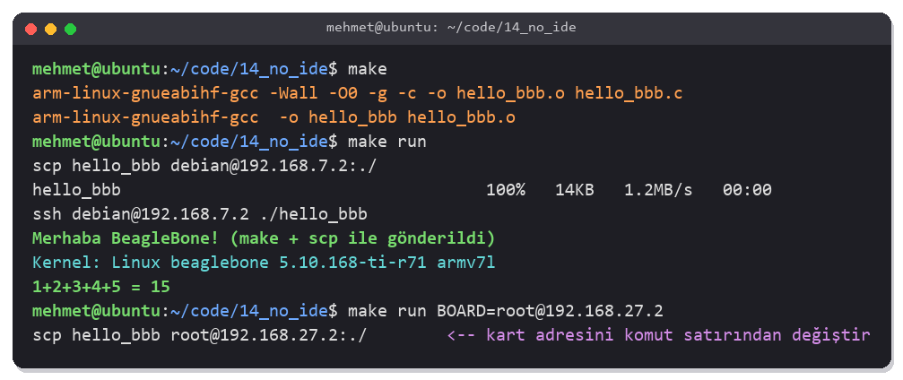
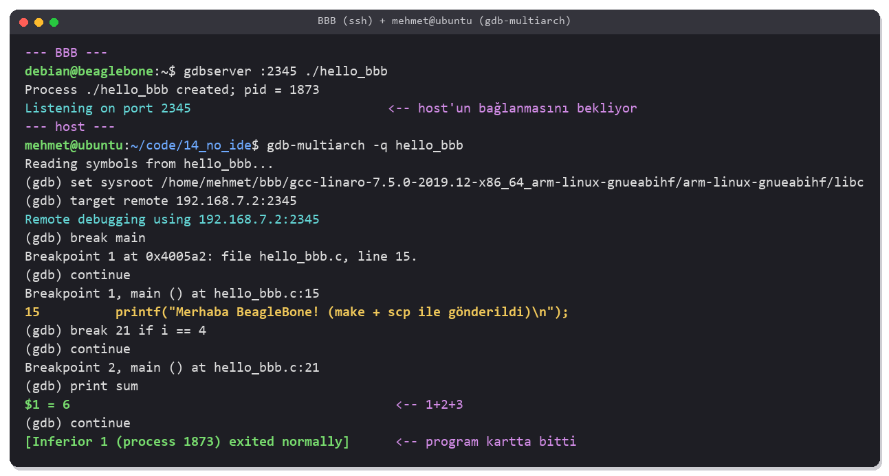

<!-- Bu dosya otomatik üretildi. Düzenlemek için chapters/ altındaki kaynağı değiştir. -->
# Bölüm 14 — Eclipse ile Uygulama Geliştirme

> <b>Bu bölümde:</b>
> - Eclipse'i (2026-09) kurup [Bölüm 9](09_uboot_build.md)'daki cross toolchain'e bağlayacaksın.
> - Bir C projesi oluşturup ARM için derleyeceksin ve derleme ayarlarını öğreneceksin.
> - Programı Eclipse'ten tek tıkla karta gönderip çalıştıracaksın.
> - Kursun hazır Eclipse projelerini içe aktaracaksın.
> - Aynı işi Eclipse olmadan yapacaksın: `make` + `scp`/`ssh`, VS Code ve `gdbserver` ile uzaktan hata ayıklama.
>
> <b>Ön koşul:</b> [Bölüm 9](09_uboot_build.md) — cross toolchain, kartta SSH ile bağlanılabilen bir Linux ([Bölüm 5](05_emmc_boot.md)'teki Debian ya da [Bölüm 13](13_buildroot.md)'teki Buildroot sistemi).

---

## 14.1 Neden Eclipse?

Şimdiye kadar her şeyi terminalden derledik. Kendi uygulamalarını yazmaya başladığında bir IDE işini kolaylaştırır: kod tamamlama, hataların satırında gösterilmesi, tek tuşla derleme ve programı karta gönderip çalıştırma.

```
 Host PC (Eclipse)                                       BeagleBone Black
 ┌──────────────────────────────────────┐   SSH + SFTP   ┌──────────────────────┐
 │ kodu yaz → Cross GCC ile derle       │ ─────────────► │ /home/debian/program │
 │ (arm-linux-gnueabihf-gcc)            │ ◄───────────── │ çalışır, çıktısı     │
 │ Console'da çıktıyı gör               │    çıktı       │ Eclipse'e döner      │
 └──────────────────────────────────────┘                └──────────────────────┘
```

Eclipse kendisi derlemez. Arka planda [Bölüm 9](09_uboot_build.md)'da kurduğun `arm-linux-gnueabihf-gcc`'yi çağırır. Bu yüzden komut satırında öğrendiğin her şey burada da geçerlidir. Eclipse kullanmak istemiyorsan [14.8](#148-eclipsesiz-geliştirme-make-vs-code-ve-gdbserver)'e geç.

> [!NOTE]
> Kurs bu bölümü <b>Windows</b> üzerinde anlatıyor; kitapta Ubuntu kullanılıyor. Adımlar iki sistemde de aynıdır, farkları [14.3](#143-eclipsei-kurmak)'te belirtildi.

---

## 14.2 Kursa Göre Değişenler

| Kursta | Bugün (2026-09) |
|---|---|
| Önce <b>Java JDK</b> kurulur, Eclipse onsuz açılmaz | Eclipse paketleri <b>kendi Java'sıyla (JRE)</b> gelir. Ayrıca Java kurmana gerek yok. |
| Uygulama karta <b>Remote System Explorer (RSE)</b> ile gönderilir | RSE artık Eclipse'in C/C++ araçlarıyla gelmiyor. Aynı işi CDT'nin <b>C/C++ Remote Launch</b> özelliği SSH üzerinden yapar ([14.6](#146-uygulamayı-kartta-çalıştırmak)). |

---

## 14.3 Eclipse'i Kurmak

<b>1) İndir.</b> <https://www.eclipse.org/downloads/packages/> adresinden <b>Eclipse IDE for C/C++ Developers</b> paketini, işletim sistemine uygun olanı indir. ("Eclipse IDE for Embedded C/C++ Developers" paketi de olur; o, mikrodenetleyiciler için ek araçlar içerir.)

<b>2) Aç ve çalıştır.</b>

```bash
cd ~
tar -xzf ~/Downloads/eclipse-cpp-2026-09-R-linux-gtk-x86_64.tar.gz
~/eclipse/eclipse &
```

İlk açılışta bir <b>workspace</b> (projelerin duracağı klasör) sorar. Varsayılan `~/eclipse-workspace` uygundur.

<b>3) Cross toolchain'in hazır olduğunu kontrol et.</b> Eclipse'in toolchain'i bulabilmesi için tam yolunu bilmen gerekir:


```bash
which arm-linux-gnueabihf-gcc
```

| Host | Toolchain |
|---|---|
| Ubuntu | [9.3](09_uboot_build.md#93-adım-adım-toolchain-kurulumu-ve-u-boot-derleme)'te kurduğun Linaro toolchain: `~/bbb/gcc-linaro-7.5.0-2019.12-x86_64_arm-linux-gnueabihf/bin` |
| Windows | Linaro'nun Windows sürümü: `gcc-linaro-7.5.0-2019.12-i686-mingw32_arm-linux-gnueabihf.tar.xz` ([indir](https://releases.linaro.org/components/toolchain/binaries/7.5-2019.12/arm-linux-gnueabihf/gcc-linaro-7.5.0-2019.12-i686-mingw32_arm-linux-gnueabihf.tar.xz)). Bir klasöre aç; içindeki `bin` klasörünün yolu Eclipse'e verilecek. Windows'ta `make` de gerekir (ör. MSYS2 veya "Windows Build Tools"). |

<b>4) Gerekli eklentileri kontrol et.</b> <i>Help → About Eclipse IDE → Installation Details</i> listesinde şu iki özellik olmalı. Yoksa <i>Help → Install New Software</i>'da <i>Work with</i> kutusuna `https://download.eclipse.org/releases/2026-09/` yaz ve aratıp kur:

| Özellik | Ne işe yarar? |
|---|---|
| <b>C/C++ GCC Cross Compiler Support</b> | Proje sihirbazındaki "Cross GCC" araç zinciri |
| <b>C/C++ Remote Launch</b> | Programı SSH ile karta gönderip çalıştırma |

---

## 14.4 Birinci Proje: Oluşturma ve Derleme

Kursun "Eclipse project creation and build settings" dersi.

### Adım 1 — Projeyi oluştur

<i>File → New → C/C++ Project → C Managed Build</i>, sonra:

| Alan | Değer |
|---|---|
| Project name | `hello_bbb` |
| Project type | Executable → <b>Hello World ANSI C Project</b> |
| Toolchains | <b>Cross GCC</b> |

<i>Next</i> ile ilerle. <b>Cross GCC Command</b> sayfasında:

| Alan | Değer |
|---|---|
| Cross compiler prefix | `arm-linux-gnueabihf-` (sondaki `-` dahil) |
| Cross compiler path | Toolchain'in `bin` klasörü, ör. `/home/<kullanıcı>/bbb/gcc-linaro-7.5.0-2019.12-x86_64_arm-linux-gnueabihf/bin` |

<i>Finish</i>'e bas. Eclipse `src/hello_bbb.c` dosyasını oluşturur. İçeriğini kartta çalıştığını gösterecek şekilde değiştir:

```c
#include <stdio.h>
#include <sys/utsname.h>

int main(void)
{
	struct utsname u;

	printf("Merhaba BeagleBone! (Eclipse'ten uzaktan çalıştırıldı)\n");
	if (uname(&u) == 0)
		printf("Kernel: %s %s %s %s\n", u.sysname, u.nodename, u.release, u.machine);
	return 0;
}
```

### Adım 2 — Derle

<i>Project → Build Project</i> (veya çekiç simgesi). <b>Console</b> görünümünde Eclipse'in çağırdığı komutları görürsün:


Eclipse proje klasöründe bir `Debug/` klasörü ve içine kendi `makefile`'ını üretir. Çıktının gerçekten ARM için olduğunu terminalden doğrulayabilirsin:


```bash
file ~/eclipse-workspace/hello_bbb/Debug/hello_bbb
```

### Derleme ayarları

<i>Project → Properties → C/C++ Build → Settings → Tool Settings</i>:

| Bölüm | Ne ayarlanır? |
|---|---|
| <b>Cross Settings</b> | <b>Prefix</b> ve <b>Path</b>: hangi toolchain kullanılacak. Toolchain'i taşıdıysan ya da başka bir bilgisayardan proje aldıysan burayı düzelt. |
| Cross GCC Compiler → Optimization | `-O0` (Debug) / `-O2` (Release) |
| Cross GCC Compiler → Warnings | `-Wall` (tüm uyarılar) |
| Cross GCC Compiler → Includes | Ek başlık klasörleri (`-I`) |
| Cross GCC Linker → Libraries | Bağlanacak kütüphaneler (ör. `m` → `-lm`, `pthread`) |
| Cross GCC Linker → Miscellaneous → Linker flags | Ek bağlayıcı seçenekleri. Programı <b>`-static`</b> derlemek için buraya yaz ([14.5](#145-karttaki-sistemle-uyum-dinamik-mi-statik-mi)). |

Üst kısımdaki <b>Configuration</b> kutusu <b>Debug</b> ve <b>Release</b> arasında seçim yapar. Her yapılandırmanın kendi ayarları ve kendi çıktı klasörü vardır.

---

## 14.5 Karttaki Sistemle Uyum: Dinamik mi, Statik mi?

Eclipse varsayılan olarak <b>dinamik</b> bağlanmış program üretir. Dinamik program kartta çalışırken iki koşul sağlanmalı ([12.11](12_busybox_rootfs.md#1211-challenge-2-busyboxı-dinamik-derlemek)):

| Karttaki sistem | Dinamik program çalışır mı? | Ne yapmalı? |
|---|---|---|
| eMMC'deki Debian ([Bölüm 5](05_emmc_boot.md)) | Genelde evet | Toolchain'in glibc'si karttakinden <b>eski veya aynı</b> olmalı. Kartta `ldd --version` ile bak. |
| Buildroot ([Bölüm 13](13_buildroot.md)) | Buildroot'un kendi toolchain'iyle derlenirse evet | Cross Settings'te Path = `output/host/bin`, Prefix = `arm-buildroot-linux-gnueabihf-` |
| BusyBox (statik) rootfs ([Bölüm 12](12_busybox_rootfs.md)) | Hayır, `/lib`'te kütüphane yok | Linker flags'e `-static` ekle ya da kütüphaneleri kopyala |

> [!TIP]
> Emin değilsen `-static` ile derle. Program biraz büyür ama karttaki kütüphanelere bağımlı olmaz, her rootfs'te çalışır.

---

## 14.6 Uygulamayı Kartta Çalıştırmak

Kursun "Installing Remote System Explorer and Testing Application" dersi. Eclipse programı <b>SSH</b> ile karta kopyalar, çalıştırır ve çıktısını Console'da gösterir.

> [!IMPORTANT]
> Dosya kopyalama için kartta bir <b>SFTP sunucusu</b> olmalı.
> - Debian'da OpenSSH ile birlikte gelir, ek bir şey gerekmez.
> - Buildroot'ta Dropbear tek başına SFTP sunmaz. <i>Target packages → Networking applications</i>'dan <b>gesftpserver</b> paketini de ekle (ya da Dropbear yerine `openssh` seç).

### Adım 1 — Bağlantı ve çalıştırma ayarı

<i>Run → Run Configurations...</i> → sol listede <b>C/C++ Remote Application</b>'a sağ tık → <i>New Configuration</i>:

| Alan | Değer |
|---|---|
| Project / C/C++ Application | `hello_bbb` / `Debug/hello_bbb` |
| Connection | <i>New...</i> → <b>SSH</b> → Host: `192.168.27.2`, User: `debian`, şifre |
| Remote Absolute File Path for C/C++ Application | `/home/debian/hello_bbb` |
| Commands to execute before application | Boş bırakabilirsin |
| Skip download to target path | İşaretleme (her çalıştırmada yeni derlenen dosya kopyalansın) |

> [!NOTE]
> Kartın IP'si bağlantı yöntemine göre değişir: Ethernet ile `192.168.27.2` ([8.4](08_tftp_boot.md#84-bağlantılar)), USB ile Debian'da `192.168.7.2` / `192.168.6.2` ([5.4.1](05_emmc_boot.md#541-kartın-ip-adresini-öğren)). Buildroot'ta kullanıcı `root`'tur.

### Adım 2 — Çalıştır

<i>Run</i>'a bas. Eclipse programı `/home/debian/` altına kopyalar, çalıştırılabilir yapar ve çalıştırır:


Bundan sonra yeşil <i>Run</i> düğmesi bu ayarı hatırlar: kodu değiştir, kaydet, <i>Run</i>'a bas. Eclipse önce derler, sonra karta gönderip çalıştırır.

> [!TIP]
> Kartın dosyalarını görmek ve kartta kabuk açmak için <i>Window → Show View → Other...</i>'dan <b>Connections</b> ve <b>Terminal</b> görünümlerini aç. Kursta RSE'nin "Remote Systems" görünümüyle yapılan dosya gezme ve terminal işlerini bunlar karşılar.

### Eclipse olmadan: `scp` + `ssh`

Aynı işi terminalden de yapabilirsin ([14.8](#148-eclipsesiz-geliştirme-make-vs-code-ve-gdbserver)'de ayrıntılı). Bir şey ters giderse sorunun Eclipse'te mi, kartta mı olduğunu anlamak için iyi bir testtir:


```bash
scp Debug/hello_bbb debian@192.168.27.2:~/
ssh debian@192.168.27.2 ./hello_bbb
```

---

## 14.7 Kursun Projelerini Eclipse'e Aktarmak

Kursun "Importing Eclipse Projects" dersi. Kursun reposundaki `Project_Src/` klasörü sonraki bölümlerin bütün uygulamalarını içeriyor.

<b>1) Repoyu indir:</b>

```bash
cd ~
git clone https://github.com/niekiran/EmbeddedLinuxBBB.git
```

<b>2) İçe aktar:</b> <i>File → Import → General → Existing Projects into Workspace</i> → <i>Select root directory</i>: `~/EmbeddedLinuxBBB/Project_Src` → istediğin projeleri işaretle → <i>Copy projects into workspace</i>'i işaretle → <i>Finish</i>.

<b>3) Toolchain yolunu düzelt.</b> Projelerdeki <b>Path</b> eğitmenin bilgisayarındaki yolu gösterir. Her proje için <i>Properties → C/C++ Build → Settings → Cross Settings → Path</i>'i kendi toolchain klasörünle değiştir. Prefix (`arm-linux-gnueabihf-`) zaten doğru.

<b>4) Temiz derle:</b> <i>Project → Clean...</i>, sonra <i>Build Project</i>. Repoda eğitmenin derlediği eski `Debug/` dosyaları da var; temizlemek bunları siler.

| Proje | Ne yapar? | Kitapta |
|---|---|---|
| `BBB_led_control` | Kartın USR3 LED'ini sysfs ile kontrol eder | [Bölüm 15](15_gpio_sysfs.md) |
| `counter_7seg`, `button_counter_7seg` | Tek haneli 7-segment gösterge, sayıcı | [Bölüm 17](17_seven_segment.md) |
| `4digitcount` | 4 haneli 7-segment sayıcı | [Bölüm 18](18_four_digit_7segment.md) |
| `MPU6050_raw_read` | I2C ile ivmeölçer/jiroskop okuma | [Bölüm 19](19_mpu6050.md) |
| `lcd_text`, `lcd_scrollable_text`, `lcd_news` | 16x2 LCD'ye yazı yazma | [Bölüm 20](20_lcd_16x2.md) |
| `Drivers/gpio`, `Drivers/lcd` | Projelerin ortak kullandığı GPIO ve LCD fonksiyonları | [Bölüm 16](16_external_led.md), [Bölüm 20](20_lcd_16x2.md) |

> [!IMPORTANT]
> Kursun projelerinde hatalar var (ör. LED programında ham bayt yazımı, LCD'de eksik başlatma dizisi). Kitaptaki bölümler her projenin hatalarını anlatıp düzeltilmiş halini repodaki `code/` klasöründe veriyor; kendi çalışmanda o sürümleri kullan.

> [!NOTE]
> Repodaki `.metadata` ve `RemoteSystemsTempFiles` klasörleri eğitmenin Eclipse çalışma alanına ait. İçe aktarırken bunları seçme.

---

## 14.8 Eclipse'siz Geliştirme: make, VS Code ve gdbserver

Eclipse zorunlu değil. Kurs kullandığı için bu bölümde anlatıldı, ama yaptığı her şeyin terminalde bir karşılığı var:

| Eclipse'te | Eclipse'siz |
|---|---|
| Cross GCC proje ayarları | `Makefile` (`CROSS_COMPILE`, `CFLAGS`, `LDFLAGS`) |
| Build Project | `make` |
| C/C++ Remote Application | `scp` + `ssh` (`make run`) |
| Debug | Kartta `gdbserver`, host'ta `gdb-multiarch` |
| Editör, kod tamamlama | Herhangi bir editör; VS Code'da C/C++ eklentisi |

Sonraki bölümlerin programları terminalden de derleniyor, [Bölüm 21](21_kernel_module.md)'den sonraki kernel sürücülerinde ise IDE hiç kullanılmıyor. Sektörde de en yaygın düzen budur: kod herhangi bir editörde yazılır, derleme `make` ya da CMake ile yapılır. Eclipse bir yerde takılırsa sorunu bulmak için de bu komutlara dönersin.

> [!NOTE]
> Bu kısımdaki terminal görüntüleri temsilidir; sürüm numaraları, adresler ve süreler sende farklı olabilir.

Bu kısmın dosyaları repoda `code/14_no_ide/` klasöründe: `hello_bbb.c`, `Makefile` ve VS Code ayarlarının bulunduğu `.vscode/`.

### 14.8.1 Makefile ile derleme ve karta gönderme

`Makefile`'ın önemli kısmı:

```make
PROG   ?= hello_bbb
SRCS   ?= hello_bbb.c
OBJS    = $(SRCS:.c=.o)

CROSS_COMPILE ?= arm-linux-gnueabihf-
CC      = $(CROSS_COMPILE)gcc
CFLAGS ?= -Wall -O0 -g

ifeq ($(STATIC),1)
LDFLAGS += -static
endif

BOARD  ?= debian@192.168.7.2
RDIR   ?= .

$(PROG): $(OBJS)
	$(CC) $(LDFLAGS) -o $@ $^ $(LDLIBS)

deploy: $(PROG)
	scp $(PROG) $(BOARD):$(RDIR)/

run: deploy
	ssh $(BOARD) $(RDIR)/$(PROG)
```

- `CC`, Eclipse'teki <b>Prefix</b> ayarının karşılığıdır: `arm-linux-gnueabihf-` + `gcc`. Toolchain'in `bin` klasörü `PATH`'te olmalı ([Bölüm 9](09_uboot_build.md)). Değilse tam yolu ver: `make CROSS_COMPILE=~/bbb/gcc-linaro-7.5.0-2019.12-x86_64_arm-linux-gnueabihf/bin/arm-linux-gnueabihf-`.
- `?=` ile tanımlanan her değişken komut satırından değiştirilebilir. Varsayılan kart, USB ile bağlı Debian'dır ([5.4.1](05_emmc_boot.md#541-kartın-ip-adresini-öğren)).
- `make STATIC=1`, Eclipse'te Linker flags'e `-static` yazmanın karşılığıdır ([14.5](#145-karttaki-sistemle-uyum-dinamik-mi-statik-mi)).
- Makefile'da komut satırları <b>sekme (Tab)</b> ile başlar, boşlukla değil.

Derle, karta gönder ve çalıştır:



```bash
cd ~/code/14_no_ide
make
make run
make run BOARD=root@192.168.27.2      # Ethernet'teki Buildroot kartı
```

Her `scp`/`ssh` çağrısında şifre sorulmasın diye SSH anahtarını bir kez karta kopyala:

```bash
ssh-keygen -t ed25519                  # anahtarın yoksa; sorulara Enter
ssh-copy-id debian@192.168.7.2
```

> [!TIP]
> Kart rootfs'ini NFS'ten alıyorsa ([Bölüm 12](12_busybox_rootfs.md)) `scp`'ye de gerek yok: host'taki NFS klasörüne kopyaladığın dosya o an kartta görünür.
> ```bash
> make STATIC=1 && sudo cp hello_bbb /srv/nfs/bbb/
> ```
> Kartta `/hello_bbb` ile çalıştır.

Başka bir programı derlemek için `PROG` ve `SRCS`'i değiştirmen yeterli. Örneğin [Bölüm 17](17_seven_segment.md)'deki sayıcı:

```bash
make PROG=counter_7seg \
     SRCS="../17_7segment/counter_7seg.c ../17_7segment/seg7.c ../lib/gpio_driver.c" \
     CFLAGS="-Wall -O2 -I../lib"
```

### 14.8.2 VS Code ile

VS Code'da Eclipse'in proje ayarlarının yerini `.vscode/` klasöründeki birkaç JSON dosyası alır. Derleme yine `make` ile yapılır, VS Code sadece onu çağırır.

<b>1) Kur.</b> VS Code'u (<https://code.visualstudio.com>) ve Microsoft'un <b>C/C++</b> eklentisini (`ms-vscode.cpptools`) kur. Hata ayıklama için host'ta `gdb-multiarch` gerekir:

```bash
sudo apt install gdb-multiarch
code ~/code/14_no_ide
```

<b>2) Kod tamamlama: `c_cpp_properties.json`.</b> Bu dosya yoksa VS Code host'un `/usr/include` başlıklarını kullanır ve ARM'a özgü kodda yanlış uyarılar verir. `compilerPath` cross derleyiciyi gösterince başlıkları ve makroları toolchain'den okur:

```json
"compilerPath": "${env:HOME}/bbb/gcc-linaro-7.5.0-2019.12-x86_64_arm-linux-gnueabihf/bin/arm-linux-gnueabihf-gcc",
"intelliSenseMode": "linux-gcc-arm"
```

<b>3) Derleme ve çalıştırma: `tasks.json`.</b> Üç görev tanımlı:

| Görev | Komut | Nasıl çalıştırılır |
|---|---|---|
| `build` | `make` | <b>Ctrl+Shift+B</b>. Derleme hataları Problems panelinde, kendi satırında görünür. |
| `run on board` | `make run` | <i>Terminal → Run Task...</i> |
| `start gdbserver` | `make deploy`, sonra kartta `gdbserver` | Hata ayıklama başlarken kendiliğinden ([14.8.4](#1484-vs-codeda-hata-ayıklama)) |

Kartın adresi `.vscode/settings.json`'daki `bbb.board` değeridir.

> [!WARNING]
> VS Code'un <b>Remote-SSH</b> eklentisiyle doğrudan kartın içinde de çalışılabilir. Ama bunun için kartta VS Code'un sunucu tarafı çalışır; BBB'nin 512 MB RAM'i ve tek çekirdeği için bu ağırdır, BusyBox rootfs'te ise hiç çalışmaz. Kodu host'ta yazıp karta göndermek daha hızlıdır.

### 14.8.3 gdbserver ile uzaktan hata ayıklama

`printf` ile hata aramak her zaman yetmez. <b>gdb</b> ile programı bir satırda durdurabilir, değişkenlere bakabilir, adım adım ilerleyebilirsin. Program kartta çalıştığı için gdb iki parçaya bölünür:

```
 Host PC                                          BeagleBone Black
 ┌──────────────────────────────┐   TCP 2345    ┌───────────────────────────┐
 │ gdb-multiarch hello_bbb      │ ────────────► │ gdbserver :2345 hello_bbb │
 │ - kaynak kod, semboller (-g) │ ◄──────────── │ - programı çalıştırır,    │
 │ - break, next, print         │   yazmaçlar,  │   durdurur, belleği okur  │
 └──────────────────────────────┘   bellek      └───────────────────────────┘
```

- <b>gdbserver</b> kartta çalışır. Küçüktür; kaynak koda ve sembollere ihtiyaç duymaz.
- <b>gdb</b> host'ta çalışır, sembolleri (`-g` ile derlenmiş dosyadan) ve kaynak kodu okur. Host'un normal `gdb`'si sadece x86'yı anlar; ARM için <b>`gdb-multiarch`</b> gerekir. (Linaro toolchain'inin içindeki `arm-linux-gnueabihf-gdb` de olur.)

<b>gdbserver'ı karta kur:</b>

| Karttaki sistem | Nasıl? |
|---|---|
| Debian ([Bölüm 5](05_emmc_boot.md)) | `sudo apt install gdbserver` (kartın internete çıkabilmesi gerekir) |
| Buildroot ([Bölüm 13](13_buildroot.md)) | <i>Target packages → Debugging, profiling and benchmark → gdb</i>'yi seç; altındaki <b>gdbserver</b> seçeneği varsayılan olarak işaretli gelir. Sonra yeniden `make`. |

<b>Programı `-g -O0` ile derle.</b> Makefile'daki varsayılan `CFLAGS` bunu yapar. `-O2` ile derlenmiş programda derleyici satırların sırasını değiştirir ve bazı değişkenleri yok eder; gdb onlar için `<optimized out>` gösterir.

<b>Çalıştır:</b>



Kartta:

```text
gdbserver :2345 ./hello_bbb
```

Host'ta:

```bash
cd ~/code/14_no_ide
gdb-multiarch -q hello_bbb
```

```text
(gdb) set sysroot ~/bbb/gcc-linaro-7.5.0-2019.12-x86_64_arm-linux-gnueabihf/arm-linux-gnueabihf/libc
(gdb) target remote 192.168.7.2:2345
(gdb) break main
(gdb) continue
(gdb) next
(gdb) print sum
(gdb) continue
```

| Komut | Kısaltma | Ne yapar? |
|---|---|---|
| `break main`, `break 21` | `b` | Fonksiyonda ya da satırda durma noktası koyar. `break 21 if i == 4` sadece koşul doğruysa durur. |
| `continue` | `c` | Sonraki durma noktasına kadar çalıştırır. gdbserver programı başlatıp ilk komutta durdurduğu için `run` değil `continue` yazılır. |
| `next` / `step` | `n` / `s` | Bir satır ilerler; `step` çağrılan fonksiyonun içine girer. |
| `print sum` | `p` | Değişkenin değerini gösterir. |
| `backtrace` | `bt` | Program çöktüyse hangi fonksiyon zincirinde olduğunu gösterir. |
| `info locals` | | Fonksiyonun bütün yerel değişkenleri. |

`set sysroot`, gdb'ye programın kullandığı paylaşılan kütüphanelerin (libc) host'taki kopyasını gösterir. Yol, `arm-linux-gnueabihf-gcc -print-sysroot` komutunun çıktısıdır. Program `-static` derlenmişse bu satıra gerek yoktur.

### 14.8.4 VS Code'da hata ayıklama

Aynı işi VS Code'un arayüzünden yapmak için `.vscode/launch.json`:

```json
{
	"name": "Debug on BBB",
	"type": "cppdbg",
	"request": "launch",
	"program": "${workspaceFolder}/hello_bbb",
	"MIMode": "gdb",
	"miDebuggerPath": "/usr/bin/gdb-multiarch",
	"miDebuggerServerAddress": "192.168.7.2:2345",
	"preLaunchTask": "start gdbserver",
	"stopAtEntry": true,
	"setupCommands": [
		{ "text": "set sysroot ${env:HOME}/bbb/gcc-linaro-7.5.0-2019.12-x86_64_arm-linux-gnueabihf/arm-linux-gnueabihf/libc" }
	]
}
```

<b>F5</b>'e bastığında:

1. `preLaunchTask` ([14.8.2](#1482-vs-code-ile)'deki `start gdbserver` görevi) programı derleyip karta kopyalar ve kartta `gdbserver`'ı başlatır.
2. Görev "Listening on port" satırını görünce VS Code `gdb-multiarch`'ı başlatır ve `miDebuggerServerAddress`'e bağlanır.
3. Program `main`'de durur. Satır numarasının soluna tıklayarak durma noktası koyar, <b>F10</b> (next) ve <b>F11</b> (step) ile ilerler, değişkenleri soldaki <i>Variables</i> panelinde görürsün.

Kartın IP'si değişirse hem `settings.json`'daki `bbb.board`'u hem `launch.json`'daki `miDebuggerServerAddress`'i güncelle.

---

## 14.9 Özet

- Eclipse (Eclipse IDE for C/C++ Developers) Java'sıyla birlikte gelir. Gereken eklentiler: <b>C/C++ GCC Cross Compiler Support</b> ve <b>C/C++ Remote Launch</b>.
- Proje: <i>C Managed Build → Executable → Cross GCC</i>. Toolchain'i <b>Prefix</b> (`arm-linux-gnueabihf-`) ve <b>Path</b> (`.../bin`) belirler.
- Karta gönderip çalıştırma: <i>Run Configurations → C/C++ Remote Application</i>, SSH bağlantısı; kartta SFTP sunucusu gerekir.
- Karttaki rootfs'te kütüphane yoksa ya da glibc eskiyse programı `-static` derle.
- Kursun projeleri: <i>Import → Existing Projects into Workspace</i>, sonra Cross Settings → Path'i düzelt.
- Eclipse zorunlu değil: `make` ile derle, `scp` + `ssh` ile çalıştır (`make run`). VS Code'da aynı işi `.vscode/` altındaki `tasks.json` ve `launch.json` yapar.
- Hata ayıklama: kartta `gdbserver :2345 ./program`, host'ta `gdb-multiarch` → `target remote <kart>:2345`. Programı `-g -O0` ile derle.

## 14.10 Karşılaşılabilecek Problemler


| Belirti | Sebep | Çözüm |
|---|---|---|
| `Program "arm-linux-gnueabihf-gcc" not found in PATH` | Cross Settings → Path yanlış ya da boş | `which arm-linux-gnueabihf-gcc` çıktısının klasörünü yaz |
| Proje sihirbazında "Cross GCC" yok | C/C++ GCC Cross Compiler Support eklentisi kurulu değil | [14.3](#143-eclipsei-kurmak) Adım 4 |
| Run Configurations'ta "C/C++ Remote Application" yok | C/C++ Remote Launch eklentisi kurulu değil | [14.3](#143-eclipsei-kurmak) Adım 4 |
| `make: *** No rule to make target 'all'` | Proje "Makefile Project" türünde açılmış, Eclipse makefile üretmiyor | Projeyi "C Managed Build → Executable" olarak yeniden oluştur |
| Kartta `version 'GLIBC_2.xx' not found` | Toolchain'in glibc'si karttakinden yeni | Karttakiyle uyumlu toolchain kullan ya da `-static` |
| Kartta `./program: not found` (dosya varken) | Dinamik program, rootfs'te `/lib/ld-linux-armhf.so.3` yok | `-static` ile derle |
| `Error during file upload` | Kartta SFTP sunucusu yok | Buildroot'a `gesftpserver` ekle |
| `Permission denied` (çalıştırırken) | Dosya çalıştırılabilir değil ya da yanlış klasöre kopyalandı | Remote path'in kullanıcının yazabildiği bir yer olduğundan emin ol |
| Kartta `Exec format error` | Program ARM için değil, host için derlenmiş | Toolchain olarak Cross GCC seçildiğini, `file` çıktısında ARM yazdığını kontrol et |
| `missing separator.  Stop.` | Makefile'da komut satırı boşlukla başlıyor | Komut satırlarının başına <b>Tab</b> koy |
| `make: arm-linux-gnueabihf-gcc: No such file or directory` | Toolchain `PATH`'te değil | `make CROSS_COMPILE=<toolchain>/bin/arm-linux-gnueabihf-` ya da `PATH`'e ekle ([14.8.1](#1481-makefile-ile-derleme-ve-karta-gönderme)) |
| gdb'de `Remote 'g' packet reply is too long` | ARM programa host'un x86 `gdb`'siyle bağlanıldı | `gdb-multiarch` kullan |
| `target remote` → `Connection timed out` / `refused` | Kartta `gdbserver` çalışmıyor, IP ya da port yanlış | Kartta `gdbserver :2345 ./program` çalışıyor mu bak |
| gdb'de değişken `<optimized out>`, satırlar atlanıyor | Program `-O2` ile derlenmiş | `-g -O0` ile derle |
| VS Code ARM başlıklarında yanlış hata gösteriyor | IntelliSense host derleyicisini kullanıyor | `c_cpp_properties.json`'da `compilerPath`'i cross gcc yap |

---

[← Bölüm 13: Buildroot](13_buildroot.md) · [İçindekiler](README.md) · [Bölüm 15: AM335x GPIO'ları, Pin Ayarları ve sysfs →](15_gpio_sysfs.md)
