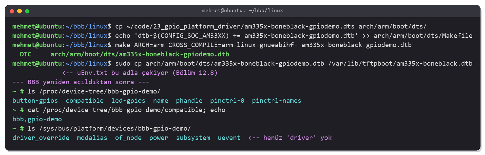
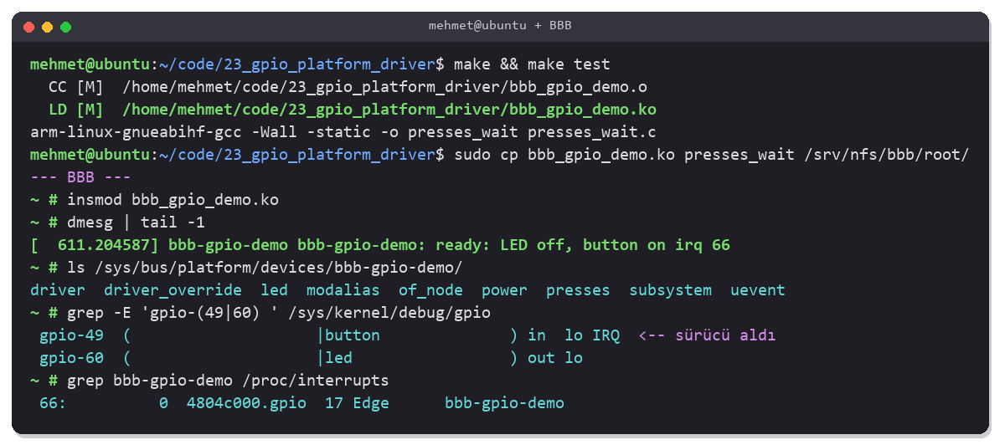
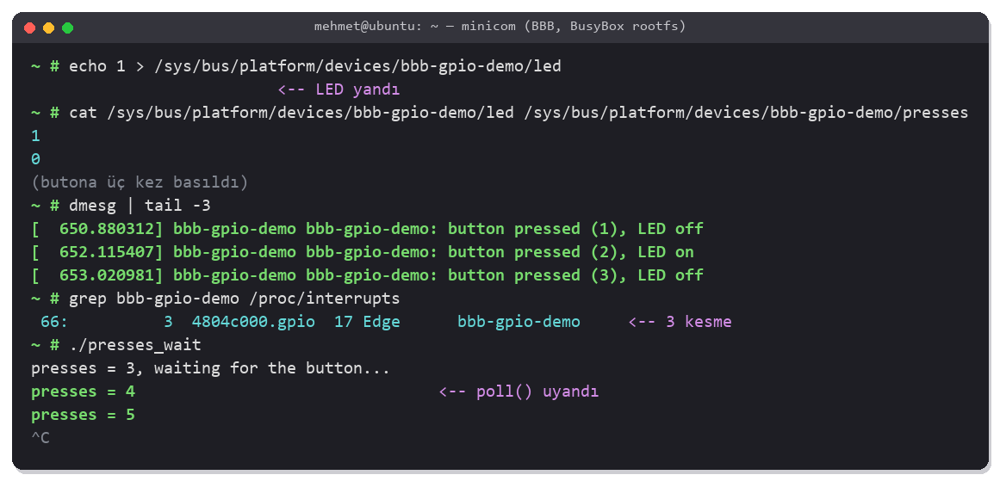
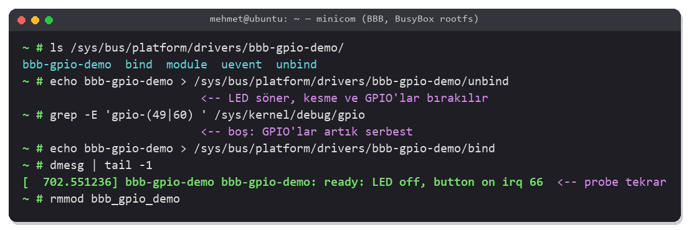
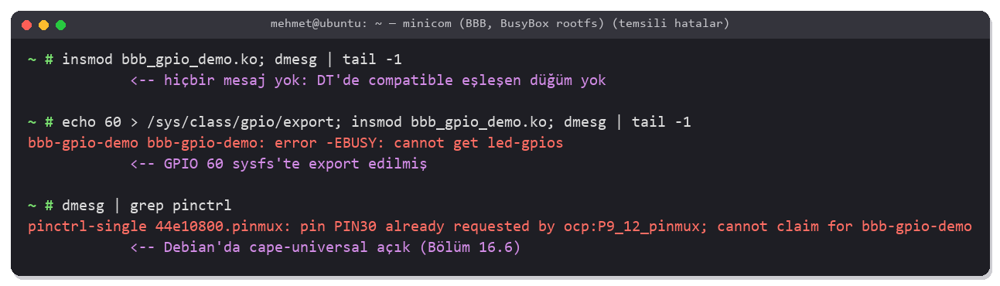

<!-- Bu dosya otomatik üretildi. Düzenlemek için chapters/ altındaki kaynağı değiştir. -->
# Bölüm 23 — Device Tree ile GPIO Platform Sürücüsü

> <b>Bu bölümde:</b>
> - Device tree'ye kendi donanımını tarif eden bir düğüm ekleyecek ve `compatible` ile sürücüne bağlayacaksın.
> - Bir <b>platform sürücüsü</b> yazacak; `probe()` içinde LED'i ve butonu kernel'in GPIO API'siyle (`gpiod`) alacaksın.
> - Butonu kesmeyle (threaded IRQ) okuyup kontak sekmesini sürücüde çözeceksin.
> - Sürücünün durumunu sysfs dosyalarıyla dışarı açacak, kullanıcı programını `poll()` ile uyandıracaksın.
> - `devm_` fonksiyonlarıyla kaynakların kendiliğinden bırakılmasını, `bind`/`unbind` ile sürücü-aygıt bağını göreceksin.
>
> <b>Ön koşul:</b> [Bölüm 11](11_device_tree.md) — device tree ve `compatible`, [Bölüm 16](16_external_led.md) — harici LED, [Bölüm 17](17_seven_segment.md#177-ek-butonla-sayma) — buton ve kesme, [Bölüm 22](22_char_driver.md) — sürücü yazmak.

> [!NOTE]
> Bu bölüm kursta yok. Kart, [Bölüm 21](21_kernel_module.md)'deki gibi kendi kernel'in (5.10.162) ve BusyBox rootfs'inle, kernel ve DTB TFTP'den gelerek ([12.8](12_busybox_rootfs.md#128-rootfsi-nfs-ile-bilgisayardan-bağlamak)) açılıyor. Kartta Debian çalıştırıyorsan [23.3](#233-device-treeye-düğüm-eklemek)'teki overlay yolunu kullan. Terminal görüntüleri temsilidir.

---

## 23.1 Kullanıcı Alanından Kernel'e

[Bölüm 16](16_external_led.md) ve [Bölüm 17](17_seven_segment.md)'de LED'i ve butonu kullanıcı alanından, `/sys/class/gpio` ile sürdük. Program GPIO'yu export ediyor, kesme için `edge` dosyasını ayarlıyor, `poll()` ile bekliyor ve kontak sekmesini kendisi süzüyordu. Bu bölümde aynı donanımı <b>kernel'in içinden</b> süreceğiz:

| | Kullanıcı alanında ([Bölüm 16](16_external_led.md)–[17](17_seven_segment.md)) | Platform sürücüsünde (bu bölüm) |
|---|---|---|
| Donanım nerede tarif ediliyor? | Programın kaynak kodunda: `#define BUTTON_GPIO 49` | <b>Device tree</b>'de: `button-gpios = <&gpio1 17 ...>` |
| GPIO numarası | Elle hesaplanıyor, kernel sürümüne bağlı ([15.6](15_gpio_sysfs.md#156-gpioları-kullanıcı-alanından-kontrol-etmek)) | Yok: sürücü GPIO'yu adıyla (`"button"`) ister |
| Pinmux | `config-pin` ya da varsayılana güven | DT'deki `pinctrl-0`, sürücü yüklenmeden kernel ayarlar |
| Kesme ve debounce | Program `poll()` + zaman kontrolü | Sürücü: kesme fonksiyonu + debounce |
| Kullanıcıya arayüz | — | Sürücünün açtığı `led` ve `presses` dosyaları |

Kernel'in kendi sürücüleri de böyle çalışır: USR LED'leri süren `leds-gpio` ([11.5](11_device_tree.md#115-bir-device-treenin-genel-yapısı)) ya da [Bölüm 19](19_mpu6050.md)'daki I2C denetleyicisi device tree'den tanıtılır ve `compatible` ile sürücüsüne bağlanır.

### Devre

[Bölüm 16](16_external_led.md)'daki LED ve [Bölüm 17](17_seven_segment.md#177-ek-butonla-sayma)'deki buton, birlikte:

```
 P9_12 (GPIO1_28) ●───[ 470 Ω ]───►|───● GND (P9_1)        LED (Bölüm 16)

 P9_3  (3.3 V)    ●───[ BUTON ]───┬────● P9_23 (GPIO1_17)   Buton (Bölüm 17)
                                  │
                              [ 10 kΩ ]
                                  │
                                  ●───── GND (P9_1)
```

> [!WARNING]
> [Bölüm 18](18_four_digit_7segment.md)'deki 4 haneli gösterge de P9_23'ü kullanıyor; o devre takılıysa sök.

---

## 23.2 Platform Aygıtı ve Platform Sürücüsü

USB veya PCI aygıtları kendini tanıtır; kernel onları veriyolunu tarayarak bulur. SoC'nin içindeki birimler ve GPIO'ya bağlı bir LED ise kendini tanıtamaz ([11.1](11_device_tree.md#111-problem-kernel-donanımı-nereden-bilecek)). Kernel bunları <b>platform veriyolu</b> (platform bus) üzerinde tutar:

```
 Device tree düğümü                          Platform sürücüsü (bizim modül)
 ┌────────────────────────────────┐          ┌─────────────────────────────────────┐
 │ bbb-gpio-demo {                │ eşleşme  │ of_match_table:                     │
 │   compatible = "bbb,gpio-demo" │◄────────►│   { .compatible = "bbb,gpio-demo" } │
 │   led-gpios = ...              │          │ .probe = gpio_demo_probe            │
 │   button-gpios = ...           │          │                                     │
 │ };                             │          │                                     │
 └────────────────────────────────┘          └─────────────────────────────────────┘
          │ açılışta                                         │ insmod
          ▼                                                  ▼
 platform aygıtı: bbb-gpio-demo  ─────── bağlanır ───────  probe(aygıt) çağrılır
```

1. Kernel açılırken DTB'deki düğümden bir <b>platform aygıtı</b> oluşturur (`/sys/bus/platform/devices/bbb-gpio-demo`). Henüz bir sürücüsü yoktur.
2. Sürücü (`insmod` ya da kernel'e gömülü) kendini platform veriyoluna kaydeder.
3. Veriyolu, aygıtların `compatible`'ını sürücülerin `of_match_table`'ıyla karşılaştırır. Eşleşen her aygıt için sürücünün <b>`probe()`</b> fonksiyonunu çağırır.
4. Sürücü ayrılırken (`rmmod`, `unbind`) aldığı kaynakları bırakır.

Sıra fark etmez: sürücü önce yüklenirse aygıt oluştuğunda, aygıt önceden varsa sürücü yüklendiğinde eşleşme olur.

---

## 23.3 Device Tree'ye Düğüm Eklemek

Bölümün kodu: [`code/23_gpio_platform_driver/`](../code/23_gpio_platform_driver/bbb_gpio_demo.c).

### Ana yol: kendi kernel'ine kart DTS'i

[`am335x-boneblack-gpiodemo.dts`](../code/23_gpio_platform_driver/am335x-boneblack-gpiodemo.dts), BBB'nin DTS'ini olduğu gibi alıp üzerine düğümümüzü ekler ([11.8](11_device_tree.md#118-kalıtım-dtsi-include-ve-label-ile-override)'deki kalıtım):

```dts
#include "am335x-boneblack.dts"

&am33xx_pinmux {
	gpio_demo_pins: gpio-demo-pins {
		pinctrl-single,pins = <
			AM33XX_PADCONF(AM335X_PIN_GPMC_BEN1, PIN_OUTPUT_PULLDOWN, MUX_MODE7)	/* P9_12: gpio1_28, LED */
			AM33XX_PADCONF(AM335X_PIN_GPMC_A1, PIN_INPUT_PULLDOWN, MUX_MODE7)	/* P9_23: gpio1_17, buton */
		>;
	};
};

/ {
	bbb-gpio-demo {
		compatible = "bbb,gpio-demo";
		pinctrl-names = "default";
		pinctrl-0 = <&gpio_demo_pins>;
		led-gpios = <&gpio1 28 GPIO_ACTIVE_HIGH>;
		button-gpios = <&gpio1 17 GPIO_ACTIVE_HIGH>;
	};
};
```

| Satır | Anlamı |
|---|---|
| `&am33xx_pinmux { ... }` | AM335x'in pin ayar düğümüne bir pin grubu ekler: P9_12 mod 7 çıkış, P9_23 mod 7 giriş + pull-down ([15.3](15_gpio_sysfs.md#153-pin-multiplexing-ve-pin-ayar-registerları)) |
| `bbb-gpio-demo` | Kök düğümün altında yeni bir düğüm; kernel bundan aynı adlı bir platform aygıtı oluşturur |
| `compatible = "bbb,gpio-demo"` | Sürücüyü seçen string. Biçim `"üretici,model"`; `bbb` burada kitabın uydurduğu bir önek |
| `pinctrl-0` | Sürücünün `probe()`'u çağrılmadan hemen önce kernel bu pin grubunu uygular |
| `led-gpios`, `button-gpios` | `<&gpio1 28 GPIO_ACTIVE_HIGH>`: GPIO1 bankasının 28. hattı, aktif yüksek. Sürücü bunları `"led"` ve `"button"` adıyla ister; property adının sonundaki `-gpios` sabittir. |

Kernel kaynağında derle ([Bölüm 10](10_linux_kernel.md)):



```bash
cd ~/bbb/linux
cp ~/code/23_gpio_platform_driver/am335x-boneblack-gpiodemo.dts arch/arm/boot/dts/
echo 'dtb-$(CONFIG_SOC_AM33XX) += am335x-boneblack-gpiodemo.dtb' >> arch/arm/boot/dts/Makefile
make ARCH=arm CROSS_COMPILE=arm-linux-gnueabihf- am335x-boneblack-gpiodemo.dtb
sudo cp arch/arm/boot/dts/am335x-boneblack-gpiodemo.dtb /var/lib/tftpboot/am335x-boneblack.dtb
```

DTS bir `.dts`'i include ettiği ve `AM33XX_PADCONF` gibi makrolar kullandığı için elle `dtc` ile değil, kernel'in derleme sistemiyle derleniyor (önce C ön işlemcisi, sonra `dtc`; [11.9](11_device_tree.md#119-dtc-kullanımı)). `Makefile`'a eklenen satır, kernel'e bu DTB'nin AM335x için derlenebileceğini söyler. Son satır yeni DTB'yi, [12.8](12_busybox_rootfs.md#128-rootfsi-nfs-ile-bilgisayardan-bağlamak)'deki `uEnv.txt`'nin TFTP'den çektiği adla koyar; asıl `am335x-boneblack.dtb`'yi istersen önce yedekle.

> [!NOTE]
> Kernel 6.5 ve sonrasında DTS'ler `arch/arm/boot/dts/ti/omap/` altında ve hedef `ti/omap/am335x-boneblack-gpiodemo.dtb` ([11.9](11_device_tree.md#119-dtc-kullanımı)).

Kartı yeniden aç ve düğümün geldiğini kontrol et:

```text
~ # ls /proc/device-tree/bbb-gpio-demo/
~ # cat /proc/device-tree/bbb-gpio-demo/compatible; echo
~ # ls /sys/bus/platform/devices/bbb-gpio-demo/
```

Platform aygıtı oluştu ama içinde `driver` bağlantısı yok: henüz onu süren bir sürücü yok.

### Debian kullanıyorsan: overlay

Kartta BeagleBoard'un Debian imajı (v5.10-ti) çalışıyorsa ana DTB'yi değiştirmek yerine [`BB-GPIO-DEMO-00A0.dts`](../code/23_gpio_platform_driver/BB-GPIO-DEMO-00A0.dts) overlay'ini kullan. Aynı düğümü ekler; derleme ve kurulum [16.6](16_external_led.md#166-ek-ledi-kernelin-led-alt-sistemine-bağlamak)'daki gibidir:

```bash
dtc -@ -I dts -O dtb -o BB-GPIO-DEMO-00A0.dtbo BB-GPIO-DEMO-00A0.dts
sudo cp BB-GPIO-DEMO-00A0.dtbo /lib/firmware/
# /boot/uEnv.txt: uboot_overlay_addr4=/lib/firmware/BB-GPIO-DEMO-00A0.dtbo
#                 enable_uboot_cape_universal=1 satırını # ile kapat
```

> [!IMPORTANT]
> Cape-universal açıkken P9_12 ve P9_23 `config-pin` için ayrılmıştır ve overlay bu pinleri alamaz ([23.10](#2310-karşılaşılabilecek-problemler)). [16.6](16_external_led.md#166-ek-ledi-kernelin-led-alt-sistemine-bağlamak)'daki `BB-EXT-LED` overlay'i de P9_12'yi kullanıyor; ikisini aynı anda yükleme. Sürücüyü de Debian'ın kernel'ine karşı derle ([21.2](21_kernel_module.md#212-hazırlık-hangi-kernele-karşı-derleniyor)).

---

## 23.4 Sürücünün İskeleti

```c
static const struct of_device_id gpio_demo_of_match[] = {
	{ .compatible = "bbb,gpio-demo" },
	{ }
};
MODULE_DEVICE_TABLE(of, gpio_demo_of_match);

static struct platform_driver gpio_demo_driver = {
	.probe = gpio_demo_probe,
	.driver = {
		.name           = "bbb-gpio-demo",
		.of_match_table = gpio_demo_of_match,
		.dev_groups     = gpio_demo_groups,
	},
};
module_platform_driver(gpio_demo_driver);
```

| Parça | Anlamı |
|---|---|
| `of_match_table` | Sürücünün sürebildiği `compatible` string'leri; boş eleman listenin sonu |
| `MODULE_DEVICE_TABLE(of, ...)` | Tabloyu modülün bilgilerine de yazar (`modinfo` → `alias: of:N*T*Cbbb,gpio-demo`). `udev` gibi araçlar bununla, eşleşen bir aygıt görünce modülü kendiliğinden yükler. |
| `.probe` | Eşleşen her aygıt için çağrılır |
| `.dev_groups` | Sürücü bağlanınca aygıtın sysfs klasörüne eklenecek dosyalar ([23.6](#236-sysfs-ile-dışarıya-açmak)) |
| `module_platform_driver()` | `module_init`'te `platform_driver_register()`, `module_exit`'te `platform_driver_unregister()` yazan kısa yol |

Sürücünün bir `.remove` fonksiyonu yok; gerek de yok. Her kaynak `devm_` fonksiyonlarıyla alındığı için sürücü ayrılırken kernel hepsini kendisi bırakır ([23.7](#237-devm-kaynakları-kendiliğinden-bırakmak)).

---

## 23.5 probe(): GPIO'ları ve Kesmeyi Almak

```c
static int gpio_demo_probe(struct platform_device *pdev)
{
	struct device *dev = &pdev->dev;
	struct gpio_demo *d;
	int ret;

	d = devm_kzalloc(dev, sizeof(*d), GFP_KERNEL);
	if (!d)
		return -ENOMEM;
	...
	d->led = devm_gpiod_get(dev, "led", GPIOD_OUT_LOW);
	if (IS_ERR(d->led))
		return dev_err_probe(dev, PTR_ERR(d->led), "cannot get led-gpios\n");

	d->button = devm_gpiod_get(dev, "button", GPIOD_IN);
	...
	gpiod_set_debounce(d->button, DEBOUNCE_MS * 1000);

	d->irq = gpiod_to_irq(d->button);
	...
	platform_set_drvdata(pdev, d);

	ret = devm_add_action_or_reset(dev, demo_led_off, d);
	...
	ret = devm_request_threaded_irq(dev, d->irq, NULL, demo_button_thread,
					IRQF_TRIGGER_RISING | IRQF_ONESHOT,
					dev_name(dev), d);
	...
	dev_info(dev, "ready: LED off, button on irq %d\n", d->irq);
	return 0;
}
```

| Çağrı | Ne yapar? |
|---|---|
| `devm_kzalloc()` | Sürücünün aygıta özel verisi (`struct gpio_demo`) için sıfırlanmış bellek. Aynı sürücü birden fazla aygıtı sürebileceği için durum global değişkende değil bu yapıda tutulur. |
| `devm_gpiod_get(dev, "led", GPIOD_OUT_LOW)` | DT'deki `led-gpios`'u bulur, GPIO'yu ister (başka biri kullanıyorsa `-EBUSY`) ve çıkış/0 yapar. Dönen `gpio_desc` artık GPIO'nun "tutamacı"dır; numara hiç görünmez. |
| `GPIO_ACTIVE_HIGH/LOW` | DT'deki bayrak mantığı belirler: `gpiod_set_value(led, 1)` "LED'i yak" demektir; aktif düşük bir devrede kernel pini 0 yapar. Sürücü kodu değişmez. |
| `gpiod_set_debounce()` | AM335x'in GPIO modülünde donanımsal debounce var; destekleniyorsa açılır. Desteklenmezse hata döner, sürücü yazılımdaki kontrolle devam eder. |
| `gpiod_to_irq()` | GPIO hattının kesme numarası |
| `platform_set_drvdata()` | Veriyi aygıta bağlar; sysfs fonksiyonları `dev_get_drvdata()` ile geri alır |
| `dev_err_probe()` | Hatayı aygıtın adıyla `dmesg`'e yazar ve hata kodunu döner. `-EPROBE_DEFER`'de susar (aşağıdaki not). |

> [!NOTE]
> <b>Ertelenen probe (`-EPROBE_DEFER`):</b> Aygıtın ihtiyaç duyduğu başka bir sürücü (ör. GPIO denetleyicisi) henüz hazır değilse `devm_gpiod_get()` `-EPROBE_DEFER` döner. Bu bir hata değildir: kernel probe'u sonra tekrar dener. Sürücüler bu hatayı yukarı iletir ve log'a yazmaz; `dev_err_probe()` bunu kendisi yapar.

### Threaded kesme

```c
static irqreturn_t demo_button_thread(int irq, void *data)
{
	struct gpio_demo *d = data;
	unsigned long now = jiffies;
	int n;

	if (time_before(now, d->last_press + msecs_to_jiffies(DEBOUNCE_MS)))
		return IRQ_HANDLED;
	d->last_press = now;

	mutex_lock(&d->lock);
	demo_set_led(d, !d->led_on);
	mutex_unlock(&d->lock);

	n = atomic_inc_return(&d->presses);
	dev_info(d->dev, "button pressed (%d), LED %s\n", n, d->led_on ? "on" : "off");

	sysfs_notify(&d->dev->kobj, NULL, "presses");
	return IRQ_HANDLED;
}
```

Kesme fonksiyonu normalde işlemcinin o an yaptığı işi keserek, <b>uyuyamayan</b> bir bağlamda çalışır: içinde mutex, `msleep` ya da uyuyabilen GPIO işlemleri kullanılamaz. `devm_request_threaded_irq()`'nin ikinci fonksiyonu ise kernel'in açtığı ayrı bir thread'de çalışır ve uyuyabilir. İlk fonksiyonu `NULL` verdik; bu durumda `IRQF_ONESHOT` zorunludur: thread bitene kadar kesme kapalı tutulur.

| Parça | Anlamı |
|---|---|
| `IRQF_TRIGGER_RISING` | Yükselen kenar: butona basıldığı an ([17.7](17_seven_segment.md#177-ek-butonla-sayma)'deki `edge = rising`) |
| `jiffies`, `time_before()` | Kernel'in zaman sayacı (saniyede `HZ` kez artar). 50 ms içindeki ikinci kenar kontak sekmesidir, sayılmaz ([17.7](17_seven_segment.md#177-ek-butonla-sayma)'deki debounce'un aynısı). |
| `atomic_t` | Kilitsiz, bölünmez sayaç; sysfs'ten okunurken yarım değer görülmez |
| `IRQ_HANDLED` | "Bu kesme benimdi, işlendi" |

---

## 23.6 sysfs ile Dışarıya Açmak

[Bölüm 22](22_char_driver.md)'de kullanıcıya bir `/dev` dosyası açmıştık. Basit değerler için sürücünün kendi sysfs klasörüne dosya eklemek daha kolaydır; kernel'in LED sürücüsündeki `brightness` dosyası ([15.5](15_gpio_sysfs.md#155-user-ledleri-sysfs-ile-kontrol-etmek)) de böyledir:

```c
static ssize_t led_show(struct device *dev, struct device_attribute *attr, char *buf)
{
	struct gpio_demo *d = dev_get_drvdata(dev);

	return sysfs_emit(buf, "%d\n", d->led_on);
}

static ssize_t led_store(struct device *dev, struct device_attribute *attr,
			 const char *buf, size_t count)
{
	...
	ret = kstrtobool(buf, &on);         /* "0", "1", "y", "n", "on", "off" */
	...
	return count;
}
static DEVICE_ATTR_RW(led);             /* led_show + led_store → "led" dosyası, 0644 */
static DEVICE_ATTR_RO(presses);         /* presses_show → "presses" dosyası, 0444 */
```

| Parça | Anlamı |
|---|---|
| `xxx_show()` | Dosya okununca çağrılır; değeri `buf`'a yazar (`sysfs_emit()` taşmayı önler) |
| `xxx_store()` | Dosyaya yazılınca çağrılır; metni çözer (`kstrtobool`, `kstrtoint`) ve `count` döner |
| `DEVICE_ATTR_RW/RO(ad)` | `ad_show`/`ad_store` fonksiyonlarından dosya tanımı üretir |
| `ATTRIBUTE_GROUPS()` + `.dev_groups` | Dosyalar sürücü bağlanınca oluşur, ayrılınca silinir |
| `sysfs_notify(..., "presses")` | `presses` dosyasını `poll()` ile bekleyenleri uyandırır |

Kullanıcı alanında sysfs dosyalarına C'den yazarken de değerin <b>metin</b> olduğunu hatırla ([15.7](15_gpio_sysfs.md#157-c-programıyla-user-led-kontrolü)).

---

## 23.7 devm: Kaynakları Kendiliğinden Bırakmak

`devm_` (device-managed) önekli fonksiyonlar aldıkları kaynağı aygıta kaydeder. Sürücü ayrılırken (ya da `probe` hata dönerse) kernel bu kaynakları <b>ters sırada</b> kendisi bırakır:

| Alınan | Kendiliğinden bırakılan |
|---|---|
| `devm_kzalloc()` | `kfree()` |
| `devm_gpiod_get()` | `gpiod_put()` |
| `devm_request_threaded_irq()` | `free_irq()` |
| `devm_add_action_or_reset(dev, demo_led_off, d)` | `demo_led_off(d)`: LED'i söndürür |

[Bölüm 22](22_char_driver.md#223-aygıtı-kaydetmek-numara-cdev-class)'deki `goto err_...` zinciri burada gerekmedi: `probe` herhangi bir adımda hata dönerse o ana kadar alınanlar bırakılır. Sıralama da önemli: kesme LED'i söndürme eyleminden <b>sonra</b> alındığı için önce kesme bırakılır, sonra LED söner; kesme fonksiyonu sönmüş LED'i yeniden yakamaz.

---

## 23.8 Kartta Dene

### Yükle



Host'ta:

```bash
cd ~/code/23_gpio_platform_driver
make && make test
sudo cp bbb_gpio_demo.ko presses_wait /srv/nfs/bbb/root/
```

Kartta:

```text
~ # insmod bbb_gpio_demo.ko
~ # dmesg | tail -1
~ # ls /sys/bus/platform/devices/bbb-gpio-demo/
~ # grep -E 'gpio-(49|60) ' /sys/kernel/debug/gpio
~ # grep bbb-gpio-demo /proc/interrupts
```

`probe` çalıştı: aygıtın klasöründe artık `driver` bağlantısı ve sürücünün açtığı `led`, `presses` dosyaları var. `/sys/kernel/debug/gpio` GPIO'ları kimin aldığını (`led`, `button`), `/proc/interrupts` kesmenin kaç kez geldiğini gösterir.

### Kullan



```text
~ # echo 1 > /sys/bus/platform/devices/bbb-gpio-demo/led
~ # cat /sys/bus/platform/devices/bbb-gpio-demo/presses
~ # dmesg | tail -3                       # butona birkaç kez bastıktan sonra
~ # ./presses_wait
```

Her basışta LED'in durumu değişir, `presses` bir artar. [`presses_wait.c`](../code/23_gpio_platform_driver/presses_wait.c), [17.7](17_seven_segment.md#177-ek-butonla-sayma)'deki `poll()` döngüsünün aynısıdır; ama kesmeyi ve debounce'u artık sürücü yapıyor, program sadece uyanıp sayıyı okuyor:

```c
read_presses(fd);                         /* bir kez okumadan poll() hemen döner */

for (;;) {
	pfd.fd = fd;
	pfd.events = POLLPRI | POLLERR;
	poll(&pfd, 1, -1);                    /* sysfs_notify gelene kadar uyu */
	printf("presses = %d\n", read_presses(fd));
}
```

### bind ve unbind

Sürücü ile aygıt arasındaki bağ sysfs'ten koparılıp yeniden kurulabilir. Bir sürücüyü modülü çıkarmadan denemek ya da bir aygıtı başka bir sürücüye vermek için kullanılır:



```text
~ # echo bbb-gpio-demo > /sys/bus/platform/drivers/bbb-gpio-demo/unbind
~ # echo bbb-gpio-demo > /sys/bus/platform/drivers/bbb-gpio-demo/bind
~ # rmmod bbb_gpio_demo
```

`unbind` ile devm kaynakları bırakılır (LED söner, GPIO'lar ve kesme serbest kalır); `bind` ile `probe` tekrar çağrılır.

---

## 23.9 Özet

- Kendini tanıtmayan donanım device tree'de bir düğümle tarif edilir; kernel her düğümden bir <b>platform aygıtı</b> oluşturur.
- Platform sürücüsü `of_match_table`'daki `compatible` ile aygıtı bulur, `probe()`'ta kaynaklarını alır. `module_platform_driver()` kayıt işini yapar.
- GPIO'lar numarayla değil adla alınır: DT'de `led-gpios`, sürücüde `devm_gpiod_get(dev, "led", ...)`. Aktif yüksek/düşük DT'de belirlenir.
- Buton: `gpiod_to_irq()` + `devm_request_threaded_irq(..., IRQF_TRIGGER_RISING | IRQF_ONESHOT)`; uyuyabilen işler thread'de, debounce `jiffies` ile.
- Kullanıcıya basit arayüz: `DEVICE_ATTR_RW/RO` + `.dev_groups`; `sysfs_notify()` ile `poll()` edenleri uyandır.
- `devm_` fonksiyonları kaynakları ters sırada kendiliğinden bırakır; `.remove` ve `goto` zinciri gerekmez.
- Sürücü-aygıt bağı `/sys/bus/platform/drivers/<sürücü>/bind` ve `unbind` ile elle de kurulup koparılabilir.

## 23.10 Karşılaşılabilecek Problemler



| Belirti | Sebep | Çözüm |
|---|---|---|
| `insmod` sessiz, `dmesg`'te hiçbir şey yok, `led` dosyası yok | DT'de `compatible`'ı eşleşen düğüm yok: eski DTB yüklendi ya da `compatible` yazımı farklı | `ls /proc/device-tree/bbb-gpio-demo`; DTB'nin TFTP klasöründe güncel olduğunu kontrol et |
| `error -EBUSY: cannot get led-gpios` | GPIO başka biri tarafından alınmış: sysfs'te export edilmiş, `BB-EXT-LED` overlay'i ya da başka bir sürücü | `cat /sys/kernel/debug/gpio`; `echo 60 > /sys/class/gpio/unexport` |
| `error -ENOENT: cannot get led-gpios` | Düğümde `led-gpios` yok ya da adı farklı (`led-gpio`, `leds-gpios`) | Property adı `<ad>-gpios`, sürücüde `"<ad>"` |
| `pin PIN30 already requested by ocp:P9_12_pinmux` | Debian'da cape-universal pinleri tutuyor | `/boot/uEnv.txt`'de `enable_uboot_cape_universal=1`'i kapat ([16.6](16_external_led.md#166-ek-ledi-kernelin-led-alt-sistemine-bağlamak)) |
| LED yanıyor ama buton hiçbir şey yapmıyor; `/proc/interrupts`'ta sayı artmıyor | Buton devresi, pull-down ya da pinmux (giriş açık değil) | P9_23'ü multimetreyle ölç; pin ayarı `0x27` olmalı ([15.3](15_gpio_sysfs.md#153-pin-multiplexing-ve-pin-ayar-registerları)) |
| Tek basış birkaç kez sayılıyor | Kontak sekmesi 50 ms'den uzun | `DEBOUNCE_MS`'yi artır; butona 100 nF kondansatör |
| `BUG: sleeping function called from invalid context` | Uyuyan bir fonksiyon (mutex, `msleep`) ilk (hard) kesme fonksiyonunda çağrıldı | İşi threaded fonksiyona taşı ([23.5](#235-probe-gpioları-ve-kesmeyi-almak)) |
| `genirq: Threaded irq requested with handler=NULL and !ONESHOT` | `IRQF_ONESHOT` unutuldu | Bayrağa ekle |
| `make: *** No rule to make target 'am335x-boneblack-gpiodemo.dtb'` | DTS `arch/arm/boot/dts/`'e kopyalanmadı ya da `Makefile` satırı eklenmedi; kernel 6.5+'ta yol farklı | [23.3](#233-device-treeye-düğüm-eklemek)'teki adımlar |
| `presses_wait` ilk anda bir kez uyanıyor | `poll()` öncesi dosya okunmadı | Döngüden önce bir kez oku (programdaki gibi) |

---

[← Bölüm 22: Karakter Aygıt Sürücüsü](22_char_driver.md) · [İçindekiler](README.md) · [Bölüm 24: MPU6050 için I2C Sürücüsü (IIO) →](24_i2c_iio_driver.md)
