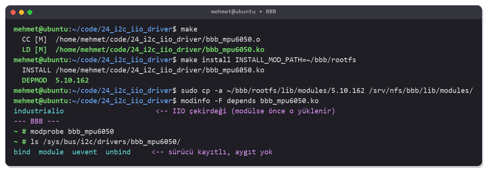
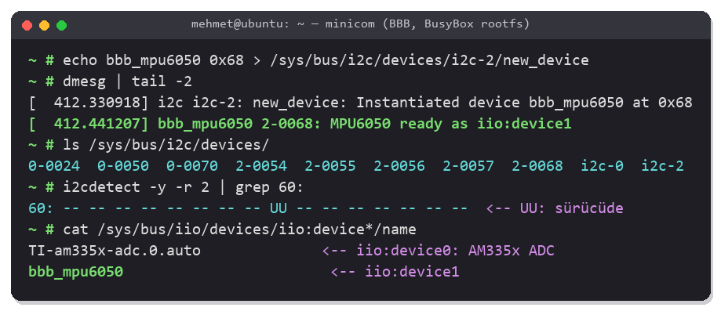
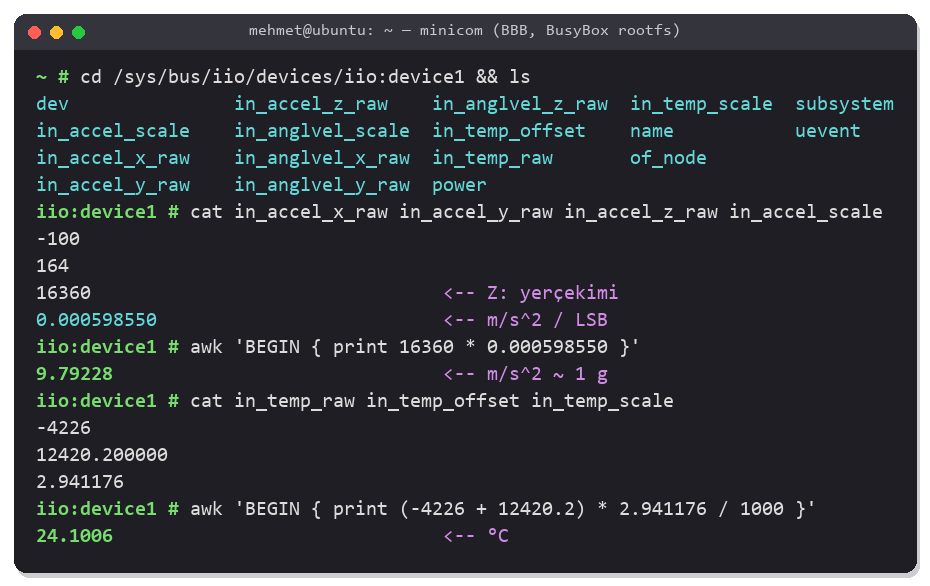
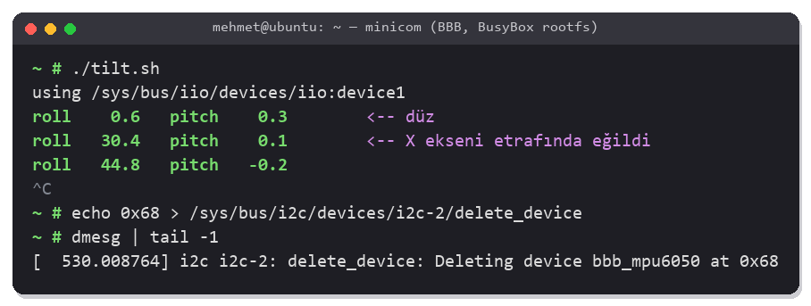
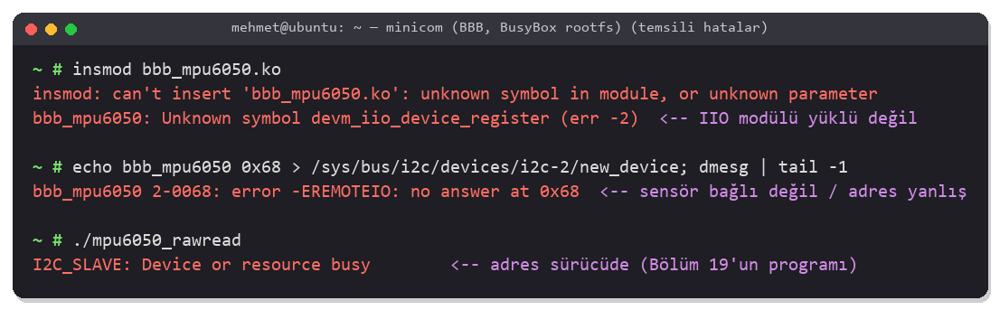

<!-- Bu dosya otomatik üretildi. Düzenlemek için chapters/ altındaki kaynağı değiştir. -->
# Bölüm 24 — MPU6050 için I2C Sürücüsü (IIO)

> <b>Bu bölümde:</b>
> - Linux'ta I2C'nin iki tarafını, <b>adaptör</b> (denetleyici) ve <b>istemci</b> (sensör) sürücülerini tanıyacaksın.
> - [Bölüm 19](19_mpu6050.md)'da kullanıcı alanından okuduğun MPU6050'yi kernel'de bir `i2c_driver` ile okuyacaksın.
> - Sürücüyü kernel'in sensör alt sistemi <b>IIO</b>'ya kaydedip değerleri standart dosyalarla (`in_accel_x_raw`, `in_accel_scale`...) açacaksın.
> - Sensörü önce `new_device` ile anında, sonra device tree ile kalıcı olarak tanıtacaksın.
> - Eğim açısını IIO dosyalarından bir kabuk betiğiyle hesaplayacaksın.
>
> <b>Ön koşul:</b> [Bölüm 19](19_mpu6050.md) — MPU6050, register'lar ve I2C, [Bölüm 21](21_kernel_module.md) — modül derleme ve `modprobe`, [Bölüm 23](23_gpio_platform_driver.md) — `probe()`, `devm_` ve device tree düğümü.

> [!NOTE]
> Bu bölüm kursta yok. Kart, [Bölüm 21](21_kernel_module.md)'deki gibi kendi kernel'in (5.10.162) ve BusyBox rootfs'inle (NFS) açılıyor; MPU6050 [19.5](19_mpu6050.md#195-devre)'teki gibi I2C2'ye (P9_19, P9_20) bağlı. Terminal görüntüleri temsilidir.

---

## 24.1 Linux'ta I2C'nin İki Tarafı

[Bölüm 19](19_mpu6050.md)'da `/dev/i2c-2`'yi açıp `ioctl(I2C_SLAVE)` ile sensörün adresini seçtik ve register'ları kullanıcı alanından okuduk. Bunun altında kernel'de iki tür sürücü vardır:

```
 Kullanıcı alanı     mpu6050_rawread (Bölüm 19)           tilt.sh (bu bölüm)
                          │ /dev/i2c-2                        │ /sys/bus/iio/devices/iio:device1/
 ─────────────────────────┼───────────────────────────────────┼───────────────────────────────────
 Kernel                   ▼                                   ▼
                     i2c-dev (genel köprü)               bbb_mpu6050  ← I2C istemci sürücüsü
                          │                                   │        (bu bölüm)
                          └──────────────┬────────────────────┘
                                         ▼
                              I2C çekirdeği (i2c-core)
                                         │
                                         ▼
                              i2c-omap  ← I2C adaptör sürücüsü (AM335x I2C2 denetleyicisi)
 ─────────────────────────────────────────┼───────────────────────────────────────────────────────
 Donanım                          SCL / SDA ── MPU6050 (0x68)
```

| Sürücü | Neyi sürer? | Örnek |
|---|---|---|
| <b>Adaptör</b> (bus/controller) sürücüsü | SoC'nin I2C denetleyicisini: START/STOP, bayt gönderme, ACK | `i2c-omap` ([10.6](10_linux_kernel.md#106-soc-sürücülerinin-düzeni-drivers)); her I2C hattı için bir `i2c-N` |
| <b>İstemci</b> (client) sürücüsü | Hattaki bir aygıtı: hangi register'ın ne anlama geldiğini bilir | EEPROM için `at24`, PMIC için `tps65217`, bu bölümdeki `bbb_mpu6050` |
| `i2c-dev` | Kullanıcı alanına genel bir kapı (`/dev/i2c-N`) | [Bölüm 19](19_mpu6050.md)'daki yol |

İstemci sürücüsü register adreslerini ve birim dönüşümünü kendisi bilir; kullanıcı programı sadece "ivme X ne?" diye sorar. Aynı sensörü kullanan her program aynı sürücüden geçer, iki program aynı anda register adresini karıştıramaz.

---

## 24.2 IIO: Sensörler için Ortak Arayüz

Kernel'de her tür aygıtın bir <b>alt sistemi</b> vardır: LED'ler için `leds` ([15.5](15_gpio_sysfs.md#155-user-ledleri-sysfs-ile-kontrol-etmek)), ağ kartları için `net`, giriş aygıtları için `input`. İvmeölçer, jiroskop, ADC, sıcaklık, basınç, ışık sensörleri için olan alt sistem <b>IIO</b>'dur (Industrial I/O).

Sürücü IIO'ya "şu kanallarım var" der; IIO her kanal için sysfs'te standart adlı dosyalar açar:

| Dosya | Anlamı |
|---|---|
| `name` | Aygıtın adı |
| `in_accel_x_raw` | İvme X ekseni, ham değer (register'daki sayı) |
| `in_accel_scale` | Ham değeri birime çeviren çarpan: `raw × scale` = <b>m/s²</b> |
| `in_anglvel_x_raw`, `in_anglvel_scale` | Açısal hız; `raw × scale` = <b>rad/s</b> |
| `in_temp_raw`, `in_temp_offset`, `in_temp_scale` | Sıcaklık; `(raw + offset) × scale` = <b>milli °C</b> |

Birimler IIO'da sabittir. Hangi üreticinin sensörünü takarsan tak, programın `in_accel_*` dosyalarını okuyup aynı formülü uygulaması yeter. AM335x'in kendi ADC'si de (`AIN0`–`AIN6`, [1.9](01_bbb_hardware.md#19-genişleme-headerları-p8-ve-p9)) bir IIO aygıtıdır; kartında genelde `iio:device0` odur.

> [!NOTE]
> Kernel'de MPU6050 için tam özellikli bir IIO sürücüsü zaten var: `inv_mpu6050` (`compatible = "invensense,mpu6050"`). Kesme, tampon (buffer) ve FIFO desteği de içerir. Bu bölümdeki `bbb_mpu6050` öğrenmek için yazılmış küçük bir sürücü; ötekiyle çakışmasın diye farklı bir ad ve `compatible` kullanıyor.

---

## 24.3 Sürücü

Bölümün kodu: [`code/24_i2c_iio_driver/bbb_mpu6050.c`](../code/24_i2c_iio_driver/bbb_mpu6050.c).

### Kanallar

```c
#define MPU6050_CHAN(_type, _axis, _reg) {				\
	.type = _type,							\
	.modified = 1,							\
	.channel2 = IIO_MOD_##_axis,					\
	.address = _reg,						\
	.info_mask_separate = BIT(IIO_CHAN_INFO_RAW),			\
	.info_mask_shared_by_type = BIT(IIO_CHAN_INFO_SCALE),		\
}

static const struct iio_chan_spec bbb_mpu_channels[] = {
	MPU6050_CHAN(IIO_ACCEL, X, MPU6050_REG_ACCEL_XOUT_H),
	MPU6050_CHAN(IIO_ACCEL, Y, MPU6050_REG_ACCEL_XOUT_H + 2),
	MPU6050_CHAN(IIO_ACCEL, Z, MPU6050_REG_ACCEL_XOUT_H + 4),
	MPU6050_CHAN(IIO_ANGL_VEL, X, MPU6050_REG_GYRO_XOUT_H),
	...
	{
		.type = IIO_TEMP,
		.address = MPU6050_REG_TEMP_OUT_H,
		.info_mask_separate = BIT(IIO_CHAN_INFO_RAW) |
				      BIT(IIO_CHAN_INFO_SCALE) |
				      BIT(IIO_CHAN_INFO_OFFSET),
	},
};
```

| Alan | Anlamı |
|---|---|
| `.type` | Ne ölçülüyor: `IIO_ACCEL`, `IIO_ANGL_VEL`, `IIO_TEMP` |
| `.modified`, `.channel2` | Eksen: dosya adına `_x`, `_y`, `_z` eklenir |
| `.address` | Sürücünün kendi kullanımı için serbest alan; burada kanalın register adresi ([19.2](19_mpu6050.md#192-mpu6050)) |
| `info_mask_separate` | Her kanalın kendi dosyası olan bilgiler: `in_accel_x_raw` |
| `info_mask_shared_by_type` | Aynı türdeki kanalların ortak dosyası: tek bir `in_accel_scale` |

### read_raw

IIO, bir dosya okunduğunda sürücünün `read_raw()` fonksiyonunu hangi kanal ve hangi bilgi istendiğiyle çağırır:

```c
static int bbb_mpu_read_raw(struct iio_dev *indio_dev,
			    struct iio_chan_spec const *chan,
			    int *val, int *val2, long mask)
{
	struct bbb_mpu *m = iio_priv(indio_dev);
	int ret;

	switch (mask) {
	case IIO_CHAN_INFO_RAW:
		mutex_lock(&m->lock);
		ret = i2c_smbus_read_word_swapped(m->client, chan->address);
		mutex_unlock(&m->lock);
		if (ret < 0)
			return ret;
		*val = (s16)ret;
		return IIO_VAL_INT;

	case IIO_CHAN_INFO_SCALE:
		switch (chan->type) {
		case IIO_ACCEL:         /* ±2 g: 9.80665 / 16384 = 0.000598550 m/s^2 */
			*val = 0;
			*val2 = 598550;
			return IIO_VAL_INT_PLUS_NANO;
		...
		}

	case IIO_CHAN_INFO_OFFSET:      /* sadece sıcaklık: 36.53 °C x 340 = 12420.2 */
		*val = 12420;
		*val2 = 200000;
		return IIO_VAL_INT_PLUS_MICRO;
	}

	return -EINVAL;
}
```

- <b>Ham değer:</b> `i2c_smbus_read_word_swapped()` register'dan 2 bayt okur. MPU6050 yüksek baytı önce gönderir; fonksiyonun adındaki "swapped" baytları buna göre çevirir. `(s16)` dönüşümü işaretli 16 bit yapar: [19.8](19_mpu6050.md#198-kursun-programı-ve-düzeltmeler)'deki `be16()`'nın işi.
- <b>Kayan nokta yok:</b> Kernel'de `float` kullanılmaz ([21.3](21_kernel_module.md#213-birinci-modül-helloc)). Ondalıklı bir çarpan iki tamsayıyla verilir: `IIO_VAL_INT_PLUS_NANO` → `val + val2 × 10⁻⁹`. IIO dosyaya `0.000598550` yazar.
- <b>Çarpanlar</b> [19.3](19_mpu6050.md#193-ölçek-aralığı-ve-birim-dönüşümü)'teki hassasiyetlerden ve IIO'nun birimlerinden gelir:

| Kanal | Hesap | Değer |
|---|---|---|
| İvme (±2 g, 16384 LSB/g) | 9.80665 m/s² / 16384 | 0.000598550 m/s² |
| Açısal hız (±250 °/s, 131 LSB/(°/s)) | (π / 180) / 131 | 0.000133231 rad/s |
| Sıcaklık: scale | 1000 / 340 | 2.941176 milli °C |
| Sıcaklık: offset | 36.53 × 340 | 12420.2 |

Sıcaklık formülü [19.3](19_mpu6050.md#193-ölçek-aralığı-ve-birim-dönüşümü)'tekinin aynısıdır: `raw / 340 + 36.53` = `(raw + 12420.2) × (1000 / 340)` milli °C.

### probe

```c
static int bbb_mpu_probe(struct i2c_client *client)
{
	...
	ret = i2c_smbus_read_byte_data(client, MPU6050_REG_WHO_AM_I);
	if (ret < 0)
		return dev_err_probe(dev, ret, "no answer at 0x%02x\n", client->addr);
	if (ret != MPU6050_WHO_AM_I_VALUE)
		return dev_err_probe(dev, -ENODEV, "WHO_AM_I = 0x%02x, not an MPU6050\n", ret);

	ret = i2c_smbus_write_byte_data(client, MPU6050_REG_PWR_MGMT_1, MPU6050_PWR_CLK_PLL_X);
	...
	indio_dev = devm_iio_device_alloc(dev, sizeof(*m));
	m = iio_priv(indio_dev);
	m->client = client;
	...
	ret = devm_add_action_or_reset(dev, bbb_mpu_sleep, m);   /* ayrılırken uyut */
	...
	indio_dev->name = "bbb_mpu6050";
	indio_dev->info = &bbb_mpu_info;
	indio_dev->channels = bbb_mpu_channels;
	indio_dev->num_channels = ARRAY_SIZE(bbb_mpu_channels);
	indio_dev->modes = INDIO_DIRECT_MODE;

	return devm_iio_device_register(dev, indio_dev);
}
```

| Adım | Karşılığı |
|---|---|
| `struct i2c_client *client` | Hattaki aygıt: adaptörü (`client->adapter`) ve adresi (`client->addr`) içerir. [Bölüm 19](19_mpu6050.md)'daki `open("/dev/i2c-2")` + `ioctl(I2C_SLAVE, 0x68)`'in kernel'deki hali. |
| `i2c_smbus_read_byte_data()` / `write_byte_data()` | Register oku/yaz. Kullanıcı alanındaki `I2C_RDWR` mesajlarını ([19.7](19_mpu6050.md#197-linuxta-i2c-devi2c-n)) bu fonksiyonlar kurar. |
| `WHO_AM_I` kontrolü | Doğru aygıta konuştuğumuzdan emin ol; değilse `probe` başarısız |
| `devm_iio_device_alloc()` | IIO aygıtı + sürücünün verisi için tek seferde bellek; veriye `iio_priv()` ile ulaşılır |
| `INDIO_DIRECT_MODE` | Değerler istendiğinde tek tek okunur (dosya okununca). Sürekli örnekleme (buffer) bu örnekte yok. |
| `devm_iio_device_register()` | sysfs dosyaları burada oluşur; sürücü ayrılırken kendiliğinden kaldırılır |

### Eşleşme tabloları

```c
static const struct i2c_device_id bbb_mpu_id[] = {
	{ "bbb_mpu6050", 0 },
	{ }
};
MODULE_DEVICE_TABLE(i2c, bbb_mpu_id);

static const struct of_device_id bbb_mpu_of_match[] = {
	{ .compatible = "bbb,mpu6050" },
	{ }
};
MODULE_DEVICE_TABLE(of, bbb_mpu_of_match);

static struct i2c_driver bbb_mpu_driver = {
	.driver = {
		.name           = "bbb_mpu6050",
		.of_match_table = bbb_mpu_of_match,
	},
#if LINUX_VERSION_CODE >= KERNEL_VERSION(6, 3, 0)
	.probe          = bbb_mpu_probe,
#else
	.probe_new      = bbb_mpu_probe,
#endif
	.id_table       = bbb_mpu_id,
};
module_i2c_driver(bbb_mpu_driver);
```

İki tablo, aygıtın iki tanıtılma yolu içindir: `id_table` adla ([24.4](#244-aygıtı-tanıtmak)'teki `new_device`), `of_match_table` device tree ile. Kernel 6.3'te `probe`'un imzası değişti (`id` argümanı kalktı); 5.10'da tek argümanlı hali `probe_new` adıyla verilir. `#if` ikisini de karşılar.

---

## 24.4 Aygıtı Tanıtmak

I2C aygıtları kendini tanıtmaz; kernel `0x68`'de ne olduğunu bilemez. Birinin söylemesi gerekir.

### Derle, kur, yükle



Host'ta:

```bash
cd ~/code/24_i2c_iio_driver
make
make install INSTALL_MOD_PATH=~/bbb/rootfs
sudo cp -a ~/bbb/rootfs/lib/modules/5.10.162 /srv/nfs/bbb/lib/modules/
sudo cp tilt.sh /srv/nfs/bbb/root/
```

Kartta:

```text
~ # modprobe bbb_mpu6050
~ # ls /sys/bus/i2c/drivers/bbb_mpu6050/
```

Sürücü IIO'nun çekirdek fonksiyonlarını kullanır (`modinfo -F depends` → `industrialio`). IIO kernel'de modül olarak derlendiyse `insmod` `Unknown symbol` verir; `modprobe` bağımlılığı önce yükler ([21.7](21_kernel_module.md#217-modüller-arası-sembol-paylaşımı-ve-modprobe)). Bu yüzden modül `make install` ile kurulup `modprobe` ile yükleniyor.

Sürücü kayıtlı ama henüz sürdüğü bir aygıt yok.

### Hızlı yol: new_device

Her I2C hattının sysfs klasöründe `new_device` dosyası vardır. "Bu hatta, bu adreste, bu adla bir aygıt var" demek, aygıtı DTB'yi değiştirmeden anında oluşturur:



```text
~ # echo bbb_mpu6050 0x68 > /sys/bus/i2c/devices/i2c-2/new_device
~ # dmesg | tail -2
~ # ls /sys/bus/i2c/devices/
~ # i2cdetect -y -r 2 | grep 60:
~ # cat /sys/bus/iio/devices/iio:device*/name
```

Kernel `2-0068` adında bir I2C aygıtı oluşturdu (hat 2, adres `0x68`), `id_table`'daki adla sürücüyü buldu ve `probe`'u çağırdı. `i2cdetect` artık `0x68`'de `UU` gösteriyor: adres bir kernel sürücüsünde ([19.6](19_mpu6050.md#196-komut-satırından-i2c-tools)).

Aygıtı silmek: `echo 0x68 > /sys/bus/i2c/devices/i2c-2/delete_device`. `new_device` kalıcı değildir; kart yeniden açılınca tekrar yazmak gerekir.

### Kalıcı yol: device tree

[Bölüm 23](23_gpio_platform_driver.md#233-device-treeye-düğüm-eklemek)'teki gibi bir kart DTS'i: [`am335x-boneblack-mpu6050.dts`](../code/24_i2c_iio_driver/am335x-boneblack-mpu6050.dts). Bu kez düğüm kökün değil, <b>I2C2 hattının</b> altında; çünkü aygıt o hatta bağlı ([11.5](11_device_tree.md#115-bir-device-treenin-genel-yapısı)'teki EEPROM örneği gibi):

```dts
#include "am335x-boneblack.dts"

&i2c2 {
	imu@68 {
		compatible = "bbb,mpu6050";
		reg = <0x68>;           /* I2C adresi (AD0 = 0) */
	};
};
```

I2C2 BBB'nin DTS'inde zaten açık ve pinmux'u ayarlı ([19.4](19_mpu6050.md#194-i2cye-kısa-bakış)); `pinctrl` ya da `status` yazmaya gerek yok. `reg`, I2C düğümlerinde aygıtın adresidir ([11.6](11_device_tree.md#116-önemli-propertyler)).

```bash
cd ~/bbb/linux
cp ~/code/24_i2c_iio_driver/am335x-boneblack-mpu6050.dts arch/arm/boot/dts/
echo 'dtb-$(CONFIG_SOC_AM33XX) += am335x-boneblack-mpu6050.dtb' >> arch/arm/boot/dts/Makefile
make ARCH=arm CROSS_COMPILE=arm-linux-gnueabihf- am335x-boneblack-mpu6050.dtb
sudo cp arch/arm/boot/dts/am335x-boneblack-mpu6050.dtb /var/lib/tftpboot/am335x-boneblack.dtb
```

Kart bu DTB ile açılınca kernel açılışta `2-0068` aygıtını kendisi oluşturur; `modprobe bbb_mpu6050` (ya da sürücüyü açılışta yükleyen [12.7](12_busybox_rootfs.md#127-usb-üzerinden-ethernet-ve-sürücüleri-açılışta-yüklemek)'deki betik) yeterli olur.

> [!TIP]
> [Bölüm 23](23_gpio_platform_driver.md)'teki LED/buton düğümünü de kullanmak istiyorsan iki düğümü tek bir DTS'te birleştir: `am335x-boneblack-gpiodemo.dts`'in sonuna buradaki `&i2c2 { ... };` bloğunu ekle.

---

## 24.5 Değerleri Okumak



```text
~ # cd /sys/bus/iio/devices/iio:device1
iio:device1 # ls
iio:device1 # cat in_accel_x_raw in_accel_y_raw in_accel_z_raw in_accel_scale
iio:device1 # awk 'BEGIN { print 16360 * 0.000598550 }'
iio:device1 # cat in_temp_raw in_temp_offset in_temp_scale
iio:device1 # awk 'BEGIN { print (-4226 + 12420.2) * 2.941176 / 1000 }'
```

Düz dururken Z ekseni ≈ 9.8 m/s² (1 g) okur; sıcaklık [19.9](19_mpu6050.md#199-ham-okuma-programı)'daki 24.1 °C ile aynı. Aygıt numarası (`iio:device1`) sistemden sisteme değişebilir; doğru klasörü `name` dosyasından bul.

### Eğim betiği

[`tilt.sh`](../code/24_i2c_iio_driver/tilt.sh), [19.10](19_mpu6050.md#1910-eğim-açısı)'daki roll/pitch formülünü IIO dosyalarıyla hesaplar. C programına, `/dev/i2c-2`'ye ya da register adreslerine gerek kalmadı; sürücü hepsini üstlendi:

```sh
DEV=
for d in /sys/bus/iio/devices/iio:device*; do
	[ "$(cat "$d/name" 2>/dev/null)" = "bbb_mpu6050" ] && DEV=$d && break
done
...
while true; do
	x=$(cat "$DEV/in_accel_x_raw")
	y=$(cat "$DEV/in_accel_y_raw")
	z=$(cat "$DEV/in_accel_z_raw")
	awk -v x="$x" -v y="$y" -v z="$z" 'BEGIN {
		r2d = 180 / 3.14159265
		printf "roll %6.1f   pitch %6.1f\n", atan2(y, z) * r2d, atan2(-x, sqrt(y*y + z*z)) * r2d
	}'
	sleep 1
done
```

Açı hesaplanırken `scale` ile çarpmaya gerek yok: üç eksen aynı çarpanla çarpılacağı için oranları, yani açı değişmez.



```text
~ # chmod +x tilt.sh
~ # ./tilt.sh
~ # echo 0x68 > /sys/bus/i2c/devices/i2c-2/delete_device
```

> [!NOTE]
> IIO'nun komut satırı araçları da var: kernel kaynağında `tools/iio/` altında `iio_info`, `lsiio`, `iio_generic_buffer`. Ayrıca `libiio` kütüphanesi IIO aygıtlarına C, Python ve ağ üzerinden erişim sağlar.

---

## 24.6 Özet

- Linux'ta I2C'nin iki tarafı var: <b>adaptör</b> sürücüsü denetleyiciyi (`i2c-omap`), <b>istemci</b> sürücüsü hattaki aygıtı sürer. `/dev/i2c-N` (`i2c-dev`) kullanıcı alanına açılan genel kapıdır.
- İstemci sürücüsü: `struct i2c_driver` + `module_i2c_driver()`; `probe(struct i2c_client *)` içinde `i2c_smbus_read_byte_data()`, `i2c_smbus_read_word_swapped()`, `i2c_smbus_write_byte_data()`.
- Sensörler <b>IIO</b>'ya kaydolur: `iio_chan_spec` kanalları, `read_raw()` ve `devm_iio_device_register()`. Değerler `in_<tür>_<eksen>_raw`, birim çarpanı `in_<tür>_scale` (ivme m/s², açısal hız rad/s, sıcaklık milli °C).
- Kernel'de kayan nokta yok: çarpanlar `IIO_VAL_INT_PLUS_MICRO/NANO` ile iki tamsayı olarak verilir.
- Aygıtı tanıtmak: anında `echo <ad> <adres> > /sys/bus/i2c/devices/i2c-N/new_device` (`id_table`), kalıcı olarak DT'de I2C hattının altına `reg = <adres>` ile düğüm (`of_match_table`).
- Adresi bir kernel sürücüsü aldığında `i2cdetect` `UU` gösterir ve kullanıcı alanından `I2C_SLAVE` `EBUSY` döner.

## 24.7 Karşılaşılabilecek Problemler



| Belirti | Sebep | Çözüm |
|---|---|---|
| `insmod: ... unknown symbol`, `dmesg`'te `Unknown symbol devm_iio_device_register` | IIO çekirdeği (`industrialio`) modül ve yüklü değil | `make install` + `modprobe bbb_mpu6050` ([24.4](#244-aygıtı-tanıtmak)) |
| `error -EREMOTEIO: no answer at 0x68` | Sensör cevap vermiyor: bağlantı, besleme ya da adres | [19.12](19_mpu6050.md#1912-karşılaşılabilecek-problemler)'deki kontroller; `i2cdetect -y -r 2` |
| `WHO_AM_I = 0x.., not an MPU6050` | Bu adreste başka bir aygıt var (ya da MPU6050 klonu farklı bir değer dönüyor) | Datasheet'e bak; klonsa `MPU6050_WHO_AM_I_VALUE`'yu değiştir |
| `new_device` yazıldı ama `probe` çağrılmadı | Sürücü yüklü değil ya da addaki yazım `id_table`'dan farklı | `ls /sys/bus/i2c/drivers/`; ad `bbb_mpu6050` olmalı |
| `new_device`: `Device or resource busy` / `already in use` | O adreste zaten bir aygıt tanımlı (DT'den ya da önceki `new_device`) | `ls /sys/bus/i2c/devices/`; önce `delete_device` |
| [Bölüm 19](19_mpu6050.md)'un programı `I2C_SLAVE: Device or resource busy` | Adres artık `bbb_mpu6050` sürücüsünde | Sürücüyü ayır (`delete_device` ya da `rmmod`) ya da IIO dosyalarını kullan |
| DT'li açılışta `inv-mpu6050` sürücüsü bağlandı | `compatible`'ı `invensense,mpu6050` yazdın | Bu sürücü için `bbb,mpu6050`; ikisi aynı aygıtı alamaz |
| Değerler hep `0` | Sensör uykuda: `probe`'daki `PWR_MGMT_1` yazılmadı ya da başka bir program sensörü uyuttu | `dmesg`'te `MPU6050 ready` satırına bak; aygıtı silip yeniden tanıt |
| `tilt.sh: bbb_mpu6050 IIO device not found` | Aygıt tanıtılmamış | [24.4](#244-aygıtı-tanıtmak) |

---

[← Bölüm 23: Device Tree ile GPIO Platform Sürücüsü](23_gpio_platform_driver.md) · [İçindekiler](README.md)
