# Embedded Linux

**BeagleBone Black ile Adım Adım**

## <a name="icindekiler"></a>İçindekiler

- [Önsöz](#c0-önsöz)

**Kısım I — Başlarken**

- [Bölüm 1 — BeagleBone Black Donanımı](#c1-bölüm-1--beaglebone-black-donanımı)
- [Bölüm 2 — Seri Konsol ve Minicom](#c2-bölüm-2--seri-konsol-ve-minicom)

**Kısım II — Boot Süreci**

- [Bölüm 3 — Linux Boot Süreci: RBL → SPL → U-Boot](#c3-bölüm-3--linux-boot-süreci-rbl--spl--u-boot)
- [Bölüm 4 — SD Karttan Boot](#c4-bölüm-4--sd-karttan-boot)
- [Bölüm 5 — eMMC'den Boot](#c5-bölüm-5--emmcden-boot)

**Kısım III — U-Boot ile Çalışmak**

- [Bölüm 6 — U-Boot Komut Satırı ve uEnv.txt](#c6-bölüm-6--u-boot-komut-satırı-ve-uenvtxt)
- [Bölüm 7 — Seri Porttan (UART) Boot](#c7-bölüm-7--seri-porttan-uart-boot)
- [Bölüm 8 — TFTP ile Ağdan Boot](#c8-bölüm-8--tftp-ile-ağdan-boot)
- [Bölüm 9 — Cross Toolchain, SPL ve U-Boot Derleme](#c9-bölüm-9--cross-toolchain-spl-ve-u-boot-derleme)

**Kısım IV — Linux Kernel**

- [Bölüm 10 — Linux Kernel: Kaynak Ağacı ve Derleme](#c10-bölüm-10--linux-kernel-kaynak-ağacı-ve-derleme)
- [Bölüm 11 — Linux Device Tree](#c11-bölüm-11--linux-device-tree)

**Kısım V — Root Filesystem**

- [Bölüm 12 — BusyBox ile Minimal Root Filesystem](#c12-bölüm-12--busybox-ile-minimal-root-filesystem)
- [Bölüm 13 — Buildroot](#c13-bölüm-13--buildroot)

**Kısım VI — Uygulama Geliştirme ve Donanım**

- [Bölüm 14 — Eclipse ile Uygulama Geliştirme](#c14-bölüm-14--eclipse-ile-uygulama-geliştirme)
- [Bölüm 15 — AM335x GPIO'ları, Pin Ayarları ve sysfs](#c15-bölüm-15--am335x-gpioları-pin-ayarları-ve-sysfs)
- [Bölüm 16 — Harici LED Bağlamak](#c16-bölüm-16--harici-led-bağlamak)
- [Bölüm 17 — 7-Segment Gösterge](#c17-bölüm-17--7-segment-gösterge)
- [Bölüm 18 — 4 Haneli 7-Segment Gösterge](#c18-bölüm-18--4-haneli-7-segment-gösterge)
- [Bölüm 19 — MPU6050 ile Eğim Ölçmek (I2C)](#c19-bölüm-19--mpu6050-ile-eğim-ölçmek-i2c)
- [Bölüm 20 — 16x2 Karakter LCD (HD44780)](#c20-bölüm-20--16x2-karakter-lcd-hd44780)

**Kısım VII — Kernel Sürücüleri**

- [Bölüm 21 — Kernel Modülü Yazmak](#c21-bölüm-21--kernel-modülü-yazmak)
- [Bölüm 22 — Karakter Aygıt Sürücüsü](#c22-bölüm-22--karakter-aygıt-sürücüsü)

<div class="page-break"></div>

# <a name="c0-önsöz"></a>Önsöz

Bu kitap, gömülü Linux'a (Embedded Linux) yeni başlayan biri için yazıldı. Bir <b>BeagleBone Black</b> kartını sıfırdan alıp önce hazır dosyalarla, sonra kendi derlediğin bootloader ile açacaksın. Her adımda <b>neyi neden yaptığını</b> görmen hedefleniyor.

Kitap, bir Embedded Linux kursunu ([https://github.com/niekiran/EmbeddedLinuxBBB](https://github.com/niekiran/EmbeddedLinuxBBB)) takip ederken alınan notlardan oluştu. Kursla birlikte de tek başına da okunabilir.

---

## <a name="c0-bir-embedded-linux-sistemi-nelerden-oluşur"></a>Bir Embedded Linux Sistemi Nelerden Oluşur?

Masaüstü bilgisayarda bu parçaları hiç görmeyiz; hepsi hazır gelir. Gömülü sistemde ise her birini tek tek hazırlamak, karta koymak ve birbirine bağlamak bizim işimizdir:

```
           ┌──────────────────────────────────────────────────┐
  KART     │ 4. Root filesystem  /bin /etc /lib ... programlar │  Bölüm 6, 12, 13
           │ 3. Linux kernel  +  Device Tree (.dtb)            │  Bölüm 10, 11
           │ 2. Bootloader: ROM Code → SPL (MLO) → U-Boot      │  Bölüm 3 – 9
           └──────────────────────────────────────────────────┘
                            ▲ derlenir
           ┌──────────────────────────────────────────────────┐
  PC       │ 1. Cross toolchain: PC'de çalışıp ARM kodu üretir │  Bölüm 9
           └──────────────────────────────────────────────────┘
```

| Parça | Görevi | Kitaptaki yeri |
|---|---|---|
| <b>Cross toolchain</b> | PC'de (x86) çalışıp karta (ARM) uygun program üreten derleyici ve araçlar | [Bölüm 9](#c9-bölüm-9--cross-toolchain-spl-ve-u-boot-derleme) |
| <b>Bootloader</b> | Kart açılınca belleği hazırlar, kernel'i ve device tree'yi RAM'e yükleyip başlatır | [Bölüm 3](#c3-bölüm-3--linux-boot-süreci-rbl--spl--u-boot) – [Bölüm 9](#c9-bölüm-9--cross-toolchain-spl-ve-u-boot-derleme) |
| <b>Linux kernel + Device Tree</b> | İşletim sisteminin çekirdeği ve kartın donanımını kernel'e tarif eden dosya | [Bölüm 10](#c10-bölüm-10--linux-kernel-kaynak-ağacı-ve-derleme), [Bölüm 11](#c11-bölüm-11--linux-device-tree) |
| <b>Root filesystem</b> | Kernel açıldıktan sonra çalışan her şey: kabuk, komutlar, ayar dosyaları | [Bölüm 6](#c6-bölüm-6--u-boot-komut-satırı-ve-uenvtxt), [Bölüm 12](#c12-bölüm-12--busybox-ile-minimal-root-filesystem), [Bölüm 13](#c13-bölüm-13--buildroot) |

---

## <a name="c0-kitabın-haritası"></a>Kitabın Haritası

| Kısım | Bölüm | Ne yapacaksın? |
|---|---|---|
| <b>I — Başlarken</b> | [1. BeagleBone Black Donanımı](#c1-bölüm-1--beaglebone-black-donanımı) | Kartı, butonları, LED'leri ve debug header'ını tanı |
| | [2. Seri Konsol ve Minicom](#c2-bölüm-2--seri-konsol-ve-minicom) | Kartın konsolunu bilgisayarda gör |
| <b>II — Boot Süreci</b> | [3. Linux Boot Süreci](#c3-bölüm-3--linux-boot-süreci-rbl--spl--u-boot) | Kart açılırken hangi programın hangi sırayla çalıştığını öğren |
| | [4. SD Karttan Boot](#c4-bölüm-4--sd-karttan-boot) | SD kartı hazırla, kartı adım adım SD karttan aç |
| | [5. eMMC'den Boot](#c5-bölüm-5--emmcden-boot) | Kartın dahili belleğine güncel Debian yükle |
| <b>III — U-Boot ile Çalışmak</b> | [6. U-Boot Komut Satırı ve uEnv.txt](#c6-bölüm-6--u-boot-komut-satırı-ve-uenvtxt) | U-Boot'u durdur, ayarlarını değiştir, rootfs'i tanı |
| | [7. Seri Porttan (UART) Boot](#c7-bölüm-7--seri-porttan-uart-boot) | Kartı SD kart ve eMMC olmadan, sadece seri kabloyla aç |
| | [8. TFTP ile Ağdan Boot](#c8-bölüm-8--tftp-ile-ağdan-boot) | Kernel'i her seferinde ağdan çekerek geliştirmeyi hızlandır |
| | [9. Cross Toolchain, SPL ve U-Boot Derleme](#c9-bölüm-9--cross-toolchain-spl-ve-u-boot-derleme) | Bootloader'ı kaynak koddan kendin derle |
| <b>IV — Linux Kernel</b> | [10. Linux Kernel: Kaynak Ağacı ve Derleme](#c10-bölüm-10--linux-kernel-kaynak-ağacı-ve-derleme) | Kernel kaynağında gezin, kernel'i ve modülleri derle |
| | [11. Linux Device Tree](#c11-bölüm-11--linux-device-tree) | Kernel'in donanımı nasıl tanıdığını öğren |
| <b>V — Root Filesystem</b> | [12. BusyBox ile Minimal Root Filesystem](#c12-bölüm-12--busybox-ile-minimal-root-filesystem) | Kendi rootfs'ini sıfırdan kur, NFS ile bilgisayardan aç |
| | [13. Buildroot](#c13-bölüm-13--buildroot) | Bütün sistemi tek komutla derle, hazır SD kart imajı üret |
| <b>VI — Uygulama Geliştirme ve Donanım</b> | [14. Eclipse ile Uygulama Geliştirme](#c14-bölüm-14--eclipse-ile-uygulama-geliştirme) | Eclipse'te ARM için program yaz, tek tıkla kartta çalıştır |
| | [15. AM335x GPIO'ları, Pin Ayarları ve sysfs](#c15-bölüm-15--am335x-gpioları-pin-ayarları-ve-sysfs) | Pinmux'u çöz, LED'leri ve GPIO'ları komut satırından ve C'den kontrol et |
| | [16. Harici LED Bağlamak](#c16-bölüm-16--harici-led-bağlamak) | LED'i dirençle bir GPIO'ya bağla, C ile ve device tree ile sür |
| | [17. 7-Segment Gösterge](#c17-bölüm-17--7-segment-gösterge) | Tek haneli göstergeyi sür, sayaç ve butonla sayma programı yaz |
| | [18. 4 Haneli 7-Segment Gösterge](#c18-bölüm-18--4-haneli-7-segment-gösterge) | Çoğullama ile dört haneyi sür, sayaç ve dijital saat yaz |
| | [19. MPU6050 ile Eğim Ölçmek (I2C)](#c19-bölüm-19--mpu6050-ile-eğim-ölçmek-i2c) | I2C ile ivmeölçer/jiroskop oku, eğim açısını hesapla |
| | [20. 16x2 Karakter LCD (HD44780)](#c20-bölüm-20--16x2-karakter-lcd-hd44780) | LCD'yi 4 bit modunda sür, kayan yazı ve Türkçe karakter göster |
| <b>VII — Kernel Sürücüleri</b> | [21. Kernel Modülü Yazmak](#c21-bölüm-21--kernel-modülü-yazmak) | İlk modülünü yaz, kartta yükle, parametre ve sembol paylaşımını dene |
| | [22. Karakter Aygıt Sürücüsü](#c22-bölüm-22--karakter-aygıt-sürücüsü) | `/dev` altında kendi aygıtını aç; read, write, ioctl'ü yaz |

<b>Okuma sırası:</b> Bölümler birbirinin üzerine kurulu. İlk kez okuyorsan sırayla git. Her bölümün başındaki <b>"Ön koşul"</b> satırı, o bölümden önce hangilerini bilmen gerektiğini söyler.

Her bölüm aynı düzende yazıldı:

1. <b>Bu bölümde:</b> Bölümün sonunda neleri yapabileceğin.
2. <b>Konu anlatımı ve adım adım uygulama:</b> Komutlar hem terminal görüntüsü olarak hem de kopyalanabilir kod bloğu olarak verilir.
3. <b>Özet:</b> Bölümün tek bakışta tekrarı.
4. <b>Karşılaşılabilecek problemler:</b> Sık görülen hatalar, sebepleri ve çözümleri.

---

## <a name="c0-gerekenler"></a>Gerekenler

| Donanım | Neden? |
|---|---|
| BeagleBone Black (Rev C) | Kitabın kartı |
| microSD kart (en az 4 GB) + kart okuyucu | SD karttan boot için |
| USB-TTL seri dönüştürücü (<b>3.3V</b>) | Kartın konsolunu görmek için. En önemli debug aracın. |
| 5V / 2A adaptör (barrel jack) | Seri boot ve TFTP bölümlerinde karta güvenilir güç için |
| Ethernet kablosu | TFTP ile ağdan boot için |
| Mini USB kablo | Karta güç vermek ve USB üzerinden SSH için |
| Breadboard, erkek-erkek / erkek-dişi kablolar | Donanım bölümlerindeki devreler ([Bölüm 16](#c16-bölüm-16--harici-led-bağlamak) – [Bölüm 20](#c20-bölüm-20--16x2-karakter-lcd-hd44780)) |
| LED, dirençler (470 Ω, 1 kΩ, 10 kΩ), buton | Harici LED ve butonla sayma ([Bölüm 16](#c16-bölüm-16--harici-led-bağlamak), [Bölüm 17](#c17-bölüm-17--7-segment-gösterge)) |
| Tek haneli ve 4 haneli 7-segment gösterge (5161, 5641 tipi), 4 adet PNP transistör (BC557) | [Bölüm 17](#c17-bölüm-17--7-segment-gösterge), [Bölüm 18](#c18-bölüm-18--4-haneli-7-segment-gösterge) |
| MPU6050 modülü (GY-521) | I2C ile eğim ölçme ([Bölüm 19](#c19-bölüm-19--mpu6050-ile-eğim-ölçmek-i2c)) |
| 16x2 karakter LCD (HD44780) + 10 kΩ potansiyometre | [Bölüm 20](#c20-bölüm-20--16x2-karakter-lcd-hd44780) |

| Yazılım | Not |
|---|---|
| <b>Ubuntu</b> (host PC) | Gerçek kurulum ya da sanal makine. Sanal makinede ağ ayarı <b>Bridged</b> olmalı ([Bölüm 8](#c8-bölüm-8--tftp-ile-ağdan-boot)). |
| `minicom`, `lrzsz` | Seri konsol ve Xmodem/Ymodem ile dosya gönderme ([Bölüm 2](#c2-bölüm-2--seri-konsol-ve-minicom)) |
| `gparted` | SD kartı bölümlemek için ([Bölüm 4](#c4-bölüm-4--sd-karttan-boot)) |
| `tftpd-hpa` | TFTP sunucusu ([Bölüm 8](#c8-bölüm-8--tftp-ile-ağdan-boot)) |
| `nfs-kernel-server` | Rootfs'i ağdan bağlamak için NFS sunucusu ([Bölüm 12](#c12-bölüm-12--busybox-ile-minimal-root-filesystem)) |
| Eclipse (Eclipse IDE for C/C++ Developers) | Uygulama geliştirme ([Bölüm 14](#c14-bölüm-14--eclipse-ile-uygulama-geliştirme)) |
| `i2c-tools` (kartta) | I2C aygıtlarını komut satırından denemek ([Bölüm 19](#c19-bölüm-19--mpu6050-ile-eğim-ölçmek-i2c)) |
| Cross toolchain, U-Boot, kernel, BusyBox kaynakları | Derleme bölümlerinde kurulur ([Bölüm 9](#c9-bölüm-9--cross-toolchain-spl-ve-u-boot-derleme), [Bölüm 10](#c10-bölüm-10--linux-kernel-kaynak-ağacı-ve-derleme), [Bölüm 12](#c12-bölüm-12--busybox-ile-minimal-root-filesystem)) |

---

## <a name="c0-bu-kitaptaki-sürümler"></a>Bu Kitaptaki Sürümler

Komutlarda ve ekran görüntülerinde geçen sürümler şunlardır. Kendi kurulumunda farklı bir sürüm kullanıyorsan komutlardaki sürüm numaralarını ona göre değiştir.

| Ne? | Değer | Bölüm |
|---|---|---|
| Kursun ilk hazır imajları (Ångström): U-Boot / kernel | 2013.04 / 3.8.13 | 4, 6, 7, 8 |
| Kursun seri boot imajları: SPL / U-Boot | 2017.03 / 2016.11-rc1 | 7 |
| Kursun güncel SD kart imajları: U-Boot / kernel | 2022.04 / 5.10.168 | 4, 8 |
| eMMC'ye yüklenen Debian imajı (kursta: `bone-debian-10.3-iot-armhf-2020-04-06-4gb.img.xz`) | Debian 13.7 IoT, v5.10-ti: `am335x-debian-13.7-base-v5.10-ti-armhf-2026-10-09-4gb.img.xz` | 5, 14–20 |
| Kendi derlediğimiz U-Boot | 2022.04 (`am335x_evm_defconfig`) | 9 |
| Cross toolchain | Linaro GCC 7.5.0 (7.5-2019.12) | 9, 10, 12 |
| Kendi derlediğimiz kernel | 5.10.162 (BeagleBoard, dal `5.10`, `bb.org_defconfig`) | 10 |
| BusyBox / Dropbear | 1.36.1 / 2022.83 | 12 |
| Buildroot (LTS) | 2026.02.3 (kernel 6.18.1, U-Boot 2026.01) | 13 |
| Eclipse | 2026-09 (Eclipse IDE for C/C++ Developers) | 14 |
| Host PC IP / kart IP | 192.168.27.1 / 192.168.27.2 | 8 |

---

## <a name="c0-yazım-kuralları"></a>Yazım Kuralları

<b>Komut satırları:</b> Bir komutun nerede çalıştırılacağını başındaki işaretten anlarsın.

| Görünüm | Nerede? |
|---|---|
| `mehmet@ubuntu:~$ komut` veya kod bloğunda `bash` | Host PC'deki Ubuntu terminali |
| `U-Boot# komut` veya `=> komut` | Kartın U-Boot komut satırı (seri konsolda). Eski U-Boot `U-Boot#`, yenisi `=>` gösterir. |
| `root@beaglebone:~# komut` veya `/ # komut` | Kartta açılmış Linux (seri konsol veya SSH) |

<b>Ekran görüntüleri:</b> Koyu renkli terminal görüntüleri adımları göstermek için hazırlanmış <b>temsili</b> çıktılardır. Sürüm, tarih, boyut ve hız değerleri senin kartında farklı görünebilir. Kursun slaytlarından, videolarından ve başka kaynaklardan (AM335x TRM, beagleboard.org, Bootlin) alınan görseller olduğu gibi kullanıldı; her birinin altında kaynağı yazılıdır.

<b>Kutular:</b>

> [!NOTE]
> Ek bilgi, arka plan.

> [!TIP]
> İşini kolaylaştıracak bir yol.

> [!IMPORTANT]
> Atlarsan adımın çalışmayacağı bilgi.

> [!WARNING]
> Dikkat etmezsen zaman kaybettirecek veya bir şeyi bozacak durum.

> [!CAUTION]
> Veri kaybına veya donanım hasarına yol açabilecek durum.

---

## <a name="c0-kaynaklar"></a>Kaynaklar

- Kursun deposu: [https://github.com/niekiran/EmbeddedLinuxBBB](https://github.com/niekiran/EmbeddedLinuxBBB)
- [BeagleBone Black resmi dokümanı](https://docs.beagleboard.org/boards/beaglebone/black/index.html)
- AM335x Technical Reference Manual (TRM): repodaki `am335x_referance_manuel.pdf`
- [U-Boot dokümantasyonu](https://docs.u-boot.org/)
- [Bootlin eğitim materyalleri](https://bootlin.com/training/) (CC BY-SA 3.0)


<div class="page-break"></div>

<div class="part-title">Kısım I<br>Başlarken</div>

<div class="page-break"></div>

# <a name="c1-bölüm-1--beaglebone-black-donanımı"></a>Bölüm 1 — BeagleBone Black Donanımı

> <b>Bu bölümde:</b>
> - BeagleBone Black'in işlemcisini, belleklerini ve bağlantı noktalarını tanıyacaksın.
> - Kartın üç butonunun (Power, Reset, Boot) ne işe yaradığını öğreneceksin.
> - Seri konsol için kullanacağın J1 debug header'ının pinlerini göreceksin.
>
> <b>Ön koşul:</b> Yok. Kitabın ilk bölümü.

> Kaynak: [BeagleBone Black resmi dokümanı (docs.beagleboard.org)](https://docs.beagleboard.org/boards/beaglebone/black/index.html). Bu bölümdeki kart görselleri bu dokümandan alınmıştır (CC BY-SA).

---

## <a name="c1-11-genel-özellikler"></a>1.1 Genel Özellikler

| Özellik | Değer |
|---|---|
| <b>İşlemci (SoC)</b> | TI Sitara <b>AM3358BZCZ100</b>, ARM <b>Cortex-A8</b>, <b>1 GHz</b>'e kadar |
| <b>Cache</b> | 64 KB L1, 256 KB L2 |
| <b>RAM</b> | <b>512 MB DDR3L</b> (400 MHz clock, 800 MHz efektif) |
| <b>Dahili depolama</b> | <b>4 GB eMMC</b> (Rev C, eski revizyonlarda 2 GB), MMC1 üzerinden 8-bit |
| <b>Harici depolama</b> | <b>microSD</b> yuvası (MMC0) |
| <b>EEPROM</b> | 4 KB, I2C0 üzerinde. Kart adı, seri numarası ve revizyon bilgisini tutar. |
| <b>PMIC</b> | <b>TPS65217C</b> (güç yönetimi) + 3.3V için harici LDO (TLV70233) |
| <b>Ethernet</b> | 10/100 Mbit (RJ45) |
| <b>USB</b> | USB0: mini-USB <b>client</b> (PC bağlantısı), USB1: Type-A <b>host</b> (500 mA) |
| <b>Görüntü</b> | micro-HDMI (NXP TDA19988 HDMI framer) |
| <b>Genişleme</b> | <b>P8</b> ve <b>P9</b> (2 x 46 pin) header'ları, en fazla 4 cape takılabilir |
| <b>PRU-ICSS</b> | 2 adet 200 MHz gerçek zamanlı yardımcı çekirdek (PRU) |
| <b>Debug</b> | <b>J1</b>: 6 pinli seri debug header (UART0), opsiyonel 20 pinli JTAG (lehimli gelmez) |

## <a name="c1-12-kart-üzerindeki-bileşenler"></a>1.2 Kart Üzerindeki Bileşenler

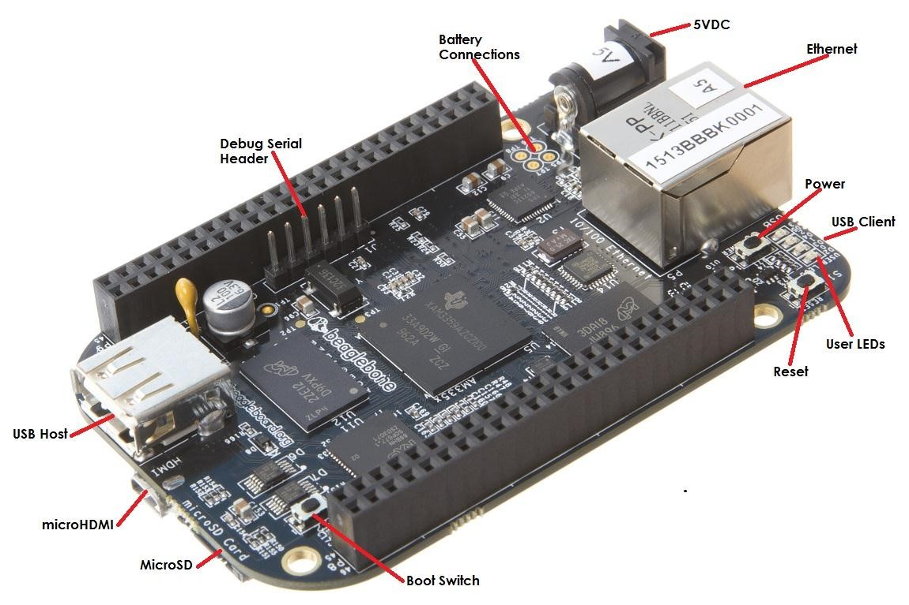

- <b>5VDC</b>: Barrel jack güç girişi (5V, en az 1A).
- <b>USB Client (mini-USB)</b>: Kartı bilgisayara bağlarsın. Hem güç verir hem de USB üzerinden ağ ve depolama sağlar. Kartın USB ağ adresi Windows'ta `192.168.7.2`, Linux ve macOS'ta `192.168.6.2`'dir ([5.4](#c5-54-uygulama-emmcyi-güncelleme)).
- <b>Debug Serial Header (J1)</b>: Seri konsol bağlantısı. Kitap boyunca en çok kullanacağın yer burası.
- <b>Power / Reset / Boot Switch</b>: Kartın üç butonu ([1.5](#c1-15-butonlar)).
- <b>User LEDs</b>: 4 adet mavi LED (USR0-USR3).

### <a name="c1-kart-üzerindeki-çipler"></a>Kart üzerindeki çipler

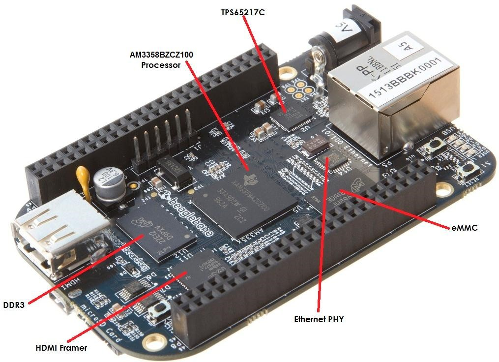

| Çip | Görevi |
|---|---|
| <b>AM3358BZCZ100</b> | Ana işlemci (SoC) |
| <b>DDR3</b> | 512 MB RAM |
| <b>eMMC</b> | Kart üstündeki flash bellek, varsayılan boot kaynağı |
| <b>TPS65217C</b> | PMIC. Tüm voltaj raylarını üretir ve power butonunu yönetir. |
| <b>Ethernet PHY</b> | Ethernet fiziksel katman çipi |
| <b>HDMI Framer</b> | LCD sinyallerini HDMI'a çevirir |

## <a name="c1-13-blok-diyagram"></a>1.3 Blok Diyagram

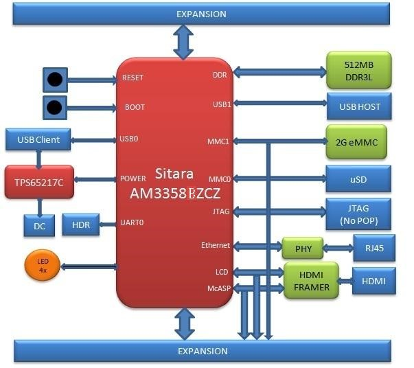

> [!NOTE]
> Diyagramda <b>2G eMMC</b> yazıyor çünkü eski revizyona ait. Rev C kartlarda eMMC <b>4 GB</b>'dır.

Diyagramdan çıkan önemli noktalar:
- <b>MMC1</b> → eMMC, <b>MMC0</b> → microSD. Kernel ve U-Boot tarafında bu isimleri sık göreceksin.
- <b>UART0</b> → Debug header (J1). Linux'ta `/dev/ttyS0` (eski kernel'lerde `/dev/ttyO0`) olarak görünür.
- <b>USB0</b> → Client portu, <b>USB1</b> → Host portu.

## <a name="c1-14-güç"></a>1.4 Güç

- <b>USB'den güç</b>: En fazla ~500 mA çeker. Bu modda P9'daki <b>VDD_5V</b> pinlerine güç gelmez.
- <b>DC jack'ten güç</b>: 5V ±0.25V, 1A önerilir. Cape takıyorsan daha yüksek akımlı bir adaptör gerekebilir.
- <b>Tipik tüketim (5V'ta)</b>: U-Boot'ta boşta ~210 mA, kernel boot sırasında ~460 mA (tepe), kernel boşta ~350 mA.

> [!WARNING]
> Kartı kapatmak için kabloyu çekme. `sudo poweroff` komutunu kullan veya <b>Power</b> butonuna kısa bas. Ani güç kesilmesi eMMC/SD karttaki dosya sistemini bozabilir.

## <a name="c1-15-butonlar"></a>1.5 Butonlar

| Buton | Kart üstündeki adı | Görevi |
|---|---|---|
| <b>Power</b> | S3 | Kısa basış işletim sistemine düzgün kapanma sinyali gönderir. <b>8 saniyeden uzun</b> basılı tutarsan kart zorla kapanır. |
| <b>Reset</b> | S1 | Kartı yeniden başlatır (warm reset). Boot modunu <b>değiştirmez</b>. |
| <b>Boot</b> | S2 | Güç verilirken basılı tutulursa boot sırasını değiştirir ([1.7](#c1-17-boot-sırası-ve-s2-butonu)). |

## <a name="c1-16-ledler"></a>1.6 LED'ler

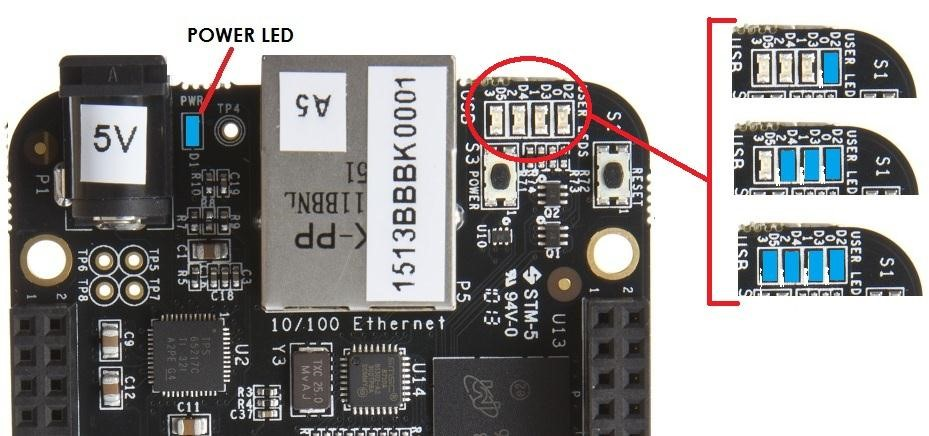

- <b>Power LED</b> (mavi): Güç varken yanar. Açılışta yanıp sönüyorsa PMIC aşırı akım nedeniyle kartı kapatmış demektir.
- <b>User LED'ler (USR0-USR3)</b>: Yazılımdan GPIO ile kontrol edilir. Hazır Debian imajındaki varsayılan görevleri:

| LED | GPIO | Varsayılan görev (Debian imajı) |
|---|---|---|
| USR0 | GPIO1_21 | <b>heartbeat</b>: Kalp atışı gibi yanıp söner, "kernel çalışıyor" demektir |
| USR1 | GPIO1_22 | microSD erişimi |
| USR2 | GPIO1_23 | CPU aktivitesi |
| USR3 | GPIO1_24 | eMMC erişimi |

Linux'ta LED'leri şu dizinden kontrol edebilirsin:

```bash
ls /sys/class/leds/
echo none > /sys/class/leds/beaglebone:green:usr0/trigger
echo 1 > /sys/class/leds/beaglebone:green:usr0/brightness
```

User LED'lerin devre şeması (her LED bir transistör üzerinden GPIO ile sürülür):

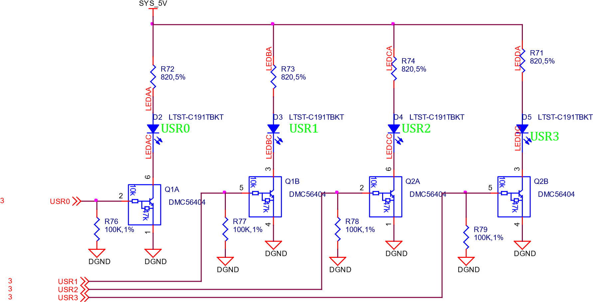

> [!TIP]
> USR0'ın kalp atışı gibi yanıp sönmesi kernel kodunda değil, <b>Device Tree</b>'de tanımlıdır ([11.5](#c11-115-bir-device-treenin-genel-yapısı)).

## <a name="c1-17-boot-sırası-ve-s2-butonu"></a>1.7 Boot Sırası ve S2 Butonu

Kitap açısından <b>en önemli başlık budur.</b>

AM3358 açılırken <b>SYSBOOT</b> pinlerinin seviyesine bakar ve hangi kaynaktan boot edeceğine bu pinlere göre karar verir. <b>Boot (S2)</b> butonu bu bitlerden birini değiştirir.

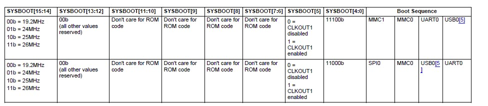

| Durum | Boot sırası |
|---|---|
| <b>S2 basılı değil</b> (varsayılan) | <b>MMC1 (eMMC)</b> → MMC0 (microSD) → UART0 → USB0 |
| <b>S2 basılı</b> (güç verilirken) | SPI0 → <b>MMC0 (microSD)</b> → USB0 → UART0 |

> [!IMPORTANT]
> Kendi derlediğin U-Boot/kernel'i <b>SD karttan</b> açmak için: Kartın gücünü kes, <b>S2</b>'yi basılı tut, gücü ver, birkaç saniye sonra bırak. Boot modu <b>sadece güç verilirken</b> okunur. Reset butonu boot modunu değiştirmez.

Boot zincirinin (ROM Code → SPL → U-Boot → Kernel) ayrıntıları ve SYSBOOT tablosunun nasıl okunduğu [Bölüm 3](#c3-bölüm-3--linux-boot-süreci-rbl--spl--u-boot)'te anlatılıyor.

## <a name="c1-18-seri-debug-header-j1"></a>1.8 Seri Debug Header (J1)

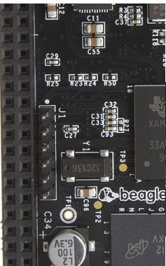

| J1 Pini | Sinyal | USB-TTL dönüştürücüde bağlanacağı yer |
|---|---|---|
| <b>1</b> | GND | GND |
| 2 | — | — |
| 3 | — | — |
| <b>4</b> | RX (kartın alıcısı) | Dönüştürücünün <b>TX</b>'i |
| <b>5</b> | TX (kartın vericisi) | Dönüştürücünün <b>RX</b>'i |
| 6 | — | — |

- 1 numaralı pin kart üzerinde <b>beyaz nokta</b> ile işaretlidir. FTDI kablosu kullanıyorsan siyah kablo (GND) bu pine gelir.
- Ayarlar: <b>115200 8N1</b>, flow control <b>kapalı</b> ([Bölüm 2](#c2-bölüm-2--seri-konsol-ve-minicom)).

> [!WARNING]
> Sinyaller <b>3.3V</b>'tur. USB-TTL dönüştürücünün <b>3.3V</b> modda olduğundan emin ol, 5V'luk dönüştürücü kartı bozabilir. Dönüştürücünün <b>VCC</b> pinini karta <b>bağlama</b>, sadece GND, TX ve RX yeterli.

## <a name="c1-19-genişleme-headerları-p8-ve-p9"></a>1.9 Genişleme Header'ları (P8 ve P9)

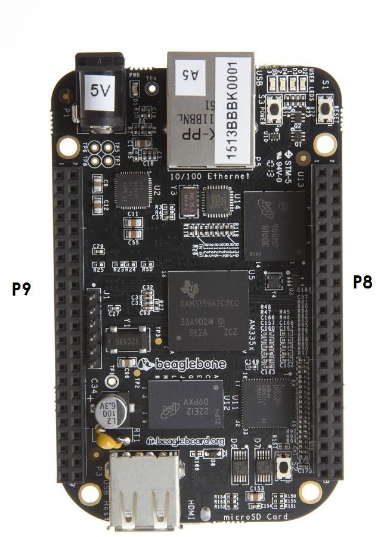

- Her biri 2x23 = <b>46 pin</b>. Toplam 92 pin.
- Pinler <b>multiplexed</b>: Aynı pin GPIO, UART, I2C, SPI, PWM gibi farklı görevlerde kullanılabilir. Hangi görevin seçileceği <b>pinmux</b> (device tree / overlay) ile belirlenir.

| Pin(ler) | Sinyal |
|---|---|
| P8_1, P8_2, P9_1, P9_2, P9_43-46 | <b>GND</b> |
| P9_3, P9_4 | <b>3.3V</b> |
| P9_5, P9_6 | <b>VDD_5V</b> (sadece DC jack'ten güç verilirken var) |
| P9_7, P9_8 | <b>SYS_5V</b> |
| P9_9 | PWR_BUT |
| P9_10 | SYS_RESETn |
| P9_32 | VADC (ADC referansı) |
| P9_33-40 | <b>AIN0-AIN6</b> (analog girişler) |
| P9_34 | AGND |

> [!CAUTION]
> - GPIO pinleri <b>3.3V</b>'tur ve <b>5V toleranslı değildir</b>. 5V sinyal bağlarsan işlemci bozulur.
> - Analog girişler (AIN) en fazla <b>1.8V</b> kabul eder.
> - Kart tamamen açılmadan (SYS_RESETn HIGH olmadan) pinlere dışarıdan sinyal verme.

## <a name="c1-110-özet"></a>1.10 Özet

1. Seri konsol (J1, 115200 8N1) en önemli debug aracın.
2. Varsayılan boot <b>eMMC</b>'den. Kendi imajını <b>SD karttan</b> açmak için <b>S2</b>'yi basılı tutarak güç ver.
3. Boot zinciri: <b>ROM → MLO (SPL) → U-Boot → Kernel + DTB → RootFS</b>.
4. eMMC = <b>MMC1</b>, microSD = <b>MMC0</b>.
5. Tüm I/O <b>3.3V</b>, ADC <b>1.8V</b>.


<div class="page-break"></div>

# <a name="c2-bölüm-2--seri-konsol-ve-minicom"></a>Bölüm 2 — Seri Konsol ve Minicom

> <b>Bu bölümde:</b>
> - USB-TTL dönüştürücüyü bilgisayara tanıtıp port adını (`/dev/ttyUSB0`) bulacaksın.
> - Minicom'u kurup BeagleBone Black için doğru ayarlarla (115200 8N1, flow control kapalı) kaydedeceksin.
> - Minicom'un sık kullanılan kısayollarını ve Windows'taki karşılığı Tera Term'i öğreneceksin.
>
> <b>Ön koşul:</b> [Bölüm 1](#c1-bölüm-1--beaglebone-black-donanımı) — J1 debug header'ının pinleri.

---

## <a name="c2-21-seri-konsol-neden-önemli"></a>2.1 Seri Konsol Neden Önemli?

Kart açılırken ekrana bir şey basan ilk programlar (ROM Code, SPL, U-Boot) HDMI veya ağ kullanmaz. Bütün mesajlarını <b>UART0</b> üzerinden, yani J1 header'ından gönderirler. Bu mesajları görmenin ve U-Boot'a komut yazmanın tek yolu seri konsoldur:

```
[Klavye] ⇄ [minicom / Tera Term] ⇄ USB-TTL kablo ⇄ J1 (UART0) ⇄ [BeagleBone: ROM / SPL / U-Boot / Linux]
```

Bilgisayardaki program sadece bir penceredir. Komutları bilgisayar değil, <b>kartın üzerindeki</b> program (U-Boot veya Linux) çalıştırır.

## <a name="c2-22-minicomu-kur"></a>2.2 Minicom'u Kur

<b>Minicom</b>, Linux'ta kullanılan bir seri port terminal programıdır. `lrzsz` paketi de Minicom'un Xmodem/Ymodem ile dosya göndermesi için gerekir ([Bölüm 6](#c6-bölüm-6--u-boot-komut-satırı-ve-uenvtxt) ve [Bölüm 7](#c7-bölüm-7--seri-porttan-uart-boot)'de kullanacağız):

```bash
sudo apt update
sudo apt install minicom lrzsz
```

## <a name="c2-23-usb-ttl-dönüştürücünün-port-adını-bul"></a>2.3 USB-TTL Dönüştürücünün Port Adını Bul

USB-TTL dönüştürücüyü bilgisayara tak ve terminalde şunu çalıştır:

```bash
sudo dmesg | grep tty
```

Çıktı aşağıdakine benzer olmalı:

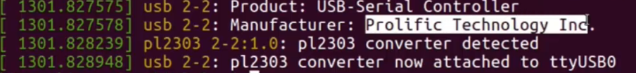

*Görsel: kursun videosundan ekran görüntüsü.*

- Kernel, dönüştürücünün çipini tanıyıp sürücüsünü yükler. Bu örnekte çip <b>pl2303</b>. Senin dönüştürücünde <b>cp210x</b>, <b>ftdi_sio</b> veya <b>ch341</b> de yazabilir.
- Satırın sonundaki <b>`ttyUSB0`</b>, Minicom'da kullanacağımız portun adıdır: <b>`/dev/ttyUSB0`</b>.

Portu her seferinde `sudo` ile açmamak için kullanıcını `dialout` grubuna ekle (bir kez yapılır, sonra oturumu kapatıp açman gerekir):

```bash
sudo usermod -aG dialout $USER
```

## <a name="c2-24-minicom-ayarlarını-yap"></a>2.4 Minicom Ayarlarını Yap

Ayar ekranını aç:

```bash
sudo minicom -s
```

Yön tuşlarıyla menüde gezinebilirsin. <b>Serial port setup</b>'ı seç:

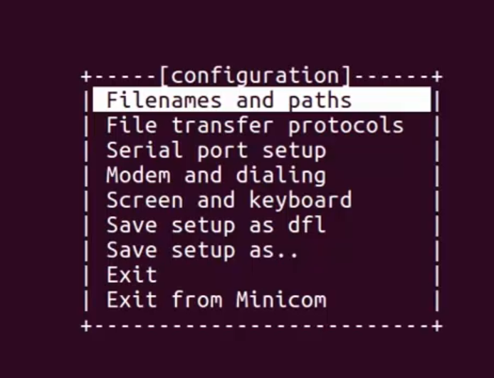

*Görsel: kursun videosundan ekran görüntüsü.*

Seri port ayarları ekranı açılır:

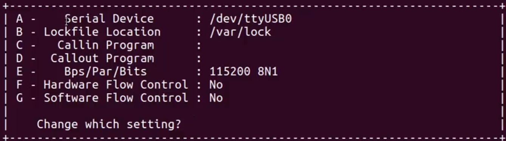

*Görsel: kursun videosundan ekran görüntüsü.*

Bu ekranda her ayarın başında bir harf vardır. Değiştirmek istediğin ayarın harfine basarsın. Örneğin <b>Serial Device</b>'ı değiştirmek için <b>A</b>'ya bas. İmleç o satıra geçer:

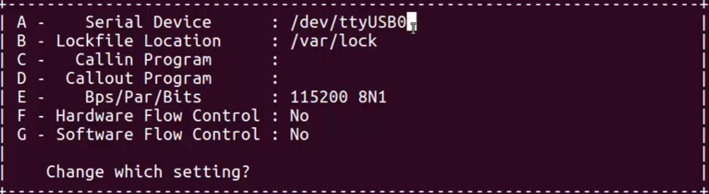

*Görsel: kursun videosundan ekran görüntüsü.*

Eski değeri silip `/dev/ttyUSB0` yaz ve <b>Enter</b>'a bas.

Baud rate'i değiştirmek için <b>E</b>'ye bas. Hız ve veri formatı ekranı açılır:

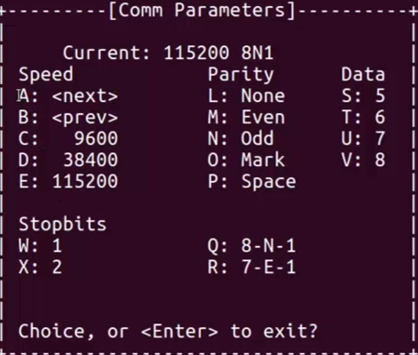

*Görsel: kursun videosundan ekran görüntüsü.*

Bu ekranda da her seçeneğin bir harfi var. Örneğin <b>D</b>'ye basınca hız 38400 olur:

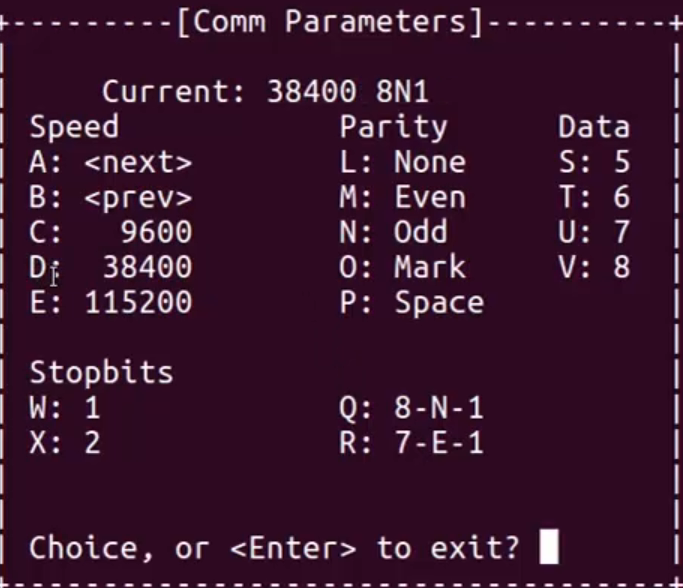

*Görsel: kursun videosundan ekran görüntüsü.*

Biz BeagleBone Black için <b>115200</b> seçeceğiz. Bu ekrandaki harflerle hızı 115200, formatı <b>8N1</b> (8 bit, parity yok, 1 stop bit) yap ve Enter ile çık.

Ayarların son hali:

| Ayar | Değer |
|---|---|
| Serial Device | `/dev/ttyUSB0` |
| Bps/Par/Bits | `115200 8N1` |
| Hardware Flow Control | <b>No</b> |
| Software Flow Control | <b>No</b> |

> [!IMPORTANT]
> BeagleBone Black'in seri hattında <b>CTS</b> ve <b>RTS</b> pinleri yoktur. Bu yüzden <b>Hardware Flow Control</b> kullanılamaz ve <b>No</b> olmalıdır. Yes kalırsa ekranda kartın mesajlarını görürsün ama klavyeden yazdıkların karta gitmez. <b>Software Flow Control</b> da <b>No</b> kalsın.

Ayarları bitirince ana menüye dön ve <b>Save setup as dfl</b>'yi seç. Böylece ayarlar varsayılan olarak kaydedilir ve her seferinde yeniden yapman gerekmez. Sonra <b>Exit</b> ile ayar ekranından çık:

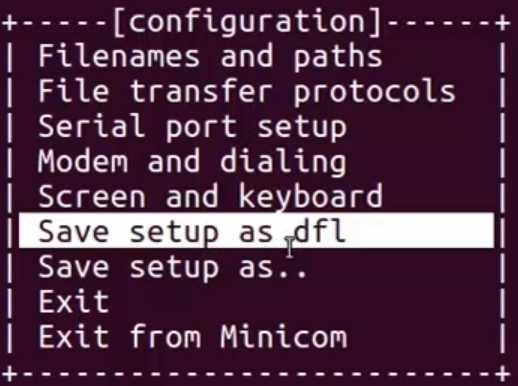

*Görsel: kursun videosundan ekran görüntüsü.*

## <a name="c2-25-minicomu-kullanmak"></a>2.5 Minicom'u Kullanmak

Ayarları kaydettikten sonra Minicom'u doğrudan açabilirsin. Ayarları komut satırında açıkça vermek de mümkün:

```bash
minicom                                  # kayıtlı ayarlarla aç
minicom -D /dev/ttyUSB0 -b 115200        # portu ve hızı açıkça ver
```

Minicom'da bütün kısayollar önce <b>`Ctrl-A`</b>, ardından bir harf ile kullanılır:

| Kısayol | Görevi |
|---|---|
| `Ctrl-A` → `Z` | Yardım: bütün kısayolların listesi |
| `Ctrl-A` → `S` | Dosya gönder (xmodem / ymodem). [Bölüm 6](#c6-bölüm-6--u-boot-komut-satırı-ve-uenvtxt) ve [Bölüm 7](#c7-bölüm-7--seri-porttan-uart-boot)'de kullanılır. |
| `Ctrl-A` → `P` | Baud rate'i değiştir |
| `Ctrl-A` → `O` | Ayar menüsü (`minicom -s` ile aynı) |
| `Ctrl-A` → `C` | Ekranı temizle |
| `Ctrl-A` → `X` | Minicom'dan çık |

> [!TIP]
> Minicom'u kartı açmadan <b>önce</b> başlat. Böylece açılıştaki ilk mesajları (SPL, U-Boot) kaçırmazsın.

## <a name="c2-26-windowsta-tera-term"></a>2.6 Windows'ta: Tera Term

Kursun bazı derslerinde Windows'ta <b>Tera Term</b> kullanılıyor. Bu bir zorunluluk değil, Tera Term de Minicom gibi bir seri terminal programıdır. Hangisini kullanırsan kullan, komutlar ve çıktılar aynıdır.

| | Linux | Windows |
|---|---|---|
| Program | `minicom` | Tera Term |
| Port adı | `/dev/ttyUSB0` | `COM3` gibi (Aygıt Yöneticisi → Bağlantı Noktaları'na bak) |
| Ayarlar | 115200, 8N1, flow control yok | Setup → Serial port: 115200, 8 bit, none, 1 stop, Flow control: none |

## <a name="c2-27-özet"></a>2.7 Özet

| Ne? | Komut / Değer |
|---|---|
| Kurulum | `sudo apt install minicom lrzsz` |
| Port adını bulmak | `sudo dmesg \| grep tty` → `/dev/ttyUSB0` |
| Ayarlar | `sudo minicom -s` → 115200 8N1, Hardware/Software Flow Control: <b>No</b> → Save setup as dfl |
| Açmak | `minicom -D /dev/ttyUSB0 -b 115200` |
| Çıkmak | `Ctrl-A` → `X` |

## <a name="c2-28-karşılaşılabilecek-problemler"></a>2.8 Karşılaşılabilecek Problemler

| Belirti | Sebep | Çözüm |
|---|---|---|
| `cannot open /dev/ttyUSB0: Permission denied` | Kullanıcın `dialout` grubunda değil | `sudo usermod -aG dialout $USER`, sonra oturumu kapatıp aç |
| `dmesg`'de `ttyUSB` hiç görünmüyor | Kablo/sürücü sorunu ya da sanal makine USB'yi görmüyor | Başka USB portu dene. Sanal makinedeysen USB aygıtını VM'e bağla (VirtualBox: Devices → USB). |
| Ekranda hiçbir şey yok | TX/RX düz bağlanmış ya da GND bağlı değil | Dönüştürücünün TX'i → kartın RX'i (J1 pin 4), RX'i → kartın TX'i (J1 pin 5), GND → pin 1 ([1.8](#c1-18-seri-debug-header-j1)) |
| Anlamsız / bozuk karakterler | Baud rate yanlış | 115200 8N1 olmalı |
| Mesajlar geliyor ama yazdıklarım gitmiyor | Hardware Flow Control açık | `minicom -s` → Serial port setup → Hardware Flow Control: <b>No</b> |
| `sx: not found` (dosya gönderirken) | `lrzsz` kurulu değil | `sudo apt install lrzsz` |


<div class="page-break"></div>

<div class="part-title">Kısım II<br>Boot Süreci</div>

<div class="page-break"></div>

# <a name="c3-bölüm-3--linux-boot-süreci-rbl--spl--u-boot"></a>Bölüm 3 — Linux Boot Süreci: RBL → SPL → U-Boot

> <b>Bu bölümde:</b>
> - Kart açılırken çalışan programları (RBL, SPL/MLO, U-Boot, kernel) ve her birinin görevini öğreneceksin.
> - Neden tek bir bootloader yerine bir <b>zincir</b> olduğunu anlayacaksın.
> - SYSBOOT pinlerinin boot sırasını nasıl belirlediğini ve S2 butonunun bunu nasıl değiştirdiğini göreceksin.
>
> <b>Ön koşul:</b> [Bölüm 1](#c1-bölüm-1--beaglebone-black-donanımı) — kartın bellekleri (SRAM, DDR, eMMC, SD) ve S2 butonu.

---

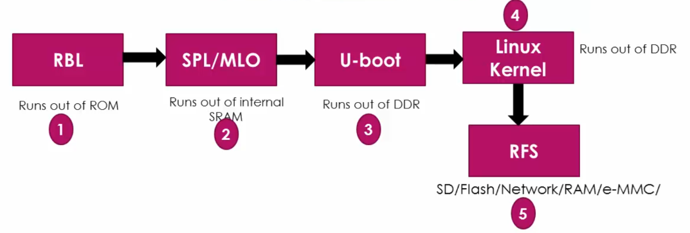

*Görsel: kursun slaytı.*

BeagleBone Black'e güç verildiğinde Linux tek adımda açılmaz. Açılış, birbirini yükleyen bir <b>zincir</b> şeklinde ilerler. Her aşama bir sonrakini belleğe yükler ve kontrolü ona devreder:

```
Güç → RBL (ROM) → SPL / MLO (SRAM) → U-Boot (DDR) → Linux kernel (DDR) → Root filesystem → init
```

Şemadaki <b>"Runs out of ..."</b> ifadeleri her aşamanın <b>hangi bellekte çalıştığını</b> gösterir. Zincirin neden bu kadar uzun olduğu da buradan anlaşılır.

> [!NOTE]
> <b>Neden tek bir bootloader yok?</b> Açılışın ilk anında 512 MB'lık <b>DDR RAM henüz kullanılamaz</b>. DDR'ın çalışması için önce saat (clock), zamanlama ve voltaj ayarlarının yapılması gerekir ve bu ayarlar karttan karta değişir. İşlemcinin hemen kullanabildiği tek RAM, SoC'nin içindeki <b>çok küçük dahili SRAM</b>'dir. Bu yüzden önce SRAM'e sığacak kadar küçük bir program (SPL) çalışır, DDR'ı hazırlar, ardından büyük programlar (U-Boot, Kernel) DDR'a yüklenebilir.

---

## <a name="c3-31-rbl-rom-boot-loader"></a>3.1 RBL (ROM Boot Loader)

- Karta enerji verildiğinde SoC (System on Chip) üzerinde çalışan <b><i>ilk kod parçasıdır</i></b>.
- Üretici firma (Texas Instruments) tarafından yazılır ve çip üretilirken SoC'nin içindeki <b>ROM</b> belleğe kaydedilir. ROM'da olduğu için <b>değiştirilemez</b>.
- <b>Nerede çalışır:</b> Doğrudan <b>ROM</b> üzerinden (Runs out of ROM).

<b>Görevleri:</b>
1. İşlemcinin temel donanımını (saat, watchdog vb.) minimum seviyede başlatır.
2. <b>SYSBOOT</b> pinlerinin seviyesini okuyarak <b>boot sırasını</b> belirler. Beaglebone'da bu sırayı <b>S2 (Boot)</b> butonu değiştirir:
   - S2 basılı değilse: <b>eMMC</b> → microSD → UART → USB
   - S2 basılıysa: SPI → <b>microSD</b> → USB → UART
3. Bu sırayla cihazları tek tek dener ve ilk bulduğu geçerli <b>ikinci aşama bootloader</b>'ı (<b>MLO</b>) dahili SRAM'e kopyalar.
4. Kontrolü MLO'ya devreder.

> [!NOTE]
> SD karttan boot ederken RBL, kartın <b>FAT formatlı ilk bölümünde</b> (boot partition) `MLO` adlı dosyayı arar. Bu yüzden kendi boot SD kartımızı hazırlarken MLO dosyasını bu bölüme koyacağız ([Bölüm 4](#c4-bölüm-4--sd-karttan-boot)).

### <a name="c3-rblin-yaptığı-işler"></a>RBL'in yaptığı işler

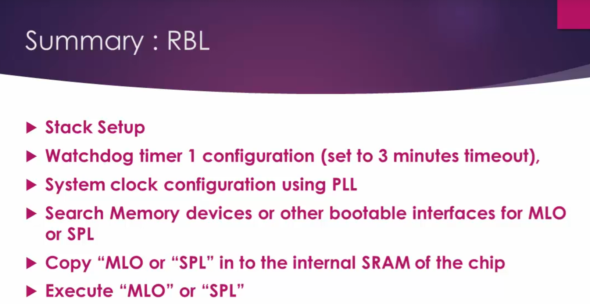

*Görsel: kursun slaytı.*

- <b>Stack Setup:</b> RBL'in C ile yazılmış fonksiyonları çalıştırabilmesi için önce bir <b>stack</b> (yığın) alanı gerekir. Fonksiyon çağrıları ve yerel değişkenler burada tutulur. RBL stack'i dahili SRAM'de kurar.
- <b>Watchdog Timer 1 (3 dakika):</b> Watchdog, belirli bir süre içinde "beslenmezse" (sıfırlanmazsa) sistemi <b>resetleyen</b> bir sayaçtır. Amacı, yazılım bir yerde takılırsa kartı kendiliğinden yeniden başlatmaktır. RBL bu sayacı <b>3 dakikaya</b> kurar ve açık bırakır. Bu yüzden sonraki aşamalar (SPL, U-Boot, Linux) bu watchdog'u ya kapatmalı ya da düzenli olarak beslemelidir. Yoksa kart 3 dakika sonra resetlenir.
- <b>System clock configuration using PLL:</b> İşlemcinin ve çevre birimlerinin saatlerini PLL ile kurar (aşağıda açıklanıyor).
- <b>MLO/SPL'i arar, SRAM'e kopyalar ve çalıştırır:</b> Yukarıdaki görev listesinin 2-4. maddeleri.

### <a name="c3-rom-code-startup-sequence"></a>ROM Code Startup Sequence

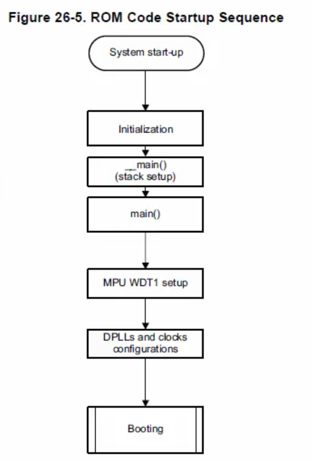

Bu akış şeması AM335x TRM'den (Figure 26-5) alınmıştır ve RBL'in açılışta yaptığı işleri sırasıyla gösterir:

1. <b>System start-up:</b> Karta güç verilir veya reset gelir.
2. <b>Initialization:</b> İşlemcinin en temel ayarları yapılır.
3. <b>__main() (stack setup):</b> Stack kurulur. Bundan sonra C kodu çalışabilir.
4. <b>main():</b> RBL'in ana fonksiyonu başlar.
5. <b>MPU WDT1 setup:</b> Watchdog Timer 1 kurulur (3 dakika).
6. <b>DPLLs and clocks configuration:</b> PLL'ler ve saatler ayarlanır.
7. <b>Booting:</b> Boot cihazları aranır ve MLO yüklenir. Bu adımın detayı aşağıdaki <b>ROM Code Booting Procedure</b> şemasındadır.

### <a name="c3-pll-phase-locked-loop-nedir"></a>PLL (Phase Locked Loop) nedir?

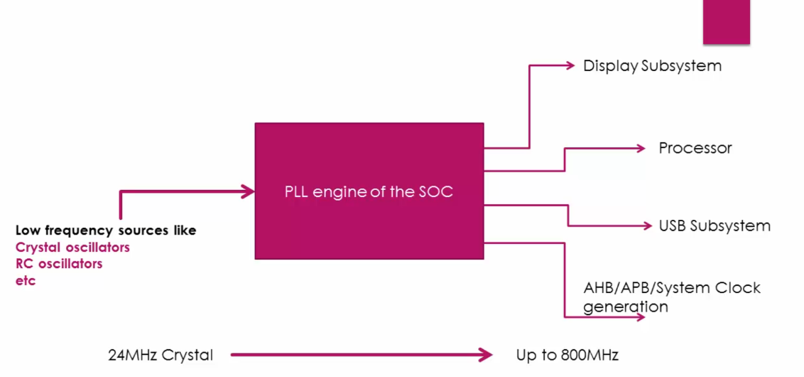

*Görsel: kursun slaytı.*

- Kart üzerindeki kristal osilatör <b>düşük frekanslıdır</b> (BBB'de <b>24 MHz</b>). Ama işlemci yüzlerce MHz ile çalışmak ister.
- <b>PLL</b>, SoC içindeki bir devredir. Kristalden gelen düşük frekansı <b>çarparak</b> (ve gerektiğinde bölerek) yüksek frekanslar üretir. Şemadaki örnekte 24 MHz'lik kristalden <b>800 MHz</b>'e kadar frekans elde edilir.
- Her birim farklı bir frekansa ihtiyaç duyar. Bu yüzden SoC'de birden fazla PLL vardır ve her biri farklı bir birimi besler: <b>işlemci</b>, <b>USB</b>, <b>ekran (display)</b>, <b>bus saatleri</b> (AHB/APB) gibi.
- Doğrudan yüksek frekanslı bir kristal kullanılmamasının sebebi: Düşük frekanslı kristaller ucuz ve kararlıdır. Tek bir kristalden PLL'ler ile ihtiyaç duyulan tüm frekansları üretmek çok daha pratiktir.

### <a name="c3-rom-code-booting-procedure"></a>ROM Code Booting Procedure

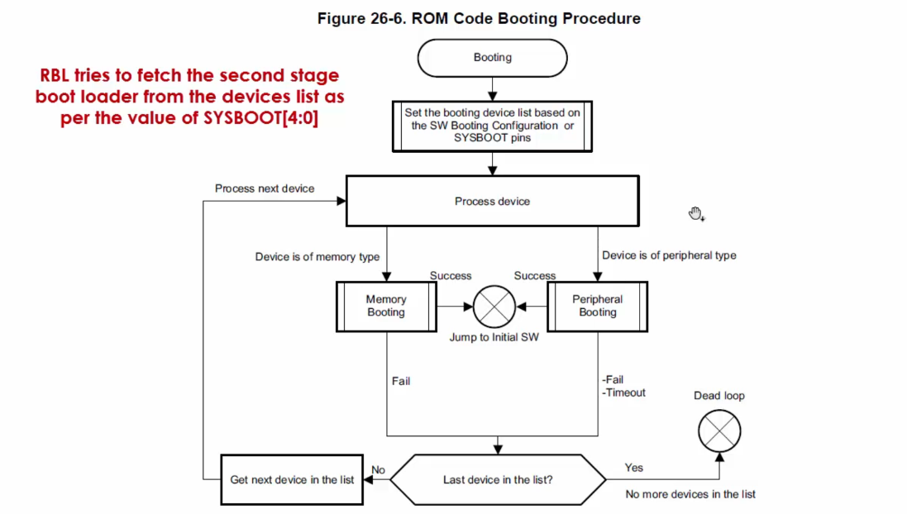

Bu şema (TRM Figure 26-6), RBL'in ikinci aşama bootloader'ı (MLO) nasıl aradığını gösterir:

1. <b>Boot cihaz listesi oluşturulur:</b> RBL, <b>SYSBOOT[4:0]</b> değerine bakarak hangi cihazları hangi sırayla deneyeceğini belirler ([3.5](#c3-35-boot-kaynakları-ve-boot-sırası-sysboot-pinleri)).
2. <b>Process device:</b> Listedeki sıradaki cihaz denenir. Cihazlar iki türe ayrılır:
   - <b>Memory type (bellek türü):</b> eMMC, SD kart, NAND, SPI flash gibi. MLO bu belleğin içinde <b>hazır durur</b>, RBL sadece okur.
   - <b>Peripheral type (çevre birimi türü):</b> UART, USB, Ethernet gibi. MLO kartta yoktur, <b>dışarıdan</b> (bir bilgisayardan) gönderilmesi beklenir. Bu yüzden burada <b>timeout</b> (zaman aşımı) vardır: Belirli süre içinde imaj gelmezse başarısız sayılır.
3. <b>Success:</b> MLO bulunduysa <b>"Jump to Initial SW"</b>, yani MLO'ya atlanır ve kontrol ona geçer.
4. <b>Fail / Timeout:</b> Listede başka cihaz varsa <b>bir sonrakine</b> geçilir.
5. <b>Dead loop:</b> Listedeki hiçbir cihazda MLO bulunamazsa RBL sonsuz bir döngüye girer ve kart hiçbir şey yapmaz.

> [!TIP]
> BBB'nin varsayılan boot listesinde <b>UART0</b> da vardır. eMMC'de ve SD kartta geçerli bir MLO yoksa RBL sırayı UART0'a getirir ve seri konsoldan X-Modem ile imaj bekler. Bu sırada seri konsolda sürekli `CCCCCCCC...` yazdığını görürsün. Bu çıktı, <b>"RBL MLO bulamadı"</b> anlamına gelir. Bu davranışı [Bölüm 7](#c7-bölüm-7--seri-porttan-uart-boot)'de kartı seri porttan açmak için kullanacağız.

---

## <a name="c3-32-spl--mlo-secondary-program-loader"></a>3.2 SPL / MLO (Secondary Program Loader)

- <b>SPL</b> = Secondary Program Loader (İkinci Aşama Önyükleyici). TI işlemcilerinde bu dosyanın adı <b>MLO</b>'dur (MLO = MMC Loader). SPL ile MLO <b>neredeyse</b> aynı şeydir (farkı aşağıda).
- SPL ayrı bir program değildir. <b>U-Boot'un kaynak kodundan derlenir</b>, ama sadece gerekli kısımları içeren çok küçük bir versiyonudur. U-Boot'u derlediğimizde hem `MLO` hem de `u-boot.img` dosyaları birlikte oluşur ([Bölüm 9](#c9-bölüm-9--cross-toolchain-spl-ve-u-boot-derleme)).
- <b>Nerede çalışır:</b> SoC içindeki <b>dahili SRAM</b> üzerinde (Runs out of internal SRAM). SRAM çok küçük olduğu için SPL de küçük olmak zorundadır.

### <a name="c3-spl-ile-mlo-arasındaki-fark"></a>SPL ile MLO arasındaki fark

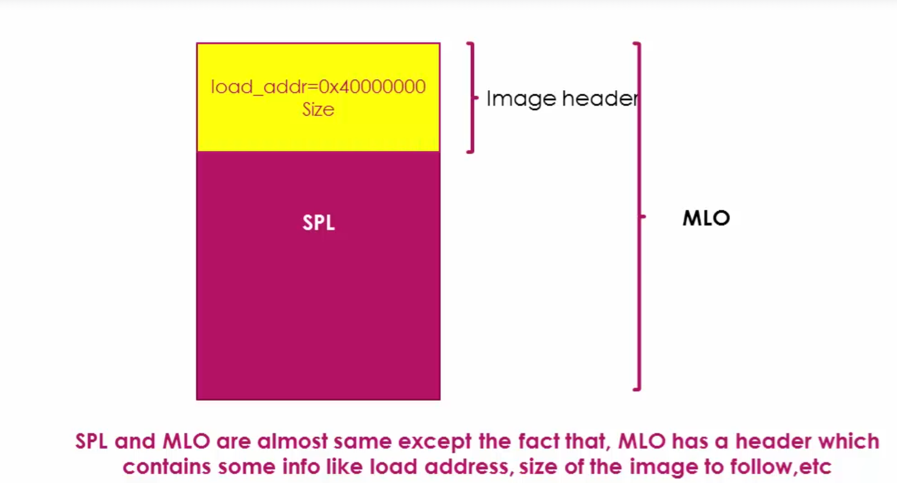

*Görsel: kursun slaytı.*

- <b>MLO = Image header + SPL</b>. Yani MLO, başına küçük bir <b>başlık (header)</b> eklenmiş SPL'dir.
- Header'da RBL'in ihtiyaç duyduğu bilgiler bulunur:
  - <b>load_addr:</b> SPL'in belleğin <b>hangi adresine</b> kopyalanacağı
  - <b>Size:</b> Header'dan sonra gelen SPL kodunun <b>boyutu</b>
- RBL önce header'ı okur. Böylece SPL'i nereye kopyalayacağını ve ne kadar veri okuyacağını öğrenir, kopyalamayı yapar ve o adrese atlar.
- U-Boot derlendiğinde önce header'sız SPL (`u-boot-spl.bin`) oluşur. Başına header eklenince `MLO` dosyası elde edilir.

> [!NOTE]
> Slayttaki `0x40000000` adresi bir örnektir. AM335x'te MLO gerçekte dahili SRAM'deki `0x402F0400` adresine yüklenir.

<b>Görevleri:</b>
1. <b>DDR RAM'i başlatır.</b> En kritik görevi budur. Saat (PLL) ve DDR zamanlama ayarlarını yapar, böylece 512 MB'lık RAM kullanılabilir hale gelir.
2. Seri konsol (UART0) gibi gerekli birkaç çevre birimini hazırlar. Seri konsolda gördüğün ilk `U-Boot SPL ...` satırı buradan gelir.
3. Üçüncü aşama bootloader'ı, yani <b>U-Boot</b>'u (`u-boot.img`) eMMC/SD karttan okuyup <b>DDR</b>'a yükler.
4. Kontrolü U-Boot'a devreder.

### <a name="c3-soru-am335xin-rbli-neden-u-bootu-doğrudan-ddra-yükleyemez"></a>Soru: AM335x'in RBL'i neden U-Boot'u doğrudan DDR'a yükleyemez?

<b>Cevap:</b> Çünkü RBL, karta <b>hangi DDR belleğin takılı olduğunu bilmez</b>. Bilmediği bir belleği de başlatamaz.

- DDR RAM'den veri okuyup yazabilmek için önce SoC içindeki <b>DDR kontrolcüsünün</b> ve RAM'in <b>doğru parametrelerle</b> ayarlanması gerekir: bellek tipi (DDR2, DDR3, DDR3L...), boyut, hız, zamanlama (timing) değerleri vb.
- Bu parametreler <b>tamamen karta (ürüne) özeldir</b>. Aynı AM335x işlemcisini kullanan farklı firmalar farklı bellekler seçebilir:
  - X firması: Micron marka <b>DDR3</b>
  - Y firması: Başka bir markanın <b>DDR2</b>'si
  - Z firması: Hiç DDR kullanmayabilir
- RBL çip üretilirken ROM'a yazılır. O an çipin hangi kartta, hangi bellekle kullanılacağı belli değildir. Bu yüzden RBL <b>DDR'ı hiç başlatmaz</b>. Sadece her işlemcide garanti olarak bulunan <b>dahili SRAM</b>'i kullanır.
- U-Boot ise dahili SRAM'e <b>sığmayacak kadar büyüktür</b>. Yani RBL'in U-Boot'u yükleyebileceği bir yer yoktur.

<b>Çözüm SPL'dir:</b> SPL, dahili SRAM'e sığacak kadar küçüktür ve kartın DDR ayarlarını <b>bilir</b>, çünkü o kart için derlenmiştir. RBL, SPL'i SRAM'e yükler. SPL de DDR'ı başlatıp U-Boot'u DDR'a yükler.

> [!NOTE]
> Kendi kartını tasarlayıp BBB'den farklı bir DDR kullanırsan, SPL kaynak kodundaki <b>DDR parametrelerini</b> kendi belleğine göre değiştirip SPL'i yeniden derlemen gerekir.

> [!NOTE]
> <b>Saat (clock) ayarları:</b> RBL'in kodu ROM'da olduğu için saat ayarları <b>değiştirilemez</b>. SYSBOOT[15:14] ile sadece karttaki kristalin frekansı bildirilir. İşlemci (MPU), DDR ve çevre birimi frekanslarını asıl kuran <b>SPL</b>'dir. SPL'i kendimiz derlediğimiz için bu ayarları kaynak kodda değiştirip yeniden derleyebiliriz. Açılıştan sonra Linux da <b>cpufreq</b> ile işlemci frekansını çalışma sırasında değiştirebilir.

---

## <a name="c3-33-u-boot-universal-bootloader"></a>3.3 U-Boot (Universal Bootloader)

- Açık kaynak kodlu ve gömülü sistemlerde en yaygın kullanılan bootloader'dır. Üçüncü (ve son) aşama önyükleyicidir.
- <b>Nerede çalışır:</b> <b>DDR RAM</b> üzerinde (Runs out of DDR). Artık bellek kısıtı olmadığı için çok daha fazla özellik içerebilir.

<b>Görevleri:</b>
1. Linux Kernel'i çalıştırmak için gereken donanımları (eMMC, SD kart, Ethernet, USB vb.) başlatır.
2. <b>Linux Kernel</b> imajını (`zImage` / `uImage`) bir kaynaktan (SD kart, eMMC, seri port, ağ üzerinden TFTP vb.) okuyup <b>DDR</b>'a yükler.
3. Kartın donanımını tarif eden <b>Device Tree</b> dosyasını (BeagleBone Black için `am335x-boneblack.dtb`) DDR'a yükler.
4. Kernel'e <b>bootargs</b> (komut satırı parametreleri) iletir. Örneğin root filesystem'in nerede olduğu (`root=`) veya hangi konsolun kullanılacağı (`console=`) bu parametrelerle bildirilir.
5. Kontrolü Linux Kernel'e devreder. Bu noktadan sonra U-Boot'un işi biter.

<b>Neden önemli:</b>
- U-Boot'un kendi <b>komut satırı</b> vardır. Açılışta seri konsolda geri sayım (`Hit any key to stop autoboot`) sırasında bir tuşa basarsan U-Boot komut satırına (`U-Boot#` veya `=>`) düşersin. Buradan bellek okuma/yazma, dosya yükleme, boot ayarlarını değiştirme gibi işlemler yapılabilir ([Bölüm 6](#c6-bölüm-6--u-boot-komut-satırı-ve-uenvtxt)).
- Boot ayarları <b>environment değişkenlerinde</b> (`bootcmd`, `bootargs` vb.) tutulur ve `printenv` / `setenv` komutlarıyla görüntülenip değiştirilebilir.

---

## <a name="c3-34-linux-kernel-ve-root-filesystem"></a>3.4 Linux Kernel ve Root Filesystem

U-Boot `bootm` (veya `bootz`) komutuyla kernel'e atladıktan sonra zincirin son iki halkası çalışır:

1. <b>Kernel</b> kendini RAM'de açar (`zImage` sıkıştırılmıştır), U-Boot'un verdiği <b>Device Tree</b>'yi okuyup kartta hangi donanımın olduğunu öğrenir ve sürücüleri başlatır ([Bölüm 11](#c11-bölüm-11--linux-device-tree)).
2. Kernel, `bootargs`'taki <b>`root=`</b> parametresine bakarak <b>root filesystem</b>'i (`/`) bağlar. Bu bir SD kart bölümü (`/dev/mmcblk0p2`), eMMC bölümü veya RAM'deki bir initramfs olabilir.
3. Rootfs'teki ilk program olan <b>`init`</b>'i (systemd veya BusyBox init) çalıştırır. Bundan sonra servisler başlar ve `login:` ekranı gelir.

> [!NOTE]
> `console=` parametresindeki konsol adı kernel sürümüne göre değişir. Kursun hazır kernel'inde (3.8.13) UART0'ın adı `ttyO0`, yeni kernel'lerde `ttyS0`'dır. Yanlış ad yazılırsa kernel açılır ama mesajlarını göremezsin.

---

## <a name="c3-35-boot-kaynakları-ve-boot-sırası-sysboot-pinleri"></a>3.5 Boot Kaynakları ve Boot Sırası (SYSBOOT Pinleri)

AM335x işlemcisi tek bir yerden boot etmek zorunda değildir. <b>Birçok farklı çevre biriminden</b> (eMMC, SD kart, UART, USB, SPI flash, NAND, Ethernet...) boot edebilir. Peki RBL hangisinden boot edeceğine nasıl karar verir? Bunu işlemcinin <b>SYSBOOT</b> pinleri belirler.

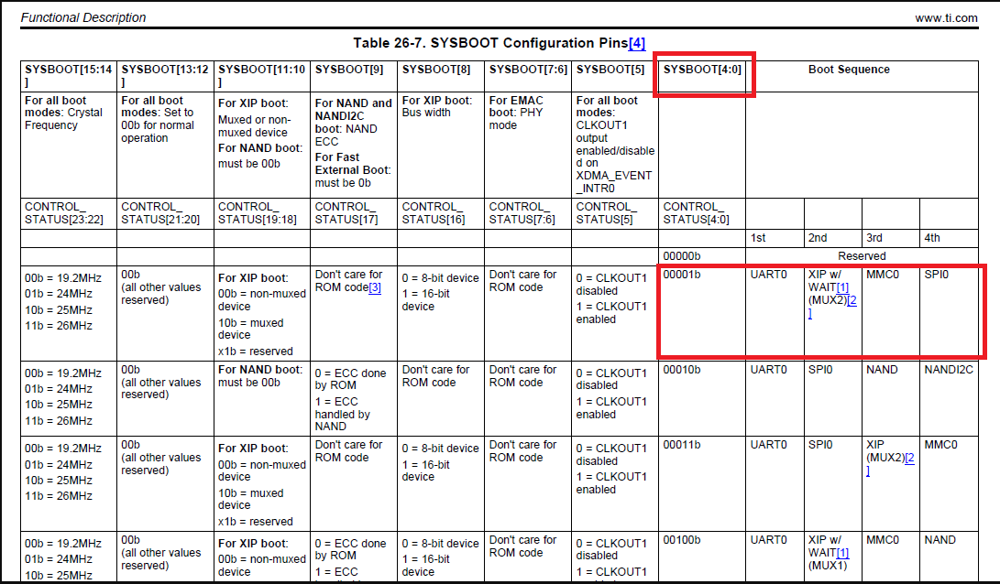

Bu tablo, AM335x'in <b>Technical Reference Manual (TRM)</b> dokümanındaki <b>Table 26-7: SYSBOOT Configuration Pins</b> tablosudur.

### <a name="c3-sysboot-pinleri-nedir"></a>SYSBOOT pinleri nedir?

- <b>SYSBOOT[15:0]</b>, işlemcinin 16 adet pinidir. Karta <b>güç verildiği anda</b> RBL bu pinlerin seviyesini (1 veya 0) okur.
- Okunan değer, <b>CONTROL_STATUS</b> adlı bir register'a kaydedilir. Tablonun 3. satırındaki `CONTROL_STATUS[...]` ifadeleri, her SYSBOOT bitinin bu register'da hangi bite karşılık geldiğini gösterir.
- Bu pinlerin seviyesi kart üzerindeki <b>pull-up / pull-down dirençleriyle</b> sabitlenir. Yani boot ayarı, kartı tasarlayan kişi tarafından donanımsal olarak belirlenir.

### <a name="c3-tablonun-sütunları"></a>Tablonun sütunları

| Sütun | Ne işe yarar? |
|---|---|
| <b>SYSBOOT[15:14]</b> | Karttaki kristalin (osilatörün) frekansını bildirir: 19.2 / 24 / 25 / 26 MHz. Beaglebone Black <b>24 MHz</b> kristal kullanır (<b>01b</b>). |
| <b>SYSBOOT[13:12]</b> | Normal çalışma için <b>00b</b> olmalıdır. |
| <b>SYSBOOT[11:10], [9], [8]</b> | Sadece belirli boot türlerinde (XIP, NAND) kullanılan ek ayarlar. Diğer boot türlerinde önemsizdir ("Don't care"). |
| <b>SYSBOOT[7:6]</b> | Ethernet (EMAC) üzerinden boot için PHY modu. |
| <b>SYSBOOT[5]</b> | CLKOUT1 saat çıkışının açık/kapalı olması. |
| <b>SYSBOOT[4:0]</b> | <b>En önemli kısım.</b> Boot modunu, yani <b>hangi cihazların hangi sırayla</b> deneneceğini belirler. |
| <b>Boot Sequence</b> | SYSBOOT[4:0] değerine göre RBL'in deneyeceği cihazlar: <b>1st → 2nd → 3rd → 4th</b>. |

### <a name="c3-boot-sequence-boot-sırası-nasıl-çalışır"></a>Boot Sequence (Boot sırası) nasıl çalışır?

Resimde kırmızıyla işaretlenen satırı örnek alalım. <b>SYSBOOT[4:0] = 00001b</b> ise boot sırası şöyledir:

```
1st: UART0  →  2nd: XIP (NOR flash)  →  3rd: MMC0 (SD kart)  →  4th: SPI0
```

1. RBL önce <b>1. cihazı</b> (UART0) dener.
2. O cihazda geçerli bir boot imajı (MLO) bulamazsa veya cihaz yanıt vermezse <b>bir sonraki cihaza</b> geçer.
3. Geçerli bir imaj bulduğu <b>ilk cihazdan</b> boot eder ve diğerlerine bakmaz.
4. Dört cihazın hiçbirinde imaj bulamazsa boot başarısız olur.

SYSBOOT[4:0] 5 bit olduğu için 32 farklı kombinasyon vardır. Her biri farklı bir boot sırası tanımlar. Resimde bunların sadece ilk birkaçı görünüyor, tablonun tamamı TRM'de.

### <a name="c3-tablodaki-boot-kaynakları"></a>Tablodaki boot kaynakları

| İsim | Anlamı |
|---|---|
| <b>MMC0</b> | Beaglebone'da <b>microSD kart</b> yuvası |
| <b>MMC1</b> | Beaglebone'da kart üstündeki <b>eMMC</b> |
| <b>UART0</b> | Seri port üzerinden boot. İmaj bilgisayardan seri hat ile (X-Modem protokolü) gönderilir ([Bölüm 7](#c7-bölüm-7--seri-porttan-uart-boot)). |
| <b>USB0</b> | USB üzerinden boot. Kart, bilgisayara bir ağ cihazı gibi görünür ve imajı oradan alır. |
| <b>SPI0</b> | SPI ile bağlı harici flash bellekten boot |
| <b>XIP</b> | e<b>X</b>ecute <b>I</b>n <b>P</b>lace: Kod, NOR flash'a kopyalanmadan doğrudan orada çalıştırılır. |
| <b>NAND / NANDI2C</b> | Harici NAND flash bellekten boot |
| <b>EMAC</b> | Ethernet üzerinden ağdan boot |

> [!NOTE]
> UART0 ve USB0 boot modları, kartta hiç yazılım olmadığında (örneğin eMMC boşsa veya bozulduysa) kartı <b>kurtarmak</b> için kullanılır.

### <a name="c3-beaglebone-blackte-durum"></a>BeagleBone Black'te durum

BeagleBone Black'in boot ayarları, resmi dokümandaki şu tabloda görünür:


| Durum | SYSBOOT[4:0] | Boot Sequence |
|---|---|---|
| <b>S2 basılı değil</b> (varsayılan) | <b>11100b</b> | <b>MMC1 (eMMC)</b> → MMC0 (SD) → UART0 → USB0 |
| <b>S2 basılı</b> (güç verilirken) | <b>11000b</b> | SPI0 → <b>MMC0 (SD)</b> → USB0 → UART0 |

- İki değer arasında sadece <b>SYSBOOT[2]</b> biti farklıdır: 11<b>1</b>00 → 11<b>0</b>00. Boot (<b>S2</b>) butonu tam olarak bu biti <b>0</b>'a çeker.
- Varsayılan durumda eMMC ilk sırada olduğu için kart <b>eMMC'deki</b> hazır Debian'dan açılır.
- S2'ye basılıyken eMMC listede <b>hiç yoktur</b>. SPI0'da flash olmadığı için o adım atlanır ve kart <b>SD karttan</b> açılır. Kendi derlediğimiz MLO/U-Boot/Kernel'i bu yüzden SD karta koyup S2 ile boot edeceğiz.
- Beaglebone'da SYSBOOT pinleri <b>LCD veri pinleriyle</b> (LCD_DATA0–15) ortaktır ve P8 header'ına çıkar. Bu pinlere boot sırasında dışarıdan sinyal verilirse boot sırası bozulabilir. Bu yüzden kart açılmadan P8'e bir şey bağlarken dikkatli olmak gerekir.
- Listede <b>EMAC (Ethernet) yoktur</b>. ROM Code BBB'de ağdan boot edemez. Ağdan boot için önce SD karttan U-Boot'u açmak gerekir ([Bölüm 8](#c8-bölüm-8--tftp-ile-ağdan-boot)).

> [!IMPORTANT]
> SYSBOOT pinleri <b>sadece güç verildiği anda</b> okunur. Kart açıldıktan sonra S2'ye basmak veya Reset butonuna basmak boot sırasını değiştirmez. S2 ile boot etmek için gücü tamamen kesip, S2'yi basılı tutarak tekrar güç vermelisin.

---

## <a name="c3-36-schematicte-boot-devresi"></a>3.6 Schematic'te Boot Devresi

Yukarıda anlatılan boot ayarının kart üzerindeki karşılığı, BBB schematic'inin <b>6. sayfasındaki</b> devredir.

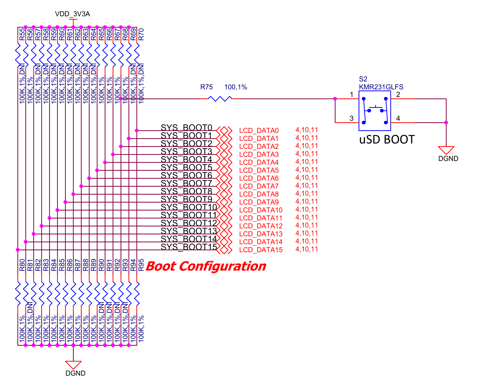

> Kaynak: BeagleBone Black Rev C schematic, sayfa 6 ([niekiran/EmbeddedLinuxBBB](https://github.com/niekiran/EmbeddedLinuxBBB) reposundaki `BBB_SCH.pdf`)

Schematic'te dikkat edilecekler:
- Her <b>SYS_BOOTx</b> hattına üstte bir pull-up (R55–R70), altta bir pull-down (R80–R95) direnci için yer var. Bunlardan sadece biri karta takılıdır. <b>DNI</b> (Do Not Install) yazan direnç kartta <b>yoktur</b>.
- Takılı dirençlere bakınca SYS_BOOT[4:0] = <b>11100b</b> çıkar. Bu değer, yukarıdaki tablodaki varsayılan değerle aynıdır.
- <b>S2</b> butonu (üzerinde <b>"uSD BOOT"</b> yazar), <b>R75</b> üzerinden <b>SYS_BOOT2</b> hattını <b>GND</b>'ye bağlar.

---

## <a name="c3-37-özet"></a>3.7 Özet

| Aşama | Kim yazar? | Nerede saklanır? | Nerede çalışır? | Ana görevi |
|---|---|---|---|---|
| <b>RBL</b> | TI (çip üreticisi) | SoC içindeki ROM | ROM | Boot cihazını seçip MLO'yu SRAM'e yüklemek |
| <b>SPL/MLO</b> | U-Boot projesi (biz derleriz) | eMMC / SD kart | Dahili SRAM | DDR'ı başlatıp U-Boot'u DDR'a yüklemek |
| <b>U-Boot</b> | U-Boot projesi (biz derleriz) | eMMC / SD kart | DDR | Kernel + DTB'yi yükleyip Kernel'i başlatmak |
| <b>Linux kernel</b> | Linux projesi (biz derleriz) | eMMC / SD kart / ağ | DDR | Donanımı başlatmak, rootfs'i bağlamak, `init`'i çalıştırmak |

- Boot sırasını <b>SYSBOOT[4:0]</b> pinleri belirler. BBB'de varsayılan <b>eMMC → SD → UART0 → USB0</b>, S2 basılıyken <b>SPI0 → SD → USB0 → UART0</b>.
- S2 sadece <b>güç verilirken</b> etkilidir.


<div class="page-break"></div>

# <a name="c4-bölüm-4--sd-karttan-boot"></a>Bölüm 4 — SD Karttan Boot

> <b>Bu bölümde:</b>
> - Bir microSD kartı GParted ile BOOT (FAT) ve ROOTFS (ext3) bölümlerine ayıracaksın.
> - Kursun hazır dosyalarını karta <b>tek tek</b> koyup her seferinde kartı açarak boot zincirinin her halkasının çalıştığını göreceksin.
> - `uEnv.txt`'nin bu açılışta ne yaptığını ve `uImage` dosyasının yapısını öğreneceksin.
> - U-Boot'u durdurup kernel'in başlığını (header) bellekten byte byte okuyacaksın.
>
> <b>Ön koşul:</b> [Bölüm 2](#c2-bölüm-2--seri-konsol-ve-minicom) — seri konsol, [Bölüm 3](#c3-bölüm-3--linux-boot-süreci-rbl--spl--u-boot) — boot zinciri.

---

## <a name="c4-41-büyük-resim"></a>4.1 Büyük Resim

Kart açılırken programlar sırayla birbirini çalıştırır. Buna <b>boot zinciri</b> denir ([Bölüm 3](#c3-bölüm-3--linux-boot-süreci-rbl--spl--u-boot)):

```
Güç → RBL → MLO → U-Boot → Linux Kernel → Root Filesystem → login ekranı
```

| Aşama | Ne yapar? | Nerede durur? |
|---|---|---|
| <b>RBL</b> (ROM Boot Loader) | Kart açılınca ilk çalışan kod. MLO'yu bulup çalıştırır. | İşlemcinin içinde, değiştirilemez |
| <b>MLO</b> | RAM'i (DDR) hazırlar, U-Boot'u yükler. | SD kart → BOOT bölümü |
| <b>U-Boot</b> | Kernel'i ve device tree'yi RAM'e yükleyip Linux'u başlatır. | SD kart → BOOT bölümü |
| <b>Linux Kernel</b> | İşletim sisteminin çekirdeği. | SD kart → ROOTFS bölümü (`/boot`) |
| <b>Root Filesystem</b> | Linux'un tüm dosyaları (`/bin`, `/etc`, ...). | SD kart → ROOTFS bölümü |

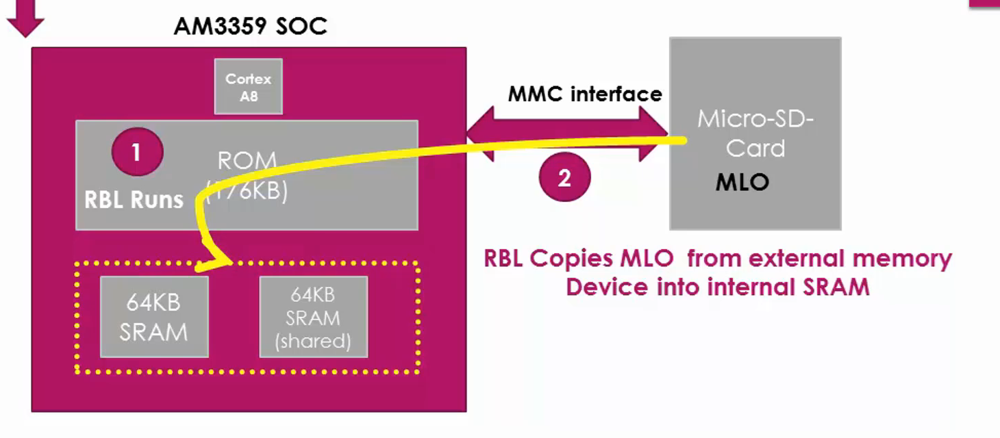

*Görsel: kursun slaytı.*

<b>SD kartın son hali</b> şöyle olacak:

```
SD Kart
├── BOOT   (FAT16, ~1 GB)  →  MLO, u-boot.img, uEnv.txt
└── ROOTFS (ext3, kalan)   →  Linux dosyaları (kernel ve .dtb dahil)
```

### <a name="c4-yol-haritası"></a>Yol haritası

Dosyalar karta <b>tek tek</b> eklenir ve her seferinde kart açılıp test edilir. Böylece zincirin her halkasının çalıştığı görülür:

| Adım | Ne yapılıyor? | Sonuç |
|---|---|---|
| [4.2](#c4-42-hazırlık) – [4.4](#c4-44-sd-kartı-bölümlere-ayırma-gparted) | Dosyaları indir, SD kartı bölümle | SD kart hazır |
| [4.6](#c4-46-aşama-1-mlo) | MLO'yu kopyala, test et | RBL ✓ → MLO ✓ → U-Boot ✗ |
| [4.7](#c4-47-aşama-2-u-boot) | U-Boot'u kopyala, test et | ... → U-Boot ✓ |
| [4.8](#c4-48-aşama-3-root-filesystem-ve-uenvtxt) | Rootfs ve uEnv.txt'yi kopyala, test et | Linux açılır ✓ |
| [4.10](#c4-410-uygulama-uimage-headerını-u-bootta-elle-okuma) | U-Boot'u durdur, uImage header'ını elle oku | Header çözüldü ✓ |

Her testte kart aynı şekilde açılır. Bu işlem [4.5](#c4-45-boot-prosedürü-her-testte-tekrarlanır)'te bir kez anlatılıyor.

---

## <a name="c4-42-hazırlık"></a>4.2 Hazırlık

<b>Gerekenler:</b>
- microSD kart (en az 4 GB) ve kart okuyucu
- USB-TTL seri dönüştürücü (3.3V). Kartın açılış mesajlarını görmek için gerekli.
- Mini USB kablo (karta güç vermek için)

<b>Dosyaları indir.</b> Kursun GitHub reposundaki <b>4 dosyanın hepsini</b> indir:
https://github.com/niekiran/EmbeddedLinuxBBB/tree/master/pre-built-images/Angstrom_Demo

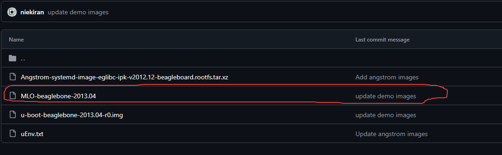

*Görsel: kursun GitHub reposu ([niekiran/EmbeddedLinuxBBB](https://github.com/niekiran/EmbeddedLinuxBBB)).*

| İndirilen dosya | Ne? | Nereye kopyalanacak? |
|---|---|---|
| `MLO-beaglebone-2013.04` | MLO | BOOT → adı `MLO` olacak |
| `u-boot-beaglebone-2013.04-r0.img` | U-Boot | BOOT → adı `u-boot.img` olacak |
| `uEnv.txt` | U-Boot ayar dosyası | BOOT → adı aynı kalacak |
| `Angstrom-systemd-image-eglibc-ipk-v2012.12-beagleboard.rootfs.tar.xz` | Root filesystem (içinde kernel `/boot/uImage` ve device tree `/boot/am335x-boneblack.dtb` da var) | ROOTFS → arşivden çıkarılacak |

---

## <a name="c4-43-sd-kartı-bilgisayarda-bulma"></a>4.3 SD Kartı Bilgisayarda Bulma

Kartı takıp terminalde çalıştır:

```bash
sudo dmesg
```

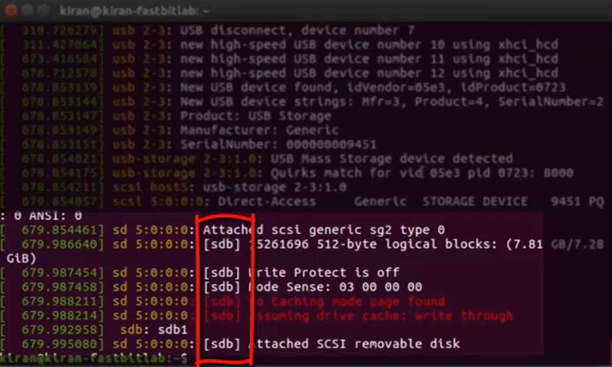

*Görsel: kursun videosundan ekran görüntüsü.*

- `sdb` → SD kartın adı (`/dev/sdb`). Yanında boyutu yazar (7.81 GB). Doğru cihaz olduğunu boyuttan anlarsın.
- `sdb1` → kartta zaten var olan bölüm (partition).

> [!TIP]
> `lsblk` komutu tüm diskleri boyutlarıyla birlikte daha okunaklı gösterir.

> [!NOTE]
> GParted'da aynı kart <b>7.28 GiB</b> görünür. Kart eksik değil, birimler farklı: 1 GB = 1.000.000.000 byte, 1 GiB = 1.073.741.824 byte.

---

## <a name="c4-44-sd-kartı-bölümlere-ayırma-gparted"></a>4.4 SD Kartı Bölümlere Ayırma (GParted)

Kart 2 bölüme ayrılacak. <b>Karttaki tüm veriler silinir.</b>

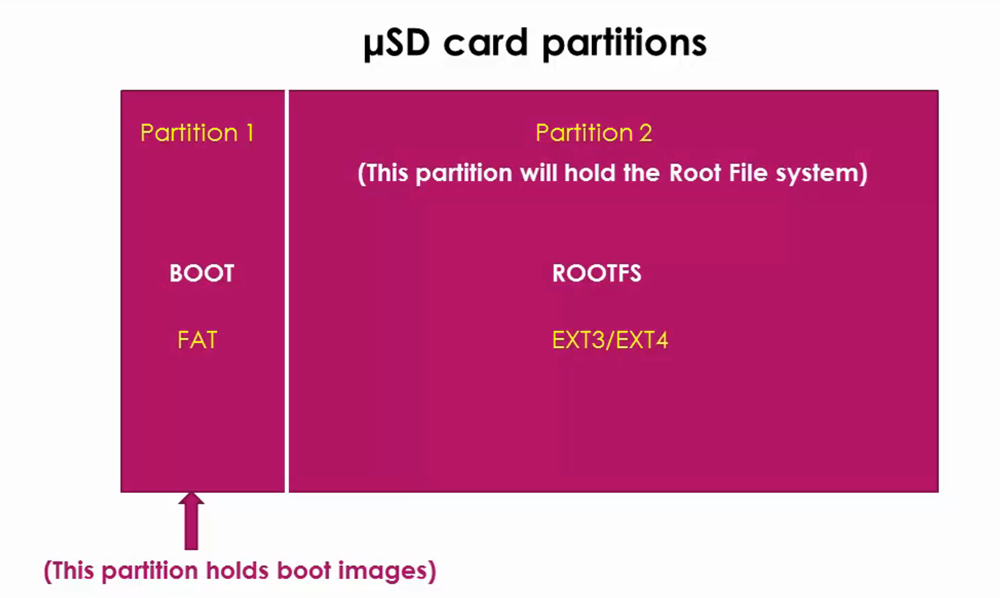

*Görsel: kursun slaytı.*

| Bölüm | Label | Dosya sistemi | Boyut | Neden? |
|---|---|---|---|---|
| 1 | `BOOT` | `fat16` | ~1 GB | RBL, MLO'yu sadece FAT bölümde arar |
| 2 | `ROOTFS` | `ext3` | Kalan alan | Linux dosyaları Linux dosya sistemi ister |

GParted'ı kur ve aç:

```bash
sudo apt install gparted
sudo gparted
```

> [!CAUTION]
> Sağ üstteki listeden <b>SD kartı seç</b> (`/dev/sdb`, 7.28 GiB). Yanlışlıkla bilgisayarının diskini (`/dev/sda`) seçersen <b>bilgisayarındaki veriler silinir</b>.

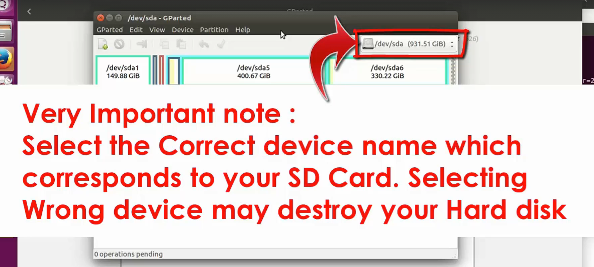

*Görsel: kursun videosundan ekran görüntüsü.*

### <a name="c4-441-unmount-et"></a>4.4.1 Unmount et

Bölüm şu an sistem tarafından kullanılıyor (yanındaki 🔑 simgesi). Kullanımdayken silinemez. <b>Sağ tık → Unmount.</b>

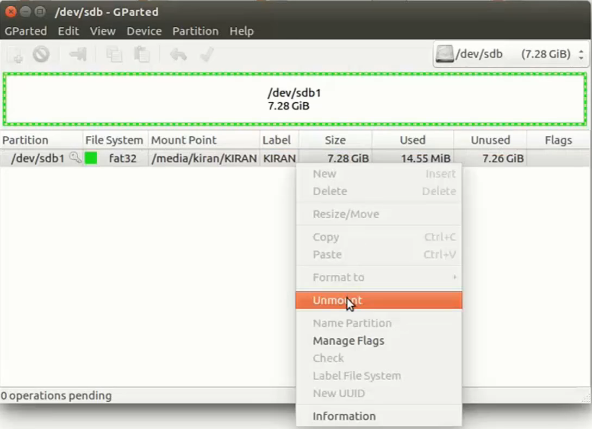

*Görsel: kursun videosundan ekran görüntüsü.*

### <a name="c4-442-eski-bölümü-sil"></a>4.4.2 Eski bölümü sil

<b>Sağ tık → Delete.</b> Kartın tamamı `unallocated` (boş alan) olur.

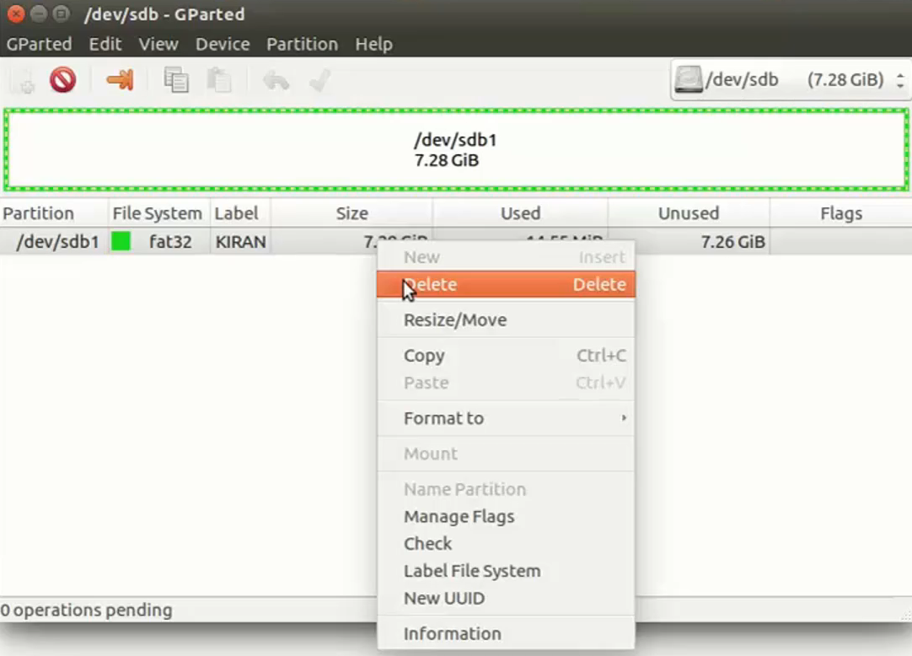

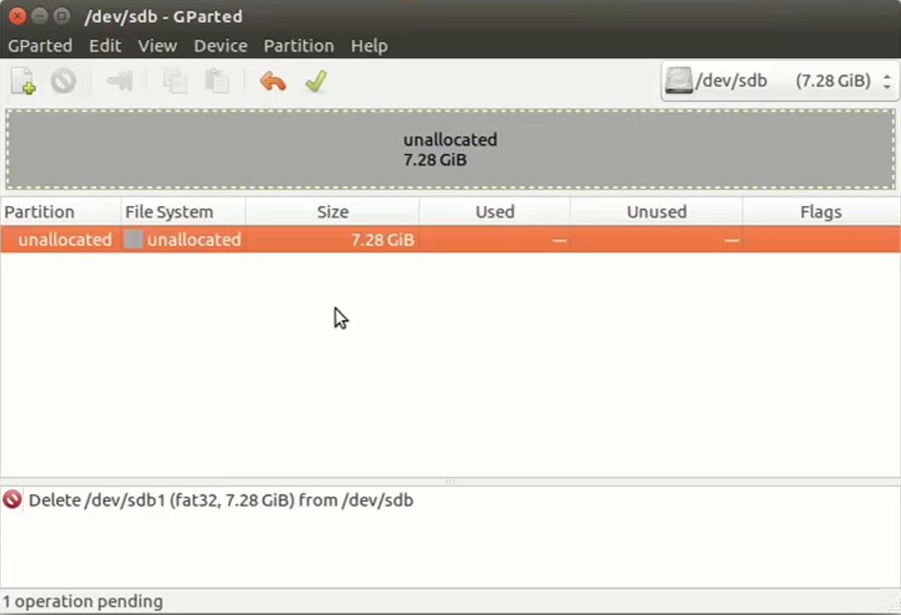

*Görseller: kursun videosundan ekran görüntüleri.*

> [!NOTE]
> GParted işlemleri hemen uygulamaz, sıraya koyar ("1 operation pending"). Hepsi en sonda [4.4.5](#c4-445-değişiklikleri-uygula)'te uygulanır. O ana kadar her şey geri alınabilir.

### <a name="c4-443-boot-bölümünü-oluştur"></a>4.4.3 BOOT bölümünü oluştur

`unallocated` alana <b>sağ tık → New.</b>

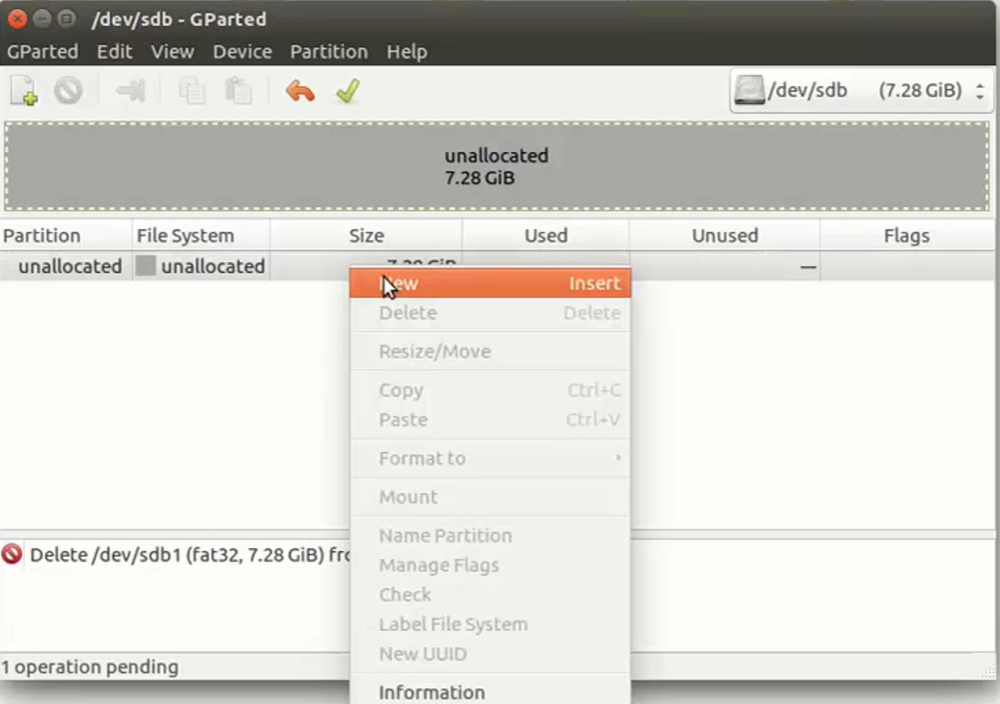

*Görsel: kursun videosundan ekran görüntüsü.*

Açılan pencerede 3 ayar yap, sonra <b>Add</b>'e bas:

| Alan | Değer |
|---|---|
| File system | `fat16` |
| Label | `BOOT` |
| New size (MiB) | `1013` (yaklaşık 1 GB) |

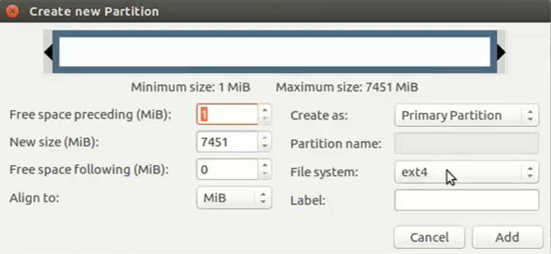

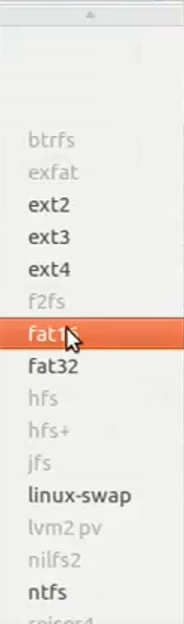

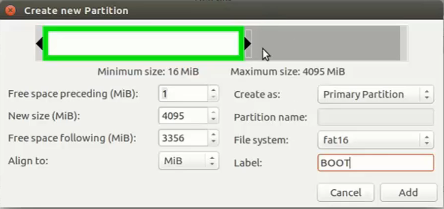

*Görseller: kursun videosundan ekran görüntüleri.*

> [!NOTE]
> fat16 seçilince boyut kendiliğinden <b>4095 MiB</b> olur, çünkü FAT16 en fazla ~4 GiB olabilir. Bunu 1013'e düşürüyoruz. Boot dosyaları zaten birkaç MB.

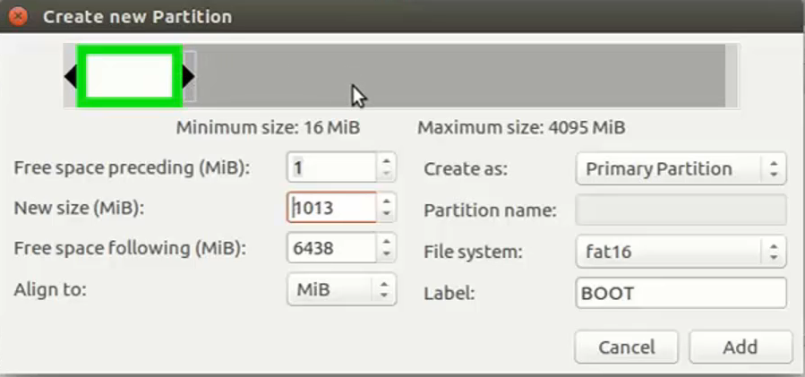

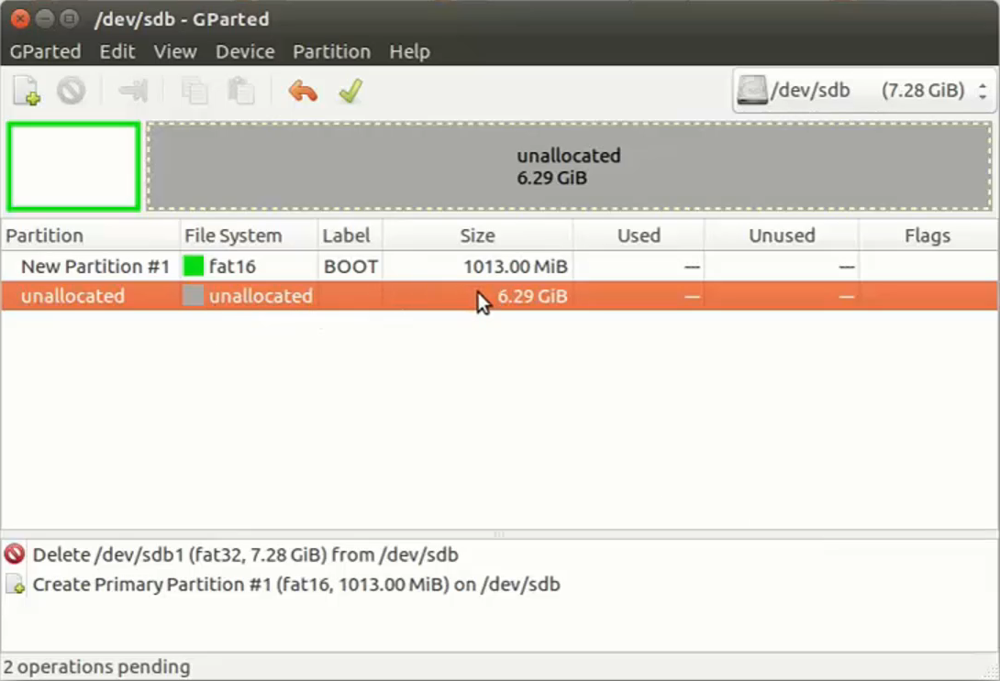

*Görseller: kursun videosundan ekran görüntüleri.*

### <a name="c4-444-rootfs-bölümünü-oluştur"></a>4.4.4 ROOTFS bölümünü oluştur

Kalan `unallocated` alana yine <b>sağ tık → New</b>, sonra <b>Add</b>:

| Alan | Değer |
|---|---|
| File system | `ext3` |
| Label | `ROOTFS` |
| New size (MiB) | Değiştirme (kalan alanın tamamı) |

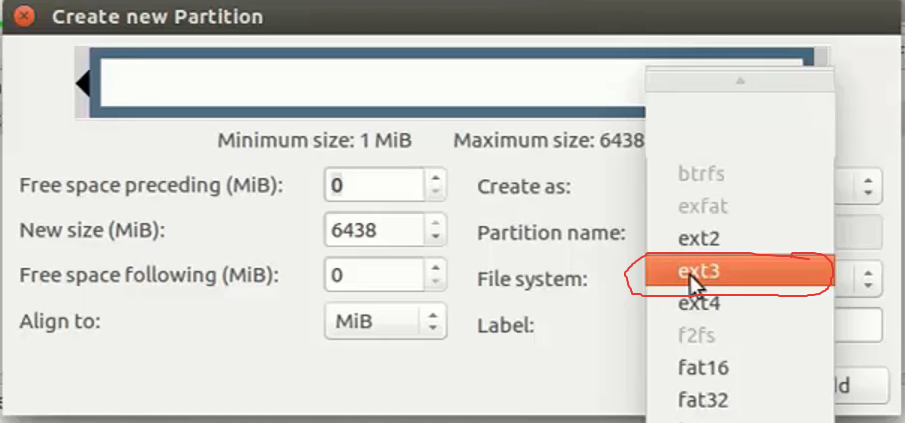

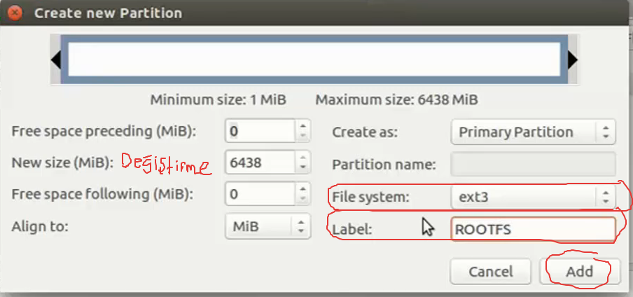

*Görseller: kursun videosundan ekran görüntüleri.*

Planlanan durum: 1 GB BOOT + 6.29 GiB ROOTFS.

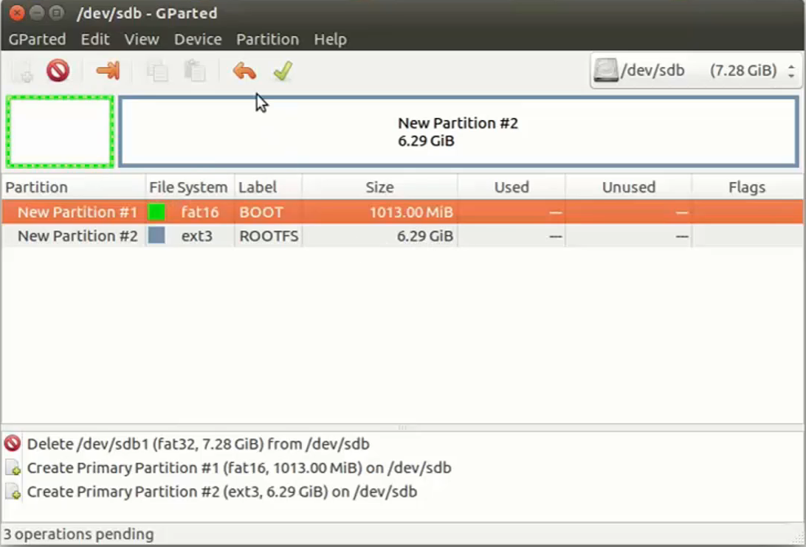

*Görsel: kursun videosundan ekran görüntüsü.*

### <a name="c4-445-değişiklikleri-uygula"></a>4.4.5 Değişiklikleri uygula

<b>Yeşil tik</b> (Apply All Operations) → onay penceresinde <b>Apply</b>.

> [!WARNING]
> Bu adımdan sonra geri dönüş yok, karttaki eski veriler silinir.

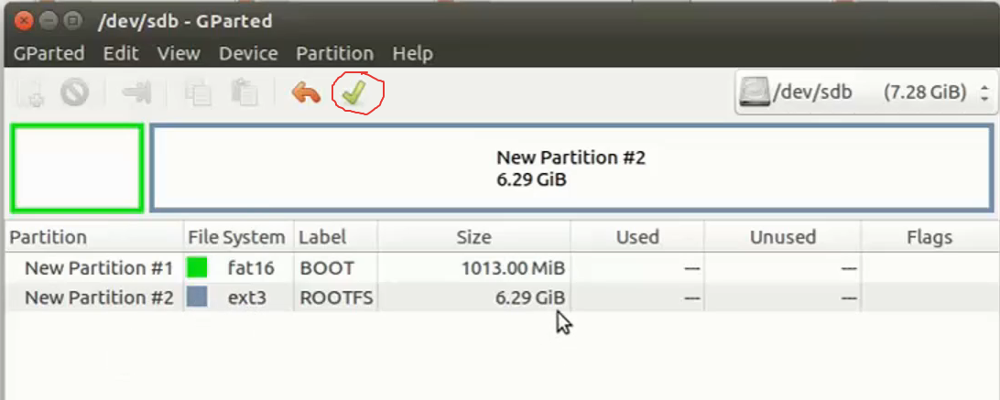

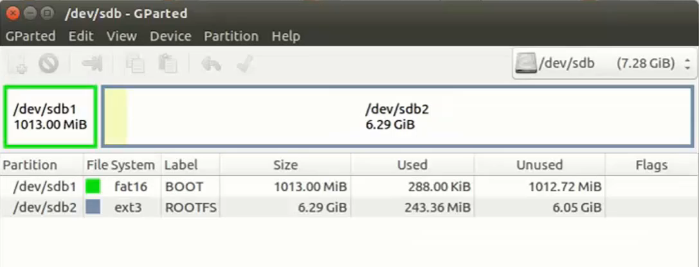

*Görseller: kursun videosundan ekran görüntüleri.*

### <a name="c4-446-boot-bölümüne-boot-bayrağı-ekle"></a>4.4.6 BOOT bölümüne `boot` bayrağı ekle

Bu bayrak, bölümü "açılış bölümü" olarak işaretler. RBL, MLO'yu bu bölümde arar.

<b>BOOT'a sağ tık → Manage Flags → `boot` kutucuğunu işaretle → Close.</b>

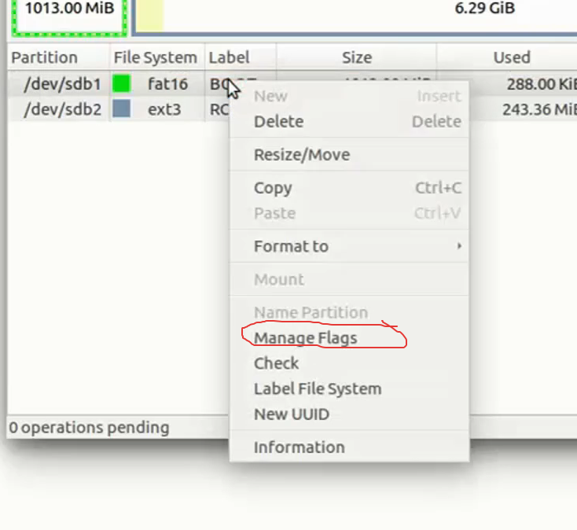

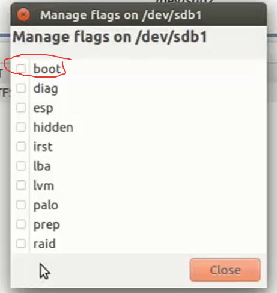

*Görseller: kursun videosundan ekran görüntüleri.*

Flags sütununda `boot` yazıyorsa tamam. GParted'ı kapatabilirsin.

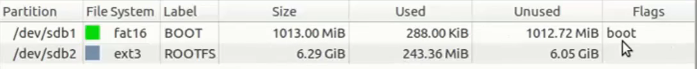

*Görsel: kursun videosundan ekran görüntüsü.*

---

## <a name="c4-45-boot-prosedürü-her-testte-tekrarlanır"></a>4.5 Boot Prosedürü (her testte tekrarlanır)

Aşağıdaki aşamaların her birinde dosya kopyaladıktan sonra bu adımları uygula.

### <a name="c4-451-kartı-bilgisayardan-güvenli-çıkar"></a>4.5.1 Kartı bilgisayardan güvenli çıkar

```bash
sync
sudo umount /media/$USER/BOOT
sudo umount /media/$USER/ROOTFS
```

- `sync` → Bekleyen yazma işlemlerini karta yazar. Atlanırsa kopyalanan dosya eksik kalabilir.
- `umount` → Bölümlerin bağlantısını keser. Artık kart çıkarılabilir.

### <a name="c4-452-seri-konsolu-hazırla-sadece-ilk-seferde"></a>4.5.2 Seri konsolu hazırla (sadece ilk seferde)

1. USB-TTL'yi kartın <b>J1</b> header'ına bağla ([1.8](#c1-18-seri-debug-header-j1)).
2. Minicom'u aç: <b>115200 baud, 8N1, Hardware Flow Control kapalı</b> ([Bölüm 2](#c2-bölüm-2--seri-konsol-ve-minicom)).

### <a name="c4-453-kartı-sd-karttan-aç-s2-butonu"></a>4.5.3 Kartı SD karttan aç (S2 butonu)

BeagleBone Black normalde <b>kendi eMMC belleğinden</b> açılır. SD karttan açılması için <b>kart açılırken S2 (BOOT) butonu basılı olmalı</b>. RBL bu butona sadece açılış anında bakar ([3.5](#c3-35-boot-kaynakları-ve-boot-sırası-sysboot-pinleri)).

SD kartı BeagleBone'a tak, sonra iki yöntemden birini uygula:

| Yöntem | Ne zaman? | Adımlar |
|---|---|---|
| <b>A: Güç vererek</b> | Kartta güç yokken | S2'yi basılı tut → USB kablosunu tak → 2–3 sn sonra S2'yi bırak |
| <b>B: Power butonuyla</b> | Kart zaten güç alıyorsa | Power'a LED'ler sönene kadar uzun bas (kapanır) → S2'yi basılı tut → Power'a kısa bas (açılır) → S2'yi bırak |

---

## <a name="c4-46-aşama-1-mlo"></a>4.6 Aşama 1: MLO

### <a name="c4-kopyala"></a>Kopyala

İndirme klasörüne git ve MLO'yu BOOT bölümüne <b>`MLO` adıyla</b> kopyala:

```bash
cd ~/BBB_Workspace/Downloads/
cp MLO-beaglebone-2013.04 /media/$USER/BOOT/MLO
```

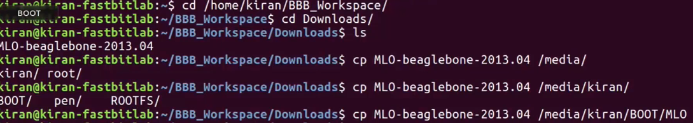

*Görsel: kursun videosundan ekran görüntüsü.*

> [!IMPORTANT]
> <b>Neden sonda `MLO` yazıyoruz?</b> `cp` komutunda hedefin sonuna bir ad yazılırsa dosya o adla kopyalanır:
> ```
> cp  MLO-beaglebone-2013.04   /media/$USER/BOOT/MLO
>     └───── kaynak ─────┘     └─ hedef klasör + YENİ AD ─┘
> ```
> RBL, BOOT bölümünde <b>tam olarak `MLO` adlı</b> dosyayı arar. Dosya uzun adıyla kalırsa bulunamaz.

> [!TIP]
> `$USER` senin kullanıcı adındır (kursta `kiran`). Dosya adlarını elle yazmak yerine ilk birkaç harfi yazıp <b>Tab</b>'a bas, terminal tamamlar.

### <a name="c4-test-et"></a>Test et

[4.5](#c4-45-boot-prosedürü-her-testte-tekrarlanır)'teki adımlarla kartı aç. Minicom'da şunu görmelisin:

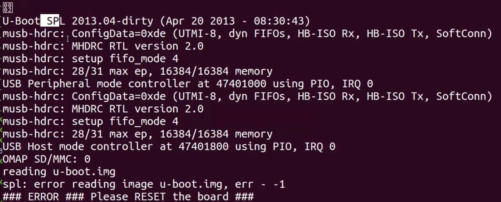

*Görsel: kursun videosundan ekran görüntüsü.*

| Satır | Anlamı |
|---|---|
| `U-Boot SPL 2013.04-dirty ...` | <b>MLO çalıştı.</b> RBL dosyayı buldu. |
| `musb-hdrc ...`, `USB ... controller` | MLO USB donanımını başlatıyor, önemli değil. |
| `reading u-boot.img` | MLO bir sonraki aşamayı (U-Boot) arıyor. |
| `spl: error reading image u-boot.img` | U-Boot bulunamadı, çünkü henüz kopyalamadık. <b>Beklenen hata.</b> |

Sonuç: <b>RBL ✓ → MLO ✓ → U-Boot ✗</b>

> [!NOTE]
> "dirty" bir hata değildir. MLO derlenirken kaynak kodda kaydedilmemiş (commit edilmemiş) değişiklik olduğunu belirtir.

---

## <a name="c4-47-aşama-2-u-boot"></a>4.7 Aşama 2: U-Boot

### <a name="c4-kopyala-1"></a>Kopyala

Kartı tekrar bilgisayara tak ve U-Boot'u <b>`u-boot.img` adıyla</b> kopyala. MLO, U-Boot'u bu adla arar:

```bash
cp u-boot-beaglebone-2013.04-r0.img /media/$USER/BOOT/u-boot.img
```

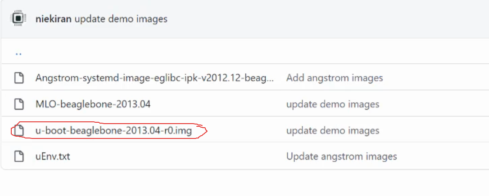

*Görsel: kursun GitHub reposu ([niekiran/EmbeddedLinuxBBB](https://github.com/niekiran/EmbeddedLinuxBBB)).*

### <a name="c4-test-et-1"></a>Test et

[4.5](#c4-45-boot-prosedürü-her-testte-tekrarlanır)'teki adımlarla kartı aç.

- `U-Boot SPL` satırlarından sonra <b>U-Boot'un kendi mesajları</b> görünüyorsa bu aşama başarılı.
- Kernel ve `uEnv.txt` henüz olmadığı için Linux SD karttan açılmaz.

Sonuç: <b>RBL ✓ → MLO ✓ → U-Boot ✓ → Kernel ✗</b>

---

## <a name="c4-48-aşama-3-root-filesystem-ve-uenvtxt"></a>4.8 Aşama 3: Root Filesystem ve uEnv.txt

### <a name="c4-kopyala-2"></a>Kopyala

Kartı tekrar bilgisayara tak.

<b>1) Root filesystem'i ROOTFS bölümüne çıkar:</b>

```bash
sudo tar -xvf Angstrom-systemd-image-eglibc-ipk-v2012.12-beagleboard.rootfs.tar.xz -C /media/$USER/ROOTFS
```

| Parça | Anlamı |
|---|---|
| `sudo` | Linux dosyalarının sahibi `root`. Dosya izinlerinin korunması için gerekli. |
| `-x` `-v` `-f` | Arşivi aç (e<b>x</b>tract), açılan dosyaları göster (<b>v</b>erbose), arşiv dosyası (<b>f</b>ile) |
| `-C /media/$USER/ROOTFS` | Dosyaları bu klasöre çıkar |

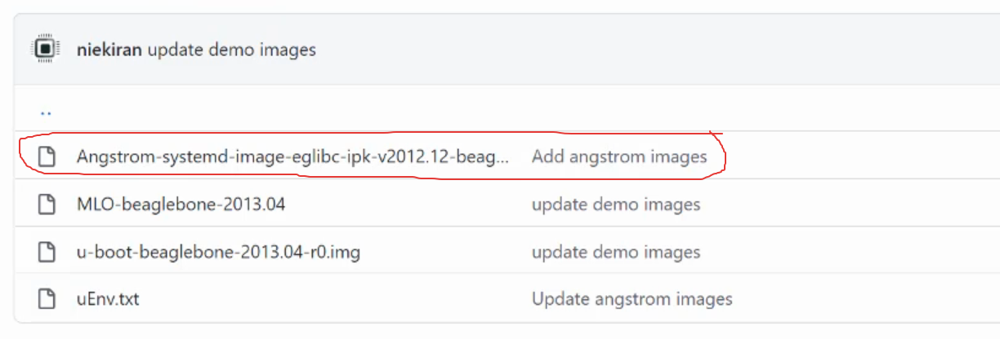

*Görsel: kursun GitHub reposu ([niekiran/EmbeddedLinuxBBB](https://github.com/niekiran/EmbeddedLinuxBBB)).*

<b>2) uEnv.txt'yi BOOT bölümüne kopyala</b> (adı değişmiyor, U-Boot bu adla arar):

```bash
cp uEnv.txt /media/$USER/BOOT/
```

<b>Kontrol et:</b>

```bash
ls /media/$USER/BOOT/            # MLO  u-boot.img  uEnv.txt
ls /media/$USER/ROOTFS/boot/     # uImage ve am335x-boneblack.dtb burada olmalı
```

### <a name="c4-test-et-2"></a>Test et

[4.5](#c4-45-boot-prosedürü-her-testte-tekrarlanır)'teki adımlarla kartı aç. Rootfs büyük olduğu için `sync` biraz uzun sürebilir, bitmesini bekle.

Kernel mesajları akar ve sonunda <b>Ångström</b> logosu ile `beaglebone login:` satırı çıkar:

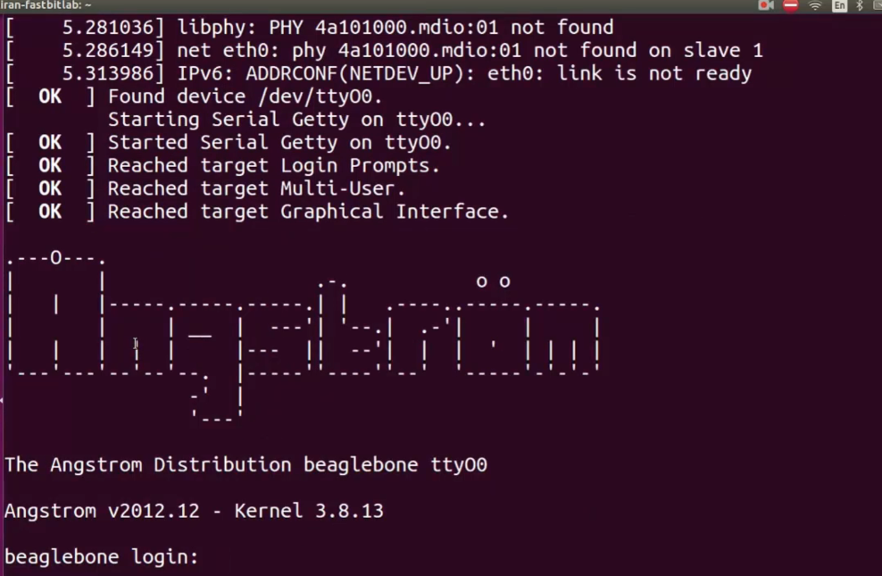

*Görsel: kursun videosundan ekran görüntüsü.*

Sonuç: <b>RBL ✓ → MLO ✓ → U-Boot ✓ → Kernel ✓ → Rootfs ✓</b> 🎉

> [!TIP]
> Giriş için kullanıcı adı `root` yaz. Bu demo imajında genelde şifre yoktur.

### <a name="c4-bu-açılışta-uenvtxt-ne-yaptı"></a>Bu açılışta uEnv.txt ne yaptı?

`uEnv.txt`, U-Boot'un davranışını değiştiren ayar dosyasıdır. BBB'nin U-Boot'u açılırken BOOT bölümündeki bu dosyayı okur ve içindeki `uenvcmd` komutunu çalıştırır.


*Görsel: kursun videosundan ekran görüntüsü.*

| Satır | Anlamı |
|---|---|
| `console=ttyO0,115200n8` | Linux mesajları UART0'a (J1 header) 115200 baud ile yazılsın. |
| `ipaddr`, `serverip` | Ağdan boot için IP adresleri. SD karttan boot'ta kullanılmıyor. |
| `loadaddr=0x82000000` | Kernel'in (uImage) <b>RAM'de (DDR) yükleneceği adres</b>. |
| `fdtaddr=0x88000000` | Device tree (.dtb) dosyasının RAM'de yükleneceği adres. |
| `loadfromsd=load mmc 0:2 ...` | `mmc 0:2` = SD kart, 2. bölüm (ROOTFS). Oradaki `/boot/uImage` → `loadaddr`'e, `/boot/am335x-boneblack.dtb` → `fdtaddr`'e yüklenir. |
| `linuxbootargs=... root=/dev/mmcblk0p2 rw` | Kernel'e "root filesystem SD kartın 2. bölümünde, okuma-yazma modunda" bilgisini verir. |
| `uenvcmd=...` | U-Boot'un çalıştırdığı komut: önce `loadfromsd`, sonra `linuxbootargs`, en son `bootm` ile kernel'i başlat. `bootm`'deki `-` "initramfs yok" demek. |

> [!NOTE]
> AM335x'te DDR'in başlangıç adresi `0x80000000`'dır. `0x82000000` ise DDR'in içinde, kernel için seçilmiş bir adres.

Aynı dosya farklı yazılarak U-Boot'a kernel'i <b>ağdan (TFTP)</b>, rootfs'u da <b>bilgisayardaki bir klasörden (NFS)</b> aldırmak mümkün ([Bölüm 8](#c8-bölüm-8--tftp-ile-ağdan-boot)):


*Görsel: kursun videosundan ekran görüntüsü.*

`uEnv.txt`'nin her satırını ve U-Boot komut satırını [Bölüm 6](#c6-bölüm-6--u-boot-komut-satırı-ve-uenvtxt)'da ayrıntılı göreceğiz.

---

## <a name="c4-49-uimage-nedir"></a>4.9 uImage Nedir?

`uImage`, U-Boot'un `bootm` komutuyla başlatabildiği kernel formatıdır. Yeni bir derleme yapılmaz. `zImage` dosyasının başına <b>64 byte'lık bir U-Boot header'ı</b> eklenir. Bu işi `mkimage` aracı yapar.

```
+-------------------+--------------------------------------+
| U-Boot Header     |               zImage                 |
|   (64 byte)       | (sıkıştırılmış, kendini açan kernel) |
+-------------------+--------------------------------------+
|<------------------------ uImage ------------------------>|
```

<b>Kernel imajları zinciri:</b>

| Dosya | Açıklama |
|---|---|
| `vmlinux` | Derlenmiş kernel. ELF formatında, sıkıştırılmamış. |
| `Image` | `vmlinux`'tan `objcopy` ile çıkarılmış ham binary |
| `zImage` | Sıkıştırılmış `Image` ve başında onu RAM'de açan küçük bir program |
| `uImage` | 64 byte U-Boot header + `zImage` |

<b>Header'ın içeriği</b> (`struct image_header`, tüm alanlar big-endian):

| Offset | Boyut | Alan | Anlamı |
|---|---|---|---|
| 0x00 | 4 | `ih_magic` | Sihirli sayı: `0x27051956` |
| 0x04 | 4 | `ih_hcrc` | Header'ın CRC32 değeri |
| 0x08 | 4 | `ih_time` | Oluşturulma zamanı |
| 0x0C | 4 | `ih_size` | zImage'in boyutu |
| 0x10 | 4 | `ih_load` | RAM'de kopyalanacağı adres |
| 0x14 | 4 | `ih_ep` | Çalıştırmanın başlayacağı adres (entry point) |
| 0x18 | 4 | `ih_dcrc` | zImage'in CRC32 değeri |
| 0x1C | 1 | `ih_os` | İşletim sistemi (Linux) |
| 0x1D | 1 | `ih_arch` | Mimari (ARM) |
| 0x1E | 1 | `ih_type` | İmaj tipi (kernel, ramdisk, script...) |
| 0x1F | 1 | `ih_comp` | Sıkıştırma tipi |
| 0x20 | 32 | `ih_name` | İmaj adı |

U-Boot bu header sayesinde dosyanın geçerli bir imaj olup olmadığını (magic number), bozulup bozulmadığını (CRC) ve RAM'de nereye yüklenip nereden çalıştırılacağını anlar.

---

## <a name="c4-410-uygulama-uimage-headerını-u-bootta-elle-okuma"></a>4.10 Uygulama: uImage Header'ını U-Boot'ta Elle Okuma

<b>Amaç:</b> uImage'ın başındaki 64 byte'lık U-Boot header'ını ([4.9](#c4-49-uimage-nedir)) kendi gözümüzle görmek.

<b>Neredeyiz?</b> [4.8](#c4-48-aşama-3-root-filesystem-ve-uenvtxt)'de U-Boot, `uEnv.txt`'deki komutları <b>otomatik</b> çalıştırıp Linux'u açtı. Bu sefer U-Boot'u durdurup aynı işin ilk yarısını <b>elle</b> yapacağız:

```
4.8:   RBL → MLO → U-Boot → Kernel → Rootfs → login     (otomatik)
4.10:  RBL → MLO → U-Boot ■ DUR → komutları elle yaz
```

| Adım | Komut | Ne yapar? |
|---|---|---|
| 1 | Açılışta bir tuşa bas | U-Boot'u durdurur, `U-Boot#` komut satırı gelir |
| 2 | `load mmc 0:2 0x82000000 /boot/uImage` | uImage'ı SD karttan DDR'e kopyalar |
| 3 | `md.b 0x82000000 40` | DDR'deki ilk 64 byte'ı (header) ekrana döker |
| 4 | — | Byte'ları header tablosuyla eşleştirip çözeriz |

> [!NOTE]
> <b>Neden önce DDR'e yüklüyoruz?</b> `md` (memory display) komutu sadece <b>belleği</b> okuyabilir. SD kart bir bellek adresi değil, depolama cihazıdır. Bu yüzden dosyayı önce RAM'e kopyalıyoruz.

Kursun bu dersinde Windows'ta Tera Term kullanılıyor. Minicom ile de komutlar ve çıktılar aynıdır ([2.6](#c2-26-windowsta-tera-term)).

### <a name="c4-4101-u-bootu-durdur"></a>4.10.1 U-Boot'u durdur

1. Seri terminali aç ve kartı [4.5.3](#c4-453-kartı-sd-karttan-aç-s2-butonu)'teki gibi SD karttan başlat.
2. Ekranda <b>`Hit any key to stop autoboot`</b> yazısı görünür görünmez bir tuşa (ör. <b>Space</b>) bas.
3. <b>`U-Boot#`</b> komut satırı geldiyse hazırsın.

> [!TIP]
> Geri sayım çok kısa (1–3 saniye). Kaçırırsan Linux açılır. Kartı yeniden başlatıp daha erken bas. Kart açılırken Space'e art arda basmak işe yarar.

### <a name="c4-4102-uimageı-ddre-yükle"></a>4.10.2 uImage'ı DDR'e yükle

Önce dosyanın orada olduğunu gör:

```text
U-Boot# ls mmc 0:2 /boot
```

Sonra DDR'e yükle:

```text
U-Boot# load mmc 0:2 0x82000000 /boot/uImage
```

| Parça | Anlamı |
|---|---|
| `load` | Bir dosya sisteminden dosyayı belleğe kopyala |
| `mmc 0:2` | MMC cihazı 0 (SD kart), 2. bölüm (ROOTFS) |
| `0x82000000` | DDR'de dosyanın yazılacağı adres (`uEnv.txt`'deki `loadaddr` ile aynı) |
| `/boot/uImage` | Bölüm içindeki dosyanın yolu |

#### <a name="c4-mmc-xy-ne-demek"></a>`mmc X:Y` ne demek?

```
load  mmc 0:2      0x82000000   /boot/uImage
      └─ NEREDEN ─┘ └─ NEREYE ─┘ └─ HANGİ DOSYA ┘
      SD kart,      DDR'deki      partition içindeki
      2. partition  bu adrese     dosya yolu
```

- <b>`X` = hangi MMC cihazı.</b> BeagleBone Black'te:
  - `mmc 0` → <b>microSD kart</b>
  - `mmc 1` → <b>eMMC</b> (karta lehimli dahili bellek)
- <b>`Y` = o cihazın kaçıncı partition'ı.</b> Numaralandırma <b>1'den</b> başlar.

> [!IMPORTANT]
> `load` her zaman <b>DDR'e</b> yükler. `mmc 0:2` dosyanın <b>nereye</b> yazılacağını değil, <b>nereden okunacağını</b> söyler. Yani "2. partition'a yükle" değil, "<b>2. partition'dan oku</b>, DDR'e yükle".

Bizim SD kartımız için:

| Yazım | Anlamı | İçinde ne var? |
|---|---|---|
| `mmc 0:1` | SD kart, 1. partition | BOOT (FAT16): `MLO`, `u-boot.img`, `uEnv.txt` |
| `mmc 0:2` | SD kart, 2. partition | ROOTFS (ext3): `/boot/uImage`, `/boot/am335x-boneblack.dtb`, Linux dosyaları |
| `mmc 1:...` | eMMC'nin partition'ları | Kartla fabrikadan gelen sistem (ör. Ångström/Debian) |

Örnekler:

```text
U-Boot# ls mmc 0:1                                  # BOOT bölümünü listele
U-Boot# ls mmc 0:2 /boot                            # ROOTFS'taki /boot klasörünü listele
U-Boot# load mmc 0:1 0x82000000 uEnv.txt            # BOOT'taki uEnv.txt'yi DDR'e yükle
U-Boot# mmc list                                    # U-Boot'un gördüğü MMC cihazlarını listele
U-Boot# mmc dev 0                                   # SD kartı seç
U-Boot# mmc part                                    # Seçili cihazın partition tablosunu göster
```

> [!NOTE]
> Linux'ta da benzer bir numaralandırma vardır: `/dev/mmcblk0p2` = MMC cihazı 0, partition 2. `uEnv.txt`'deki `root=/dev/mmcblk0p2` ifadesi, U-Boot'taki `mmc 0:2` ile aynı yeri gösterir. Ancak Linux'un numaraları kernel sürümüne göre U-Boot'tan farklı olabilir, bu yüzden ikisinin her zaman aynı olacağını varsayma.

Çıktıda kaç byte okunduğu yazar (`xxxxxxx bytes read`). Bu sayı uImage'ın boyutudur, yani 64 byte header + zImage.

> [!NOTE]
> Bu komut `uEnv.txt`'deki `loadfromsd` satırının yaptığı işin aynısı. Fark sadece bu sefer elle yazmamız.

> [!TIP]
> `load` komutu tanınmazsa eski adı olan `ext2load mmc 0:2 0x82000000 /boot/uImage` komutunu kullan (ext3 de bu komutla okunur). `ls` yerine de `ext2ls mmc 0:2 /boot` kullanılır.

### <a name="c4-4103-headerı-ekrana-dök"></a>4.10.3 Header'ı ekrana dök

```text
U-Boot# md.b 0x82000000 40
```

| Parça | Anlamı |
|---|---|
| `md` | memory display: belleği ekrana dök |
| `.b` | byte byte göster |
| `0x82000000` | Başlangıç adresi (uImage'ı yüklediğimiz yer) |
| `40` | Kaç byte gösterilecek. <b>U-Boot sayıları hex kabul eder:</b> `0x40` = <b>64 byte</b> = header'ın tamamı |

Çıktı 4 satırdır. Her satırda adres, 16 byte ve sağda bu byte'ların ASCII karşılığı bulunur.

> [!WARNING]
> `md` komutu nokta olmadan (`md 0x82000000 10`) yazılırsa veriyi <b>4 byte'lık word'ler</b> halinde gösterir. ARM işlemci <b>little-endian</b>, header ise <b>big-endian</b> olduğu için byte'lar ters görünür. Örneğin magic number `27051956` yerine <b>`56190527`</b> olarak görünür. Header'ı okurken `md.b` kullanmak daha kolaydır.

### <a name="c4-4104-byteları-çöz"></a>4.10.4 Byte'ları çöz

Çıktının her satırı header'ın şu alanlarına denk gelir:

```
82000000: [27 05 19 56] [.. .. .. ..] [.. .. .. ..] [.. .. .. ..]
            ih_magic      ih_hcrc       ih_time       ih_size
82000010: [.. .. .. ..] [.. .. .. ..] [.. .. .. ..] [..][..][..][..]
            ih_load       ih_ep         ih_dcrc      os arch type comp
82000020: [ ih_name: 32 byte imaj adı, sağdaki ASCII sütununda okunur ...
82000030:   ...                                                        ]
```

| Alan | Nasıl kontrol edilir? |
|---|---|
| `ih_magic` | `27 05 19 56` olmalı. Değilse bu adreste geçerli bir uImage yok. |
| `ih_time` | Unix zaman damgası. Linux'ta tarihe çevir: `date -d @$((0xXXXXXXXX))` |
| `ih_size` | zImage boyutu. Ondalığa çevir: `echo $((0xXXXXXXXX))`. Bu değer + 64 = `load` komutunun okuduğu byte sayısı olmalı. |
| `ih_load`, `ih_ep` | Kernel'in DDR'de çalışacağı adres ve başlangıç noktası |
| `os` | `05` = Linux |
| `arch` | `02` = ARM |
| `type` | `02` = Kernel |
| `comp` | `00` = sıkıştırma yok. zImage zaten kendini açtığı için U-Boot ayrıca açmaz. |
| `ih_name` | Sağdaki ASCII sütununda imajın adı okunur |

> [!TIP]
> Hex'i ondalığa çevirmek için Windows Hesap Makinesi'nin <b>Programcı</b> modunu da kullanabilirsin.

### <a name="c4-4105-sonucu-u-boota-doğrulat"></a>4.10.5 Sonucu U-Boot'a doğrulat

Elle çözdüğün değerleri U-Boot'un kendi çözümüyle karşılaştır:

```text
U-Boot# iminfo 0x82000000
```

`iminfo` komutu header'ı okuyup Image Name, Created, Image Type, Data Size, Load Address ve Entry Point bilgilerini yazar. Ayrıca CRC'yi kontrol eder (`Verifying Checksum ... OK`). Değerler senin bulduklarınla aynı olmalı.

### <a name="c4-4106-linuxu-başlat"></a>4.10.6 Linux'u başlat

İşin bitince Linux'u normal şekilde açmak için:

```text
U-Boot# boot
```

Ya da kartı yeniden başlat (`reset` veya Power butonu).

### <a name="c4-komut-özeti"></a>Komut özeti

| Komut | Ne yapar? |
|---|---|
| `ls mmc 0:2 /boot` | SD kartın 2. bölümündeki `/boot` klasörünü listeler |
| `load mmc 0:2 0x82000000 /boot/uImage` | uImage'ı DDR'de `0x82000000` adresine yükler |
| `md.b 0x82000000 40` | O adresten başlayarak 64 byte'ı byte byte gösterir |
| `iminfo 0x82000000` | O adresteki uImage header'ını çözüp yazar |
| `boot` | Normal açılışa devam eder (Linux'u başlatır) |
| `reset` | Kartı yeniden başlatır |
| `help` | Tüm U-Boot komutlarını listeler (`help md` gibi tek komut için de olur) |

---

## <a name="c4-411-kursun-güncel-sd-kart-i̇majları-u-boot-202204--kernel-510168"></a>4.11 Kursun Güncel SD Kart İmajları (U-Boot 2022.04 + Kernel 5.10.168)

Bu bölümde kullandığımız Ångström dosyaları kursun ilk sürümünden kalma (2013). Kursun reposundaki `pre-built-images/SD-boot` klasöründe güncel bir set de var:

| Dosya | İçerik | SD kartta nereye? |
|---|---|---|
| `MLO`, `u-boot.img` | U-Boot 2022.04 | BOOT |
| `uImage` | Linux 5.10.168 | BOOT |
| `am335x-boneblack.dtb` | Aynı kernel'in device tree'si | BOOT |
| `uEnv.txt` | Aşağıda | BOOT |

Farklar:
- Kernel ve DTB artık ROOTFS'teki `/boot` klasöründe değil, <b>BOOT (FAT) bölümünde</b> duruyor. `load mmc 0:1 ...` ile okunuyor.
- Bu set bir rootfs içermiyor. ROOTFS bölümüne [Bölüm 12](#c12-bölüm-12--busybox-ile-minimal-root-filesystem)'de BusyBox ile hazırlayacağımız dosya sistemini koyacağız. Kernel 5.10 ile 2012 tarihli Ångström rootfs'i birlikte çalışmaz.
- Bu U-Boot'ta `bootdelay=0`: geri sayım yok. U-Boot'u durdurmak için kart açılırken <b>Space'e basılı tut</b>. Bekleme süresini uzatmak [9.4](#c9-94-challenge-autoboot-bekleme-süresini-10-saniyeye-çıkarmak)'ün konusu.

Kursun `uEnv.txt`'si:

```text
console=ttyS0,115200n8
netargs=setenv bootargs console=ttyO0,115200n8 root=/dev/mmcblk0p2 rw rootfstype=ext4 rootwait debug earlyprintk mem=512M
netboot=echo Booting from microSD ...; setenv autoload no ; load mmc 0:1 ${loadaddr} uImage ; load mmc 0:1 ${fdtaddr} am335x-boneblack.dtb ; run netargs ; bootm ${loadaddr} - ${fdtaddr}
uenvcmd=run netboot
```

| Parça | Anlamı |
|---|---|
| `rootfstype=ext4` | Rootfs'in dosya sistemi türü. ext4 sürücüsü ext3 bölümleri de bağlayabilir. |
| `rootwait` | Kernel, rootfs'in bulunduğu aygıt (SD kart) hazır olana kadar bekler. MMC aygıtları geç algılandığı için önemli. |
| `debug earlyprintk` | Açılışta daha fazla mesaj basar. Sorun ayıklarken işe yarar. |
| `mem=512M` | Kernel'e kullanacağı RAM miktarını söyler. |
| `${loadaddr}`, `${fdtaddr}` | U-Boot'un kendi varsayılan değişkenleri (`0x82000000`, `0x88000000`). Dosyada tanımlanmadıkları halde çalışır. |

> [!WARNING]
> Dosyanın ilk satırında `console=ttyS0` tanımlanmış ama `netargs` bu değişkeni kullanmıyor, `console=ttyO0` yazıyor. Kernel 5.10'da UART0'ın adı `ttyS0`'dır ([3.4](#c3-34-linux-kernel-ve-root-filesystem)). Açılışta `Starting kernel ...`'dan sonra mesaj göremezsen `netargs` içinde `console=${console}` kullan.

## <a name="c4-412-özet"></a>4.12 Özet

- SD kart iki bölümden oluşur: <b>BOOT</b> (FAT16, `boot` bayraklı: `MLO`, `u-boot.img`, `uEnv.txt`) ve <b>ROOTFS</b> (ext3: kernel, DTB ve Linux dosyaları).
- Dosya adları önemli: RBL tam olarak <b>`MLO`</b>'yu, MLO tam olarak <b>`u-boot.img`</b>'yi arar.
- Kartı SD karttan açmak için güç verirken <b>S2</b>'yi basılı tut.
- U-Boot `uEnv.txt`'deki `uenvcmd`'yi çalıştırır: kernel ve DTB'yi `mmc 0:2`'den RAM'e yükler, `bootargs`'ı ayarlar, `bootm` ile başlatır.
- `uImage` = 64 byte U-Boot header + `zImage`. `md.b` ile byte byte, `iminfo` ile çözülmüş halde okunabilir.

## <a name="c4-413-karşılaşılabilecek-problemler"></a>4.13 Karşılaşılabilecek Problemler

| Belirti | Sebep | Çözüm |
|---|---|---|
| Minicom'da hiçbir şey yok | TX/RX düz bağlı, baud yanlış ya da Hardware Flow Control açık | Bağlantıyı ve 115200 8N1 ayarını kontrol et ([2.8](#c2-28-karşılaşılabilecek-problemler)) |
| Sürekli `CCCCCCCC...` | RBL, MLO'yu bulamadı | Dosya adı tam `MLO` mu, BOOT bölümü FAT mı, `boot` bayrağı açık mı? ([4.4](#c4-44-sd-kartı-bölümlere-ayırma-gparted)) |
| `error reading image u-boot.img` | BOOT'ta `u-boot.img` yok veya adı yanlış | Dosyayı `u-boot.img` adıyla kopyala ([4.7](#c4-47-aşama-2-u-boot)) |
| Eski Linux açılıyor (Debian vb.) | Kart eMMC'den açıldı; S2 açılış anında basılı değildi | Gücü kes, S2 basılıyken tekrar ver ([4.5.3](#c4-453-kartı-sd-karttan-aç-s2-butonu)) |
| U-Boot `/boot/uImage` bulamıyor | Rootfs ROOTFS bölümüne çıkarılmamış veya yanlış klasöre çıkarılmış | `ls /media/$USER/ROOTFS/boot/` ile kontrol et, arşivi `-C` ile doğru yere çıkar |
| `Kernel panic ... Unable to mount root fs` | ROOTFS bölümü boş veya `sync` yapılmadan kart çıkarılmış | Rootfs'i yeniden çıkar, `sync` + `umount` ile güvenli çıkar |


<div class="page-break"></div>

# <a name="c5-bölüm-5--emmcden-boot"></a>Bölüm 5 — eMMC'den Boot

> <b>Bu bölümde:</b>
> - eMMC'nin ne olduğunu ve DDR RAM'den farkını öğreneceksin.
> - Güncel bir Debian imajını önce SD karta yazıp sonra <b>flasher script</b> ile eMMC'ye aktaracaksın.
> - Karta USB üzerinden SSH ile bağlanmayı göreceksin.
>
> <b>Ön koşul:</b> [Bölüm 3](#c3-bölüm-3--linux-boot-süreci-rbl--spl--u-boot) — boot sırası ve S2, [Bölüm 4](#c4-bölüm-4--sd-karttan-boot) — SD karttan boot.

---

## <a name="c5-51-hatırlatma-emmc-nedir"></a>5.1 Hatırlatma: eMMC Nedir?

<b>eMMC (embedded MultiMediaCard)</b>, BeagleBone Black'in üzerine lehimli olarak gelen dahili depolama birimidir. Aslında içinde bir SD kart vardır ve doğrudan karta lehimlenmiştir. Kapasitesi Rev C'de <b>4 GB</b>, eski Rev B'de <b>2 GB</b>'tır.

- Kartın <b>kalıcı depolama alanıdır</b>. Bilgisayardaki HDD/SSD gibi düşünebilirsin.
- Kart fabrikadan eMMC'de yüklü bir Debian ile gelir. Bu yüzden SD kart takmadan güç verildiğinde Linux açılır.
- SD karta göre <b>daha hızlı ve güvenilirdir</b>: 8-bit veri yolu ve dahili denetleyicisi vardır. Kartın üzerinde olduğu için çıkmaz, kaybolmaz, temas sorunu yaşamaz. Bu yüzden ürünlerde (sahadaki cihazlarda) tercih edilir.

### <a name="c5-ddr-ram-ile-farkı"></a>DDR RAM ile farkı

| | DDR RAM | eMMC |
|---|---|---|
| <b>PC karşılığı</b> | RAM | HDD / SSD |
| <b>Kalıcılık</b> | Geçici, güç gidince silinir | Kalıcı |
| <b>Görevi</b> | Çalışma alanı | Depolama |
| <b>BBB'de boyut</b> | 512 MB DDR3L | 4 GB (Rev C) |

> [!NOTE]
> İşlemci kodu doğrudan eMMC'den çalıştırmaz. Açılışta MLO, U-Boot, kernel ve device tree eMMC'den okunur, adım adım RAM'e yüklenir ve orada çalıştırılır.

---

## <a name="c5-52-donanım-bağlantısı"></a>5.2 Donanım Bağlantısı


*Görsel: kursun slaytı.*

| Bileşen | AM335x'e bağlantısı | Linux'ta (genelde) |
|---|---|---|
| <b>4 GB eMMC</b> | <b>mmc1</b> arayüzü (8-bit) | `mmcblk1` |
| <b>microSD kart</b> | <b>mmc0</b> arayüzü | `mmcblk0` |
| <b>DDR (512 MB)</b> | DDR arayüzü | - |

> [!CAUTION]
> Numaralandırma kernel sürümüne ve device tree'ye göre değişebilir. Bir diske bir şey yazmadan önce <b>`lsblk` ile mutlaka kontrol et</b>. Yanlış diske yazmak oradaki sistemi siler.

Varsayılan boot sırasında eMMC ilk sıradadır. eMMC'de geçerli bir MLO varsa kart oradan açılır, SD kart takılı olsa bile ona bakmaz. SD karttan açmak için <b>güç verirken S2'ye basılı tutulmalıdır</b> ([3.5](#c3-35-boot-kaynakları-ve-boot-sırası-sysboot-pinleri)).

---

## <a name="c5-53-emmcye-debian-yükleme-teori"></a>5.3 eMMC'ye Debian Yükleme (Teori)

eMMC'ye doğrudan bilgisayardan yazılamaz, çünkü kartın üzerine lehimlidir. Bu yüzden önce <b>SD karttan</b> boot edilir, sonra SD karttaki her şey eMMC'ye kopyalanır.


*Görsel: kursun slaytı.*

1. En güncel <b>Debian OS</b> image'ını indir.
2. Bootable image'ı önce <b>SD karta</b> yaz.
3. Kartı <b>SD karttan boot et</b> (güç verirken S2'ye basılı tut).
4. <b>eMMC flasher script</b>'ini çalıştır.
5. Flasher script, <b>SD karttaki her şeyi eMMC'ye kopyalar</b>.

### <a name="c5-emmc-flasher-script-ne-yapar"></a>eMMC flasher script ne yapar?


*Görsel: kursun slaytı.*

1. Script <b>SD karttan</b> çalıştırılır.
2. eMMC iki bölüme (partition) ayrılır: <b>FAT</b> ve <b>EXT4</b>.
3. Bu bölümler formatlanır ve dosya sistemleri oluşturulur:
   - <b>FAT</b>: Boot dosyaları (MLO, u-boot.img vb.)
   - <b>EXT4</b>: Root dosya sistemi (rootfs)
4. SD karttaki tüm içerik yeni oluşturulan bölümlere kopyalanır.
5. İş bitince kart <b>kapatılır</b>.

> [!NOTE]
> Bu, [Bölüm 4](#c4-bölüm-4--sd-karttan-boot)'te SD kart için GParted ile elle yaptığımız bölümlendirme ve kopyalama işleminin eMMC için otomatik yapılan halidir.

---

## <a name="c5-54-uygulama-emmcyi-güncelleme"></a>5.4 Uygulama: eMMC'yi Güncelleme

### <a name="c5-541-kartın-ip-adresini-öğren"></a>5.4.1 Kartın IP adresini öğren

Kartı bilgisayara bağladığın yönteme göre IP adresi değişir. Güncel liste: <https://beagleboard.org/getting-started>


*Görsel: beagleboard.org.*

| Bağlantı | Bilgisayarın işletim sistemi | IP adresi |
|---|---|---|
| USB | Windows | `192.168.7.2` |
| USB | Mac OS X, <b>Linux</b> | `192.168.6.2` |
| WiFi | Hepsi | `192.168.8.1` |
| Hepsi (mDNS) | Hepsi | `beaglebone.local` |

Bağlantıyı test etmek için:

```bash
ping 192.168.6.2
```

### <a name="c5-542-ssh-ile-karta-bağlan"></a>5.4.2 SSH ile karta bağlan

> [!TIP]
> SSH'ın bilgisayarında yüklü olup olmadığını `ssh -V` komutuyla kontrol edebilirsin. Yüklü değilse Ubuntu'da `sudo apt install openssh-client`, Fedora'da `sudo dnf install openssh-clients` ile kurabilirsin.

```bash
ssh debian@192.168.6.2
```


*Görsel: kursun videosundan ekran görüntüsü.*

Bağlanınca kart karşılama mesajında varsayılan kullanıcı adını ve şifreyi gösterir. `password:` satırına şifreyi yaz:

| Kullanıcı adı | Şifre |
|---|---|
| `debian` | `temppwd` |

> [!NOTE]
> Şifre yazarken ekranda hiçbir karakter görünmez. Bu normaldir, yazmaya devam edip Enter'a bas.

> [!IMPORTANT]
> `temppwd` şifresi kartla gelen <b>eski image'larda</b> geçerlidir. En güncel image'larda varsayılan şifre yoktur. Kullanıcı adı ve şifre, SD karta yazdıktan sonra FAT bölümündeki <b>`sysconf.txt`</b> dosyasından ilk açılıştan önce ayarlanmalıdır ([5.4.4](#c5-544-en-güncel-imageı-indir)).

İlk bağlantıda `Are you sure you want to continue connecting (yes/no)?` diye sorarsa `yes` yaz.

### <a name="c5-543-karttaki-debian-sürümünü-kontrol-et"></a>5.4.3 Karttaki Debian sürümünü kontrol et

```bash
lsb_release -da
```


*Görsel: kursun videosundan ekran görüntüsü.*

Bu örnekte kartta <b>Debian 10 (buster)</b> yüklü.

> [!TIP]
> Kartında zaten en güncel Debian image'ı yüklüyse bu bölümün geri kalanını atlayabilirsin.

### <a name="c5-544-en-güncel-imageı-indir"></a>5.4.4 En güncel image'ı indir

Güncel image'lar: <https://beagleboard.org/latest-images>


*Görsel: beagleboard.org. Görselde aynı tarihli imajın v6.18.x çeşidi görünüyor; listede başlığında <b>(v5.10-ti)</b> yazanı seç.*

Bu kitap yazılırken en güncel sürüm <b>Debian 13.7 (2026-10-09, IoT)</b> idi. Karttaki Debian 10'dan çok daha yeni olduğu için eMMC'yi güncellemek gerekiyor.

Aynı tarihli imaj <b>üç farklı kernel</b> ile yayınlanıyor: v6.18.x, v6.12.x ve <b>v5.10-ti</b>. Bu kitapta <b>v5.10-ti</b> çeşidini indir:

| Çeşit | Kernel | Bu kitapta |
|---|---|---|
| <b>IoT (v5.10-ti)</b> | BeagleBoard'un 5.10 LTS kernel'i | <b>Kullanılan.</b> [Bölüm 15](#c15-bölüm-15--am335x-gpioları-pin-ayarları-ve-sysfs) – [Bölüm 20](#c20-bölüm-20--16x2-karakter-lcd-hd44780)'deki GPIO numaraları, `config-pin` ve cape-universal bu kernel'e göre. [Bölüm 10](#c10-bölüm-10--linux-kernel-kaynak-ağacı-ve-derleme)'da derlediğimiz kernel de 5.10. |
| IoT (v6.12.x / v6.18.x) | Daha yeni kernel'ler | GPIO numaraları 512'den başlar ([15.6](#c15-156-gpioları-kullanıcı-alanından-kontrol-etmek)); donanım bölümlerindeki `echo 60 > export` gibi komutlar başka pine gider. |

İndireceğin dosya: `am335x-debian-13.7-base-v5.10-ti-armhf-2026-10-09-4gb.img.xz` ([imajın sayfası](https://www.beagleboard.org/distros/beaglebone-black-debian-13-7-2026-10-09-iot-v5-10-ti)).

- <b>Image</b> butonu ile `.img.xz` dosyasını indir.
- İstersen <b>sha256</b> ile indirdiğin dosyanın bozulmadığını kontrol edebilirsin:
  ```bash
  sha256sum <indirilen-dosya>.img.xz
  ```
  Çıkan değer sitedeki sha256 değeriyle aynı olmalı.

> [!IMPORTANT]
> Sitedeki açıklamada da yazdığı gibi, bu image'da kullanıcı şifresi <b>ilk açılıştan önce</b> FAT32 bölümündeki `sysconf.txt` dosyasından ayarlanmalıdır.

### <a name="c5-545-imageı-sd-karta-yaz-balenaetcher"></a>5.4.5 Image'ı SD karta yaz (balenaEtcher)

Bu image doğrudan eMMC'ye yazılamaz. Önce <b>SD karta</b> yazılır, ardından kart SD karttan açılıp eMMC'ye aktarılır ([5.3](#c5-53-emmcye-debian-yükleme-teori)). SD karta yazmak için bir programa ihtiyacımız var: <b>balenaEtcher</b> (<https://etcher.balena.io>).


*Görsel: kursun videosundan ekran görüntüsü.*

#### <a name="c5-neden-dosyayı-sd-karta-kopyalamak-yetmiyor"></a>Neden dosyayı SD karta kopyalamak yetmiyor?

İndirilen `.img.xz` dosyası normal bir dosya değil, <b>bütün bir diskin birebir kopyasıdır</b>:

```
Debian image'ı (.img)
├── Bölüm tablosu (partition table)   → diskin hangi kısmı hangi bölüm
├── BOOT bölümü (FAT)                  → MLO, u-boot.img, sysconf.txt ...
└── rootfs bölümü (EXT4)               → Debian'ın tamamı
```

Dosyayı sürükle-bırak ile kopyalarsan SD kartta sadece tek bir büyük `.img` dosyası olur ve kart açılmaz. Etcher ise image'ı <b>diskin en başından itibaren ham olarak (byte byte) yazar</b>. Böylece SD kart image'daki bölümlere birebir sahip olur ve boot edilebilir hale gelir.

#### <a name="c5-etcher-ile-yazma-adımları"></a>Etcher ile yazma adımları


*Görsel: kursun videosundan ekran görüntüsü.*

1. <b>Flash from file</b> ile indirdiğin image dosyasını seç (`am335x-debian-13.7-base-v5.10-ti-armhf-2026-10-09-4gb.img.xz`; kursta `bone-debian-10.3-iot-armhf-2020-04-06-4gb.img.xz`).
2. <b>Select target</b> ile SD kartı seç. Kart okuyucu bilgisayarda bir USB depolama aygıtı olarak görünür.
3. <b>Flash!</b> butonuna bas. Yazma ve doğrulama (verify) bitene kadar bekle.


*Görsel: kursun videosundan ekran görüntüsü.*

Bu örnekte iki aygıt görünüyor:

| Aygıt | Boyut | Konum | Açıklama |
|---|---|---|---|
| Compute Module | 18.9 MB | `/dev/sdb` | <b>Locked / Too small</b>, seçilemez |
| <b>Generic STORAGE DEVICE</b> | <b>15.9 GB</b> | <b>`/dev/sdc`</b> | <b>SD kart</b> → bunu seç |

#### <a name="c5-hangisi-sd-kart-dmesg"></a>Hangisi SD kart? (`dmesg`)

Listede birden fazla aygıt çıkarsa ve hangisinin SD kart olduğundan emin değilsen, SD kartı taktıktan hemen sonra terminalde şunu çalıştır:

```bash
sudo dmesg | tail -20
```


*Görsel: kursun videosundan ekran görüntüsü.*

Son satırlarda yeni takılan aygıtın adı ve boyutu görünür. Bu örnekte `[sdc] ... (15.9 GB/14.8 GiB)` satırı, SD kartın <b>`/dev/sdc`</b> olduğunu gösteriyor.

> [!TIP]
> `lsblk` komutu da aygıtları boyutlarıyla listeler. Harf (`sdb`, `sdc` ...) bilgisayardan bilgisayara değişir. Her seferinde boyuta bakarak kontrol et.

### <a name="c5-546-kartı-sd-karttan-boot-et"></a>5.4.6 Kartı SD karttan boot et

1. Kartın <b>gücünü kes</b>.
2. SD kartı BeagleBone'a <b>tak</b>.
3. Güç kablosunu tak.
4. <b>Power</b> butonuna LED'ler sönene kadar basılı tut, LED'ler sönünce bırak. Kart artık kapalı.
5. <b>S2</b> butonunu basılı tut ve bu sırada <b>Power</b> butonuna bir kez basıp bırak.
6. S2'yi <b>2-3 saniye</b> daha basılı tut, sonra bırak.
7. Kart SD karttan açılmaya başlar. Bu sırada LED'ler hızlı hızlı yanıp söner.


*Görsel: kursun videosundan ekran görüntüsü.*

Bilgisayarında <b>BEAGLEBONE</b> adında bir sürücü göründüyse kart açılmıştır. Şimdi [5.4.2](#c5-542-ssh-ile-karta-bağlan)'deki SSH komutuyla tekrar bağlan:

```bash
ssh debian@192.168.6.2
```

> [!NOTE]
> Bağlanırken `REMOTE HOST IDENTIFICATION HAS CHANGED!` uyarısı alırsan bu normaldir. Kart farklı bir sistemden (SD karttan) açıldığı için SSH anahtarı değişmiştir. Eski kaydı silip tekrar bağlan:
> ```bash
> ssh-keygen -R 192.168.6.2
> ```

### <a name="c5-547-emmc-flasher-scriptini-çalıştır"></a>5.4.7 eMMC flasher script'ini çalıştır

Flasher'ın adı ve yeri imajın yaşına göre değişir:

| İmaj | Flasher |
|---|---|
| Güncel imajlar (Debian 11 ve sonrası, ör. 13.7) | `beagle-flasher` paketi |
| Kursun imajı (Debian 10.3) | `/opt/scripts/tools/eMMC/init-eMMC-flasher-v3.sh` |

#### <a name="c5-güncel-imajlarda-beagle-flasher"></a>Güncel imajlarda: `beagle-flasher`

```bash
sudo enable-beagle-flasher      # bir sonraki açılışta SD karttaki sistemi eMMC'ye yazar
sudo reboot
```

`enable-beagle-flasher`, SD kartı bir sonraki açılışta flasher olarak çalışacak şekilde ayarlar. Kart yeniden açılınca kopyalama kendiliğinden başlar, bitince kart kapanır. Aynı paketteki `sudo beagle-flasher` komutu ise kopyalamayı hemen, çalışan sistemin içinden yapar. Daha hızlıdır ama kaynak sistem kopyalanırken çalıştığı için önerilen yol `enable-beagle-flasher`'dır.

> [!NOTE]
> Komut bulunamazsa paketini ara ve kur: `sudo apt update && apt search beagle-flasher`, ardından listede çıkan paketi `sudo apt install <paket>` ile kur.

#### <a name="c5-kursun-imajında-init-emmc-flasher-v3sh"></a>Kursun imajında: `init-eMMC-flasher-v3.sh`

Flasher script'leri `/opt/scripts/tools/eMMC` klasöründe bulunur:

```bash
cd /opt/scripts/tools/eMMC
ls
```


*Görseller: kursun videosundan ekran görüntüleri.*

Listede birçok script var. BeagleBone Black için kullanılan <b>`init-eMMC-flasher-v3.sh`</b>:

```bash
sudo ./init-eMMC-flasher-v3.sh
```

> [!CAUTION]
> Bu script eMMC'deki <b>her şeyi siler</b> ve yerine SD karttaki sistemi yazar. eMMC'de saklamak istediğin dosya varsa önce yedekle.

Script çalışırken [5.3](#c5-emmc-flasher-script-ne-yapar)'te anlatılan adımları sırayla yapar: bölümlendirme → formatlama → kopyalama. Bu birkaç dakika sürer.


*Görsel: kursun videosundan ekran görüntüsü.*

Flash işlemi başarılıysa şu mesajı görürsün:

```
eMMC has been flashed: please wait for device to power down.
```

Ardından kart kendini kapatır ve SSH bağlantısı kopar (`Connection to 192.168.6.2 closed by remote host.`). Bu normaldir.

### <a name="c5-548-emmcden-boot-et"></a>5.4.8 eMMC'den boot et

1. SD kartı BeagleBone'dan <b>çıkar</b>. Artık ona ihtiyacın yok.
2. <b>Power</b> butonuna bir kez bas (S2'ye <b>basmadan</b>). Kart artık eMMC'den açılır.
3. SSH ile tekrar bağlan:
   ```bash
   ssh debian@192.168.6.2
   ```
4. Yeni sürümün yüklendiğini kontrol et:
   ```bash
   lsb_release -da
   ```

---

## <a name="c5-55-özet"></a>5.5 Özet

- eMMC kartın kalıcı, dahili deposudur (MMC1). DDR ise geçici çalışma belleğidir.
- eMMC'ye doğrudan yazılamaz: imaj önce <b>balenaEtcher</b> ile SD karta yazılır, kart <b>S2</b> ile SD karttan açılır, <b>flasher</b> (`enable-beagle-flasher`; eski imajlarda `init-eMMC-flasher-v3.sh`) SD karttaki sistemi eMMC'ye kopyalar.
- Bu kitapta Debian 13.7'in <b>v5.10-ti</b> çeşidi kullanılıyor; donanım bölümlerindeki GPIO numaraları bu kernel'e göre.
- USB üzerinden kartın adresi Linux'ta `192.168.6.2`, Windows'ta `192.168.7.2`. Bağlantı: `ssh debian@192.168.6.2`.

## <a name="c5-56-karşılaşılabilecek-problemler"></a>5.6 Karşılaşılabilecek Problemler

| Belirti | Sebep | Çözüm |
|---|---|---|
| `ping 192.168.6.2` cevap vermiyor | Kart henüz açılmadı ya da Windows'tasın | 1–2 dakika bekle. Windows'ta adres `192.168.7.2`. `beaglebone.local` da denenebilir. |
| `REMOTE HOST IDENTIFICATION HAS CHANGED!` | Kart farklı bir sistemden açıldı | `ssh-keygen -R 192.168.6.2` |
| Şifre kabul edilmiyor | Yeni image'da varsayılan şifre yok | SD karttaki `sysconf.txt` ile kullanıcı/şifre belirle ([5.4.4](#c5-544-en-güncel-imageı-indir)) |
| `/opt/scripts/tools/eMMC` yok | Güncel imaj; flasher artık `beagle-flasher` paketinde | `sudo enable-beagle-flasher` ([5.4.7](#c5-547-emmc-flasher-scriptini-çalıştır)) |
| Donanım bölümlerinde `echo 60 > /sys/class/gpio/export` hata veriyor ya da başka pin değişiyor | İmajın v6.x çeşidi yüklendi; GPIO numaraları 512'den başlıyor | v5.10-ti çeşidini yükle ya da numarayı `cat /sys/kernel/debug/gpio` ile bul ([15.6](#c15-156-gpioları-kullanıcı-alanından-kontrol-etmek)) |
| Kart flash'tan sonra yine eski sistemle açılıyor | SD kart hâlâ takılı ve S2'ye basıldı / flash yarıda kaldı | SD kartı çıkar, S2'ye basmadan aç. Gerekirse flash'ı tekrarla. |


<div class="page-break"></div>

<div class="part-title">Kısım III<br>U-Boot ile Çalışmak</div>

<div class="page-break"></div>

# <a name="c6-bölüm-6--u-boot-komut-satırı-ve-uenvtxt"></a>Bölüm 6 — U-Boot Komut Satırı ve uEnv.txt

> <b>Bu bölümde:</b>
> - `uEnv.txt` dosyasının <b>satır satır ne yaptığını</b> anlayacaksın.
> - Bu dosyayı SD karta kopyalamadan, <b>seri port (UART) üzerinden</b> doğrudan U-Boot'a göndereceksin (`loady`, `env import`).
> - Kursun challenge'ı: boot imajlarını eMMC yerine <b>SD karttan (MMC0)</b> yükleyeceksin. Ek alıştırmada da tersini yapıp rootfs'i <b>eMMC'den</b> bağlayacaksın.
> - <b>ROOTFS</b> bölümünde hangi klasör ve dosyaların olduğunu ve bunlara <b>hangi komutlarla</b> ulaşacağını göreceksin.
>
> <b>Ön koşul:</b> [Bölüm 4](#c4-bölüm-4--sd-karttan-boot) — SD karttan boot, [Bölüm 5](#c5-bölüm-5--emmcden-boot) — eMMC'deki Debian.

> [!NOTE]
> Bu bölümdeki terminal görüntüleri temsilidir. Senin kartında U-Boot sürümü, dosya boyutları ve bölüm boyutları farklı görünebilir.

---

## <a name="c6-61-temel-kavramlar"></a>6.1 Temel Kavramlar

| Kavram | Ne işe yarar? |
|---|---|
| <b>`uEnv.txt`</b> | U-Boot ortam değişkenlerini <b>metin olarak</b> tanımlayan dosya. Her satır `isim=değer` biçimindedir. U-Boot'un bu dosyayı açılışta otomatik okuyup okumaması, U-Boot'un yapılandırmasına bağlıdır (BBB'nin varsayılan U-Boot'u SD karttaki `uEnv.txt`'yi arar). |
| <b>Ortam değişkeni (environment)</b> | U-Boot'un ayarları ve makroları. `printenv` ile görülür, `setenv` ile değiştirilir, `saveenv` ile kalıcı kaydedilir. |
| <b>Minicom</b> | Bilgisayardan seri port (UART) üzerinden karta bağlanmayı sağlayan terminal programı ([Bölüm 2](#c2-bölüm-2--seri-konsol-ve-minicom)). |
| <b>`loady`</b> | U-Boot'ta <b>YMODEM</b> protokolüyle seri porttan dosya alıp RAM'e yazan komut. |
| <b>`env import -t <adres> <boyut>`</b> | RAM'deki `isim=değer` metnini okuyup U-Boot'un <b>aktif</b> ortamına ekler. `-t` "düz metin" demektir, `<boyut>` metnin bayt cinsinden uzunluğudur. |

Bütün akış şöyle:

```
Bilgisayar (uEnv.txt) ──YMODEM / UART──► RAM 0x82000000 ──env import──► U-Boot ortamı ──boot──► Linux
```

---

## <a name="c6-62-uenvtxt-satır-satır"></a>6.2 `uEnv.txt` Satır Satır

Kullanacağımız dosya bu:

```text
mypcip=setenv serverip 192.168.1.2
ipaddr=192.168.27.1
bootargs=console=ttyO0,115200 root=/dev/mmcblk0p2 rw
bootcmd=echo "**********Booting from memory**********";load mmc 0:1 0x82000000 uImage;load mmc 0:1 0x88000000 am335x-boneblack.dtb;bootm 0x82000000 - 0x88000000
```

### <a name="c6-mypcip-ve-ipaddr--ağ-ayarları"></a>`mypcip` ve `ipaddr` — ağ ayarları

| Satır | Anlamı |
|---|---|
| `mypcip=setenv serverip 192.168.1.2` | Bir <b>makro</b>. Kendi başına hiçbir şey yapmaz; `run mypcip` yazınca içindeki komut çalışır ve `serverip` (TFTP/NFS sunucusunun, yani bilgisayarın IP'si) `192.168.1.2` olur. |
| `ipaddr=192.168.27.1` | Kartın kendi statik IP adresi. |

> [!WARNING]
> Bu örnekte kart `192.168.27.x`, sunucu `192.168.1.x` ağında. Ağ geçidi (`gatewayip`) tanımlanmadığı sürece TFTP/NFS çalışmaz. Ağdan boot yapacaksan iki adresi <b>aynı alt ağda</b> seç ([Bölüm 8](#c8-bölüm-8--tftp-ile-ağdan-boot)). Ayrıca kitabın ağ ayarlarında `192.168.27.1` <b>bilgisayarın</b> adresidir; kursun dosyasındaki `ipaddr=192.168.27.1` onunla çakışır, kart için `192.168.27.2` kullan. SD karttan boot için bu iki satır kullanılmaz.

### <a name="c6-bootargs--kernele-verilen-parametreler"></a>`bootargs` — kernel'e verilen parametreler

`bootargs=console=ttyO0,115200 root=/dev/mmcblk0p2 rw`

| Parça | Anlamı |
|---|---|
| `console=ttyO0,115200` | Linux mesajları UART0'a (J1 header) 115200 baud ile yazılsın. `ttyO0` eski OMAP kernel'lerindeki addır; yeni kernel'lerde `ttyS0` olur. |
| `root=/dev/mmcblk0p2` | Root filesystem: MMC aygıtı <b>0</b>, bölüm <b>2</b> (`p2`). |
| `rw` | Rootfs okuma-yazma modunda bağlansın. |

### <a name="c6-bootcmd--otomatik-açılış-komutu"></a>`bootcmd` — otomatik açılış komutu

`bootcmd`, `;` ile ayrılmış komutlardan oluşur. U-Boot bunları sırayla çalıştırır:

| Sıra | Komut | Ne yapar? |
|---|---|---|
| 1 | `echo "****Booting from memory****"` | Ekrana mesaj basar (hangi yoldan açıldığını görmek için). |
| 2 | `load mmc 0:1 0x82000000 uImage` | `mmc 0:1` = SD kart, 1. bölüm (BOOT). Oradaki `uImage` dosyasını RAM'de `0x82000000` adresine yükler. |
| 3 | `load mmc 0:1 0x88000000 am335x-boneblack.dtb` | Aynı bölümdeki device tree dosyasını (DTB) `0x88000000` adresine yükler. |
| 4 | `bootm 0x82000000 - 0x88000000` | Kernel'i başlatır. Ortadaki `-` "initramfs yok" demektir, son adres DTB'nin adresidir. |

```
RAM (DDR, 0x80000000'dan başlar)
├── 0x82000000  →  uImage   (kernel)
└── 0x88000000  →  am335x-boneblack.dtb
```

> [!NOTE]
> `mmc 0` ↔ `/dev/mmcblk0` eşleşmesi çoğu kurulumda doğrudur ama <b>garanti değildir</b>. U-Boot tarafında `mmc list`, Linux tarafında `lsblk` ile kontrol et ([6.5](#c6-65-ek-alıştırma-kernel-ve-dtb-sd-karttan-rootfs-emmcden)).

---

## <a name="c6-63-uygulama-uenvtxtyi-seri-porttan-göndermek"></a>6.3 Uygulama: `uEnv.txt`'yi Seri Porttan Göndermek

Normalde `uEnv.txt` SD kartın BOOT bölümüne kopyalanır. Her değişiklikte SD kartı çıkar-tak yapmak yerine dosyayı <b>seri porttan</b> gönderip anında deneyebiliriz.

### <a name="c6-adım-1--bilgisayarda-dosyayı-hazırla-ve-minicomu-aç"></a>Adım 1 — Bilgisayarda dosyayı hazırla ve Minicom'u aç

Dosyanın içeriğini ve <b>boyutunu</b> kontrol et, sonra Minicom ile karta bağlan:


> [!TIP]
> Windows'ta port adı `/dev/ttyUSB0` yerine `COM3` gibi olur ([2.6](#c2-26-windowsta-tera-term)).

### <a name="c6-adım-2--u-bootu-durdur"></a>Adım 2 — U-Boot'u durdur

Kartı aç. `Hit any key to stop autoboot` yazısı çıkınca <b>bir tuşa bas</b>. `U-Boot#` komut satırı gelmeli:


### <a name="c6-adım-3--loady-ile-dosyayı-rame-al"></a>Adım 3 — `loady` ile dosyayı RAM'e al

U-Boot'ta YMODEM alımını başlat:

```text
U-Boot# loady 0x82000000
```

U-Boot `C` karakterleri basarak beklemeye başlar. Şimdi Minicom'da:

1. `Ctrl-A` → `S` (Send files)
2. Protokol olarak <b>ymodem</b> seç
3. `uEnv.txt` dosyasını seçip gönder

Transfer bitince U-Boot alınan dosyanın boyutunu yazar:


> [!NOTE]
> `## Total Size = 0x0000010D = 269 Bytes` satırı önemli: Bu değer otomatik olarak <b>`filesize`</b> değişkenine yazılır. Bir sonraki adımda boyutu elle yazmak yerine `${filesize}` kullanabiliriz.

### <a name="c6-adım-4--env-import-ile-ortama-aktar-ve-kontrol-et"></a>Adım 4 — `env import` ile ortama aktar ve kontrol et

```text
U-Boot# env import -t 0x82000000 ${filesize}
U-Boot# printenv bootargs
U-Boot# printenv bootcmd
```


`printenv` çıktısı `uEnv.txt`'deki değerlerle aynıysa aktarım başarılıdır. `run mypcip` ile makronun da çalıştığını görebilirsin.

> [!WARNING]
> `${filesize}` yerine boyutu elle yazarsan <b>hex</b> olarak yaz (`0x10d` veya `10d`). U-Boot sayıları varsayılan olarak hex kabul eder; `269` yazarsan `0x269` = 617 bayt okur ve dosyanın sonundaki çöp veriyi de içe aktarmaya çalışır.

### <a name="c6-adım-5--boot-et"></a>Adım 5 — Boot et

```text
U-Boot# boot
```

`boot` komutu `bootcmd`'yi çalıştırır. Ekrana bizim `echo` mesajımız gelmeli:


### <a name="c6-dikkat-edilecekler"></a>Dikkat edilecekler

| Konu | Açıklama |
|---|---|
| <b>Adres çakışması</b> | `uEnv.txt` `0x82000000`'a yüklendi; `bootcmd` de kernel'i aynı adrese yüklüyor. Sorun değil, çünkü `env import` dosyayı önce okuyup bitiriyor, kernel <b>sonra</b> üzerine yazılıyor. Sıra ters olursa kernel bozulur. |
| <b>Geçicilik</b> | `env import` sadece RAM'deki aktif ortamı değiştirir. Kart yeniden açılınca değişiklikler kaybolur. |
| <b>Kalıcı yapmak</b> | Her şeyin doğru olduğundan emin olduktan sonra `saveenv` ile kaydedilebilir. Bu komut kalıcı U-Boot ortamının üzerine yazar; geri dönmek için `env default -a` + `saveenv` gerekir. |
| <b>Otomatik okumada `bootcmd`</b> | BBB'nin varsayılan U-Boot'u SD karttaki `uEnv.txt`'yi kendi `bootcmd`'si <b>çalışırken</b> okur ve `uenvcmd` değişkenini arar. Bu yüzden SD karttaki `uEnv.txt`'de `bootcmd` tanımlamak o açılışı etkilemez; orada `uenvcmd` kullanılır ([4.8](#c4-bu-açılışta-uenvtxt-ne-yaptı)'deki örnek gibi). Seri porttan yüklemede ise `boot` komutunu biz verdiğimiz için `bootcmd` çalışır. |

---

## <a name="c6-64-challenge-boot-i̇majlarını-mmc0dan-sd-kart-yüklemek"></a>6.4 Challenge: Boot İmajlarını MMC0'dan (SD Kart) Yüklemek

### <a name="c6-görev"></a>Görev

Kursun bu bölümdeki challenge'ı:

> <i>Derste boot imajları (uImage ve DTB) <b>MMC1</b>'den (eMMC) yüklendi, dosya sistemi olarak <b>MMC0</b>'daki (microSD) rootfs kullanıldı. `uEnv.txt`'yi, boot imajları da <b>MMC0</b>'dan (microSD) yüklenecek şekilde değiştir.</i>

| | Önce | Sonra |
|---|---|---|
| Kernel + DTB | eMMC (`mmc 1`) | <b>SD kart (`mmc 0`)</b> |
| Rootfs | SD kart, 2. bölüm (`/dev/mmcblk0p2`) | Değişmez |

### <a name="c6-çözüm"></a>Çözüm

Değişen tek şey `load` komutlarındaki <b>aygıt numarası</b> (ve dosyanın o aygıttaki yeri). `bootargs` değişmez, çünkü rootfs zaten SD kartta.

<b>1) Dosyaları SD karta koy.</b> `uImage` ve `am335x-boneblack.dtb`'yi SD kartın BOOT bölümüne kopyala:

```bash
cp uImage am335x-boneblack.dtb /media/$USER/BOOT/
sync && sudo umount /media/$USER/BOOT /media/$USER/ROOTFS
```

<b>2) `load` satırlarını `mmc 0:1`'e çevir.</b>

```text
eski:  load mmc 1:2 0x82000000 /boot/uImage                    (eMMC, 2. bölüm)
yeni:  load mmc 0:1 0x82000000 uImage                          (SD kart, 1. bölüm: BOOT)

eski:  load mmc 1:2 0x88000000 /boot/am335x-boneblack.dtb
yeni:  load mmc 0:1 0x88000000 am335x-boneblack.dtb
```

[6.2](#c6-62-uenvtxt-satır-satır)'deki dosyanın `bootcmd` satırı tam olarak bunu yapıyor:

```text
bootcmd=echo "**********Booting from memory**********";load mmc 0:1 0x82000000 uImage;load mmc 0:1 0x88000000 am335x-boneblack.dtb;bootm 0x82000000 - 0x88000000
```

<b>3) Doğrula.</b> U-Boot'u durdurup dosyaların orada olduğunu gör, sonra boot et:

```text
U-Boot# ls mmc 0:1
U-Boot# boot
```

Ekranda `**********Booting from memory**********` yazısından sonra `reading uImage` görüyorsan imajlar SD karttan geliyor.

> [!TIP]
> SD kart dosyayı U-Boot'a FAT bölümünden de ext bölümünden de verebilir. `uImage`'ı BOOT (FAT) bölümüne koymak, dosyayı Windows'tan bile kopyalayabilmeni sağlar. ROOTFS bölümündeki `/boot` klasöründe tutmak istersen `load mmc 0:2 ... /boot/uImage` yaz.

---

## <a name="c6-65-ek-alıştırma-kernel-ve-dtb-sd-karttan-rootfs-emmcden"></a>6.5 Ek Alıştırma: Kernel ve DTB SD Karttan, Rootfs eMMC'den

### <a name="c6-görev-1"></a>Görev

Challenge'ın tersi: kernel ve DTB SD karttan gelsin, ama rootfs eMMC'deki Debian olsun.

| Ne? | Nereden? |
|---|---|
| Kernel (`uImage`) | <b>MMC0</b> — microSD kart, 1. bölüm |
| Device tree (`.dtb`) | <b>MMC0</b> — microSD kart, 1. bölüm |
| Root filesystem | <b>MMC1</b> — dahili eMMC, 2. bölüm |

```
microSD (mmc 0)                      eMMC (mmc 1)
├── p1 BOOT  → uImage, .dtb  ──┐     ├── p1 BOOT
└── p2 ROOTFS                  │     └── p2 ROOTFS  ◄── root=/dev/mmcblk1p2
                               ▼
                        U-Boot RAM'e yükler → kernel başlar → rootfs'i eMMC'den bağlar
```

### <a name="c6-adım-1--aygıt-numaralarını-doğrula"></a>Adım 1 — Aygıt numaralarını doğrula

Önce varsayımımızı kontrol edelim: `mmc 0` gerçekten SD kart, `mmc 1` gerçekten eMMC mi ve eMMC'de 2. bölüm var mı?

```text
U-Boot# mmc list
U-Boot# mmc dev 1
U-Boot# mmc part
```


eMMC'de `83` (Linux) tipinde 2. bölüm görünüyorsa rootfs için doğru yerdeyiz.

### <a name="c6-adım-2--sadece-bootargsı-değiştir"></a>Adım 2 — Sadece `bootargs`'ı değiştir

Kernel ve DTB hâlâ SD karttan yükleneceği için <b>`bootcmd` aynı kalır</b>. Değişen tek şey, kernel'e "rootfs nerede?" bilgisini veren `bootargs`:

| | Değer |
|---|---|
| <b>Eski</b> — rootfs SD kartta | `bootargs=console=ttyO0,115200 root=/dev/mmcblk0p2 rw` |
| <b>Yeni</b> — rootfs eMMC'de | `bootargs=console=ttyO0,115200 root=/dev/mmcblk1p2 rw` |

Bunu iki yolla yapabilirsin:

- <b>a)</b> `uEnv.txt`'deki satırı değiştirip [6.3](#c6-63-uygulama-uenvtxtyi-seri-porttan-göndermek)'teki gibi tekrar gönder.
- <b>b)</b> Doğrudan U-Boot'ta `setenv` ile değiştir:

```text
U-Boot# setenv bootargs console=ttyO0,115200 root=/dev/mmcblk1p2 rw
U-Boot# boot
```


### <a name="c6-adım-3--linuxta-sonucu-doğrula"></a>Adım 3 — Linux'ta sonucu doğrula

Kart açılınca rootfs'in gerçekten eMMC'den bağlandığını kontrol et:

```bash
cat /proc/cmdline   # kernel'e giden bootargs
lsblk               # hangi bölüm / olarak bağlı?
findmnt /           # rootfs'in kaynağı
```


`/` bağlama noktası `mmcblk1p2`'nin yanında görünüyorsa challenge tamam.

### <a name="c6-sonuç"></a>Sonuç

| Bileşen | Durum |
|---|---|
| <b>Kernel ve DTB</b> | microSD'nin 1. bölümünden RAM'e yüklenir. |
| <b>Rootfs</b> | Kernel açıldıktan sonra eMMC'nin 2. bölümünden bağlanır. |
| <b>`bootcmd`</b> | Değişmez; yükleme kaynağı hâlâ SD kart. |
| <b>`bootargs`</b> | `root=/dev/mmcblk1p2` olarak güncellenir. |

> [!IMPORTANT]
> Bunun çalışması için:
> - eMMC'nin 2. bölümünde gerçekten bir Linux rootfs olmalı.
> - Kernel'de MMC sürücüsü ve rootfs'in dosya sistemi (ör. ext4) desteği <b>built-in</b> olmalı (veya bir initramfs'ten yüklenmeli).
> - Linux'taki numaralandırma U-Boot'unkiyle aynı olmalı. Değilse kernel `VFS: Unable to mount root fs` hatasıyla durur; bu durumda `root=/dev/mmcblk0p2` dene veya `root=PARTUUID=...` kullan.

---

## <a name="c6-66-rootfs-bölümünde-neler-var"></a>6.6 ROOTFS Bölümünde Neler Var?

<b>Root filesystem (rootfs)</b>, Linux'un `/` (kök) dizinidir. Kernel açıldıktan sonra `root=` ile gösterilen bölümü `/` olarak bağlar ve bundan sonra çalışan <b>her program, her ayar dosyası ve her kütüphane</b> buradan okunur. Kernel tek başına bir işe yaramaz; kullanıcıya kabuk (shell), komutlar ve servisler rootfs ile gelir.

Rootfs'teki klasör düzeni rastgele değildir; <b>FHS (Filesystem Hierarchy Standard)</b> denen ortak bir standarda uyar. Bu yüzden Ubuntu'da, BeagleBone'daki Ångström'de veya eMMC'deki Debian'da aynı klasörleri görürüz.

### <a name="c6-661-klasörler-ve-görevleri"></a>6.6.1 Klasörler ve görevleri

| Klasör | İçinde ne var? | BBB'de örnek | Bakmak için |
|---|---|---|---|
| <b>`/bin`</b> | Temel kullanıcı komutları (`ls`, `cp`, `cat`, `sh`...) | `bash`, `busybox` | `ls /bin` |
| <b>`/sbin`</b> | Sistem yönetimi komutları (genelde root için) | `init`, `mount`, `ifconfig`, `reboot` | `ls /sbin` |
| <b>`/boot`</b> | Kernel ve device tree dosyaları | `uImage`, `am335x-boneblack.dtb` | `ls -l /boot` |
| <b>`/etc`</b> | Sistem <b>ayar</b> dosyaları (metin) | `hostname`, `fstab`, `passwd`, `os-release` | `cat /etc/hostname` |
| <b>`/lib`</b> | Paylaşılan kütüphaneler (`.so`) ve kernel modülleri | `libc.so.6`, `modules/3.8.13/` | `ls /lib/modules` |
| <b>`/usr`</b> | Ek programlar, kütüphaneler, belgeler (rootfs'in en büyük kısmı) | `/usr/bin`, `/usr/lib` | `du -sh /usr` |
| <b>`/home`</b> | Kullanıcıların kişisel klasörleri | `/home/root` (Ångström'de root'un ev dizini) | `ls /home` |
| <b>`/root`</b> | root kullanıcısının ev dizini (Debian/Ubuntu'da) | eMMC'deki Debian'da kullanılır | `ls /root` |
| <b>`/var`</b> | Zamanla değişen veriler: loglar, kuyruklar, önbellek | `/var/log` | `ls /var/log` |
| <b>`/tmp`</b> | Geçici dosyalar (açılışta temizlenir, genelde RAM'de) | | `ls /tmp` |
| <b>`/media`, `/mnt`</b> | Harici diskleri (USB, SD) bağlama noktaları | `mount /dev/mmcblk1p1 /mnt` | `ls /mnt` |
| <b>`/dev`</b> <i>(sanal)</i> | Donanım aygıt dosyaları | `mmcblk0p2`, `ttyO0` | `ls /dev` |
| <b>`/proc`</b> <i>(sanal)</i> | Kernel ve süreç bilgileri | `cpuinfo`, `meminfo`, `cmdline` | `cat /proc/cpuinfo` |
| <b>`/sys`</b> <i>(sanal)</i> | Aygıt ve sürücü ayarları (sysfs) | `/sys/class/leds/...` | `ls /sys/class` |
| <b>`/run`</b> <i>(sanal)</i> | Çalışma anı bilgileri (PID dosyaları, soketler) | | `ls /run` |

> [!IMPORTANT]
> <i>(sanal)</i> işaretli klasörler <b>sanal (virtual)</b> dosya sistemleridir. Diskte gerçek dosya içermezler; kernel çalışırken içlerini <b>RAM'de</b> doldurur (`devtmpfs`, `proc`, `sysfs`, `tmpfs`). Bu yüzden SD kartı bilgisayara takıp baktığında bu klasörler <b>boş</b> görünür. Bu bir hata değildir.

### <a name="c6-662-rootfse-üç-yerden-ulaşabiliriz"></a>6.6.2 ROOTFS'e üç yerden ulaşabiliriz

```
                  ┌─────────────────────────────────────────────────┐
 a) Bilgisayar ──►│ SD kart takılı → /media/$USER/ROOTFS/...        │  (cd, ls, cat, file)
 b) U-Boot     ──►│ ls mmc 0:2 /...   (sadece okur, Linux yok)      │  (ls, load)
 c) BBB Linux  ──►│ Kart açık → /  (kök dizin)                      │  (cd, ls, cat, df, mount)
                  └─────────────────────────────────────────────────┘
```

| Nereden? | Ne zaman? | Rootfs'in yolu |
|---|---|---|
| <b>a) Bilgisayar</b> | SD kart okuyucuya takılıyken, kartı açmadan dosya kopyalamak / düzeltmek için | `/media/$USER/ROOTFS` |
| <b>b) U-Boot</b> | Linux açılmadan önce, dosya gerçekten orada mı diye bakmak için | `mmc 0:2` (SD) veya `mmc 1:2` (eMMC) |
| <b>c) BBB Linux</b> | Kart açıldıktan sonra, seri konsol (Minicom) veya SSH üzerinden | `/` |

### <a name="c6-663-a-bilgisayardan-ulaşmak"></a>6.6.3 a) Bilgisayardan ulaşmak

SD kartı bilgisayara tak. Ubuntu bölümleri <b>etiket (label)</b> adlarıyla otomatik bağlar. Önce kartın nereye bağlandığını bul, sonra klasöre gir:

```bash
lsblk -o NAME,SIZE,FSTYPE,LABEL,MOUNTPOINT   # SD kart hangi aygıt, nereye bağlı?
cd /media/$USER/ROOTFS                         # rootfs'in içine gir
ls                                             # kök klasörleri listele
ls boot/                                       # kernel ve dtb burada
du -sh .                                       # rootfs'in toplam boyutu
```


Burada iki şeyi gözlemle: sanal klasörler boş, programlar ise bilgisayarın değil <b>ARM</b> işlemcinin komut setiyle derlenmiş:

```bash
ls proc/ sys/ dev/      # boş görünür
file bin/bash           # "ARM" yazısını gör
cat etc/hostname        # BBB'nin hostname'i (başta / YOK)
```


> [!WARNING]
> Bilgisayardayken yolun başına <b>`/` koyma</b>. `cat /etc/hostname` bilgisayarın <b>kendi</b> dosyasını okur; BBB'ninki `etc/hostname` (ROOTFS klasöründeyken) veya `/media/$USER/ROOTFS/etc/hostname` yolundadır. Bu karışıklıkla bilgisayarın `/etc/fstab` gibi dosyalarını yanlışlıkla bozmak mümkündür. Rootfs'e yazmak için `sudo` gerekir ve işin bitince kartı çıkarmadan önce `sync` + `umount` yap.
>
> `file bin/bash` çıktısında `ARM` yazdığı için bu programları bilgisayarda <b>çalıştıramazsın</b> (`./bin/bash` → `Exec format error`). Sadece okuyabilir/kopyalayabilirsin. Bunun sebebini [Bölüm 9](#c9-bölüm-9--cross-toolchain-spl-ve-u-boot-derleme)'da (cross compile) göreceğiz.

### <a name="c6-664-b-u-boottan-ulaşmak"></a>6.6.4 b) U-Boot'tan ulaşmak

U-Boot dosya sistemini <b>okuyabilir</b> (ext2/3/4 ve FAT). Linux açılmadan önce kernel'in gerçekten orada olup olmadığını görmek için kullanışlıdır:

```text
U-Boot# ls mmc 0:2 /          # SD kartın 2. bölümü (ROOTFS) kökü
U-Boot# ls mmc 0:2 /boot      # kernel ve dtb
U-Boot# ls mmc 1:2 /          # eMMC'nin 2. bölümü (Debian rootfs)
```


| Komut | Anlamı |
|---|---|
| `ls mmc <aygıt>:<bölüm> <yol>` | Bölümdeki klasörü listeler |
| `load mmc 0:2 0x82000000 /boot/uImage` | Dosyayı RAM'e yükler ([4.10.2](#c4-4102-uimageı-ddre-yükle)) |
| `ext4ls` / `ext2ls` / `fatls` | Eski U-Boot sürümlerinde dosya sistemine özel `ls` komutları |

> [!NOTE]
> U-Boot'ta `cd` yoktur ve dosya içeriğini `cat` ile göremezsin; her komutta tam yolu yazarsın. U-Boot rootfs'e normalde <b>yazmaz</b>, sadece okur.

### <a name="c6-665-c-bbb-linuxtan-ulaşmak"></a>6.6.5 c) BBB Linux'tan ulaşmak

Kart açılıp `root` olarak giriş yaptıktan sonra rootfs artık `/` dizinidir. Dolaşmak için temel komutlar:

| Komut | Görevi |
|---|---|
| `pwd` | Şu an hangi klasördeyim? |
| `cd /` · `cd /etc` · `cd ..` · `cd ~` | Kök dizine / bir klasöre / bir üste / ev dizinine git |
| `ls` · `ls -l` · `ls -a` | Listele / ayrıntılı (izin, boyut, tarih) / gizli dosyalarla |
| `cat <dosya>` · `head -n 5` · `less` | Metin dosyasını göster / ilk satırları / sayfa sayfa |
| `which <komut>` | Bir komutun hangi dosya olduğunu bul |
| `find / -name "*.dtb" 2>/dev/null` | Rootfs'te dosya ara |
| `df -h /` · `du -sh <klasör>` | Rootfs'in doluluk oranı / klasör boyutu |
| `mount` | Hangi bölüm nereye bağlı? |

#### <a name="c6-kök-dizin-ve-bin"></a>Kök dizin ve `/bin`

```bash
pwd                 # /home/root  (Ångström'de root'un ev dizini)
cd /
ls
ls /bin | head -5
which ls
ls -l /bin/ls       # Ångström'de birçok komut busybox'a link
```


> [!TIP]
> <b>BusyBox</b>, `ls`, `cp`, `mount` gibi yüzlerce komutu <b>tek bir küçük programda</b> toplayan araçtır. Gömülü sistemlerde yer kazanmak için yaygın kullanılır; `/bin/ls` gibi dosyalar aslında `busybox`'a giden <b>sembolik linklerdir</b>.

#### <a name="c6-etc--ayar-dosyaları"></a>`/etc` — ayar dosyaları

```bash
cat /etc/hostname      # kartın adı
cat /etc/os-release    # hangi dağıtım, hangi sürüm
cat /etc/fstab         # açılışta hangi bölüm nereye bağlanacak
head -2 /etc/passwd    # kullanıcı listesi
```


#### <a name="c6-proc-ve-sys--kernel-ile-konuşmak"></a>`/proc` ve `/sys` — kernel ile konuşmak

```bash
cat /proc/version                                   # kernel sürümü
cat /proc/cmdline                                   # U-Boot'un verdiği bootargs
grep -m2 -E 'model name|BogoMIPS' /proc/cpuinfo     # işlemci bilgisi
head -2 /proc/meminfo                               # RAM bilgisi
ls /sys/class/leds/                                 # kartın USR LED'leri
echo none > /sys/class/leds/beaglebone:green:usr0/trigger
echo 1    > /sys/class/leds/beaglebone:green:usr0/brightness   # LED'i yak (0 = söndür)
```


`/sys` altındaki dosyalara yazmak, sürücüye doğrudan komut vermek demektir. `trigger` dosyasını `none` yapmadan `brightness`'a yazarsan LED'in varsayılan görevi (ör. `heartbeat`) senin değerini hemen ezer.

#### <a name="c6-dev-boot-ve-disk-kullanımı"></a>`/dev`, `/boot` ve disk kullanımı

```bash
ls /dev/mmcblk* /dev/ttyO*   # MMC bölümleri ve seri portlar
ls -l /boot                  # kernel ve dtb
df -h /                      # rootfs ne kadar dolu, hangi bölümden geliyor
du -sh /usr /lib /etc        # en çok yer kaplayan klasörler
mount | grep -E ' / | /proc | /sys | /dev '   # gerçek ve sanal bağlamalar
```


`mount` çıktısında `/` gerçek bir diskten (`/dev/mmcblk0p2`, `ext3`) gelirken `/dev`, `/proc` ve `/sys`'in tipi `devtmpfs`, `proc`, `sysfs` olarak görünür. Bu, [6.6.1](#c6-661-klasörler-ve-görevleri)'deki sanal klasörlerin kanıtıdır. Rootfs'i eMMC'den açtıysan ([6.5](#c6-65-ek-alıştırma-kernel-ve-dtb-sd-karttan-rootfs-emmcden)) `df -h /` satırında `/dev/mmcblk1p2` görürsün.

---

## <a name="c6-67-özet"></a>6.7 Özet

| Komut / Değişken | Görevi |
|---|---|
| `uEnv.txt` | U-Boot ortam değişkenlerini metin olarak tanımlar |
| `loady <adres>` | YMODEM ile seri porttan RAM'e dosya alır, boyutu `filesize`'a yazar |
| `env import -t <adres> ${filesize}` | RAM'deki metin değişkenlerini aktif ortama aktarır |
| `printenv <isim>` | Değişkenin değerini gösterir |
| `setenv <isim> <değer>` | Değişkeni değiştirir (geçici) |
| `run <makro>` | Değişkendeki komutları çalıştırır (ör. `run mypcip`) |
| `boot` | `bootcmd`'yi çalıştırır |
| `bootcmd` | Otomatik açılışta çalışan komut dizisi |
| `bootargs` | Linux kernel'ine verilen açılış parametreleri |
| `root=/dev/mmcblk1p2` | Rootfs'in eMMC'nin 2. bölümünde olduğunu söyler |
| `mmc list` / `mmc part` | U-Boot'un gördüğü MMC aygıtlarını ve bölümleri listeler |
| `saveenv` | Aktif ortamı kalıcı olarak kaydeder (dikkatli kullan) |
| `/media/$USER/ROOTFS` | SD kart bilgisayara takılıyken rootfs'in yolu |
| `ls mmc 0:2 /boot` | U-Boot'tan rootfs'teki klasörü listeler |
| `/bin`, `/sbin`, `/usr` | Programlar |
| `/etc` | Ayar dosyaları (`hostname`, `fstab`, `passwd`) |
| `/boot` | Kernel (`uImage`) ve device tree (`.dtb`) |
| `/lib` | Kütüphaneler ve kernel modülleri |
| `/dev`, `/proc`, `/sys` | Sanal klasörler; kernel çalışırken dolar |
| `cat /proc/cmdline` | Kernel'e giden bootargs |
| `df -h /` · `mount` | Rootfs hangi bölümden geliyor? |

## <a name="c6-68-karşılaşılabilecek-problemler"></a>6.8 Karşılaşılabilecek Problemler

| Belirti | Sebep | Çözüm |
|---|---|---|
| `loady` sonrası transfer başlamıyor | Minicom'da xmodem seçildi ya da `lrzsz` yok | Protokol <b>ymodem</b> olmalı; `sudo apt install lrzsz` |
| `env import` sonrası değişkenler bozuk / fazladan satırlar | Boyut ondalık yazıldı | `${filesize}` kullan ya da boyutu hex yaz |
| `## Error: "mypcip" not defined` | `env import` yapılmadı ya da kart yeniden açıldı | Adım 3–4'ü tekrarla; değişiklikler kalıcı değildir |
| `VFS: Unable to mount root fs` (challenge) | Linux'ta eMMC'nin numarası farklı | `root=/dev/mmcblk0p2` dene; Linux'ta `lsblk` ile kontrol et |
| Açılışta `uEnv.txt`'deki `bootcmd` çalışmıyor | Otomatik okumada `bootcmd` değil `uenvcmd` çalıştırılır | SD karttaki dosyada komutları `uenvcmd`'ye yaz |


<div class="page-break"></div>

# <a name="c7-bölüm-7--seri-porttan-uart-boot"></a>Bölüm 7 — Seri Porttan (UART) Boot

> <b>Bu bölümde:</b>
> - BeagleBone Black'i <b>SD kart ve eMMC kullanmadan</b>, bütün boot dosyalarını bilgisayardan <b>seri port (UART0)</b> üzerinden göndererek açacaksın.
> - Xmodem ve Ymodem protokollerinin farkını ve ROM Code'un UART boot davranışını öğreneceksin.
> - Kernel, DTB ve initramfs'i RAM'de nereye yükleyeceğini ve `bootm` ile nasıl başlatacağını göreceksin.
>
> <b>Ön koşul:</b> [Bölüm 2](#c2-bölüm-2--seri-konsol-ve-minicom) — Minicom, [Bölüm 3](#c3-bölüm-3--linux-boot-süreci-rbl--spl--u-boot) — boot sırası, [Bölüm 6](#c6-bölüm-6--u-boot-komut-satırı-ve-uenvtxt) — `loady` ile dosya gönderme.

---

## <a name="c7-71-dosya-transfer-protokolleri"></a>7.1 Dosya Transfer Protokolleri


*Görsel: kursun slaytı.*

Bilgisayardan karta dosya göndermenin iki yolu var:

| Bağlantı | Protokoller | Ne zaman kullanılır? |
|---|---|---|
| <b>IP ağı (Ethernet)</b> | TFTP, HTTP, FTP, SMTP... | Kartta çalışan bir ağ yığını (U-Boot veya Linux) varsa. Hızlıdır ([Bölüm 8](#c8-bölüm-8--tftp-ile-ağdan-boot)). |
| <b>UART (seri port)</b> | Xmodem, Ymodem, Zmodem, Kermit... | Ağ yokken veya kartta henüz hiçbir yazılım yokken. Yavaştır ama çok basittir. |

UART sadece ham baytları taşır; "dosya nerede başlıyor, nerede bitiyor, veri bozuldu mu?" gibi bilgileri taşımaz. <b>Xmodem / Ymodem</b> gibi protokoller veriyi paketlere bölüp her pakete kontrol bilgisi (checksum / CRC) ekler, bozuk paketi tekrar istetir.

| Protokol | Özellik |
|---|---|
| <b>Xmodem</b> | 128 bayt (Xmodem-1K'da 1024 bayt) paketler. Dosya adı ve boyutu göndermez. AM335x'in <b>ROM kodu</b> bunu kullanır. |
| <b>Ymodem</b> | Xmodem'in geliştirilmiş hali: dosya adını ve boyutunu da gönderir. U-Boot'ta `loady` komutu. |

---

## <a name="c7-72-seri-boot-fikri"></a>7.2 Seri Boot Fikri


*Görsel: kursun slaytı.*

Bütün boot dosyaları — <b>SPL, U-Boot, Linux kernel (uImage), DTB ve dosya sistemi</b> — kartta değil, <b>bilgisayarda (HOST)</b> durur. Kart ile bilgisayar arasındaki tek bağlantı, J1 header'daki <b>UART0</b> pinlerine bağlı USB-TTL seri kablodur. Kart açılırken her dosyayı bu kablo üzerinden sırayla göndeririz.

Bu yöntem şu durumlarda işe yarar:
- SD kart ve eMMC boşsa veya içindeki bootloader bozulduysa (kartı "kurtarmak" için).
- Yeni derlenmiş bir SPL / U-Boot'u karta yazmadan denemek için.

---

## <a name="c7-73-kartı-uart-boot-moduna-sokmak"></a>7.3 Kartı UART Boot Moduna Sokmak


*Görsel: kursun slaytı.*

Kartı UART'tan boot ettirmek için SD karttan boot ederken yaptığımızın aynısını yaparız:

1. <b>S2 (BOOT)</b> butonuna basılı tut,
2. <b>S3 (POWER)</b> butonuna basıp bırak (veya beslemeyi tak),
3. Boot başladıktan sonra S2'yi bırak.

Tek fark: <b>SD kart takılı olmamalı.</b> Takılıysa ROM kodu boot dosyalarını SD karttan bulur ve UART'a hiç sıra gelmez.

### <a name="c7-am335x-boot-sırası"></a>AM335x boot sırası


AM335x'in içindeki ROM kodu, açılışta `SYSBOOT[4:0]` pinlerine bakarak hangi çevre birimlerini hangi sırayla deneyeceğine karar verir ([3.5](#c3-35-boot-kaynakları-ve-boot-sırası-sysboot-pinleri)). BBB'de S2 butonu bu pinlerden birinin değerini değiştirir:

| Sıra | S2 basılı <b>değil</b> | S2 <b>basılı</b> |
|---|---|---|
| 1 | MMC1 (eMMC) | SPI0 |
| 2 | MMC0 (SD kart) | MMC0 (SD kart) |
| 3 | UART0 | <b>USB0</b> |
| 4 | USB0 | <b>UART0</b> |

S2 basılı bir şekilde boot işlemi yaparsak ROM kodu sırayla her çevre biriminde geçerli bir boot image'ı olup olmadığını kontrol eder:

- <b>SPI0</b>: BBB'de SPI flash yok → hemen geçer.
- <b>MMC0</b>: SD kart takılı değil → hemen geçer.
- <b>USB0</b>: Burada farklı bir durum oluşuyor (aşağıda).
- <b>UART0</b>: Bizim istediğimiz yer.

### <a name="c7-usb0-sorunu-45-dakikalık-bekleme"></a>USB0 sorunu: 4.5 dakikalık bekleme

Eğer USB kablosu bu sırada karta takılıysa ve image dosyası USB üzerinden gönderilmiyorsa, ROM kodu bir sonraki boot aygıtı olan UART0'a geçmeden önce <b>4.5 dakikaya kadar</b> bekliyor. Bu süre dolduktan sonra UART0'a geçiyor.


AM335x Technical Reference Manual'ın (TRM) <b>26.1.8.6 USB Boot Procedure</b> bölümünde, USB boot'un kısıtlamaları için <b>Silicon Errata (SPRZ360)</b> belgesine bakılması söyleniyor:


*Görsel: TI, AM335x Sitara Processors Silicon Errata (SPRZ360).*

Errata'daki <b>Advisory 1.0.25</b>'te Ethernet denilmiş, ancak bu durum USB için de geçerli. Çünkü AM335x'in ROM kodu USB boot'u, USB kablosu üzerinden <b>sanal bir Ethernet bağlantısı (RNDIS)</b> kurarak yapar. Yani USB boot aslında "USB üzerinden Ethernet boot"tur ve aynı 4.5 dakikalık beklemeye takılır.

### <a name="c7-çözüm-kartı-harici-adaptörle-beslemek"></a>Çözüm: Kartı harici adaptörle beslemek


*Görsel: kursun slaytı.*

Peki bu bekleme süresinden nasıl kurtulabiliriz? Beslemeyi <b>P4 mini USB portundan değil</b>, harici bir <b>5V - 2A adaptör</b> yardımıyla (DC jack) yapacağız. USB kablosu takılı olmayınca ROM kodu USB0'da hiçbir şey bulamaz, hiç beklemeden UART0 sekansına geçer ve image yüklemesini oradan yaparız.

| Koşul | Neden? |
|---|---|
| <b>SD kart takılı olmamalı</b> | ROM, UART0'dan önce MMC0'ı dener; SD kartta MLO varsa oradan açılır. |
| <b>P4 (mini USB) kablosu takılı olmamalı</b> | Takılıysa USB0 boot denenir ve 4.5 dakika beklenir. |
| <b>Kart DC jack'ten 5V adaptörle beslenmeli</b> | USB kablosu çıkınca kartın beslemesi başka yerden gelmeli. |
| <b>UART0 seri kablosu bağlı olmalı</b> | Bütün dosyalar buradan gidecek. |

> [!WARNING]
> Seri kablonun (USB-TTL) <b>VCC / 5V</b> ucunu karta bağlama. J1 header'da sadece <b>GND, RX ve TX</b> bağlanır; kart zaten adaptörden besleniyor.

---

## <a name="c7-74-rom-kodunun-uart-boot-davranışı"></a>7.4 ROM Kodunun UART Boot Davranışı


TRM'nin <b>26.1.9.5 UART Boot Procedure</b> bölümüne göre:

| Konu | Değer |
|---|---|
| Kullanılan port | <b>UART0</b> (pinler: `uart0_rxd`, `uart0_txd`) |
| Ayarlar | <b>115200 baud, 8 bit, parity yok, 1 stop bit, flow control yok</b> (115200 8N1) |
| Protokol | <b>Xmodem</b> (ROM kodu Xmodem istemcisi olarak dosyayı alır) |
| Bilgisayar tarafı | HyperTerminal, Tera Term, <b>Minicom</b> gibi programlar kullanılabilir |
| Hız | 1K paketlerle yaklaşık <b>4 KB/s</b> |
| Zaman aşımı | ROM, 3 saniye içinde 10 kez bilgisayarı "dürter" (ekrana `C` karakteri basar). Cevap gelmezse veya transfer başladıktan sonra 3 saniye paket gelmezse UART boot iptal olur. |
| Hata kontrolü | Xmodem'in CRC-16 desteği; bozuk paket tekrar istenir |

> [!TIP]
> Minicom ekranında art arda `CCCC...` görmek, kartın UART boot moduna girip <b>dosya beklediği</b> anlamına gelir. 3 saniyelik süre kısa olduğu için Minicom'da gönderme menüsünü (`Ctrl-A` → `S` → <b>xmodem</b>) önceden hazırla.

---

## <a name="c7-75-önerilen-ram-yükleme-adresleri"></a>7.5 Önerilen RAM Yükleme Adresleri


*Görsel: kursun slaytı.*

U-Boot'a geldikten sonra kernel, DTB ve dosya sistemini RAM'e (DDR, `0x80000000`'dan başlar) yükleyeceğiz. Dosyaların birbirinin üzerine yazmaması için bu adresler kullanılır:

| Dosya | Adres |
|---|---|
| Kernel (`uImage`) | `0x82000000` |
| Device tree (`.dtb`) | `0x88000000` |
| initramfs | `0x88080000` |

Seri boot'ta SD kart ve eMMC kullanılmadığı için rootfs'i bağlayacak bir disk yoktur. Bu yüzden dosya sistemi de RAM'e yüklenir: <b>RAMDISK / INITRAMFS</b>, RAM'de duran küçük bir rootfs'tir. DTB'ye ayrılan alan `0x88000000` – `0x8807FFFF` arası (512 KB) olduğu için initramfs hemen arkasından, `0x88080000`'dan başlar.

---

## <a name="c7-76-seri-boot-adımlarına-genel-bakış"></a>7.6 Seri Boot Adımlarına Genel Bakış


*Görsel: kursun slaytı.*

```
Bilgisayar (HOST)                          BeagleBone Black
──────────────────                         ────────────────────────────────────────
                                           ROM kodu (S2 basılı, SD kart yok) → UART0
u-boot-spl.bin ──── Xmodem ──────────────► SPL çalışır (DDR'ı hazırlar)
u-boot.img     ──── Ymodem ──────────────► U-Boot çalışır → => komut satırı
uImage         ──── loadx / loady ───────► 0x82000000
.dtb           ──── loadx / loady ───────► 0x88000000
initramfs      ──── loadx / loady ───────► 0x88080000
                                           bootm → Linux açılır
```

1. Önce kartı <b>UART boot moduna</b> sokarız (SD kart yok, USB kablosu yok, S2 basılı, adaptörle besleme).
2. UART boot moduna girince ROM kodu, <b>SPL</b>'i UART üzerinden <b>Xmodem</b> protokolüyle bekler. Bu yüzden bilgisayardan önce SPL'i göndeririz.
3. SPL kartta çalışır (DDR RAM'i hazırlar) ve bu sefer <b>U-Boot</b> image'ını bekler. U-Boot'u da göndeririz.
4. U-Boot'un kontrolü ele geçince, U-Boot'un <b>Xmodem / Ymodem</b> komutlarıyla (`loadx` / `loady`) diğer bütün boot image'larını (kernel, DTB, initramfs) kartın DDR belleğine indirir ve kartı boot ederiz.

> [!NOTE]
> ROM kodu SD karttaki `MLO` dosyasından farklı olarak, UART'tan gelen SPL'in başında <b>GP header</b> beklemez. Bu yüzden UART boot'ta `MLO` değil, U-Boot derlemesinin ürettiği ham <b>`u-boot-spl.bin`</b> gönderilir.

---

## <a name="c7-77-elimizdeki-boot-dosyaları-nedir"></a>7.7 Elimizdeki Boot Dosyaları Nedir?

Seri boot için bilgisayarda (HOST) şu 5 dosya hazır olmalı. Her biri boot zincirinin bir halkasıdır; her dosyanın işi bir sonrakini yükleyip çalıştırmaktır:

| Dosya | Nedir? | Kim yükler? | Nereye yüklenir? | Protokol |
|---|---|---|---|---|
| <b>`u-boot-spl.bin`</b> | <b>SPL</b> (Secondary Program Loader). U-Boot'un küçük ilk aşaması. Saatleri, pin ayarlarını, UART'ı ve en önemlisi <b>DDR RAM</b>'i hazırlar. | ROM kodu | AM335x'in iç SRAM'i (`0x402F0400`, en fazla ~109 KB) | Xmodem |
| <b>`u-boot.img`</b> | Asıl <b>U-Boot</b>. Başında 64 baytlık U-Boot (mkimage) başlığı vardır. Komut satırını (`=>`) bize o verir. | SPL | DDR (`0x80800000`) | Ymodem |
| <b>`uImage`</b> | <b>Linux kernel</b>. `zImage`'in başına U-Boot başlığı (yükleme adresi, giriş noktası, CRC) eklenmiş hali ([4.9](#c4-49-uimage-nedir)). | U-Boot (`loadx`) | `0x82000000` | Xmodem |
| <b>`am335x-boneblack.dtb`</b> | <b>Device Tree Blob</b>. Kernel'e kartta hangi donanımın olduğunu anlatan derlenmiş dosya ([Bölüm 11](#c11-bölüm-11--linux-device-tree)). | U-Boot (`loadx`) | `0x88000000` | Xmodem |
| <b>`initramfs`</b> | RAM'de çalışan küçük <b>kök dosya sistemi</b> (genellikle BusyBox). `cpio` arşivi + gzip + U-Boot başlığı. SD/eMMC olmadığı için rootfs'i buradan alırız. | U-Boot (`loadx`) | `0x88080000` | Xmodem |

### <a name="c7-bu-dosyaları-nereden-bulurum"></a>Bu dosyaları nereden bulurum?

Bu dosyaları <b>kendin yazmazsın</b>. Hepsi açık kaynak projelerden (U-Boot, Linux kernel, BusyBox) çıkar; senin işin kaynak kodu indirip ayarlamak ve derlemektir. Üç yol vardır:

| Yol | Ne zaman? | Artısı / eksisi |
|---|---|---|
| <b>1. Hazır (prebuilt) dosyalar</b> | İlk deneme, "kart çalışıyor mu?" testi | En hızlısı; ama içinde ne olduğunu sen seçmezsin. |
| <b>2. Kaynak koddan elle derleme</b> | Öğrenirken (kursta yapılan) | Her adımı görürsün; daha uzun sürer. |
| <b>3. Buildroot / Yocto</b> | Gerçek projeler | Hepsini tek komutla üretir; ilk derleme uzun sürer. |

#### <a name="c7-yol-1--hazır-dosyalar"></a>Yol 1 — Hazır dosyalar

- <b>Kursun kaynakları:</b> Kurslar bu dosyaları genelde derlenmiş olarak verir (Udemy ekleri / kursun GitHub reposu). Kursla birebir uyumlu oldukları için ilk seri boot denemesinde en kolayı bunlar.
- <b>TI Processor SDK (AM335x):</b> TI'ın sitesinden indirilir. `board-support/prebuilt-images/` klasöründe genellikle `MLO`, `u-boot-spl.bin`, `u-boot.img`, `zImage`, `.dtb` dosyaları ve bir rootfs hazır gelir.
- <b>BeagleBoard.org Debian imajı:</b> Bootloader, kernel ve DTB içerir ama hazır initramfs yoktur; seri boot için daha az uygundur.

#### <a name="c7-yol-2--kaynak-koddan-derleme"></a>Yol 2 — Kaynak koddan derleme

Cross toolchain kurulumu ve SPL/U-Boot derlemesi [Bölüm 9](#c9-bölüm-9--cross-toolchain-spl-ve-u-boot-derleme)'da adım adım anlatılıyor. `mkimage` aracı için `sudo apt install u-boot-tools` yeterli.

| Dosya | Kaynak kod | Çıktının yeri |
|---|---|---|
| `u-boot-spl.bin`, `u-boot.img` | <b>U-Boot</b> ([Bölüm 9](#c9-bölüm-9--cross-toolchain-spl-ve-u-boot-derleme)) | `spl/u-boot-spl.bin`, `u-boot.img` |
| `uImage` | <b>Linux kernel</b> (BBB için genelde `github.com/beagleboard/linux`) | `arch/arm/boot/uImage` |
| `am335x-boneblack.dtb` | Aynı kernel kaynağı | `arch/arm/boot/dts/am335x-boneblack.dtb` |
| `initramfs` | <b>BusyBox</b> (`busybox.net`) ile hazırlanan rootfs klasörü | Senin oluşturduğun dosya |

```bash
# U-Boot  -> spl/u-boot-spl.bin ve u-boot.img  (ayrıntılar: Bölüm 9)
make ARCH=arm CROSS_COMPILE=arm-linux-gnueabihf- am335x_evm_defconfig
make ARCH=arm CROSS_COMPILE=arm-linux-gnueabihf- -j4

# Kernel + DTB  -> arch/arm/boot/uImage ve .../dts/am335x-boneblack.dtb
make ARCH=arm CROSS_COMPILE=arm-linux-gnueabihf- bb.org_defconfig
make ARCH=arm CROSS_COMPILE=arm-linux-gnueabihf- uImage dtbs LOADADDR=0x80008000

# BusyBox  -> _install/ klasörü (rootfs'in temeli)
make ARCH=arm CROSS_COMPILE=arm-linux-gnueabihf- defconfig
make ARCH=arm CROSS_COMPILE=arm-linux-gnueabihf- CONFIG_PREFIX=../rootfs install

# initramfs: rootfs klasöründen cpio arşivi + U-Boot başlığı
cd rootfs
find . | cpio -H newc -o | gzip -9 > ../initramfs.cpio.gz
cd ..
mkimage -A arm -O linux -T ramdisk -C gzip -n initramfs -d initramfs.cpio.gz initramfs
```

Son satırdaki `mkimage` önemli: `bootm` komutu ramdisk'in başında <b>U-Boot başlığı</b> görmek ister. Ham `initramfs.cpio.gz` gönderirsen `Wrong Ramdisk Image Format` hatası alırsın ([7.10 (g)](#c7-g-bootm-hataları)).

#### <a name="c7-yol-3--buildroot-ile-hepsini-tek-seferde"></a>Yol 3 — Buildroot ile hepsini tek seferde

Buildroot toolchain'i, U-Boot'u, kernel'i, DTB'yi ve rootfs'i senin yerine indirip derler. Kurulumu ve ayrıntıları [Bölüm 13](#c13-bölüm-13--buildroot)'te:

```bash
wget https://buildroot.org/downloads/buildroot-2026.02.3.tar.gz
tar -xzf buildroot-2026.02.3.tar.gz && cd buildroot-2026.02.3
make beaglebone_defconfig
make menuconfig
make                     # ilk derleme 30 dk - 2 saat sürebilir
ls -1 output/images/
```

`make menuconfig`'te seri boot için iki ayar yap:

| Menü | Ayar | Neden? |
|---|---|---|
| Bootloaders → U-Boot → U-Boot SPL binary name | `MLO spl/u-boot-spl.bin` | Varsayılan sadece `MLO`'yu kopyalar; seri boot için ham SPL gerekir. |
| Filesystem images → cpio the root filesystem → <b>Create U-Boot image of the root filesystem</b> | Aç | `rootfs.cpio.uboot` üretir: başında U-Boot başlığı olan initramfs. |


Buildroot kernel'i `zImage` olarak verir. `bootm` için `uImage`'e çevir (ya da `uImage` yerine `zImage` gönderip `bootm` yerine `bootz` kullan):

```bash
mkimage -A arm -O linux -T kernel -C none -a 0x80008000 -e 0x80008000 -n Linux -d zImage uImage
```

### <a name="c7-her-projede-baştan-mı-derleyeceğim"></a>Her projede baştan mı derleyeceğim?

Hayır. Hangi dosyanın ne zaman yeniden üretildiği:

| Dosya | Ne zaman yeniden derlenir? |
|---|---|
| SPL + U-Boot | Neredeyse hiç. Bir kez derlenir, uzun süre aynısı kullanılır. |
| Kernel (`uImage`) | Yeni bir sürücü eklendiğinde veya kernel ayarı değiştiğinde. |
| DTB | Donanım ayarı (pin, I2C/SPI cihazı vb.) değiştiğinde; sadece `make dtbs` yeterli. |
| initramfs / rootfs | En sık değişen kısım; kendi uygulamanı buraya koyarsın. Sadece `cpio` + `mkimage` adımı tekrarlanır. |

Gerçekten <b>senin yazdığın</b> kısım: kendi uygulaman, gerekirse bir kernel sürücüsü ve DTS'teki küçük değişiklikler. Geri kalanı hazır projelerin derlenmesidir.

> [!TIP]
> Önce kursun hazır dosyalarıyla seri boot'u bir kez çalıştır. Sonra dosyaları <b>teker teker</b> kendi derlediklerinle değiştir. Bir şey bozulursa hangi dosyada olduğunu hemen anlarsın.

---

## <a name="c7-78-adım-adım-seri-porttan-boot"></a>7.8 Adım Adım Seri Porttan Boot

> [!NOTE]
> Aşağıdaki ekran görüntüleri <b>temsilidir</b>; sürüm numaraları, tarih, boyut ve hız değerleri senin derlemene göre farklı olacaktır.

### <a name="c7-adım-0--bilgisayarda-hazırlık"></a>Adım 0 — Bilgisayarda hazırlık

Bütün dosyaları tek bir klasörde topla (örnekte `~/bbb`) ve U-Boot başlıklarını `mkimage -l` ile kontrol et:


```bash
cd ~/bbb
ls -l
mkimage -l uImage
mkimage -l initramfs
```

`u-boot-spl.bin` <b>109 KB'tan küçük</b> olmalı; ROM kodu onu iç SRAM'e koyar ve SRAM'de daha fazla yer yoktur.

### <a name="c7-adım-1--seri-kabloyu-bağla-minicomu-hazırla"></a>Adım 1 — Seri kabloyu bağla, Minicom'u hazırla

USB-TTL kablosunu J1 header'a bağla (<b>GND, RX, TX</b>; kablonun RX'i kartın TX'ine, TX'i kartın RX'ine). Port adını bulma, `dialout` grubu ve Minicom ayarları [Bölüm 2](#c2-bölüm-2--seri-konsol-ve-minicom)'de anlatıldı. Kısaca:


```bash
sudo dmesg | tail -3
sudo usermod -aG dialout $USER      # bir kez; sonra oturumu kapatıp aç
sudo apt install minicom lrzsz
minicom -s                          # ayarlar (aşağıda)
cd ~/bbb && minicom -D /dev/ttyUSB0 -b 115200
```

> [!IMPORTANT]
> Minicom Xmodem/Ymodem gönderirken işi kendisi yapmaz, <b>`lrzsz`</b> paketindeki `sx` (Xmodem) ve `sb` (Ymodem) programlarını çalıştırır. `lrzsz` kurulu değilse dosya gönderilemez.

`minicom -s` → <b>Serial port setup</b> ekranında ayarlar şöyle olmalı. <b>Filenames and paths</b> menüsünde upload klasörünü `~/bbb` yaparsan dosya seçerken her seferinde klasör aramazsın:


### <a name="c7-adım-2--kartı-uart-boot-modunda-aç-ve-spli-gönder-xmodem"></a>Adım 2 — Kartı UART boot modunda aç ve SPL'i gönder (Xmodem)

1. SD kartı çıkar, P4 mini USB kablosunu çıkar, 5V adaptörü hazırla ([7.3](#c7-73-kartı-uart-boot-moduna-sokmak)).
2. Minicom açıkken <b>S2</b>'ye basılı tut, adaptörü tak / <b>S3</b>'e bas, sonra S2'yi bırak.
3. Ekranda `CCCC...` akmaya başlar: ROM kodu UART0'da Xmodem ile dosya bekliyor.
4. Minicom'da `Ctrl-A` → `S` → <b>xmodem</b> → <b>`u-boot-spl.bin`</b> seç, gönder.


Transfer bitince SPL çalışır, DDR'ı hazırlar, `U-Boot SPL ...` yazısını basar ve tekrar `CCCC` basmaya başlar. Bu sefer bekleyen <b>SPL</b>'dir ve <b>Ymodem</b> ister.

### <a name="c7-adım-3--u-bootu-gönder-ymodem"></a>Adım 3 — U-Boot'u gönder (Ymodem)

> [!NOTE]
> Kursun `serial-boot` klasöründeki dosyalar: SPL <b>2017.03</b>, U-Boot <b>2016.11-rc1</b>. Bu sürümlerde U-Boot'un komut istemi `=>`'dir. [Bölüm 4](#c4-bölüm-4--sd-karttan-boot)'teki eski Ångström U-Boot'u (2013.04) ise `U-Boot#` gösterir. Komutlar ikisinde de aynıdır.

1. `Ctrl-A` → `S` → <b>ymodem</b> → <b>`u-boot.img`</b> seç, gönder.
2. U-Boot açılır. `Hit any key to stop autoboot` çıkınca <b>hemen bir tuşa bas.</b>


> [!WARNING]
> Autoboot'u durdurmazsan U-Boot kendi `bootcmd`'ini çalıştırır ve kartın <b>eMMC</b>'sindeki Linux'u (ör. Debian) açar. O zaman seri boot'un amacı boşa gider; kartı kapatıp Adım 2'den başla.

### <a name="c7-adım-4--kerneli-rame-al-loadx-0x82000000"></a>Adım 4 — Kernel'i RAM'e al: `loadx 0x82000000`

```text
=> loadx 0x82000000
```

U-Boot Xmodem ile beklemeye başlar. Minicom'da `Ctrl-A` → `S` → <b>xmodem</b> → <b>`uImage`</b>.


> [!NOTE]
> 115200 baud'da hız en fazla ~11 KB/s'dir. 4 MB'lık bir `uImage` yaklaşık <b>6–7 dakika</b> sürer; bu normaldir. Xmodem son paketi 128 bayta tamamladığı için `Total Size` dosya boyutundan biraz büyük görünür, sorun değil.

### <a name="c7-adım-5--dtb-ve-initramfsi-rame-al"></a>Adım 5 — DTB ve initramfs'i RAM'e al

```text
=> loadx 0x88000000        (Minicom: xmodem -> am335x-boneblack.dtb)
=> loadx 0x88080000        (Minicom: xmodem -> initramfs)
```


### <a name="c7-adım-6--yüklenenleri-kontrol-et-isteğe-bağlı-ama-önerilir"></a>Adım 6 — Yüklenenleri kontrol et (isteğe bağlı ama önerilir)

Boot etmeden önce dosyaların sağlam geldiğini görmek, sonradan "neden açılmadı?" diye uğraşmaktan iyidir:

```text
=> iminfo 0x82000000
=> iminfo 0x88080000
=> md.b 0x88000000 4
```


- `iminfo`, U-Boot başlığındaki CRC'yi RAM'deki veriyle karşılaştırır. `Verifying Checksum ... OK` görmelisin.
- DTB'nin U-Boot başlığı yoktur; ilk 4 baytı her zaman <b>`d0 0d fe ed`</b> olmalıdır.

### <a name="c7-adım-7--bootargs-ayarla-ve-bootm-ile-boot-et"></a>Adım 7 — `bootargs` ayarla ve `bootm` ile boot et

```text
=> setenv bootargs console=ttyO0,115200 root=/dev/ram0 rw initrd=0x88080000
=> bootm 0x82000000 0x88080000 0x88000000
```

Boot etmeden önce kernel'e <b>rootfs'in nerede olduğunu</b> `bootargs` ile bildiriyoruz:

| Parametre | Anlamı |
|---|---|
| `console=ttyO0,115200` | Kernel mesajlarını UART0'a, 115200 baud ile bas (kursun kernel'i 3.8.13 için `ttyO0`; [7.10 (h)](#c7-h-starting-kernel--yazıp-donuyor)). |
| `root=/dev/ram0` | Kök dosya sistemi (rootfs) bir disk değil, <b>RAM</b>'de duruyor. |
| `rw` | Rootfs okunur-yazılır bağlansın. |
| `initrd=0x88080000` | Kursun komutunda var ama bu haliyle <b>etkisizdir</b>: ARM kernel'i bu parametreyi sadece `initrd=<adres>,<boyut>` biçiminde kabul eder; boyut yoksa yok sayar. initramfs'in yerini kernel'e asıl `bootm` bildirir (aşağıdaki not). |
| `bootm <kernel> <initramfs> <dtb>` | Sıra önemli: <b>kernel – ramdisk – DTB</b>. Ramdisk yoksa ortaya `-` yazılır (`bootm 0x82000000 - 0x88000000`). |

> [!NOTE]
> `bootm`'in ikinci parametresi (`0x88080000`), initramfs'in U-Boot başlığından boyutunu okur ve adresiyle birlikte kernel'e DTB'nin `/chosen` düğümü üzerinden (`linux,initrd-start`, `linux,initrd-end`) bildirir. Kernel initramfs'i buradan bulur. Bu yüzden `bootargs`'taki `initrd=` satırı olmasa da açılış aynıdır; kursla aynı kalsın diye komutta bırakıldı.


### <a name="c7-adım-8--linux-açıldı"></a>Adım 8 — Linux açıldı

Kernel initramfs'i açar, içindeki `/init` (BusyBox) çalışır ve seri konsoldan kabuk gelir:


`mount` çıktısında `/`'nin <b>`rootfs`</b> olduğunu görürsün: Kart ne SD karta ne eMMC'ye dokunmadan, tamamen seri porttan gelen dosyalarla RAM'den çalışıyor.

> [!TIP]
> RAM'deki her şey kart kapanınca silinir. Bir sonraki açılışta bütün adımları (SPL'den itibaren) tekrar yapman gerekir.

### <a name="c7-komutların-kısa-özeti"></a>Komutların kısa özeti

```text
[Kart: S2 basılı + güç, ekranda CCCC]
Minicom: Ctrl-A S -> xmodem -> u-boot-spl.bin
Minicom: Ctrl-A S -> ymodem -> u-boot.img
[Hit any key -> tuşa bas]
=> loadx 0x82000000          -> xmodem -> uImage
=> loadx 0x88000000          -> xmodem -> am335x-boneblack.dtb
=> loadx 0x88080000          -> xmodem -> initramfs
=> setenv bootargs console=ttyO0,115200 root=/dev/ram0 rw initrd=0x88080000
=> bootm 0x82000000 0x88080000 0x88000000
```

---

## <a name="c7-79-özet"></a>7.9 Özet

- UART boot için kart <b>SD kartsız</b>, <b>mini USB kablosu takılı değilken</b> (yoksa ROM USB0'da 4.5 dakika bekler), DC jack'ten beslenerek ve <b>S2 basılıyken</b> açılır. Ekrandaki `CCCC...` ROM kodunun Xmodem ile dosya beklediğini gösterir.
- Sıra: ROM ← <b>`u-boot-spl.bin`</b> (Xmodem; `MLO` değil, başlıksız ve 109 KB'tan küçük) → SPL ← <b>`u-boot.img`</b> (Ymodem) → U-Boot'ta `loadx` ile kernel, DTB ve initramfs.
- RAM adresleri: kernel `0x82000000`, DTB `0x88000000`, initramfs `0x88080000`. initramfs'in başında `mkimage -T ramdisk` ile eklenmiş U-Boot başlığı olmalı.
- Açılış: `setenv bootargs console=... root=/dev/ram0 rw` → `bootm <kernel> <initramfs> <dtb>`. Rootfs RAM'de olduğu için kart kapanınca her şey silinir.
- 115200 baud'da transfer yavaştır (~11 KB/s). Günlük geliştirmede TFTP ([Bölüm 8](#c8-bölüm-8--tftp-ile-ağdan-boot)) kullanılır; UART boot bozuk bir kartı kurtarmak ve yeni bir SPL/U-Boot'u karta yazmadan denemek içindir.

## <a name="c7-710-karşılaşılabilecek-problemler"></a>7.10 Karşılaşılabilecek Problemler


### <a name="c7-a-ekranda-hiç-cccc-çıkmıyor"></a>a) Ekranda hiç `CCCC` çıkmıyor

| Olası neden | Çözüm |
|---|---|
| SD kart takılı | ROM önce MMC0'ı dener, SD'de MLO varsa oradan açılır. SD kartı çıkar. |
| P4 mini USB kablosu takılı | ROM USB0'da 4.5 dakika bekler. Kabloyu çıkar, kartı 5V adaptörle besle ([7.3](#c7-73-kartı-uart-boot-moduna-sokmak)). |
| S2 basılı değildi | Kart eMMC'den açılır (ekranda eMMC'deki U-Boot/Linux çıkar). Kartı kapat, S2 basılıyken tekrar aç. |
| TX / RX ters bağlı ya da GND bağlı değil | Kablonun TX'i → kartın RX'i, RX'i → kartın TX'i. GND mutlaka bağlı olmalı. |
| Yanlış port / baud | `dmesg` ile doğru `/dev/ttyUSBx`'i bul; ayar 115200 8N1 olmalı. |
| Minicom'u kart açıldıktan sonra açtın | `C`'leri kaçırmış olabilirsin. Önce Minicom'u aç, sonra kartı aç. |

### <a name="c7-b-cccc-var-ama-transfer-başlamıyor--yarıda-kesiliyor"></a>b) `CCCC` var ama transfer başlamıyor / yarıda kesiliyor

| Olası neden | Çözüm |
|---|---|
| <b>Hardware Flow Control: Yes</b> | Minicom karta veri göndermez. `minicom -s` ile <b>No</b> yap (en sık yapılan hata!). |
| `lrzsz` kurulu değil (`sx: not found`) | `sudo apt install lrzsz` |
| Dosya seçmek çok uzun sürdü, ROM vazgeçti | Upload klasörünü önceden ayarla, `C` görünür görünmez gönder. `C` akışı durduysa kartın gücünü kesip S2 ile baştan aç. |
| Yanlış protokol | ROM ve `loadx` → <b>xmodem</b>; SPL'in `u-boot.img` için beklediği ve `loady` → <b>ymodem</b>. Karıştırılırsa transfer hiç başlamaz veya `Transfer incomplete` olur. |
| Transfer sırasında klavyeye basıldı | Gelen tuşlar Xmodem paketlerini bozar. Transfer bitene kadar dokunma. |

### <a name="c7-c-spl-gönderildi-ama-hiçbir-şey-olmuyor"></a>c) SPL gönderildi ama hiçbir şey olmuyor

| Olası neden | Çözüm |
|---|---|
| `u-boot-spl.bin` yerine <b>`MLO`</b> gönderildi | MLO'nun başında GP header var; ROM onu kod sanıp çalıştırır ve kilitlenir. UART boot'ta <b>ham `u-boot-spl.bin`</b> gönderilir. |
| SPL 109 KB'tan büyük | ROM iç SRAM'e sığdıramaz. SPL'deki gereksiz özellikleri kapatıp yeniden derle. |
| SPL farklı bir kart/işlemci için derlenmiş | BBB için uygun defconfig ile yeniden derle ([9.3](#c9-93-adım-adım-toolchain-kurulumu-ve-u-boot-derleme)). |

### <a name="c7-d-spl-çalışıyor-ama-u-bootimg-yüklenmiyor"></a>d) SPL çalışıyor ama `u-boot.img` yüklenmiyor

| Olası neden | Çözüm |
|---|---|
| SPL, UART'tan Ymodem alma desteğiyle derlenmemiş (`CONFIG_SPL_YMODEM_SUPPORT`) | SPL başka bir aygıt (MMC) arar ve hata verir. Config'te YMODEM desteğini aç, yeniden derle. |
| `u-boot.img` Xmodem ile gönderildi | SPL Ymodem bekler; <b>ymodem</b> seç. |
| `u-boot.img` yerine `u-boot.bin` gönderildi | SPL, başında mkimage başlığı olan `u-boot.img`'i bekler. |

### <a name="c7-e-u-boot-açıldı-ama-kendi-kendine-emmcden-boot-etti"></a>e) U-Boot açıldı ama kendi kendine eMMC'den boot etti

`Hit any key to stop autoboot` sırasında tuşa basılmadı. Kartı kapatıp baştan başla; geri sayım başlar başlamaz bir tuşa bas.

> [!CAUTION]
> Seri boot sırasında U-Boot'ta <b>`saveenv` yapma</b>. Değişkenler eMMC'deki ortama yazılır ve kartın normal açılışını bozabilir.

### <a name="c7-f-transfer-çok-yavaş"></a>f) Transfer çok yavaş

115200 baud'da ~11 KB/s normaldir; `uImage` 6–7 dakika, initramfs birkaç dakika sürer. Hızlandırmak için:

- <b>Baud yükseltme:</b> `loadx`/`loady` ikinci parametre olarak baud alır: `loady 0x82000000 460800`. U-Boot hızı değiştirmeni ister; Minicom'da `Ctrl-A` → `P` ile aynı hıza geç, Enter'a bas, gönder. Bitince U-Boot 115200'e dönmeni ister; Minicom'u geri al ve <b>ESC</b>'ye bas. (Her USB-TTL kablo yüksek hızlarda güvenilir çalışmaz; hata alırsan 115200'e dön.)
- <b>Ymodem:</b> `loady` 1 KB'lık paketlerle çalıştığı için `loadx`'ten biraz daha hızlıdır.
- <b>TFTP:</b> U-Boot açıldıktan sonra Ethernet kablosu varsa `tftpboot` ile saniyeler içinde yüklenir ([Bölüm 8](#c8-bölüm-8--tftp-ile-ağdan-boot)).

### <a name="c7-g-bootm-hataları"></a>g) `bootm` hataları

| Hata | Neden | Çözüm |
|---|---|---|
| `Wrong Ramdisk Image Format` / `Ramdisk image is corrupt or invalid` | initramfs'in başında U-Boot başlığı yok veya yanlış adrese yüklendi | Bilgisayarda `mkimage -T ramdisk ...` ile başlık ekle ([7.7](#c7-77-elimizdeki-boot-dosyaları-nedir)). `iminfo 0x88080000` ile kontrol et. |
| `Bad Data CRC` | Transfer sırasında veri bozuldu ya da bir dosya diğerinin üstüne yazıldı | Dosyayı tekrar gönder. Adresleri [7.5](#c7-75-önerilen-ram-yükleme-adresleri)'teki gibi kullan; DTB 512 KB'ı aşmamalı. |
| `Bad Magic Number` / `Wrong Image Format for bootm command` | `uImage` yerine `zImage` gönderildi veya adres yanlış | Kernel'i `make uImage LOADADDR=0x80008000` ile derle ya da `zImage` için `bootz` kullan. |
| DTB bulunamadı / `FDT_ERR_BADMAGIC` | DTB bozuk ya da yanlış adrese yüklendi | `md.b 0x88000000 4` → `d0 0d fe ed` görmelisin. Görmüyorsan DTB'yi tekrar gönder. |

### <a name="c7-h-starting-kernel--yazıp-donuyor"></a>h) `Starting kernel ...` yazıp donuyor

| Olası neden | Çözüm |
|---|---|
| `console=` yanlış | Eski kernel'ler (3.x, TI omap-serial sürücüsü) → `ttyO0`. Daha yeni (4.x ve sonrası) kernel'lerde genellikle `ttyS0`. Kernel aslında açılmış olabilir, sadece mesajları başka yere basıyordur. |
| DTB, kernel sürümüyle uyumsuz | DTB'yi <b>aynı kernel kaynağından</b> derlenmiş olanla değiştir; BBB için `am335x-boneblack.dtb` (`am335x-bone.dtb` değil). |
| `bootm` parametre sırası yanlış | Sıra: `bootm <kernel> <ramdisk> <dtb>`. |

### <a name="c7-i-kernel-açılıyor-ama-panic-veriyor"></a>i) Kernel açılıyor ama panic veriyor

| Hata | Neden | Çözüm |
|---|---|---|
| `VFS: Unable to mount root fs on unknown-block(1,0)` | initramfs içinde <b>`/init`</b> yok; kernel `root=/dev/ram0`'ı bağlamaya çalışıyor ve başarısız oluyor | rootfs klasöründe `ln -s sbin/init init` yapıp initramfs'i yeniden oluştur, ya da `bootargs`'a `rdinit=/sbin/init` ekle. |
| `VFS: Unable to mount root fs on unknown-block(0,0)` | Kernel ramdisk'i hiç almamış veya `CONFIG_BLK_DEV_INITRD` kapalı | `bootm`'in ikinci parametresini kontrol et; kernel config'te initramfs/initrd desteğini aç. |
| `Failed to execute /init` / `No working init found` | initramfs'teki programlar ARM için derlenmemiş veya kütüphaneler eksik | BusyBox'ı `CROSS_COMPILE=arm-linux-gnueabihf-` ile ve tercihen <b>static</b> derle; dinamik derlediysen `lib/` klasörüne gerekli kütüphaneleri koy. `file bin/busybox` → `ARM` yazmalı. |
| `RAMDISK: incomplete write` | initramfs yerine ext2 <b>initrd</b> imajı kullanılıyor ve kernel'in varsayılan ramdisk boyutundan büyük | `bootargs`'a `ramdisk_size=<KB>` ekle. |

### <a name="c7-j-ekranda-bozuk--anlamsız-karakterler"></a>j) Ekranda bozuk / anlamsız karakterler

Baud rate uyuşmuyor. Minicom 115200 8N1 olmalı. Baud yükseltme ([f](#c7-f-transfer-çok-yavaş)) denediysen Minicom'u tekrar 115200'e al.


<div class="page-break"></div>

# <a name="c8-bölüm-8--tftp-ile-ağdan-boot"></a>Bölüm 8 — TFTP ile Ağdan Boot

> <b>Bu bölümde:</b>
> - Bilgisayarına bir TFTP sunucusu (`tftpd-hpa`) kuracaksın.
> - Kernel, DTB ve initramfs'i her açılışta <b>Ethernet üzerinden</b> host'tan çekerek kartı açacaksın: önce komutları elle yazarak, sonra `uEnv.txt` ile otomatik olarak.
> - Neden bazı dosyaların yine de SD kartta durmak zorunda olduğunu anlayacaksın.
> - Challenge: eMMC → SD → TFTP → NFS sırasıyla deneyen genel bir `uEnv.txt` yazacaksın.
>
> <b>Ön koşul:</b> [Bölüm 4](#c4-bölüm-4--sd-karttan-boot) — SD kart, [Bölüm 6](#c6-bölüm-6--u-boot-komut-satırı-ve-uenvtxt) — `uEnv.txt` ve U-Boot komutları, [Bölüm 7](#c7-bölüm-7--seri-porttan-uart-boot) — RAM adresleri ve `bootm`.

---

## <a name="c8-81-genel-bakış"></a>8.1 Genel Bakış

Host bilgisayar <b>TFTP sunucusu</b>, BeagleBone Black ise <b>TFTP istemcisi</b> olur. İkisi Ethernet kablosuyla bağlanır:


*Görsel: kursun slaytı.*

Dosyalar iki gruba ayrılır:


*Görsel: kursun slaytı.*

| Nerede? | Dosyalar |
|---|---|
| <b>SD kart</b> | SPL (MLO), u-boot.img, uEnv.txt |
| <b>Host PC</b> `/var/lib/tftpboot` | am335x-boneblack.dtb, uImage, initramfs |

Kart önce SD karttan U-Boot'a kadar açılır. Sonra U-Boot, uEnv.txt'deki `tftp` komutlarıyla diğer dosyaları host'tan çekip DDR'a yerleştirir:


*Görseller: kursun slaytları.*

---

## <a name="c8-82-neden-bütün-dosyalar-tftp-ile-gönderilmiyor"></a>8.2 Neden Bütün Dosyalar TFTP ile Gönderilmiyor?

Kısaca: <b>TFTP isteğini yapacak kod U-Boot'un içinde.</b> U-Boot ağdan gelecek olsaydı, onu ağdan isteyecek bir program olmazdı. Bu bir tavuk-yumurta problemi.

### <a name="c8-boot-zinciri"></a>Boot zinciri

```
1. ROM Code (çipin içinde, değiştirilemez)
   │  SD karttan MLO/SPL'i bulur, dahili SRAM'e (~109 KB) yükler
   ▼
2. SPL / MLO
   │  saatleri ve pinleri ayarlar, DDR RAM'i başlatır,
   │  u-boot.img'yi DDR'a yükler
   ▼
3. u-boot.img  (tam U-Boot)
   │  Ethernet + MMC + UART sürücülerini başlatır,
   │  uEnv.txt'yi okur, TFTP istemcisini çalıştırır
   ▼
TFTP ile host'tan:  uImage, .dtb, initramfs  →  DDR  →  bootm
```

- <b>SPL</b>, DDR RAM'i başlatır. DDR hazır olmadan büyük dosyalar (U-Boot, kernel) bir yere yüklenemez.
- <b>u-boot.img</b>, U-Boot'un kendisidir. Ethernet sürücüsü ve TFTP istemcisi buradadır.
- <b>uEnv.txt</b>, U-Boot'a `ipaddr`, `serverip` ve hangi dosyayı hangi adrese çekeceğini söyler. U-Boot bu bilgiyi okuyabilmek için dosyanın yerel bir depolamada durması gerekir.
- <b>TFTP istemci/sunucu protokolüdür.</b> Host dosyayı kendiliğinden göndermez, kartın istemesi gerekir. İsteyecek kod (U-Boot) çalışmadan kart ağdan hiçbir şey alamaz.
- <b>ROM Code'un okuyabileceği yerler sabittir.</b> BBB'nin boot listesinde Ethernet yoktur ([3.5](#c3-35-boot-kaynakları-ve-boot-sırası-sysboot-pinleri)). AM335x'in ROM'u aslında Ethernet'ten boot'u destekler, ama BBB'de bu seçeneği açmak için donanımda değişiklik gerekir.

> [!NOTE]
> U-Boot'un başlattığı sürücüler <b>kalıcı değildir</b>. U-Boot sadece dosya yükleyip kernel'i çalıştırmak için gereken sürücüleri başlatır. Kernel açılınca bütün donanımı kendi sürücüleriyle <b>yeniden</b> başlatır.

### <a name="c8-bunun-amacı-geliştirmeyi-hızlandırmak"></a>Bunun amacı: geliştirmeyi hızlandırmak

| Dosya | Ne sıklıkla değişir? | Nerede durur? |
|---|---|---|
| SPL, u-boot.img, uEnv.txt | Neredeyse hiç | SD kart (bir kere kopyalanır) |
| uImage, .dtb, initramfs | Sürekli (kernel derle, DT düzenle, rootfs'e ekle) | Host PC, `/var/lib/tftpboot` |

- Kernel ya da device tree değişince SD kartı çıkarıp takmaya gerek kalmaz. Yeni dosyayı `/var/lib/tftpboot` içine kopyalayıp kartı resetlemek yeterli.
- SD kartın yıpranma ve bozulma riski azalır.
- Sektörde de böyle çalışılır: bootloader kartta sabit durur, kernel (ve sonra NFS ile rootfs) ağdan gelir.

> [!TIP]
> Tek cümleyle: SD karttaki SPL + U-Boot kartı <b>"ağdan dosya isteyebilir"</b> hale getirir. Ondan sonra gelen her şey TFTP ile host'tan alınır.

---

## <a name="c8-83-tftp-hostu-hazırlama"></a>8.3 TFTP Host'u Hazırlama

> [!NOTE]
> Aşağıdaki ekran görüntüleri <b>temsilidir</b>; sürüm numaraları, tarih ve PID değerleri senin bilgisayarında farklı olacaktır.

### <a name="c8-adım-1--paket-listesini-güncelle"></a>Adım 1 — Paket listesini güncelle


```bash
sudo apt-get update
sudo apt upgrade
```

### <a name="c8-adım-2--tftp-sunucusunu-kur"></a>Adım 2 — TFTP sunucusunu kur

`tftpd-hpa`, Trivial File Transfer Protocol için bir sunucu (daemon) programıdır.


```bash
sudo apt-get install tftpd-hpa
```

### <a name="c8-adım-3--ayar-dosyasını-düzenle"></a>Adım 3 — Ayar dosyasını düzenle

`/etc/default/tftpd-hpa` dosyasını aç ve içeriği aşağıdaki gibi yap:


```bash
sudo vim /etc/default/tftpd-hpa
```

```
TFTP_USERNAME="tftp"
TFTP_DIRECTORY="/var/lib/tftpboot"
TFTP_ADDRESS=":69"
TFTP_OPTIONS="--create --secure"
```

| Ayar | Anlamı |
|---|---|
| `TFTP_USERNAME` | Servis bu kullanıcının yetkileriyle çalışır |
| `TFTP_DIRECTORY` | Kartın dosya çekeceği klasör |
| `TFTP_ADDRESS=":69"` | Bütün ağ arayüzlerinde UDP 69 portunu dinle |
| `--secure` | Dosya yolları bu klasöre göre yazılır (`tftp ... uImage` yeterli, tam yol gerekmez) |
| `--create` | İstemcinin klasöre yeni dosya yüklemesine izin verir |

> [!WARNING]
> Ayar dosyasında portu <b>69</b> olarak bırak. `TFTP_ADDRESS="0.0.0.0:6900"` gibi farklı bir port yazarsan U-Boot'un `tftpboot` komutu sunucuyu bulamaz, çünkü varsayılan olarak 69'a bağlanır. `TFTP_DIRECTORY` için `/home/<user>/tftp` gibi başka bir klasör de kullanabilirsin, ama bu kitapta her yerde `/var/lib/tftpboot` geçiyor.

### <a name="c8-adım-4--tftpboot-klasörünü-oluştur"></a>Adım 4 — tftpboot klasörünü oluştur


```bash
sudo mkdir -p /var/lib/tftpboot
sudo chown tftp:tftp /var/lib/tftpboot
sudo chmod -R 777 /var/lib/tftpboot
```

### <a name="c8-adım-5--tftp-servisini-başlat-ve-kontrol-et"></a>Adım 5 — TFTP servisini başlat ve kontrol et


```bash
sudo systemctl start tftpd-hpa
systemctl status tftpd-hpa       # "active (running)" görmelisin
sudo ss -ulpn | grep :69         # UDP 69 dinleniyor mu?
```

> [!TIP]
> Ayar dosyasını sonradan değiştirirsen servisi yeniden başlat: `sudo systemctl restart tftpd-hpa`

---

## <a name="c8-84-bağlantılar"></a>8.4 Bağlantılar

| Kablo | Görevi |
|---|---|
| 5V adaptör (barrel jack) | Güç. Bilgisayarın USB'si 500 mA ile sınırlı, kart boot sırasında resetlenebilir. |
| USB-TTL kablo (J1 header) | Seri konsol (minicom): U-Boot'u durdurmak ve mesajları görmek |
| <b>Ethernet kablosu</b> (host ↔ BBB) | <b>TFTP dosya aktarımı</b> |

Bu bölümde kullanılan adresler:

| Cihaz | IP | U-Boot değişkeni |
|---|---|---|
| Host PC (TFTP sunucu) | `192.168.27.1` | `serverip` |
| BBB (TFTP istemci) | `192.168.27.2` | `ipaddr` |

İki adres <b>aynı alt ağda</b> (`192.168.27.x`) olmalı. Kursun şemasındaki `192.168.7.x` adreslerini de kullanabilirsin; önemli olan host ile kartın aynı ağda olması.

---

## <a name="c8-85-yol-1--komutları-elle-yazarak-tftp-ile-boot"></a>8.5 Yol 1 — Komutları Elle Yazarak TFTP ile Boot

İki yol var:

| | Yol 1 — Elle (bu başlık) | Yol 2 — uEnv.txt ile otomatik ([8.6](#c8-86-yol-2--uenvtxt-ile-otomatik-tftp-boot)) |
|---|---|---|
| Nasıl? | Her açılışta U-Boot'u durdurup komutları minicom'a yazarsın | Komutlar SD karttaki `uEnv.txt`'de durur, U-Boot kendisi çalıştırır |
| Ne zaman? | İlk deneme, hata ayıklama: hangi komutun nerede takıldığını görürsün | Kurulum bir kez çalıştıktan sonra, günlük geliştirmede |

Önce Yol 1 ile bir kere çalıştır, sonra Yol 2'ye geç. Yol 2'deki `uEnv.txt` aynı komutları içerdiği için bir hata olursa Yol 1'e dönüp tek tek denersin.

<b>Hangi dosyalar?</b>

| Nerede? | Dosya | Kaynak |
|---|---|---|
| SD kart (BOOT) | `MLO`, `u-boot.img` | Kursun güncel `SD-boot` imajları (U-Boot 2022.04) ya da [Bölüm 9](#c9-bölüm-9--cross-toolchain-spl-ve-u-boot-derleme)'da kendi derlediklerin |
| Host (`/var/lib/tftpboot`) | `uImage`, `am335x-boneblack.dtb`, `initramfs` | Kursun `tftp-boot` klasörü (Ångström kernel 3.8.13) ya da kendi derlediklerin |

> [!WARNING]
> Kursun güncel `SD-boot` U-Boot'unda `bootdelay=0`. Yani `Hit any key to stop autoboot` geri sayımı yok denecek kadar kısa. U-Boot'u durdurmak için kart açılırken <b>Space tuşuna basılı tut</b> ya da art arda bas. Bekleme süresini uzatmak [9.4](#c9-94-challenge-autoboot-bekleme-süresini-10-saniyeye-çıkarmak)'teki challenge'ın konusu.

> [!NOTE]
> Aşağıdaki ekran görüntüleri <b>temsilidir</b>; arayüz adı (`enp3s0`), sürüm, tarih, boyut ve hız değerleri senin ortamında farklı olacaktır.

### <a name="c8-adım-1--hostun-ethernet-arayüzüne-ip-ver-dosyaları-kopyala"></a>Adım 1 — Host'un Ethernet arayüzüne IP ver, dosyaları kopyala

Önce kartın bağlı olduğu Ethernet arayüzünün adını bul. Sonra o arayüze statik IP ver ve boot dosyalarını TFTP klasörüne kopyala:


```bash
ip -br a                                                          # arayüz adını bul (örn. enp3s0, eth0)
sudo ip addr add 192.168.27.1/24 dev enp3s0       # geçici: yeniden başlatınca silinir
sudo cp uImage am335x-boneblack.dtb initramfs /var/lib/tftpboot/
ls -l /var/lib/tftpboot
```

> [!TIP]
> <b>`ifconfig` eski bir komut.</b> Yeni Ubuntu'larda kurulu bile gelmez (`net-tools` paketi gerekir). Yerine `ip a` / `ip -br a` kullan.
>
> IP adresinin kalıcı olmasını istersen NetworkManager ile bir profil oluştur:
> ```bash
> nmcli con add type ethernet ifname enp3s0 con-name bbb ipv4.method manual ipv4.addresses 192.168.27.1/24
> nmcli con up bbb
> ```

> [!IMPORTANT]
> <b>Ubuntu sanal makinedeyse</b> (VirtualBox/VMware), VM'in ağ ayarını <b>Bridged</b> yap ve fiziksel Ethernet kartını seç. NAT modunda kart host'a ulaşamaz.
>
> Güvenlik duvarı açıksa UDP 69'a izin ver: `sudo ufw allow 69/udp`

### <a name="c8-adım-2--sd-kartı-hazırla-1-bölüm-boot"></a>Adım 2 — SD kartı hazırla (1. bölüm: BOOT)

Dosyalar SD kartın <b>1. bölümüne (BOOT, FAT)</b> gider. ROM Code ve U-Boot sadece bu FAT bölümünü okur. 2. bölüm (ROOTFS, ext4) bu yöntemde kullanılmaz, çünkü kök dosya sistemi initramfs olarak ağdan geliyor.


```bash
lsblk -o NAME,SIZE,FSTYPE,LABEL,MOUNTPOINT
cp MLO u-boot.img uEnv.txt /media/$USER/BOOT/
sync && sudo umount /media/$USER/BOOT
```

> [!IMPORTANT]
> SD karttaki SPL dosyasının adı tam olarak <b>`MLO`</b> olmalı. Seri boot'ta gönderdiğimiz `u-boot-spl.bin` SD kart için uygun değil, çünkü ROM Code SD karttan okurken başında GP başlığı olan `MLO` dosyasını arar. İkisi de U-Boot derlemesinde birlikte çıkar.

`uEnv.txt`'nin içeriği için iki seçenek var:
- <b>Elle deneyeceksen (Adım 3–5):</b> Önceki bölümlerdeki `uEnv.txt`'yi ya hiç koyma ya da U-Boot açılırken bir tuşa basıp autoboot'u durdur. Aksi halde kart kendi kendine SD/eMMC'den boot eder.
- <b>Otomatik boot için:</b> [8.6](#c8-86-yol-2--uenvtxt-ile-otomatik-tftp-boot)'daki `uEnv.txt`'yi koy.

Kartı SD karttan açmak için <b>S2 butonuna basılı tutarak</b> güç ver. Basmazsan kart eMMC'den açılır.

### <a name="c8-adım-3--u-bootu-durdur-ağ-ayarlarını-yap-ping-at"></a>Adım 3 — U-Boot'u durdur, ağ ayarlarını yap, ping at

Minicom açıkken kartı S2'ye basılı tutarak başlat, `Hit any key to stop autoboot` yazısı çıkınca bir tuşa bas:


```
=> setenv ipaddr 192.168.27.2
=> setenv serverip 192.168.27.1
=> setenv ethact ethernet@4a100000
=> printenv ipaddr serverip ethact
=> ping 192.168.27.1
```

| Komut | Açıklama |
|---|---|
| `setenv ipaddr ...` | Kartın (istemci) IP adresi |
| `setenv serverip ...` | TFTP sunucusunun (host) IP adresi. `tftpboot` dosyayı bu adresten ister. |
| `setenv ethact ethernet@4a100000` | Kullanılacak ağ aygıtı. BBB'nin U-Boot'unda iki aygıt var: Ethernet portu ve USB üzerinden ağ (`usb_ether`). Adlarını açılıştaki `Net:` satırında görürsün. U-Boot 2022.04'te Ethernet'in adı `ethernet@4a100000`, 2016–2017 öncesi sürümlerde `cpsw`'dir. Çoğu zaman zaten varsayılandır, ama `Using usb_ether device` görürsen bu satır gerekir. |
| `ping ...` | Kablo ve IP ayarlarını test eder. `is alive` görmelisin. |

> [!NOTE]
> U-Boot sadece <b>ping atabilir</b>, gelen ping'e cevap vermez. Host'tan karta `ping 192.168.27.2` atarsan cevap gelmez, bu normaldir. Testi her zaman kart tarafından yap.

### <a name="c8-adım-4--dosyaları-tftp-ile-rame-çek"></a>Adım 4 — Dosyaları TFTP ile RAM'e çek


```
=> tftpboot 0x82000000 uImage
=> tftpboot 0x88000000 am335x-boneblack.dtb
=> tftpboot 0x88080000 initramfs
```

Adresler seri boot bölümündekiyle aynı ([7.5](#c7-75-önerilen-ram-yükleme-adresleri)): kernel `0x82000000`, DTB `0x88000000`, initramfs `0x88080000`. `Bytes transferred` değeri host'taki `ls -l` boyutuyla aynı olmalı. (`tftp` ve `tftpboot` U-Boot'ta aynı komuttur.)

### <a name="c8-adım-5--bootargs-ayarla-ve-boot-et"></a>Adım 5 — `bootargs` ayarla ve boot et


```
=> setenv bootargs console=ttyO0,115200 root=/dev/ram0 rw initrd=0x88080000
=> bootm 0x82000000 0x88080000 0x88000000
```

`bootm` argüman sırası: <b>kernel – initramfs – DTB</b>. Komuta sadece adresler yazılır. `bootargs`'ın ayrıntıları: [7.8 Adım 7](#c7-adım-7--bootargs-ayarla-ve-bootm-ile-boot-et).

### <a name="c8-komutların-kısa-özeti"></a>Komutların kısa özeti

```
# Host
sudo ip addr add 192.168.27.1/24 dev enp3s0
sudo cp uImage am335x-boneblack.dtb initramfs /var/lib/tftpboot/

# U-Boot (minicom)
setenv ipaddr 192.168.27.2
setenv serverip 192.168.27.1
ping 192.168.27.1
tftpboot 0x82000000 uImage
tftpboot 0x88000000 am335x-boneblack.dtb
tftpboot 0x88080000 initramfs
setenv bootargs console=ttyO0,115200 root=/dev/ram0 rw initrd=0x88080000
bootm 0x82000000 0x88080000 0x88000000
```

---

## <a name="c8-86-yol-2--uenvtxt-ile-otomatik-tftp-boot"></a>8.6 Yol 2 — uEnv.txt ile Otomatik TFTP Boot

Yol 1'deki U-Boot komutlarının hepsi `uEnv.txt`'ye yazılır. Kart açılınca U-Boot bu dosyayı SD kartın BOOT bölümünden okur ve `uenvcmd` içindeki komutları kendisi çalıştırır. Böylece <b>minicom'a hiçbir şey yazmana gerek kalmaz</b>; minicom'u sadece açılışı izlemek için kullanırsın.

Host tarafındaki hazırlık (IP verme, dosyaları `/var/lib/tftpboot`'a kopyalama) iki yolda da aynı. Yol 2 sadece U-Boot'ta elle yazdığın kısmı (Yol 1, Adım 3–5) otomatik yapar.

### <a name="c8-adım-1--hostu-hazırla"></a>Adım 1 — Host'u hazırla

Yol 1'in Adım 1'i ile aynı: Ethernet arayüzüne `192.168.27.1` ver, `uImage`, `am335x-boneblack.dtb`, `initramfs` dosyalarını `/var/lib/tftpboot`'a kopyala ve `systemctl status tftpd-hpa` ile servisin çalıştığını kontrol et.

### <a name="c8-adım-2--uenvtxt-dosyasını-yaz"></a>Adım 2 — `uEnv.txt` dosyasını yaz

Host'ta aşağıdaki içerikle bir `uEnv.txt` oluştur. Her değişken <b>tek satırda</b> olmalı; satırları bölme.

```
console=ttyO0,115200n8
serverip=192.168.27.1
ipaddr=192.168.27.2
loadaddr=0x82000000
fdtaddr=0x88000000
initrdaddr=0x88080000
loadfromtftp=echo "*** Booting From Network ***";tftpboot ${loadaddr} uImage;tftpboot ${fdtaddr} am335x-boneblack.dtb;tftpboot ${initrdaddr} initramfs
linuxbootargs=setenv bootargs console=${console} root=/dev/ram0 rw initrd=${initrdaddr}
uenvcmd=setenv autoload no;run loadfromtftp;run linuxbootargs;bootm ${loadaddr} ${initrdaddr} ${fdtaddr}
```


| Satır | Açıklama | Yol 1'deki karşılığı |
|---|---|---|
| `console=ttyO0,115200n8` | Kendi tanımladığımız bir değişken; aşağıda `${console}` ile kullanılıyor. `n8`: parity yok, 8 bit. | `bootargs` içindeki `console=...` |
| `serverip=...` | TFTP sunucusunun (host) IP'si | `setenv serverip 192.168.27.1` |
| `ipaddr=...` | Kartın IP'si | `setenv ipaddr 192.168.27.2` |
| `loadaddr`, `fdtaddr`, `initrdaddr` | Kernel, DTB ve initramfs'in RAM adresleri. Adresleri bir kere yazıp aşağıda `${...}` ile kullanıyoruz; değiştirmek gerekirse tek yerden değişir. | `0x82000000`, `0x88000000`, `0x88080000` |
| `loadfromtftp=...` | Bir <b>makro</b>: ekrana mesaj basar, sonra 3 dosyayı TFTP ile RAM'e çeker. `run loadfromtftp` yazılınca çalışır. | 3 adet `tftpboot` komutu |
| `linuxbootargs=...` | Bir makro: `bootargs`'ı ayarlar | `setenv bootargs ...` |
| `uenvcmd=...` | U-Boot'un `uEnv.txt`'yi okuduktan sonra <b>otomatik çalıştırdığı</b> komut. Sırayla: makroları çalıştır, sonra `bootm`. | Yazdığın bütün komutların sırası |
| `setenv autoload no` | `dhcp`/`bootp` komutlarının IP aldıktan sonra kendiliğinden TFTP ile dosya çekmesini engeller. Statik IP kullandığımız için şart değil, ama zararı yok ve ileride `dhcp` eklersen sürpriz yaşatmaz. | — |

> [!WARNING]
> En sık yapılan iki hata:
> - `setenv booargs ...` gibi bir yazım hatası. U-Boot hata vermez, `booargs` adında yeni bir değişken oluşturur. Kernel'e gerçek `bootargs` gitmez, `Starting kernel ...` sonrası ekran boş kalabilir veya kernel rootfs bulamadan panic verir.
> - Makroyu bir adla tanımlayıp başka bir adla çağırmak (ör. `loadftp=...` tanımlayıp `run loadfromtftp` yazmak). U-Boot `## Error: "loadfromtftp" not defined` der ve dosyalar hiç çekilmez. Tanımladığın ad ile çağırdığın ad <b>birebir aynı</b> olmalı.

> [!IMPORTANT]
> Komutu `bootcmd` içine değil <b>`uenvcmd`</b> içine yaz. BBB'nin U-Boot'u `uEnv.txt`'yi kendi `bootcmd`'si çalışırken okur ve ardından `uenvcmd`'yi çalıştırır. Bu yüzden dosyadaki `bootcmd` o açılışı etkilemez ([6.3](#c6-63-uygulama-uenvtxtyi-seri-porttan-göndermek)).

### <a name="c8-adım-3--uenvtxtyi-sd-kartın-boot-bölümüne-koy"></a>Adım 3 — `uEnv.txt`'yi SD kartın BOOT bölümüne koy

İki seçenek var.

<b>a) Kart okuyucuyla (en basiti):</b> SD kartı bilgisayara tak ve dosyayı 1. bölüme kopyala.

```bash
cp uEnv.txt /media/$USER/BOOT/
sync && sudo umount /media/$USER/BOOT
```

<b>b) SD kartı çıkarmadan, TFTP ile:</b> Kart Linux'a açıkken (örneğin Yol 1 ile açtıktan sonra) dosyayı host'tan doğrudan SD karta çekebilirsin. Bunun için BusyBox'taki `tftp -g -r uEnv.txt 192.168.27.1` komutu kullanılır ([8.7](#c8-87-linux-açıldıktan-sonra-tftp-ile-dosya-çekme)).

Önce host'ta dosyayı TFTP klasörüne koy (`sudo cp uEnv.txt /var/lib/tftpboot/`). Sonra kartta:


```
ifconfig eth0 192.168.27.2 netmask 255.255.255.0 up
mount /dev/mmcblk0p1 /mnt
cd /mnt
tftp -g -r uEnv.txt 192.168.27.1
ls
cd / && sync && umount /mnt
reboot
```

> [!IMPORTANT]
> `tftp` dosyayı <b>bulunduğun klasöre</b> kaydeder. Önce SD kartın BOOT bölümünü bağlayıp (`mount`) o klasöre girmezsen dosya initramfs'e, yani RAM'e yazılır ve yeniden başlatınca kaybolur. `mmcblk0` SD kart, `mmcblk1` eMMC'dir; `p1` 1. bölüm demek.

### <a name="c8-adım-4--kartı-başlat-ve-hiçbir-tuşa-basma"></a>Adım 4 — Kartı başlat ve hiçbir tuşa basma

S2'ye basılı tutarak güç ver (veya `reboot` sırasında basılı tut). Bu sefer `Hit any key to stop autoboot` çıkınca <b>dokunma</b>; U-Boot `uEnv.txt`'yi okur ve `uenvcmd`'yi çalıştırır:


Ekranda `Running uenvcmd ...`, ardından `*** Booting From Network ***` ve üç tane `Bytes transferred` görmelisin.

### <a name="c8-adım-5--doğrula"></a>Adım 5 — Doğrula

Linux açılınca `bootargs`'ın gerçekten kernel'e gittiğini kontrol et:


```
cat /proc/cmdline
```

Burada `console=ttyO0,115200n8 root=/dev/ram0 ...` görmüyorsan `linuxbootargs` çalışmamış demektir (değişken adını kontrol et).

### <a name="c8-adım-6--s2ye-basmadan-açılış-challenge"></a>Adım 6 — S2'ye basmadan açılış (Challenge)

Kursun bu bölümdeki challenge'ı: <i>TFTP boot'u `uEnv.txt` ile otomatikleştir; kart güç alınca ya da reset'e basılınca imajlar kendiliğinden insin ve <b>S2'ye basmadan</b> açılsın.</i>

S2'ye basmadan güç verince ROM Code <b>eMMC</b>'deki MLO/U-Boot'u çalıştırır ([3.5](#c3-35-boot-kaynakları-ve-boot-sırası-sysboot-pinleri)). Çözüm, eMMC'deki U-Boot'un `uEnv.txt`'yi nerede aradığına bağlı:

1. <b>Önce kontrol et.</b> U-Boot'u durdur ve ortamına bak:
   ```
   => printenv mmcdev bootenvfile bootenv
   => printenv bootcmd
   ```
   `mmcdev=0` ve `bootcmd` içinde `loadbootenv` / `envboot` gibi bir adım varsa, U-Boot açılışta önce <b>SD kartın 1. bölümündeki</b> `uEnv.txt`'yi okur (`mmc 0` = SD kart).
2. <b>Bu durumda yapman gereken tek şey</b> Adım 3'teki `uEnv.txt`'yi SD kartın BOOT bölümüne koymak. Kart eMMC'den açılsa bile SD karttaki dosyayı okur ve `uenvcmd` ile TFTP boot'u başlatır. S2'ye basmana gerek kalmaz.
3. eMMC'deki U-Boot dosyayı başka bir yerde arıyorsa (BeagleBoard'un yeni Debian imajları gibi, ör. eMMC'nin rootfs'indeki `/boot/uEnv.txt`), iki seçenek var:
   - Komutları U-Boot'un okuduğu dosyaya yaz, ya da
   - eMMC'deki `MLO`'yu devre dışı bırak. ROM Code eMMC'de geçerli MLO bulamayınca SD karta geçer ([3.1](#c3-31-rbl-rom-boot-loader)).

> [!CAUTION]
> eMMC'deki `MLO`'yu silmek, eMMC'deki sistemin kendi başına açılmamasına yol açar. Geri dönmek için [Bölüm 5](#c5-bölüm-5--emmcden-boot)'teki gibi eMMC'yi yeniden flash'lamak gerekir. Önce 1. ve 2. maddeyi dene.

### <a name="c8-yol-2nin-özeti"></a>Yol 2'nin özeti

Artık geliştirme döngüsü şu kadar:

```bash
# Host: kernel'i / DTB'yi yeniden derledin
sudo cp uImage am335x-boneblack.dtb /var/lib/tftpboot/
# Kartın reset butonuna bas → U-Boot yeni dosyaları kendisi çeker ve boot eder
```

> [!TIP]
> <b>Yol 2'yi kullanınca Yol 1'deki komutlara gerek kalmaz mı?</b> Her açılışta yazmana gerek kalmaz, ama komutları bilmek yine de gerekli. Bir şey bozulduğunda U-Boot'u durdurup `run loadfromtftp`, `printenv bootargs` gibi komutları tek tek çalıştırarak hangi adımın bozulduğunu bulursun. `uEnv.txt` sadece aynı komutları senin yerine yazar.

---

## <a name="c8-87-linux-açıldıktan-sonra-tftp-ile-dosya-çekme"></a>8.7 Linux Açıldıktan Sonra TFTP ile Dosya Çekme

Kart Linux'a açıldıktan sonra BusyBox'taki `tftp` istemcisiyle host'tan dosya alabilirsin.

<b>Host PC'de:</b>

```bash
echo "Merhaba BeagleBone, TFTP!" > helloworld     # veya: vi helloworld
sudo cp helloworld /var/lib/tftpboot/
```

<b>BeagleBone'da (seri konsol):</b>


```
ifconfig eth0 192.168.27.2 netmask 255.255.255.0 up
ping -c 2 192.168.27.1
cd /tmp
tftp -g -r helloworld 192.168.27.1
cat helloworld
```

| Komut / seçenek | Açıklama |
|---|---|
| `ifconfig eth0 ... up` | U-Boot'un IP ayarı kernel'e <b>geçmez</b>. Kernel ağ kartını sıfırdan başlatır, bu yüzden Linux'ta IP'yi her açılışta tekrar vermek gerekir. BusyBox'ta `ifconfig` vardır; `ip addr add 192.168.27.2/24 dev eth0` ve `ip link set eth0 up` da çalışır. |
| `tftp` | Tek başına yazarsan kullanım yardımını gösterir. |
| `-g` | get: sunucudan dosya al |
| `-r helloworld` | remote: sunucudaki dosya adı |
| `-l isim` | local: kartta farklı bir adla kaydet (isteğe bağlı) |
| `192.168.27.1` | TFTP sunucusunun IP'si |
| `-p -l dosya 192.168.27.1` | put: karttan host'a dosya gönder (`--create` ayarı sayesinde) |

> [!NOTE]
> initramfs RAM'de çalışır. Kartta oluşturduğun veya indirdiğin dosyalar <b>yeniden başlatınca kaybolur</b>.

---

## <a name="c8-88-challenge-her-kaynaktan-boot-edebilen-genel-uenvtxt"></a>8.8 Challenge: Her Kaynaktan Boot Edebilen Genel uEnv.txt

### <a name="c8-görev"></a>Görev

Tek bir `uEnv.txt` yazacağız. Bu dosya kaynakları sırayla deneyecek ve ilk çalışan kaynaktan boot edecek: <b>eMMC → SD → TFTP → NFS</b>. eMMC'de boot dosyaları yoksa SD karta, SD kart yoksa TFTP'ye geçecek.

### <a name="c8-çözüm-fikri"></a>Çözüm fikri

U-Boot'un komut satırı (hush) `if ... then ... fi` ve `&&` destekler. Komutların başarılı olup olmadığına göre karar verebiliriz:

- `load` dosyayı bulamazsa hata döner.
- `mmc rescan` kart yoksa hata döner.
- `tftpboot` dosya yoksa ya da sunucu cevap vermezse hata döner.
- `bootm` başarılı olursa <b>geri dönmez</b>, kernel çalışır. Başarısız olursa (bozuk imaj vb.) bir sonraki satıra geçilir.

Her kaynak için bir `try_...` makrosu yazıyoruz. Makro önce dosyaları yüklemeyi dener; yükleme başarılıysa `bootargs`'ı ayarlayıp `bootm` çalıştırır. Başarısızsa hiçbir şey yapmaz ve `uenvcmd` sıradaki makroya geçer:

```
uenvcmd
  ├─ try_emmc : eMMC'de uImage + dtb var mı? ─ evet → bootm (rootfs: eMMC p2)
  │                                          └ hayır ↓
  ├─ try_sd   : SD kart takılı ve imajlar var mı? ─ evet → bootm (rootfs: SD p2)
  │                                               └ hayır ↓
  ├─ try_tftp : TFTP'den uImage + dtb + initramfs ─ evet → bootm (rootfs: RAM)
  │                                               └ hayır ↓
  ├─ try_nfs  : TFTP'den uImage + dtb ─ evet → bootm (rootfs: NFS, host'ta)
  │                                   └ hayır ↓
  └─ "Hicbir kaynaktan boot edilemedi"
```

### <a name="c8-çözüm-uenvtxt"></a>Çözüm: `uEnv.txt`

Her değişken <b>tek satırda</b> olmalı. Bu çözümde varsayılan dosya düzeni şu: her MMC aygıtında 1. bölüm (FAT, BOOT) içinde `uImage` ve `am335x-boneblack.dtb`, 2. bölüm (ext4) rootfs.

```
console=ttyO0,115200n8
ipaddr=192.168.27.2
serverip=192.168.27.1
netretry=once
loadaddr=0x82000000
fdtaddr=0x88000000
initrdaddr=0x88080000
nfspath=/srv/nfs/bbb,nolock,wsize=1024,rsize=1024
mmc_load=mmc dev ${mmcnum} && mmc rescan && load mmc ${mmcnum}:1 ${loadaddr} uImage && load mmc ${mmcnum}:1 ${fdtaddr} am335x-boneblack.dtb
mmc_args=setenv bootargs console=${console} root=${mmcroot} rw rootwait
emmc_root=if mmc dev 0 && mmc rescan; then setenv mmcroot /dev/mmcblk1p2; else setenv mmcroot /dev/mmcblk0p2; fi
try_emmc=echo "[1/4] eMMC deneniyor ..."; setenv mmcnum 1; if run mmc_load; then run emmc_root; run mmc_args; bootm ${loadaddr} - ${fdtaddr}; fi
try_sd=echo "[2/4] SD kart deneniyor ..."; setenv mmcnum 0; if run mmc_load; then setenv mmcroot /dev/mmcblk0p2; run mmc_args; bootm ${loadaddr} - ${fdtaddr}; fi
net_load=tftpboot ${loadaddr} uImage && tftpboot ${fdtaddr} am335x-boneblack.dtb
try_tftp=echo "[3/4] TFTP (initramfs) deneniyor ..."; if run net_load && tftpboot ${initrdaddr} initramfs; then setenv bootargs console=${console} root=/dev/ram0 rw initrd=${initrdaddr}; bootm ${loadaddr} ${initrdaddr} ${fdtaddr}; fi
try_nfs=echo "[4/4] TFTP + NFS deneniyor ..."; if run net_load; then setenv bootargs console=${console} root=/dev/nfs rw nfsroot=${serverip}:${nfspath} ip=${ipaddr}:${serverip}::255.255.255.0::eth0:off rootwait; bootm ${loadaddr} - ${fdtaddr}; fi
uenvcmd=if test "${generic_tried}" != "yes"; then setenv generic_tried yes; setenv autoload no; run try_emmc; run try_sd; run try_tftp; run try_nfs; echo "!!! Hicbir kaynaktan boot edilemedi"; fi
```

### <a name="c8-satırların-açıklaması"></a>Satırların açıklaması

| Satır | Açıklama |
|---|---|
| `console`, `ipaddr`, `serverip`, `*addr` | Yol 2'deki ile aynı: konsol, IP'ler ve RAM adresleri |
| `netretry=once` | <b>Önemli.</b> Varsayılan olarak `tftpboot` sunucu cevap vermezse <b>sonsuza kadar</b> tekrar dener (`Retry count exceeded; starting again`). O zaman NFS adımına hiç geçilmez. `once` ile bir kere dener, olmazsa hata döner. |
| `nfspath` | NFS rootfs'in host'taki yolu ve NFS seçenekleri: `nolock` (kartta kilit servisi yok), `wsize/rsize=1024` (küçük paket boyutu, yavaş ama güvenilir) |
| `mmc_load` | Ortak MMC yükleyici. `${mmcnum}` hangi aygıt olduğunu söyler (`1` = eMMC, `0` = SD). Dört komut `&&` ile bağlı: biri başarısız olursa geri kalanlar çalışmaz ve makro hata döner. |
| `mmc_args` | MMC için `bootargs`. Rootfs, `${mmcroot}` ile belirtilen bölüm. |
| `emmc_root` | Kernel'de eMMC'nin adını bulur (aşağıdaki uyarıya bak). SD kart varsa eMMC `mmcblk1`, yoksa `mmcblk0` olur. |
| `try_emmc`, `try_sd` | `mmc_load` başarılıysa → `bootargs` ayarla → `bootm`. `-`: initramfs yok. |
| `net_load` | TFTP ile kernel + DTB. TFTP ve NFS adımları ortak kullanır. |
| `try_tftp` | Kernel + DTB + <b>initramfs</b>. Rootfs RAM'de (Yol 2 ile aynı). |
| `try_nfs` | Kernel + DTB TFTP'den gelir, rootfs NFS ile host'tan bağlanır. `ip=...` kernel'e kendi IP'sini verir; U-Boot'un IP'si kernel'e geçmediği için NFS'te şart. Bu adım, host'ta `initramfs` dosyası yoksa devreye girer. |
| `uenvcmd` | Makroları sırayla çağırır. `generic_tried` bir <b>koruma bayrağı</b>: U-Boot sürümüne göre varsayılan `bootcmd` önce SD'de, sonra eMMC'de `uEnv.txt` arayabilir, yani `uenvcmd` iki kez çalışabilir. Bayrak sayesinde zincir sadece bir kez denenir. |

> [!WARNING]
> <b>eMMC'nin kernel'deki adı değişebilir.</b> U-Boot'ta eMMC her zaman `mmc 1`'dir. Ama eski kernel'lerde (3.8.13 gibi) SD kart <b>takılı değilse</b> eMMC `mmcblk0` olarak görünür, takılıysa `mmcblk1` olarak görünür. `emmc_root` makrosu SD kartın olup olmadığına bakıp doğru adı seçer. Yeni kernel'lerde DTB'deki `aliases` ile bu sabitlenebilir.

### <a name="c8-dosya-nereye-konur"></a>Dosya nereye konur?

Burada da bir tavuk-yumurta durumu var: `uEnv.txt`'nin kendisi yerel bir depolamada olmalı. U-Boot onu önce SD'de (`mmcdev 0`), bulamazsa eMMC'de (`mmcdev 1`) arar.

| Senaryo | `uEnv.txt` nerede olmalı? |
|---|---|
| SD kart her zaman takılı | SD kartın 1. bölümü (BOOT) yeterli |
| "SD kart yoksa TFTP'ye geç" durumu da çalışsın | <b>eMMC'nin 1. bölümüne de</b> aynı dosyayı koy |

En güvenlisi aynı `uEnv.txt`'yi hem SD'nin hem eMMC'nin BOOT bölümüne koymak.

### <a name="c8-örnek-açılış-emmcde-imaj-yok-sd-kart-takılı-değil"></a>Örnek açılış: eMMC'de imaj yok, SD kart takılı değil


### <a name="c8-nasıl-test-edilir"></a>Nasıl test edilir?

Her satırda tek bir şeyi değiştirip kartı yeniden başlat. Hangi `[n/4]` satırından sonra `Starting kernel ...` geldiğine bak.

| Test | Ne yaparsın? | Beklenen |
|---|---|---|
| 1 | Her şey yerinde | `[1/4] eMMC` → boot |
| 2 | eMMC'deki `uImage`'ın adını değiştir (`mv uImage uImage.bak`) | eMMC başarısız → `[2/4] SD` → boot |
| 3 | SD kartı çıkar (`uEnv.txt` eMMC'de olmalı) | eMMC, SD başarısız → `[3/4] TFTP` → boot |
| 4 | Host'ta `/var/lib/tftpboot/initramfs`'i taşı | ... → `[4/4] NFS` → boot (NFS sunucusu kurulu olmalı) |
| 5 | Ethernet kablosunu da çıkar | `!!! Hicbir kaynaktan boot edilemedi`, U-Boot komut satırı |

Bir adımı elle denemek istersen U-Boot'u durdurup `uEnv.txt`'yi yükle (`run loadbootenv; run importbootenv`), sonra makroları tek tek çalıştır: `run try_sd`, `printenv bootargs` gibi.

### <a name="c8-sınırlamalar"></a>Sınırlamalar

- Bu zincir sadece <b>U-Boot aşamasındaki</b> hataları yakalar (dosya yok, kart yok, sunucu yok). Kernel açılıp sonra panic verirse (yanlış rootfs vb.) U-Boot'a geri dönülmez.
- `MLO` ve `u-boot.img` yine eMMC'de ya da SD'de olmalı. ROM Code BBB'de ağdan boot edemez ([8.2](#c8-82-neden-bütün-dosyalar-tftp-ile-gönderilmiyor)).
- `uEnv.txt` içindeki U-Boot `echo` mesajlarında Türkçe karakter kullanma; seri konsolda bozuk görünebilir.

---

## <a name="c8-89-özet"></a>8.9 Özet

- Host: `tftpd-hpa` kur, `/var/lib/tftpboot`'u hazırla, Ethernet arayüzüne `192.168.27.1` ver, dosyaları kopyala.
- SD kart: sadece `MLO`, `u-boot.img`, `uEnv.txt`. Kernel, DTB ve initramfs ağdan gelir.
- U-Boot: `setenv ipaddr` / `serverip` → `ping` → `tftpboot` (3 dosya) → `setenv bootargs` → `bootm kernel initrd dtb`.
- Bu komutları `uEnv.txt`'deki `uenvcmd`'ye yazarsan açılış otomatik olur; geliştirme döngüsü "dosyayı kopyala, reset'e bas"a iner.
- U-Boot'taki IP ayarı kernel'e geçmez; Linux'ta `eth0`'a IP'yi yeniden ver.

## <a name="c8-810-karşılaşılabilecek-problemler"></a>8.10 Karşılaşılabilecek Problemler


| Hata | Sebep | Çözüm |
|---|---|---|
| `*** ERROR: 'serverip' not set` | Sunucu IP'si tanımlı değil | `setenv serverip 192.168.27.1` |
| `Using usb_ether device` | U-Boot USB ağını kullanmaya çalışıyor | `setenv ethact ethernet@4a100000` (eski U-Boot'larda `setenv ethact cpsw`) |
| `Loading: T T T T ...` / `Retry count exceeded` | Paket gidiyor ama cevap gelmiyor | Host IP'si ve alt ağ doğru mu? `systemctl status tftpd-hpa` çalışıyor mu? Firewall (`sudo ufw allow 69/udp`)? VM ise Bridged mi? Sunucu port 69'da mı? |
| `TFTP error: 'File not found' (1)` | Dosya `/var/lib/tftpboot` içinde değil ya da adı yanlış | `ls -l /var/lib/tftpboot`. Linux'ta büyük-küçük harf farklıdır: `uImage` ≠ `uimage` |
| `TFTP error: 'Permission denied'` | Dosya okunamıyor | `sudo chmod -R 777 /var/lib/tftpboot` |
| `ping failed; host ... is not alive` | Host'un o arayüzde IP'si yok / kablo takılı değil | `ip -br a` ile kontrol et, Ethernet ışıklarına bak |
| Kart U-Boot'a gelmeden eMMC'den açılıyor | S2'ye basılmadı | Güç verirken S2'yi basılı tut |
| Kart SD'den hiç açılmıyor | SPL dosyasının adı yanlış / BOOT bölümü FAT değil | Dosya adı `MLO` olmalı; 1. bölüm FAT ve boot bayrağı açık olmalı |
| `bootm` sonrası `Wrong Ramdisk Image Format` | initramfs'te U-Boot başlığı yok | `mkimage -A arm -T ramdisk -C gzip -d initramfs.cpio.gz initramfs` ([7.10 (g)](#c7-g-bootm-hataları)) |
| `## Error: "loadfromtftp" not defined` | `uenvcmd` içinde çağrılan makro adı, tanımlanan adla aynı değil | `uEnv.txt`'de iki adı birebir aynı yaz |
| `Running uenvcmd ...` hiç çıkmıyor | `uEnv.txt` okunmadı: BOOT bölümünde değil, adı yanlış (`uenv.txt`) veya kart eMMC'den açıldı | Dosyayı 1. bölüme koy, S2'ye basılı tutarak aç |
| `Starting kernel ...` sonrası ekran boş | `bootargs` ayarlanmamış (ör. `booargs` yazım hatası) ya da `console` yanlış | U-Boot'ta `printenv bootargs` ile kontrol et |


<div class="page-break"></div>

# <a name="c9-bölüm-9--cross-toolchain-spl-ve-u-boot-derleme"></a>Bölüm 9 — Cross Toolchain, SPL ve U-Boot Derleme

> <b>Bu bölümde:</b>
> - Cross compile'ın ne olduğunu ve neden gerektiğini öğreneceksin.
> - Linaro cross toolchain'ini kurup `PATH`'e ekleyeceksin.
> - U-Boot 2022.04 kaynağını indirip BeagleBone Black için yapılandıracak ve derleyeceksin: `MLO`, `u-boot-spl.bin`, `u-boot.img`.
> - Kendi derlediğin U-Boot ile kartı açacaksın.
> - Challenge: U-Boot'un açılıştaki bekleme süresini kaynak koddan 10 saniyeye çıkaracaksın.
>
> <b>Ön koşul:</b> [Bölüm 3](#c3-bölüm-3--linux-boot-süreci-rbl--spl--u-boot) — SPL ve U-Boot'un görevleri, [Bölüm 4](#c4-bölüm-4--sd-karttan-boot) — SD karta dosya koyma.

---

## <a name="c9-91-bu-bölümde-neden-toolchain-kuruyoruz"></a>9.1 Bu Bölümde Neden Toolchain Kuruyoruz?

Şimdiye kadar kullandığımız `MLO`, `u-boot.img`, `uImage` hazır dosyalardı. Bu bölümde <b>SPL ve U-Boot'u kaynak koddan kendimiz derleyeceğiz</b>. Bunun için ARM kodu üretebilen bir derleyiciye ihtiyacımız var.

| | Host PC | BeagleBone Black |
|---|---|---|
| İşlemci | x86_64 (Intel/AMD) | ARM Cortex-A8 (AM335x) |
| Komut seti | x86 makine kodu | ARM makine kodu |

Ubuntu'daki `gcc` x86 için kod üretir. Onunla derlenen U-Boot'u ROM Code yükler ama ARM işlemci çalıştıramaz.

> <b>Cross compile:</b> Bir mimaride (x86) çalışıp <b>başka bir mimari</b> (ARM) için çalıştırılabilir kod üretmek. Bunu yapan derleyici ve yardımcı araçların toplamına <b>cross toolchain</b> denir.

<b>Neden kartın üzerinde derlemiyoruz?</b>
- Kart yavaş ve RAM'i az. U-Boot dakikalar, kernel saatler sürer.
- Tavuk-yumurta: kartta derleme yapmak için önce çalışan bir Linux gerekir. O Linux'u açacak olan da derleyeceğimiz U-Boot.

### <a name="c9-toolchainin-içinde-ne-var"></a>Toolchain'in içinde ne var?

| Araç | Görevi |
|---|---|
| `arm-linux-gnueabihf-gcc` | C kodunu ARM assembly'ye çevirir |
| `arm-linux-gnueabihf-as` | Assembly'yi makine koduna çevirir (binutils) |
| `arm-linux-gnueabihf-ld` | Parçaları birleştirir; kodu linker script'e göre SRAM/DDR adreslerine yerleştirir |
| `arm-linux-gnueabihf-objcopy` | ELF dosyasından ham binary üretir (`u-boot.bin`, `u-boot-spl.bin`) |
| glibc ve kütüphaneler | Kernel ve kullanıcı programları için. U-Boot kullanmaz. |
| `arm-linux-gnueabihf-gdb` | Hata ayıklama |

<b>İsimdeki önek (`arm-linux-gnueabihf-`):</b>

| Parça | Anlamı |
|---|---|
| `arm` | Hedef mimari |
| `linux` | Hedef işletim sistemi: Linux üzerinde çalışacak programlar |
| `gnueabi` | GNU ABI (Application Binary Interface) |
| `hf` | <b>h</b>ard-<b>f</b>loat: ondalıklı sayı işlemleri donanımdaki FPU ile yapılır (Cortex-A8'de FPU var) |

### <a name="c9-neden-u-boot-bölümünde-anlatılıyor"></a>Neden U-Boot bölümünde anlatılıyor?

U-Boot, kitapta <b>derlediğimiz ilk parça</b>. Toolchain burada bir kere kuruluyor ve sonraki her aşamada aynısı kullanılıyor:

```
cross toolchain ──┬── SPL + U-Boot          (bu bölüm)
                  ├── Linux kernel + DTB     (uImage, am335x-boneblack.dtb)
                  ├── BusyBox / rootfs / initramfs
                  └── kendi uygulamaların ve sürücülerin
```

> [!NOTE]
> U-Boot "bare-metal" çalışır: altında işletim sistemi yoktur ve glibc kullanmaz. Teknik olarak `arm-none-eabi-` (işletim sistemi olmayan) toolchain ile de derlenebilir. `arm-linux-gnueabihf-` seçilmesinin sebebi, aynı toolchain'in kernel ve kullanıcı programları için de gerekli olması. Tek toolchain her şeye yetiyor.

---

## <a name="c9-92-sürüm-uyumu-hangi-toolchain"></a>9.2 Sürüm Uyumu: Hangi Toolchain?

En çok sorun çıkaran konu bu. <b>Eski U-Boot/kernel kaynağını yeni GCC ile derlemek çoğu zaman hata verir.</b> Toolchain'i derleyeceğin kaynağın yaşına göre seç:

| Derlenecek kaynak | Uygun toolchain | Nasıl kurulur? |
|---|---|---|
| U-Boot 2013.x, kernel 3.8 | GCC 4.x (ör. Linaro 4.9-2014.09) | Linaro arşivinden indir |
| U-Boot 2016.x – 2022.x, kernel 4.x | GCC 6 / 7 (ör. Linaro 6.5, 7.5) | Linaro'dan indir (aşağıda) |
| U-Boot 2023+, kernel 5.x / 6.x | Güncel GCC | `sudo apt install gcc-arm-linux-gnueabihf` |

> [!IMPORTANT]
> Bu bölümde kursun videolarında kullanılan <b>U-Boot 2022.04 + Linaro GCC 7.5.0</b> kullanılıyor ([9.3](#c9-93-adım-adım-toolchain-kurulumu-ve-u-boot-derleme) Adım 4'teki menuconfig ekranında görünüyor). Başka sürüm kullanırsan komutlarda sadece sürüm numaraları değişir, adımlar aynıdır.

> [!NOTE]
> Kursun GitHub reposundaki eski derleme notları (`notes/compilation_commands`) Linaro GCC 6.3.1 ve `am335x_boneblack_defconfig` kullanıyor. Bu, kursun 2017 sürümüne ait; güncellenen videolarda U-Boot 2022.04 kullanılıyor. Bu kitap videolardaki güncel sürümü takip ediyor.

İndirme adresleri:

| Dosya | Adres |
|---|---|
| Linaro GCC 7.5 | `https://releases.linaro.org/components/toolchain/binaries/7.5-2019.12/arm-linux-gnueabihf/` |
| Linaro GCC 6.5 | `https://releases.linaro.org/components/toolchain/binaries/6.5-2018.12/arm-linux-gnueabihf/` |
| Linaro GCC 4.9 | `https://releases.linaro.org/archive/14.09/components/toolchain/binaries/` |
| U-Boot kaynakları | `https://ftp.denx.de/pub/u-boot/` |

---

## <a name="c9-93-adım-adım-toolchain-kurulumu-ve-u-boot-derleme"></a>9.3 Adım Adım: Toolchain Kurulumu ve U-Boot Derleme

> [!NOTE]
> Aşağıdaki ekran görüntüleri <b>temsilidir</b>; sürüm, tarih ve boyut değerleri senin ortamında farklı olacaktır. Örneklerde çalışma klasörü `~/bbb`.

### <a name="c9-adım-1--cross-toolchaini-kur"></a>Adım 1 — Cross toolchain'i kur

Linaro toolchain hazır derlenmiş bir arşiv olarak gelir. İndirip açman ve `bin` klasörünü `PATH`'e eklemen yeterli:


```bash
cd ~/bbb
wget https://releases.linaro.org/components/toolchain/binaries/7.5-2019.12/arm-linux-gnueabihf/gcc-linaro-7.5.0-2019.12-x86_64_arm-linux-gnueabihf.tar.xz
tar -xf gcc-linaro-7.5.0-2019.12-x86_64_arm-linux-gnueabihf.tar.xz
echo 'export PATH=$HOME/bbb/gcc-linaro-7.5.0-2019.12-x86_64_arm-linux-gnueabihf/bin:$PATH' >> ~/.bashrc
source ~/.bashrc
arm-linux-gnueabihf-gcc --version
```

`~/.bashrc`'ye eklediğimiz için her yeni terminalde `PATH` hazır olur.

> [!TIP]
> Güncel U-Boot (2023+) derleyeceksen indirmeye gerek yok: `sudo apt install gcc-arm-linux-gnueabihf` yeterli. Bu paket `/usr/bin`'e kurulur, `PATH` ayarı gerekmez.

### <a name="c9-adım-2--i̇steğe-bağlı-cross-compileı-kendi-gözünle-gör"></a>Adım 2 — (İsteğe bağlı) Cross compile'ı kendi gözünle gör

Aynı C dosyasını iki derleyiciyle derleyip `file` ile karşılaştır:


```bash
gcc hello.c -o hello_x86
arm-linux-gnueabihf-gcc hello.c -o hello_arm
file hello_x86 hello_arm
./hello_arm          # Exec format error: PC ARM kodu çalıştıramaz
```

`hello_arm` dosyasını karta kopyalarsan orada çalışır. U-Boot da aynı şekilde: PC'de derlenir, kartta çalışır. [6.6.3](#c6-663-a-bilgisayardan-ulaşmak)'te rootfs'teki programların PC'de çalışmamasının sebebi de budur.

### <a name="c9-adım-3--host-paketlerini-kur-ve-u-boot-kaynağını-indir"></a>Adım 3 — Host paketlerini kur ve U-Boot kaynağını indir

U-Boot derlenirken bazı yardımcı programlar (`mkimage`, `kconfig` vb.) <b>PC için</b> derlenip çalıştırılır. Bu yüzden host'ta da bazı paketler gerekir:


```bash
sudo apt install build-essential bison flex libssl-dev device-tree-compiler \
     u-boot-tools bc lzop libncurses-dev libgnutls28-dev
wget https://ftp.denx.de/pub/u-boot/u-boot-2022.04.tar.bz2
tar -xjf u-boot-2022.04.tar.bz2
cd u-boot-2022.04
ls configs | grep am335x
```

| Paket | Neden? |
|---|---|
| `build-essential` | Host'un kendi `gcc`'si ve `make` (yardımcı araçlar için) |
| `bison`, `flex` | Kconfig ve dtc ayrıştırıcıları |
| `libssl-dev`, `libgnutls28-dev` | `mkimage` ve diğer host araçlarının imza/özet özellikleri |
| `device-tree-compiler` | `dtc`: U-Boot'un kendi device tree'si için |
| `libncurses-dev` | `make menuconfig` menüsü |
| `u-boot-tools` | Hazır `mkimage` (kernel/initramfs'e başlık eklemek için) |

> [!TIP]
> `git clone https://source.denx.de/u-boot/u-boot.git` ve ardından `git checkout v2022.04` ile de alabilirsin. Kaynağı değiştirip deneyeceksen git daha kullanışlı, çünkü `git diff` ile ne değiştirdiğini görürsün.

### <a name="c9-adım-4--bbb-için-yapılandır"></a>Adım 4 — BBB için yapılandır

`configs/` klasöründe her kart için hazır bir ayar dosyası (`defconfig`) bulunur. Önce eski derleme kalıntılarını temizle, sonra BBB'nin ayarını yükle:


```bash
make ARCH=arm CROSS_COMPILE=arm-linux-gnueabihf- distclean
make ARCH=arm CROSS_COMPILE=arm-linux-gnueabihf- am335x_evm_defconfig
make ARCH=arm CROSS_COMPILE=arm-linux-gnueabihf- menuconfig     # isteğe bağlı
```

| Parça | Anlamı |
|---|---|
| `ARCH=arm` | Hedef mimari: `arch/arm/` altındaki kodlar kullanılır |
| `CROSS_COMPILE=arm-linux-gnueabihf-` | Makefile'daki `gcc`, `ld`, `objcopy` komutlarının <b>başına eklenir</b>. `gcc` yerine `arm-linux-gnueabihf-gcc` çalışır. Sondaki `-` önemli. |
| `distclean` | Önceki derlemeden kalan her şeyi (`.config` dahil) siler |
| `am335x_evm_defconfig` | BBB'nin hazır ayarlarını `.config` dosyasına yazar |
| `menuconfig` | `.config`'i menüden düzenler (ör. `bootdelay`, komutlar) |

> [!NOTE]
> Ayar adı sürüme göre değişir: U-Boot 2013.10'da `am335x_evm_config`, 2017–2019 arası `am335x_boneblack_defconfig`, 2020 ve sonrası `am335x_evm_defconfig`. Bu sonuncusu tek bir SPL/U-Boot ile BBB, Bone, Bone Green, PocketBeagle ve EVM kartlarını kapsar; U-Boot açılırken kartın EEPROM'unu okuyup doğru DTB'yi seçer. Doğru adı `ls configs | grep am335x` ile bul.

#### <a name="c9-menuconfig-ekranı"></a>`menuconfig` ekranı

`make ... menuconfig` komutu aşağıdaki menüyü açar (kursun ekran görüntüsü). İsteğe bağlı bir adım; hiçbir şeyi değiştirmeden `Exit` ile çıkabilirsin.


*Görsel: kursun videosundan ekran görüntüsü.*

| Ekranda | Anlamı |
|---|---|
| `U-Boot 2022.04 Configuration` | Derlenen U-Boot sürümü. Başka sürüm indirdiysen burada o yazar. |
| `*** Compiler: arm-linux-gnueabihf-gcc (Linaro GCC 7.5-2019.12) 7.5.0 ***` | `CROSS_COMPILE` ile verdiğin derleyici. <b>Toolchain'in doğru bulunduğunu buradan anlarsın.</b> Burada Ubuntu'nun `gcc`'si görünüyorsa `CROSS_COMPILE` yazılmamış ya da `PATH` yanlış demektir. |
| `Architecture select (ARM architecture)` | `ARCH=arm` ve defconfig'in seçtiği mimari |
| `[*]` / `[ ]` | Seçili (U-Boot'a dahil) / seçili değil. <b>Boşluk</b> tuşu ile değiştirilir. |
| `--->` | Alt menü, <b>Enter</b> ile girilir |
| `v(+)` | Listenin devamı var, aşağı ok ile kaydır |
| `<Save>` / `<Exit>` | Değişiklikleri `.config`'e yazar / çıkar (değişiklik varsa kaydetmek ister) |
| `/` | Ayar arama (ör. `BOOTDELAY`) |

Kursta sık bakılan yerler: <b>Boot options</b> (`bootdelay`, `bootcmd`), <b>Command line interface</b> (hangi U-Boot komutlarının derleneceği), <b>Environment</b> (ortam değişkenlerinin nereye kaydedileceği).

### <a name="c9-adım-5--derle"></a>Adım 5 — Derle


```bash
make ARCH=arm CROSS_COMPILE=arm-linux-gnueabihf- -j4
ls -l MLO u-boot.img spl/u-boot-spl.bin
file spl/u-boot-spl u-boot
```

`-j4`: 4 iş parçacığıyla paralel derle (çekirdek sayına göre artırabilirsin, `nproc` ile öğren).

Derleme sonunda çıkan dosyalar:

| Dosya | Ne işe yarar? | Nerede kullandık? |
|---|---|---|
| `MLO` | SPL + başında <b>GP başlığı</b> (ROM Code'un okuyacağı yükleme adresi ve boyut) | SD kart / eMMC BOOT bölümü ([Bölüm 4](#c4-bölüm-4--sd-karttan-boot)) |
| `spl/u-boot-spl.bin` | Başlıksız ham SPL | Seri (UART) boot, Xmodem ile ([Bölüm 7](#c7-bölüm-7--seri-porttan-uart-boot)) |
| `u-boot.img` | Tam U-Boot + U-Boot başlığı (SPL bunu okur) | SD kart, seri boot (Ymodem) |
| `u-boot`, `spl/u-boot-spl` | ELF dosyaları (sembollü) | Hata ayıklama (`gdb`) |

`file` çıktısındaki <b>ARM, EABI5</b> ifadesi dosyanın gerçekten ARM için derlendiğini gösterir.

> [!IMPORTANT]
> `MLO` <b>109 KB'tan küçük</b> olmalı. ROM Code onu AM335x'in dahili SRAM'ine koyar ve SRAM'de daha fazla yer yok. U-Boot'a çok özellik eklersen SPL büyüyebilir; o zaman SPL ayarlarından gereksiz özellikleri kapatmak gerekir.

### <a name="c9-adım-6--sd-karta-kopyala"></a>Adım 6 — SD karta kopyala


```bash
cp MLO u-boot.img /media/$USER/BOOT/
sync && sudo umount /media/$USER/BOOT
```

Seri boot için ise `spl/u-boot-spl.bin` ve `u-boot.img` dosyalarını kullan ([Bölüm 7](#c7-bölüm-7--seri-porttan-uart-boot)).

### <a name="c9-adım-7--kartta-doğrula"></a>Adım 7 — Kartta doğrula

Kartı S2'ye basılı tutarak aç. İlk satırlardaki <b>tarih ve saat senin derleme zamanın</b> olmalı:


```
=> version
```

> [!NOTE]
> Yeni U-Boot sürümlerinde komut satırı `U-Boot#` yerine `=>` olarak görünür. Önceki bölümlerdeki komutlar aynı şekilde çalışır.
>
> Bir fark var: Ethernet aygıtının adı değişti. Kursun hazır U-Boot'unda (2013.04) `cpsw` olan aygıt 2022.04'te `ethernet@4a100000` olarak görünür (`Net:` satırına bak). Bu yüzden TFTP bölümünde `setenv ethact ethernet@4a100000` kullanılıyor ([8.5](#c8-85-yol-1--komutları-elle-yazarak-tftp-ile-boot)); eski bir U-Boot kullanıyorsan `cpsw` yaz. Çoğu zaman varsayılan zaten doğrudur, emin olmak için `printenv ethact` ile bak.

### <a name="c9-komutların-kısa-özeti"></a>Komutların kısa özeti

```bash
# Toolchain (bir kere)
wget https://releases.linaro.org/components/toolchain/binaries/7.5-2019.12/arm-linux-gnueabihf/gcc-linaro-7.5.0-2019.12-x86_64_arm-linux-gnueabihf.tar.xz
tar -xf gcc-linaro-7.5.0-2019.12-x86_64_arm-linux-gnueabihf.tar.xz
echo 'export PATH=$HOME/bbb/gcc-linaro-7.5.0-2019.12-x86_64_arm-linux-gnueabihf/bin:$PATH' >> ~/.bashrc
source ~/.bashrc

# U-Boot
sudo apt install build-essential bison flex libssl-dev device-tree-compiler u-boot-tools bc lzop libncurses-dev libgnutls28-dev
wget https://ftp.denx.de/pub/u-boot/u-boot-2022.04.tar.bz2 && tar -xjf u-boot-2022.04.tar.bz2 && cd u-boot-2022.04
make ARCH=arm CROSS_COMPILE=arm-linux-gnueabihf- distclean
make ARCH=arm CROSS_COMPILE=arm-linux-gnueabihf- am335x_evm_defconfig
make ARCH=arm CROSS_COMPILE=arm-linux-gnueabihf- -j4
cp MLO u-boot.img /media/$USER/BOOT/ && sync
```

---

## <a name="c9-94-challenge-autoboot-bekleme-süresini-10-saniyeye-çıkarmak"></a>9.4 Challenge: Autoboot Bekleme Süresini 10 Saniyeye Çıkarmak

### <a name="c9-görev"></a>Görev

Kursun bu bölümdeki challenge'ı:

> <i>U-Boot açılınca otomatik açılışa (uEnv.txt'yi okuma, uImage'ı yükleme...) geçmeden önce birkaç saniye bekler. Bu sürede bir tuşa basarsan U-Boot komut satırına düşersin. Bu bekleme süresini <b>10 saniyeye</b> çıkar ve kartta test et. Bunun için U-Boot <b>kaynak kodunu</b> değiştirip yeniden derlemen gerekiyor.</i>

### <a name="c9-bekleme-süresi-nereden-geliyor"></a>Bekleme süresi nereden geliyor?

Geri sayımı `bootdelay` ortam değişkeni belirler. Bu değişkenin <b>varsayılan</b> değeri derleme sırasında `CONFIG_BOOTDELAY` ayarından gelir ve U-Boot'un içine gömülür:

| Kaynak | Değer |
|---|---|
| U-Boot 2022.04 varsayılanı (`am335x_evm_defconfig` değiştirmiyor) | 2 saniye |
| Kursun güncel `SD-boot` U-Boot'u | 0 (geri sayım yok, tuşa basılı tutmak gerekir) |
| Kursun eski videolarındaki U-Boot | 5 saniye |

> [!NOTE]
> `setenv bootdelay 10` + `saveenv` ile de aynı sonuç alınır. Ama bu sadece o kartın kayıtlı ortamını değiştirir; challenge, ayarın <b>U-Boot imajının kendisinde</b> değişmesini istiyor. Böylece imajı hangi karta koyarsan koy 10 saniye bekler.

### <a name="c9-çözüm"></a>Çözüm

<b>1) Ayarı değiştir.</b> [9.3](#c9-93-adım-adım-toolchain-kurulumu-ve-u-boot-derleme)'teki U-Boot kaynak klasöründe `menuconfig`'i aç ve şu ayarı `10` yap:

```
Boot options  --->
    Autoboot options  --->
        (10) delay in seconds before automatically booting
```

Ayarı bulmak için menüde `/` tuşuna basıp `BOOTDELAY` aramak daha hızlı. Kaydedip çık.

<b>2) Kontrol et, derle, SD karta kopyala.</b>


```bash
grep BOOTDELAY .config                                   # CONFIG_BOOTDELAY=10 görmelisin
make ARCH=arm CROSS_COMPILE=arm-linux-gnueabihf- -j4
cp MLO u-boot.img /media/$USER/BOOT/ && sync && sudo umount /media/$USER/BOOT
```

<b>3) Kartta test et.</b> Kartı S2'ye basılı tutarak aç. Geri sayım 10'dan başlamalı:


> [!IMPORTANT]
> Geri sayım hâlâ eski değerdeyse, kartta daha önce `saveenv` ile kaydedilmiş bir ortam vardır. Kayıtlı ortam derlemedeki varsayılanı ezer. U-Boot'ta `env default -a` ile varsayılanlara dön ve `saveenv` ile kaydet. Ayrıca `uEnv.txt`'de `bootdelay=` satırı olmadığından emin ol.

> [!TIP]
> Değişikliğin kaynak kodda kalıcı olmasını istersen `make savedefconfig` ile küçük bir `defconfig` dosyası üret ve onu `configs/` altına kendi adınla kaydet (ör. `configs/my_bbb_defconfig`). Sonraki derlemelerde `make my_bbb_defconfig` yeterli olur.

## <a name="c9-95-özet"></a>9.5 Özet

- Cross toolchain, PC'de (x86) çalışıp ARM kodu üretir. Önek: `arm-linux-gnueabihf-`.
- Toolchain'i derlenecek kaynağın yaşına göre seç; eski kaynak + yeni GCC = derleme hatası.
- Derleme üç komut: `distclean` → `am335x_evm_defconfig` → `make -j4`. Hepsinde `ARCH=arm CROSS_COMPILE=arm-linux-gnueabihf-`.
- Çıktılar: `MLO` (SD/eMMC için), `spl/u-boot-spl.bin` (seri boot için), `u-boot.img` (ikisi için de).
- Kendi U-Boot'unun çalıştığını açılıştaki derleme tarihinden anlarsın.
- U-Boot'un davranışını değiştirmenin kalıcı yolu `menuconfig` ile `.config`'i değiştirip yeniden derlemektir (ör. `CONFIG_BOOTDELAY`).

## <a name="c9-96-karşılaşılabilecek-problemler"></a>9.6 Karşılaşılabilecek Problemler


| Hata | Sebep | Çözüm |
|---|---|---|
| `arm-linux-gnueabihf-gcc: not found` | Toolchain `PATH`'te değil | `echo $PATH` ile kontrol et, `source ~/.bashrc` çalıştır, yolu doğru yazdığından emin ol |
| `fatal error: linux/compiler-gccN.h: No such file or directory` | GCC, U-Boot/kernel kaynağından <b>daha yeni</b>. Eski kaynaklar sadece tanıdıkları GCC sürümleri için başlık dosyası içerir. | [9.2](#c9-92-sürüm-uyumu-hangi-toolchain)'deki tablodan kaynağa uygun toolchain'i kullan |
| `multiple definition of 'yylloc'` | Eski kaynaktaki `dtc` + host'ta GCC 10 veya üstü | `scripts/dtc/dtc-lexer.l` (veya `.lex.c_shipped`) içinde `YYLTYPE yylloc;` satırını `extern YYLTYPE yylloc;` yap |
| `openssl/evp.h: No such file` | `libssl-dev` kurulu değil | `sudo apt install libssl-dev` |
| `bison: not found` / `flex: not found` | Host paketleri eksik | `sudo apt install bison flex` |
| `Your dtc is too old` | Host'taki `dtc` eski | `sudo apt install device-tree-compiler` |
| `*** Can't find default configuration "..."` | Yanlış `defconfig` adı | `ls configs \| grep am335x` |
| 32-bit Linaro 4.x toolchain çalışmıyor: `arm-linux-gnueabihf-gcc: No such file or directory` (dosya varken) | Eski toolchain 32-bit, 64-bit Ubuntu'da 32-bit kütüphaneler eksik | `sudo dpkg --add-architecture i386 && sudo apt update && sudo apt install libc6:i386 libstdc++6:i386 zlib1g:i386` |
| Kart açılıyor ama ekranda eski U-Boot tarihi var | Kart eMMC'den açıldı ya da SD'ye kopyalanan dosyalar eski | S2'ye basılı tutarak aç, `ls -l /media/$USER/BOOT` ile tarihleri kontrol et |
| SPL hiç çalışmıyor | `MLO` yerine `u-boot-spl.bin` kopyalandı ya da `MLO` çok büyük | SD karta `MLO` koy, boyutunu kontrol et (< 109 KB) |


<div class="page-break"></div>

<div class="part-title">Kısım IV<br>Linux Kernel</div>

<div class="page-break"></div>

# <a name="c10-bölüm-10--linux-kernel-kaynak-ağacı-ve-derleme"></a>Bölüm 10 — Linux Kernel: Kaynak Ağacı ve Derleme

> <b>Bu bölümde:</b>
> - BeagleBone Black için hangi kernel kaynağının kullanıldığını ve kursun kernel sürüm geçmişini öğreneceksin.
> - Kernel kaynak ağacında gezinmeyi öğreneceksin: ARM mimarisi kodu, kart yapılandırma dosyaları ve SoC sürücüleri nerede durur?
> - Kernel'i `bb.org_defconfig` ile yapılandırıp `uImage`, `am335x-boneblack.dtb` ve modülleri derleyeceksin.
> - Kendi derlediğin kernel ile kartı açacaksın.
>
> <b>Ön koşul:</b> [Bölüm 3](#c3-bölüm-3--linux-boot-süreci-rbl--spl--u-boot) — boot zinciri, [Bölüm 9](#c9-bölüm-9--cross-toolchain-spl-ve-u-boot-derleme) — cross toolchain kurulumu.

---

## <a name="c10-101-hangi-kernel"></a>10.1 Hangi Kernel?

Linux kernel'in "resmi" kaynağı Linus Torvalds'ın yönettiği <b>mainline</b> ağaçtır (kernel.org). Kart üreticileri bunun üzerine kendi kartlarına özel yamaları ekleyip <b>vendor</b> ağaçları yayınlar. BeagleBone Black için iki seçenek var:

| Kaynak | Adres | Ne zaman? |
|---|---|---|
| <b>BeagleBoard kernel'i</b> (vendor) | `https://github.com/beagleboard/linux.git` | Kursta ve bu kitapta kullanılan. BBB'ye özel ayar (`bb.org_defconfig`), cape ve PRU desteği hazır gelir. |
| <b>Mainline</b> | `https://git.kernel.org` | En yeni özellikler. BBB'de temel donanım çalışır, bazı ekstralar eksik olabilir. |

Kursun kullandığı kernel sürümleri zamanla değişti:

| Nerede? | Kernel |
|---|---|
| Kursun ilk hazır imajları (Ångström) | 3.8.13 |
| Kursun eski derleme notları | 4.4 (`bb.org_defconfig`) ve 4.11 (`omap2plus_defconfig`) |
| <b>Kursun güncel imajları</b> | <b>5.10.168</b> |

Kursun başındaki "Important Update on Linux Kernel Version" notu bu güncellemeyi anlatıyor. Bu kitap BeagleBoard'un <b>5.10</b> dalını kullanıyor. 5.10 bir <b>LTS</b> (Long Term Support, uzun süre desteklenen) sürümdür.

> [!NOTE]
> Dal (branch) zamanla güncellenir. Bu kitap yazılırken `5.10` dalının ucu <b>5.10.162</b> sürümündeydi. Kursun hazır imajı 5.10.168. Aradaki fark sadece küçük düzeltmelerdir, anlatılan her şey ikisinde de aynıdır.

---

## <a name="c10-102-kaynak-kodu-i̇ndirme"></a>10.2 Kaynak Kodu İndirme

```bash
cd ~/bbb
git clone --depth=1 -b 5.10 https://github.com/beagleboard/linux.git
cd linux
head -4 Makefile
```


| Parça | Anlamı |
|---|---|
| `--depth=1` | Sadece son sürümü indir, binlerce commit'lik geçmişi indirme. İndirme birkaç GB yerine birkaç yüz MB olur. |
| `-b 5.10` | `5.10` dalını al |
| `Makefile` başı | `VERSION`, `PATCHLEVEL`, `SUBLEVEL` satırları indirdiğin sürümü gösterir |

> [!TIP]
> Kaynak kodda bir fonksiyonun ya da sürücünün nerede tanımlandığını bulmak için tarayıcıdan <b>Elixir</b>'i kullan: <https://elixir.bootlin.com/linux/v5.10/source>. Her sembole tıklayınca tanımına ve kullanıldığı yerlere gider. Bilgisayarda ise `grep -rn "aranan" drivers/` iş görür.

---

## <a name="c10-103-kaynak-ağacının-genel-yapısı"></a>10.3 Kaynak Ağacının Genel Yapısı


| Klasör | İçinde ne var? |
|---|---|
| <b>`arch/`</b> | Mimariye özel kod: `arch/arm`, `arch/arm64`, `arch/x86`... Açılış kodu, bellek yönetiminin mimariye bağlı kısmı, <b>device tree</b> dosyaları ve <b>defconfig</b>'ler burada. |
| <b>`drivers/`</b> | Bütün aygıt sürücüleri: GPIO, I2C, SPI, UART, MMC, USB, ağ... Kaynağın yaklaşık yarısı. |
| `include/` | Ortak başlık dosyaları (`include/linux/`, `include/dt-bindings/`...) |
| `init/` | Kernel'in açılışı: `start_kernel()` (`init/main.c`) ve ilk kullanıcı programını (`init`) başlatan kod |
| `kernel/` | Çekirdeğin kalbi: zamanlayıcı (scheduler), süreç yönetimi, sinyaller, zamanlayıcılar |
| `mm/` | Bellek yönetimi |
| `fs/` | Dosya sistemleri: ext4, FAT, NFS, proc, sysfs... |
| `net/` | Ağ yığını: TCP/IP, soketler |
| `block/` | Blok aygıt katmanı (diskler, SD kart) |
| `lib/`, `crypto/`, `security/`, `sound/`, `ipc/` | Yardımcı kütüphaneler, şifreleme, güvenlik modülleri, ses, süreçler arası iletişim |
| `Documentation/` | Kernel'in kendi belgeleri. Device tree binding'leri `Documentation/devicetree/bindings/` altında ([11.7](#c11-117-compatible-ile-driver-eşleşmesi)). |
| `scripts/` | Derleme sistemi araçları (`kconfig`, `dtc`...) |
| `Makefile`, `Kconfig` | Derleme sisteminin girişi ve ayar menüsünün kökü |

Kernel'in kullanıcı programlarıyla ilişkisi:

```
 Kullanıcı alanı (user space)     uygulamalar, BusyBox, kütüphaneler (glibc)
 ─────────────────────────────── sistem çağrıları (open, read, write, ioctl...)
 Kernel alanı (kernel space)      kernel/ mm/ fs/ net/ ipc/   ← mimariden bağımsız çekirdek
                                  drivers/                     ← aygıt sürücüleri
                                  arch/arm/                    ← ARM'a özel kod
 ─────────────────────────────── 
 Donanım                          AM335x: Cortex-A8, UART, GPIO, I2C, MMC, Ethernet...
```

---

## <a name="c10-104-arm-mimarisi-kodunun-düzeni-archarm"></a>10.4 ARM Mimarisi Kodunun Düzeni (`arch/arm`)


| Klasör | İçinde ne var? |
|---|---|
| `arch/arm/boot/` | Derlenen imajlar (`Image`, `zImage`, `uImage`) buraya çıkar. |
| `arch/arm/boot/compressed/` | `zImage`'in başındaki, kernel'i RAM'de açan küçük program ([4.9](#c4-49-uimage-nedir)) |
| `arch/arm/boot/dts/` | Device tree kaynakları (`am335x-boneblack.dts` ve `.dtsi`'leri) |
| `arch/arm/configs/` | Hazır ayar dosyaları (<b>defconfig</b>) |
| `arch/arm/kernel/` | ARM'a özel çekirdek kodu. Kernel'in ilk çalışan komutları `arch/arm/kernel/head.S`'tedir. |
| `arch/arm/mm/` | ARM'a özel bellek yönetimi (MMU, cache) |
| `arch/arm/mach-omap2/` | <b>TI OMAP/AM335x ailesine özel kod:</b> güç ve saat alanları, uyku modu (`sleep33xx.S`), DT ile açılan kartların ortak girişi (`board-generic.c`) |
| `arch/arm/mach-*/` | Diğer SoC aileleri: `mach-imx` (NXP i.MX), `mach-stm32`, `mach-at91`... |

> [!NOTE]
> Device tree'den önce her kart için `arch/arm/mach-omap2/board-xxx.c` gibi bir <b>board file</b> yazılırdı. Bugün `mach-omap2` içinde kart dosyası yoktur. Kartları device tree tarif eder, `board-generic.c` sadece "bu SoC ailesi DT ile açılıyor" der ([11.1](#c11-111-problem-kernel-donanımı-nereden-bilecek)).

---

## <a name="c10-105-kart-yapılandırma-dosyaları"></a>10.5 Kart Yapılandırma Dosyaları

Bir kart için kernel hazırlarken iki tür dosya kullanılır:

| Dosya türü | Ne tarif eder? | BBB için |
|---|---|---|
| <b>defconfig</b> (`arch/arm/configs/`) | <b>Kernel'e hangi özelliklerin ve sürücülerin derleneceğini</b> | `bb.org_defconfig` |
| <b>Device tree</b> (`arch/arm/boot/dts/`) | <b>Kartta hangi donanımın nerede olduğunu</b> | `am335x-boneblack.dts` |

Kullanılabilecek defconfig'ler:

| defconfig | Kapsamı |
|---|---|
| `bb.org_defconfig` | BeagleBoard'un BBB ve diğer Beagle kartları için hazırladığı ayar. Cape, PRU, USB gadget desteği açık. <b>Bu kitapta kullanılan.</b> |
| `omap2plus_defconfig` | Mainline'daki bütün OMAP2+ / AM335x / AM437x / DRA7 kartları için ortak ayar |
| `multi_v7_defconfig` | Bütün ARMv7 kartları (TI, NXP, ST, Rockchip...) için tek kernel. En büyük imaj. |

BBB ailesinin device tree dosyaları:

| DTS | Kart |
|---|---|
| `am335x-boneblack.dts` | BeagleBone Black |
| `am335x-boneblack-wireless.dts` | BeagleBone Black Wireless |
| `am335x-bonegreen.dts` | SeeedStudio BeagleBone Green |
| `am335x-bone.dts` | Eski BeagleBone (White) |
| `am335x-pocketbeagle.dts` | PocketBeagle |

Device tree'nin yapısı ve include zinciri [Bölüm 11](#c11-bölüm-11--linux-device-tree)'de anlatılıyor.

---

## <a name="c10-106-soc-sürücülerinin-düzeni-drivers"></a>10.6 SoC Sürücülerinin Düzeni (`drivers/`)

Sürücüler mimariye göre değil, <b>aygıt türüne</b> göre klasörlenir. AM335x'in çevre birimlerini süren sürücüler:

| AM335x birimi | Sürücü dosyası | Kernel ayarı |
|---|---|---|
| UART | `drivers/tty/serial/8250/8250_omap.c` | `CONFIG_SERIAL_8250_OMAP` |
| GPIO | `drivers/gpio/gpio-omap.c` | `CONFIG_GPIO_OMAP` |
| I2C | `drivers/i2c/busses/i2c-omap.c` | `CONFIG_I2C_OMAP` |
| SPI (McSPI) | `drivers/spi/spi-omap2-mcspi.c` | `CONFIG_SPI_OMAP24XX` |
| MMC / SD / eMMC | `drivers/mmc/host/sdhci-omap.c` (eski: `omap_hsmmc.c`) | `CONFIG_MMC_SDHCI_OMAP` |
| Ethernet (CPSW) | `drivers/net/ethernet/ti/cpsw.c`, `cpsw_new.c` | `CONFIG_TI_CPSW` |
| USB (MUSB) | `drivers/usb/musb/musb_dsps.c` | `CONFIG_USB_MUSB_DSPS` |
| USB gadget: Ethernet (`g_ether`) | `drivers/usb/gadget/legacy/ether.c` | `CONFIG_USB_ETH` |
| RTC | `drivers/rtc/rtc-omap.c` | `CONFIG_RTC_DRV_OMAP` |
| Watchdog | `drivers/watchdog/omap_wdt.c` | `CONFIG_OMAP_WATCHDOG` |
| PWM (EHRPWM) | `drivers/pwm/pwm-tiehrpwm.c` | `CONFIG_PWM_TIEHRPWM` |
| ADC | `drivers/iio/adc/ti_am335x_adc.c` | `CONFIG_TI_AM335X_ADC` |
| LCD / HDMI | `drivers/gpu/drm/tilcdc/` | `CONFIG_DRM_TILCDC` |
| PMIC (TPS65217) | `drivers/mfd/tps65217.c` | `CONFIG_MFD_TPS65217` |

Bir sürücünün hangi device tree düğümüyle eşleştiğini `compatible` dizisinden bulursun:

```bash
grep -n "compatible" drivers/gpio/gpio-omap.c          # "ti,omap4-gpio" ...
grep -rn "ti,omap4-gpio" arch/arm/boot/dts/am33xx*.dtsi # DT'deki karşılığı
```

> [!NOTE]
> UART sürücüsü konsolun adını belirler: `8250_omap` → `/dev/ttyS0`, eski `omap-serial` → `/dev/ttyO0`. Kernel 5.10'da `8250_omap` kullanıldığı için `bootargs`'ta <b>`console=ttyS0`</b> yazılır ([3.4](#c3-34-linux-kernel-ve-root-filesystem)).

---

## <a name="c10-107-kernel-yapılandırması-kconfig-config-menuconfig"></a>10.7 Kernel Yapılandırması: Kconfig, `.config`, menuconfig

Kernel'de binlerce seçenek var ve her biri `CONFIG_` ile başlayan bir isimle temsil edilir.

| Parça | Görevi |
|---|---|
| `Kconfig` dosyaları | Her klasörde bulunur. Seçenekleri, açıklamalarını ve birbirine bağımlılıklarını tanımlar. |
| `.config` | Derlemede kullanılan <b>gerçek</b> ayar dosyası. Binlerce satır, kaynak klasörünün kökünde. |
| `defconfig` | `.config`'in kısaltılmış hali: sadece varsayılandan farklı olan satırlar. `make xxx_defconfig` bunu açıp `.config` üretir. |
| `make menuconfig` | `.config`'i menüden düzenler. U-Boot'taki menüyle aynı ([9.3](#c9-93-adım-adım-toolchain-kurulumu-ve-u-boot-derleme)). |
| `make savedefconfig` | Değiştirdiğin `.config`'ten tekrar küçük bir `defconfig` üretir. |


*Görsel: Bootlin, "Embedded Linux system development" eğitim slaytları (CC BY-SA 3.0)*

Her sürücü veya özellik için üç seçenek var:

| Değer | menuconfig'te | Anlamı |
|---|---|---|
| `y` | `[*]` / `<*>` | Kernel imajının <b>içine</b> derlenir (built-in). Kernel açılır açılmaz hazırdır. |
| `m` | `<M>` | <b>Modül</b> olarak ayrı bir `.ko` dosyasına derlenir. Rootfs'ten `modprobe` / `insmod` ile sonradan yüklenir. |
| `n` | `[ ]` / `< >` | Derlenmez |

> [!IMPORTANT]
> Rootfs'i bağlamak için gereken sürücüler (MMC, ext4, NFS için ağ sürücüsü) <b>`y`</b> olmalıdır. Kernel bunlar olmadan rootfs'i bağlayamaz, rootfs'i bağlamadan da modül yükleyemez. Modüller (`m`) ancak rootfs bağlandıktan sonra kullanılabilir.

---

## <a name="c10-108-adım-adım-kerneli-derleme"></a>10.8 Adım Adım: Kernel'i Derleme

> [!NOTE]
> Aşağıdaki ekran görüntüleri <b>temsilidir</b>. Örneklerde çalışma klasörü `~/bbb/linux`, toolchain [Bölüm 9](#c9-bölüm-9--cross-toolchain-spl-ve-u-boot-derleme)'da kurulan Linaro GCC 7.5.0.

### <a name="c10-adım-1--host-paketlerini-kur"></a>Adım 1 — Host paketlerini kur

```bash
sudo apt install build-essential bc bison flex libssl-dev libncurses-dev lzop u-boot-tools git
```

| Paket | Neden? |
|---|---|
| `bc` | Derleme sırasında bazı sabitler `bc` ile hesaplanır |
| `lzop` | `bb.org_defconfig` kernel'i <b>LZO</b> ile sıkıştırır (`CONFIG_KERNEL_LZO=y`) |
| `libssl-dev` | Modül imzalama ve sertifika araçları |
| `u-boot-tools` | `mkimage`: `uImage` üretmek için |
| `bison`, `flex`, `libncurses-dev` | Kconfig ve `menuconfig` |

### <a name="c10-adım-2--yapılandır"></a>Adım 2 — Yapılandır


```bash
make ARCH=arm CROSS_COMPILE=arm-linux-gnueabihf- distclean
make ARCH=arm CROSS_COMPILE=arm-linux-gnueabihf- bb.org_defconfig
make ARCH=arm CROSS_COMPILE=arm-linux-gnueabihf- menuconfig     # isteğe bağlı
```

Kernel'de U-Boot'tan farklı olarak <b>`ARCH=arm` her komutta zorunludur</b>. Yazmazsan kernel host'un mimarisini (x86) varsayar ve yanlış `.config` üretir.

### <a name="c10-adım-3--kernel-imajını-ve-device-treeyi-derle"></a>Adım 3 — Kernel imajını ve device tree'yi derle


```bash
make ARCH=arm CROSS_COMPILE=arm-linux-gnueabihf- uImage dtbs LOADADDR=0x80008000 -j$(nproc)
```

| Parça | Anlamı |
|---|---|
| `uImage` | `vmlinux` → `Image` → `zImage` → `uImage` zincirini üretir ([4.9](#c4-49-uimage-nedir)) |
| `dtbs` | Bütün `.dts` dosyalarını `.dtb`'ye derler |
| `LOADADDR=0x80008000` | `uImage` başlığına yazılan yükleme ve giriş adresi. AM335x'te DDR `0x80000000`'da başlar; kernel ilk 32 KB'ın (`0x8000`) arkasına yerleşir. |
| `-j$(nproc)` | İşlemcinin çekirdek sayısı kadar paralel derle |

İlk derleme bilgisayarına göre 10–40 dakika sürer. Paralel derlemenin etkisi:


*Görsel: Bootlin, "Embedded Linux system development" eğitim slaytları (CC BY-SA 3.0)*

Derleme sonunda çıkan dosyalar:

| Dosya | Ne? |
|---|---|
| `vmlinux` | Derlenmiş kernel, ELF formatında (sembollü, hata ayıklama için) |
| `arch/arm/boot/Image` | Ham binary kernel |
| `arch/arm/boot/zImage` | Sıkıştırılmış, kendini açan kernel |
| <b>`arch/arm/boot/uImage`</b> | `zImage` + U-Boot başlığı. <b>Karta giden dosya.</b> |
| <b>`arch/arm/boot/dts/am335x-boneblack.dtb`</b> | BBB'nin device tree'si. <b>Karta giden dosya.</b> |
| `System.map` | Kernel sembollerinin adresleri |

### <a name="c10-adım-4--modülleri-derle-ve-kur"></a>Adım 4 — Modülleri derle ve kur

`m` olarak seçilen sürücüler ayrı derlenir ve rootfs'e kurulur:


```bash
make ARCH=arm CROSS_COMPILE=arm-linux-gnueabihf- modules -j$(nproc)
make ARCH=arm CROSS_COMPILE=arm-linux-gnueabihf- INSTALL_MOD_PATH=~/bbb/rootfs modules_install
```

`modules_install`, modülleri `<INSTALL_MOD_PATH>/lib/modules/5.10.162/` altına kopyalar ve `modprobe`'un kullandığı `modules.dep` dosyasını üretir. Buradaki rootfs klasörünü [Bölüm 12](#c12-bölüm-12--busybox-ile-minimal-root-filesystem)'de BusyBox ile dolduracağız.

> [!CAUTION]
> `INSTALL_MOD_PATH`'i <b>unutma</b>. Yazmazsan `sudo make modules_install` modülleri <b>host bilgisayarının</b> `/lib/modules` klasörüne kurar; ARM modülleri Ubuntu'nun klasörüne karışır.

### <a name="c10-komutların-kısa-özeti"></a>Komutların kısa özeti

```bash
cd ~/bbb
git clone --depth=1 -b 5.10 https://github.com/beagleboard/linux.git
cd linux
make ARCH=arm CROSS_COMPILE=arm-linux-gnueabihf- distclean
make ARCH=arm CROSS_COMPILE=arm-linux-gnueabihf- bb.org_defconfig
make ARCH=arm CROSS_COMPILE=arm-linux-gnueabihf- uImage dtbs LOADADDR=0x80008000 -j$(nproc)
make ARCH=arm CROSS_COMPILE=arm-linux-gnueabihf- modules -j$(nproc)
make ARCH=arm CROSS_COMPILE=arm-linux-gnueabihf- INSTALL_MOD_PATH=~/bbb/rootfs modules_install
```

---

## <a name="c10-109-yeni-kerneli-kartta-denemek"></a>10.9 Yeni Kernel'i Kartta Denemek

Kernel'i tam olarak denemek için bir rootfs gerekir. Kendi rootfs'imizi [Bölüm 12](#c12-bölüm-12--busybox-ile-minimal-root-filesystem)'de hazırlayacağız. Kernel'in açıldığını görmek için şimdilik <b>eMMC'deki Debian'ın rootfs'ini</b> kullanabilirsin.

<b>1) Dosyaları SD kartın BOOT bölümüne kopyala:</b>

```bash
cp arch/arm/boot/uImage arch/arm/boot/dts/am335x-boneblack.dtb /media/$USER/BOOT/
```

<b>2) BOOT bölümündeki `uEnv.txt`'yi yaz.</b> Kursun `uEnv-SD.txt` dosyası temel alındı; konsol `ttyS0`, rootfs eMMC:

```text
console=ttyS0,115200n8
netargs=setenv bootargs console=${console} root=/dev/mmcblk1p2 rw rootwait
netboot=echo Booting from microSD ...; setenv autoload no; load mmc 0:1 ${loadaddr} uImage; load mmc 0:1 ${fdtaddr} am335x-boneblack.dtb; run netargs; bootm ${loadaddr} - ${fdtaddr}
uenvcmd=run netboot
```

> [!IMPORTANT]
> eMMC'deki rootfs'in hangi bölümde olduğu Debian imajına göre değişir. Eski imajlarda 2. bölüm (`mmcblk1p2`), yenilerinde tek bölüm (`mmcblk1p1`) olabilir. U-Boot'ta `mmc dev 1` ve `mmc part` ile kontrol et ([6.5](#c6-65-ek-alıştırma-kernel-ve-dtb-sd-karttan-rootfs-emmcden)).

<b>3) Kartı S2'ye basılı tutarak aç.</b> Açılış mesajlarında kendi kernel sürümünü, derleme makineni ve toolchain'ini görmelisin:


```bash
cat /proc/version
```

> [!NOTE]
> eMMC'deki Debian kendi kernel modüllerini (`/lib/modules/<eski sürüm>`) içerir, senin kernel'inin modüllerini içermez. Kernel açılır ama bazı sürücüler (Wi-Fi, USB gadget...) yüklenmeyebilir. Bu bir sorun değil; amacımız sadece kernel'in açıldığını görmek. Modüller [Bölüm 12](#c12-bölüm-12--busybox-ile-minimal-root-filesystem)'deki rootfs'e kurulacak.

---

## <a name="c10-1010-özet"></a>10.10 Özet

- BeagleBone Black için BeagleBoard'un kernel ağacı kullanılıyor: `https://github.com/beagleboard/linux.git`, dal `5.10`.
- `arch/arm` mimariye özel kodu, `arch/arm/configs` defconfig'leri, `arch/arm/boot/dts` device tree'leri, `drivers/` sürücüleri tutar. AM335x'e özel SoC kodu `arch/arm/mach-omap2`'de.
- `defconfig` → `.config` → `menuconfig` ile ayarlanır. `y` = kernel'in içinde, `m` = modül.
- Derleme: `distclean` → `bb.org_defconfig` → `uImage dtbs LOADADDR=0x80008000` → `modules` → `modules_install INSTALL_MOD_PATH=...`. Her komutta `ARCH=arm CROSS_COMPILE=arm-linux-gnueabihf-`.
- Karta giden dosyalar: `uImage`, `am335x-boneblack.dtb` ve rootfs'e kurulan modüller.

## <a name="c10-1011-karşılaşılabilecek-problemler"></a>10.11 Karşılaşılabilecek Problemler


| Belirti | Sebep | Çözüm |
|---|---|---|
| `Specify LOADADDR on the commandline to build an uImage` | `uImage` için yükleme adresi verilmedi | Komuta `LOADADDR=0x80008000` ekle |
| `"mkimage" command not found` | `u-boot-tools` kurulu değil | `sudo apt install u-boot-tools` |
| `lzop: not found` | Kernel LZO ile sıkıştırılıyor | `sudo apt install lzop` |
| `openssl/bio.h: No such file` | `libssl-dev` eksik | `sudo apt install libssl-dev` |
| `bc: not found` | `bc` eksik | `sudo apt install bc` |
| Derleme x86 için yapılıyor, `.config`'te ARM seçenekleri yok | Bir komutta `ARCH=arm` unutuldu | `distclean` ile temizleyip her komutta `ARCH=arm` yazarak baştan başla |
| `Starting kernel ...` sonrası hiçbir şey yok | `console=` yanlış ya da DTB uyumsuz | Kernel 5.10'da `console=ttyS0`. DTB'yi aynı kernel kaynağından derle. |
| `VFS: Unable to mount root fs on unknown-block(179,...)` | `root=` yanlış bölümü gösteriyor | U-Boot'ta `mmc part`, Linux'ta (açılabiliyorsa) `lsblk` ile doğru bölümü bul |
| Ubuntu'nun `/lib/modules` klasöründe ARM modülleri var | `modules_install` `INSTALL_MOD_PATH` olmadan `sudo` ile çalıştırıldı | O sürüm klasörünü `/lib/modules`'ten sil, komutu `INSTALL_MOD_PATH` ile tekrar çalıştır |


<div class="page-break"></div>

# <a name="c11-bölüm-11--linux-device-tree"></a>Bölüm 11 — Linux Device Tree

> <b>Bu bölümde:</b>
> - Kernel'in, kendini tanıtmayan donanımı (UART, I2C, GPIO...) nereden öğrendiğini anlayacaksın.
> - DTS, DTSI, DTB, DTBO dosyalarını ve `dtc` derleyicisini tanıyacaksın.
> - Device tree söz dizimini, `compatible` ile driver eşleşmesini ve BeagleBone Black'in include zincirini göreceksin.
> - Çalışan sistemde device tree'yi `/proc/device-tree` altından inceleyeceksin.
>
> <b>Ön koşul:</b> [Bölüm 3](#c3-bölüm-3--linux-boot-süreci-rbl--spl--u-boot) — boot zinciri, [Bölüm 4](#c4-bölüm-4--sd-karttan-boot) — U-Boot'un DTB'yi RAM'e yüklemesi.

---

## <a name="c11-111-problem-kernel-donanımı-nereden-bilecek"></a>11.1 Problem: Kernel Donanımı Nereden Bilecek?

Kernel'in çalışabilmesi için kartta <b>hangi donanımların olduğunu, nerede durduklarını ve nasıl bağlandıklarını</b> bilmesi gerekir. Örneğin:

- UART denetleyicisinin register'ları hangi adreste?
- Kaç MB RAM var, hangi adresten başlıyor?
- I2C hattına hangi çip, hangi adresle bağlı?
- USR0 LED'i hangi GPIO pinine bağlı?
- Hangi cihaz hangi interrupt hattını kullanıyor?

### <a name="c11-keşfedilebilen-ve-keşfedilemeyen-donanım"></a>Keşfedilebilen ve keşfedilemeyen donanım

| | Keşfedilebilir (discoverable) | Keşfedilemez (non-discoverable) |
|---|---|---|
| <b>Örnek</b> | PCI, PCIe, USB | UART, I2C, SPI, GPIO, Ethernet MAC, NAND, SoC içindeki çoğu çevre birimi |
| <b>Nasıl bulunur?</b> | Cihaz kendini tanıtır (Vendor ID / Device ID). Kernel bus'ı tarayarak bulur. | Cihaz kendini tanıtmaz. Kernel'e <b>birinin söylemesi gerekir</b>. |

Masaüstü PC'lerde (x86) bu bilgi BIOS/UEFI tarafından <b>ACPI tabloları</b> ile verilir. Gömülü sistemlerde (ARM, RISC-V, PowerPC) ise donanımın büyük kısmı SoC'un içinde, belirli adreslerde duran ve kendini tanıtmayan bloklardır. Bu yüzden bu bilgiyi kernel'e bir şekilde aktarmak gerekir.

### <a name="c11-eski-yöntem-board-filelar"></a>Eski yöntem: board file'lar

Device Tree'den önce ARM'da her kart için kernel kaynak kodunda bir C dosyası (<b>board file</b>) yazılırdı (`arch/arm/mach-xxx/board-yyy.c`). Donanım bilgisi bu dosyalara sabit olarak gömülürdü:

```c
/* Eski usül: donanım C koduna gömülü (temsili örnek) */
static struct resource uart0_resources[] = {
    { .start = 0x44E09000, .end = 0x44E09FFF, .flags = IORESOURCE_MEM },
    { .start = 72,         .end = 72,         .flags = IORESOURCE_IRQ },
};
```

Bu yöntemin sorunları:

- Her yeni kart = kernel'e yeni C kodu. `arch/arm` altında binlerce kart dosyası birikti.
- Kartta küçük bir değişiklik (ör. LED'in başka pine taşınması) bile <b>kernel'i yeniden derlemeyi</b> gerektiriyordu.
- Her kart için ayrı bir kernel image'ı gerekiyordu. <b>Tek bir kernel, birden fazla kartta çalışamıyordu.</b>


*Görsel: kursun slaytı. Her kartın kendi `boardN-config.c` dosyası ve kendi kernel imajı var; Board-1 için derlenen imaj diğer kartlarda çalışmaz.*

2011'de Linus Torvalds ARM tarafındaki bu karmaşadan açıkça şikayet etti. Bunun üzerine ARM dünyası, PowerPC'de zaten kullanılan <b>Device Tree</b>'ye geçti (kernel 3.x serisi). Bugün yeni ARM32 ve ARM64 kartları için Device Tree zorunludur.

> [!NOTE]
> Temel fikir: <b>Donanım tarifi koddan ayrılır.</b> Kernel aynı kalır, kartı tarif eden küçük bir veri dosyası (DTB) değişir. Böylece aynı `zImage` hem BeagleBone Black'te hem de başka bir AM335x kartında çalışabilir. Sadece DTB farklıdır.

---

## <a name="c11-112-device-tree-nedir"></a>11.2 Device Tree Nedir?

<b>Device Tree (DT)</b>, bir sistemdeki donanımı tarif eden, <b>ağaç (tree) şeklinde bir veri yapısıdır</b>.

- Ağaç <b>node</b>'lardan (düğüm) oluşur. Her node bir donanım bloğunu temsil eder (CPU, bellek, UART, I2C denetleyicisi, EEPROM...).
- Her node'un <b>property</b>'leri (özellikleri) vardır: adres, interrupt numarası, uyumlu driver adı, durum vb.
- Node'lar iç içe olabilir. Bir I2C denetleyicisinin altında ona bağlı I2C cihazları alt node olarak yer alır. Bu, donanımdaki <b>fiziksel bağlantı hiyerarşisini</b> yansıtır.
- Kökeni Sun'ın <b>OpenFirmware</b> standardına dayanır. Bugün <b>devicetree.org</b> tarafından [Devicetree Specification](https://www.devicetree.org/specifications/) olarak standartlaştırılmıştır.
- <b>İşletim sisteminden bağımsızdır</b>: Linux, U-Boot, FreeBSD, Zephyr gibi projeler de kullanır.

> [!IMPORTANT]
> Device Tree <b>donanımın ne olduğunu</b> tarif eder, <b>nasıl kullanılacağını</b> değil. "Bu kartta 0x44E09000 adresinde bir UART var" bir DT bilgisidir. "Bu UART'ı 115200 baud ile konsol olarak kullan" ise bir yapılandırma tercihidir ve genelde kernel command line'a (`bootargs`) aittir.

Device Tree'de olmayan bir şey kernel tarafından <b>bilinemez</b>. Driver kernel'e derlenmiş olsa bile, DT'de ona uyan bir node yoksa o driver hiç çalışmaz (probe edilmez).

---

## <a name="c11-113-dosya-türleri-dts-dtsi-dtc-dtb-dtbo"></a>11.3 Dosya Türleri: DTS, DTSI, DTC, DTB, DTBO


*Görsel: Bootlin, "Linux kernel and driver development" eğitim slaytları (CC BY-SA 3.0)*

| Kısaltma | Açılımı | Ne? |
|---|---|---|
| <b>DT</b> | Device Tree | Genel kavram: donanımı tarif eden ağaç yapısı |
| <b>.dts</b> | Device Tree <b>Source</b> | İnsanın okuyup yazabildiği <b>metin</b> kaynak dosyası. Bir kartı tarif eder. Örn: `am335x-boneblack.dts` |
| <b>.dtsi</b> | Device Tree Source <b>Include</b> | Başka dosyalara `#include` edilen ortak parça. Genelde SoC'u ya da bir kart ailesini tarif eder. Örn: `am33xx.dtsi`. C'deki `.h` dosyalarına benzer. |
| <b>dtc</b> | Device Tree <b>Compiler</b> | `.dts` dosyasını `.dtb`'ye derleyen (ve tersini yapabilen) araç |
| <b>.dtb</b> | Device Tree <b>Blob</b> (Binary) | Derlenmiş, <b>ikili (binary)</b> çıktı. Bootloader bunu RAM'e yükler ve kernel bunu okur. Örn: `am335x-boneblack.dtb` |
| <b>FDT</b> | Flattened Device Tree | DTB'nin bellekteki "düzleştirilmiş" formatının adı. U-Boot'taki `fdt` komutu ve `fdtaddr` değişkeni buradan gelir. |
| <b>.dtbo</b> | Device Tree Blob <b>Overlay</b> | Var olan bir DTB'ye çalışma/boot anında eklenen <b>yama</b>. Cape/HAT gibi eklenti kartlar için kullanılır. ([11.12](#c11-1112-device-tree-overlay-dtbo)) |

### <a name="c11-derleme-akışı"></a>Derleme akışı

```
am33xx.dtsi ─┐
am335x-bone-common.dtsi ─┤  #include
am335x-boneblack-common.dtsi ─┤
                              ▼
            am335x-boneblack.dts
                    │
                    │  1) C preprocessor (cpp): #include, #define çözülür
                    │  2) dtc: metin → binary
                    ▼
            am335x-boneblack.dtb   (~60-70 KB)
                    │
                    │  U-Boot RAM'e yükler (fdtaddr)
                    ▼
                 Linux kernel
```

- Kernel kaynak ağacında `.dts` dosyaları önce <b>C ön işlemcisinden (cpp)</b> geçer. Bu sayede `#include <dt-bindings/gpio/gpio.h>` ve `GPIO_ACTIVE_HIGH` gibi sabitler kullanılabilir. Sonra `dtc` ile derlenir.
- DTB küçüktür (birkaç on KB) ve kernel'in hızlıca okuyabileceği bir formattadır.
- Her DTB dosyası <b>`0xd00dfeed`</b> sihirli sayısı (magic number) ile başlar. Bir dosyanın gerçekten DTB olup olmadığını böyle anlayabilirsin:

```bash
$ hexdump -C am335x-boneblack.dtb | head -1     # ilk 4 byte: d0 0d fe ed
00000000  d0 0d fe ed 00 01 0a 5c  00 00 00 38 00 00 f8 a8  |.......\...8....|
```

> [!NOTE]
> Kernel tarafındaki `.dts` dosyaları kernel kaynak kodunun içindedir: ARM32 için `arch/arm/boot/dts/`, ARM64 için `arch/arm64/boot/dts/<vendor>/`. Kernel 6.5'ten itibaren ARM32 dosyaları da vendor klasörlerine taşındı. BeagleBone Black'in dosyası yeni kernel'lerde `arch/arm/boot/dts/ti/omap/am335x-boneblack.dts` konumundadır.

---

## <a name="c11-114-söz-dizimi-syntax"></a>11.4 Söz Dizimi (Syntax)


*Görsel: Bootlin eğitim materyalleri (CC BY-SA 3.0)*

### <a name="c11-node"></a>Node

```dts
[label:] node-name[@unit-address] {
    [properties]
    [child nodes]
};
```

| Parça | Açıklama | Örnek |
|---|---|---|
| <b>`/`</b> | Kök (root) node. Her DT'de bir tane vardır ve tüm sistemi temsil eder. | `/ { ... };` |
| <b>node-name</b> | Cihazın <b>türünü</b> anlatan genel bir isim | `serial`, `i2c`, `gpio`, `memory`, `eeprom` |
| <b>@unit-address</b> | Node'un adresi. Genelde `reg` property'sinin ilk değeriyle aynıdır. | `serial@44e09000`, `eeprom@50` |
| <b>label</b> | Node'a verilen takma ad. Başka yerlerden `&label` diye referans verilir. | `uart0: serial@44e09000` |
| <b>`;`</b> | Her node ve property `;` ile biter. Unutmak en sık yapılan derleme hatasıdır. | |

Bir node'un tam yolu (path) dosya sistemi yoluna benzer: `/ocp/interconnect@44c00000/.../serial@0`.

### <a name="c11-property"></a>Property

Property'ler `isim = değer;` şeklindedir. Değer türleri:

| Tür | Yazım | Örnek |
|---|---|---|
| <b>Boş (boolean)</b> | Sadece isim. Varsa "true", yoksa "false" demektir. | `gpio-controller;` |
| <b>String</b> | Çift tırnak | `status = "okay";` |
| <b>String listesi</b> | Virgülle ayrılmış string'ler | `compatible = "ti,am3352-uart", "ti,omap3-uart";` |
| <b>Cell (u32) listesi</b> | `< >` içinde 32-bit sayılar | `reg = <0x44e09000 0x2000>;` |
| <b>Byte dizisi</b> | `[ ]` içinde hex byte'lar | `local-mac-address = [00 11 22 33 44 55];` |
| <b>phandle (referans)</b> | `< >` içinde `&label` | `gpios = <&gpio1 21 GPIO_ACTIVE_HIGH>;` |

> [!TIP]
> <b>phandle</b>, bir node'un başka bir node'a "işaretçi" (pointer) gibi referans vermesidir. Yukarıdaki `gpios` örneği şunu söyler: "Bu LED, `gpio1` denetleyicisinin <b>21.</b> pinine bağlı ve <b>active-high</b>." dtc derleme sırasında `&gpio1`'i o node'a ait benzersiz bir sayıya (phandle) çevirir.

---

## <a name="c11-115-bir-device-treenin-genel-yapısı"></a>11.5 Bir Device Tree'nin Genel Yapısı


*Görsel: Bootlin eğitim slaytları (CC BY-SA 3.0). Soldaki ağaç, sağdaki AM335x tabanlı donanımı tarif ediyor.*

Görseldeki eşleşmeye dikkat et: DT'deki iç içe yapı <b>donanımdaki bağlantıyı</b> birebir yansıtır. EEPROM, I2C denetleyicisine bağlı olduğu için DT'de de `i2c@40012000` node'unun <b>altındadır</b>.

Hemen her DT'de bulunan standart node'lar:

| Node | Görevi |
|---|---|
| <b>`/`</b> | Kök. `model` (kartın adı) ve `compatible` (kartın kimliği) burada tanımlanır. |
| <b>`cpus`</b> | İşlemci çekirdekleri (BBB'de tek bir Cortex-A8) |
| <b>`memory@...`</b> | RAM'in başlangıç adresi ve boyutu |
| <b>`chosen`</b> | Donanım değil, bootloader ile kernel arasındaki bilgiler: `bootargs`, `stdout-path` (konsol) |
| <b>`aliases`</b> | Kısa isimler. Örn: `serial0 = &uart0;` sayesinde `uart0` → `/dev/ttyS0` olur. |
| <b>`ocp` / `soc`</b> | SoC içindeki çevre birimlerinin bulunduğu bus. AM335x'te adı `ocp`'dir (On-Chip Peripherals). |

### <a name="c11-beaglebone-blackten-gerçek-bir-örnek"></a>BeagleBone Black'ten gerçek bir örnek

BBB'nin ana DTS dosyası aslında çok kısadır. Asıl iş include ettiği dosyalardadır:

```dts
/* am335x-boneblack.dts (kısaltılmış) */
/dts-v1/;

#include "am33xx.dtsi"                    /* AM335x SoC tanımı */
#include "am335x-bone-common.dtsi"        /* Tüm BeagleBone'larda ortak */
#include "am335x-boneblack-common.dtsi"   /* BBB ve BBB Wireless'ta ortak */
#include "am335x-boneblack-hdmi.dtsi"     /* HDMI desteği */

/ {
	model = "TI AM335x BeagleBone Black";
	compatible = "ti,am335x-bone-black", "ti,am335x-bone", "ti,am33xx";
};
```

`am335x-bone-common.dtsi` içinden USR LED tanımı (kısaltılmış):

```dts
leds {
	pinctrl-names = "default";
	pinctrl-0 = <&user_leds_s0>;      /* pin mux ayarı */
	compatible = "gpio-leds";         /* hangi driver? → leds-gpio */

	led2 {
		label = "beaglebone:green:usr0";
		gpios = <&gpio1 21 GPIO_ACTIVE_HIGH>;    /* GPIO1_21 pini */
		linux,default-trigger = "heartbeat";    /* kalp atışı gibi yanıp söner */
		default-state = "off";
	};
	/* usr1, usr2, usr3 ... */
};
```

> [!TIP]
> Kart açıldığında USR0 LED'inin "kalp atışı" gibi yanıp sönmesinin sebebi tam olarak bu satırdır: `linux,default-trigger = "heartbeat";`. Yani bu davranış kernel kodunda değil, <b>Device Tree'de</b> tanımlıdır.

---

## <a name="c11-116-önemli-propertyler"></a>11.6 Önemli Property'ler

| Property | Anlamı | Örnek |
|---|---|---|
| <b>`compatible`</b> | <b>En önemli property.</b> Cihazın ne olduğunu ve hangi driver'ın onu yöneteceğini belirler. Format: `"üretici,model"`. En özelden en genele doğru sıralanır. | `"ti,am3352-uart", "ti,omap3-uart"` |
| <b>`reg`</b> | Cihazın adresi. Memory-mapped cihazlarda <b>(başlangıç adresi, boyut)</b> çifti. I2C/SPI cihazlarında bus üzerindeki adres. | `reg = <0x44e09000 0x2000>;` <br> `reg = <0x50>;` |
| <b>`#address-cells`</b> | Alt node'ların `reg` değerindeki <b>adresin</b> kaç adet 32-bit cell olduğu | `<1>` |
| <b>`#size-cells`</b> | Alt node'ların `reg` değerindeki <b>boyutun</b> kaç cell olduğu. I2C'de boyut yoktur, bu yüzden `<0>`. | `<1>` veya `<0>` |
| <b>`status`</b> | Cihaz kullanılıyor mu? `"okay"` → evet, `"disabled"` → hayır (driver probe edilmez). | `status = "okay";` |
| <b>`interrupts`</b> | Cihazın kullandığı interrupt hattı | `interrupts = <72>;` |
| <b>`interrupt-parent`</b> | Interrupt'ın hangi interrupt denetleyicisine gittiği (phandle) | `<&intc>` |
| <b>`clocks`</b> | Cihazın beslendiği saat (clock) kaynakları | `clocks = <&l4ls_gclk>;` |
| <b>`pinctrl-0`, `pinctrl-names`</b> | Pin multiplexing: SoC pinlerinin bu cihaz için hangi moda alınacağı | `pinctrl-0 = <&uart0_pins>;` |
| <b>`gpios`, `*-gpios`</b> | Kullanılan GPIO pinleri (phandle + pin no + flag) | `<&gpio1 21 GPIO_ACTIVE_HIGH>` |

### <a name="c11-reg-address-cells-ve-size-cells-ilişkisi"></a>reg, #address-cells ve #size-cells ilişkisi

`reg`'in nasıl okunacağını <b>parent node'daki</b> `#address-cells` ve `#size-cells` belirler:

```dts
ocp {
	#address-cells = <1>;   /* alt node'larda adres = 1 cell */
	#size-cells = <1>;      /* alt node'larda boyut = 1 cell */

	serial@44e09000 {
		reg = <0x44e09000 0x2000>;   /* adres=0x44E09000, boyut=8 KB */
	};
};

i2c0: i2c@44e0b000 {
	#address-cells = <1>;
	#size-cells = <0>;      /* I2C cihazlarının "boyutu" yok */

	baseboard_eeprom: eeprom@50 {
		compatible = "atmel,24c256";
		reg = <0x50>;       /* I2C adresi 0x50 */
	};
};
```

> [!NOTE]
> BBB'nin üzerindeki <b>EEPROM</b> (kart adını ve seri numarasını tutan çip) gerçekten de I2C0 hattında <b>0x50</b> adresindedir. U-Boot bu EEPROM'u okuyarak kartın BeagleBone Black olduğunu anlar ve doğru DTB'yi (`am335x-boneblack.dtb`) seçer.

---

## <a name="c11-117-compatible-ile-driver-eşleşmesi"></a>11.7 compatible ile Driver Eşleşmesi

Kernel DTB'yi okuduğunda her node için bir <b>device</b> oluşturur. Sonra her device için `compatible` string'ine bakar ve <b>aynı string'i destekleyen bir driver</b> arar. Eşleşme bulunursa driver'ın `probe()` fonksiyonu çağrılır ve cihaz o driver'a <b>bağlanır (bind)</b>.


*Görsel: Bootlin eğitim slaytları (CC BY-SA 3.0)*

- Kök node'un hemen altındaki ve `simple-bus` altındaki node'lar → <b>platform device</b> olur.
- I2C denetleyicisinin altındaki node'lar → <b>I2C device</b> olur.
- SPI denetleyicisinin altındaki node'lar → <b>SPI device</b> olur.

Driver tarafında bu eşleşme `of_device_id` tablosu ile yapılır (`of` = OpenFirmware):

```c
/* drivers/i2c/busses/i2c-omap.c (kısaltılmış) */
static const struct of_device_id omap_i2c_of_match[] = {
	{ .compatible = "ti,omap4-i2c", .data = &omap4_pdata },
	{ .compatible = "ti,omap3-i2c", .data = &omap3_pdata },
	{ },
};
MODULE_DEVICE_TABLE(of, omap_i2c_of_match);

static struct platform_driver omap_i2c_driver = {
	.probe  = omap_i2c_probe,
	.remove = omap_i2c_remove,
	.driver = {
		.name           = "omap_i2c",
		.of_match_table = omap_i2c_of_match,   /* DT eşleşme tablosu */
	},
};
```

```
DT node:   compatible = "ti,omap4-i2c"
                    │
                    │  string eşleşmesi
                    ▼
Driver:    { .compatible = "ti,omap4-i2c" }  →  omap_i2c_probe() çağrılır
```

Driver `probe()` içinde `reg`, `interrupts`, `clocks` gibi property'leri okuyarak cihazı başlatır (`platform_get_resource()`, `of_property_read_u32()` vb.).

> [!TIP]
> `compatible` listesinde birden fazla string olmasının sebebi <b>geriye dönük uyumluluktur</b>. `"ti,am3352-uart", "ti,omap3-uart"` şunu söyler: "Ben aslında AM3352 UART'ıyım. Bana özel driver yoksa OMAP3 UART driver'ı da beni sürebilir." Kernel listeyi soldan sağa dener.

> [!NOTE]
> Bir cihazın property'lerinin nasıl yazılacağı (hangi property zorunlu, hangi değerler geçerli) <b>binding</b> denen belgelerle tanımlanır. Bunlar kernel'de `Documentation/devicetree/bindings/` altındadır ve günümüzde YAML formatındadır. Yeni bir cihaz eklerken ilk bakılacak yer burasıdır.

---

## <a name="c11-118-kalıtım-dtsi-include-ve-label-ile-override"></a>11.8 Kalıtım: .dtsi, include ve Label ile Override

Aynı SoC'u kullanan onlarca kart vardır. Her kart için SoC'un tamamını baştan yazmak yerine:

1. SoC'un tüm çevre birimleri bir <b>`.dtsi`</b> dosyasında tanımlanır. Çoğu `status = "disabled"` olarak bırakılır.
2. Kartın <b>`.dts`</b> dosyası bu `.dtsi`'yi include eder. Kartta kullanılan birimleri `status = "okay"` yaparak açar ve karta özel cihazları (EEPROM, LED, PMIC...) ekler.

Aynı node birden fazla kez tanımlanırsa dtc bunları <b>birleştirir</b>. Aynı property iki yerde varsa <b>sonra gelen kazanır</b>.

### <a name="c11-beaglebone-blackin-include-zinciri"></a>BeagleBone Black'in include zinciri


*Görsel: Bootlin eğitim slaytları (CC BY-SA 3.0)*

| Dosya | Seviye | İçerik |
|---|---|---|
| `am33xx.dtsi` | SoC | AM335x işlemcinin genel tanımı. `am33xx-l4.dtsi` (çevre birimleri) ve `am33xx-clocks.dtsi` (saatler) dosyalarını include eder. |
| `am335x-bone-common.dtsi` | Kart ailesi | Tüm BeagleBone'larda ortak olanlar: LED'ler, EEPROM, PMIC (TPS65217), 256 MB RAM |
| `am335x-boneblack-common.dtsi` | Kart ailesi | BBB ve BBB Wireless'ta ortak olanlar: eMMC, 512 MB RAM |
| `am335x-boneblack-hdmi.dtsi` | Ek özellik | HDMI çıkışı (TDA19988 çipi) |
| `am335x-boneblack.dts` | Kart | Sadece BBB'ye özel olanlar: `model`, `compatible` |

Override'a güzel bir örnek RAM boyutudur. `am335x-bone-common.dtsi` RAM'i 256 MB tanımlar (eski BeagleBone White'ta 256 MB vardı). `am335x-boneblack-common.dtsi` aynı node'u tekrar yazarak bunu 512 MB'a çıkarır:

```dts
/* am335x-bone-common.dtsi */
memory@80000000 {
	device_type = "memory";
	reg = <0x80000000 0x10000000>;   /* 256 MB */
};

/* am335x-boneblack-common.dtsi (sonra include edildiği için kazanır) */
memory@80000000 {
	device_type = "memory";
	reg = <0x80000000 0x20000000>;   /* 512 MB */
};
```

### <a name="c11-label-ile-override-tercih-edilen-yöntem"></a>Label ile override (tercih edilen yöntem)

Bir node'u değiştirmek için tam yolunu tekrar yazmak yerine, <b>label</b>'ı ile doğrudan ona erişmek tercih edilir:


*Görsel: Bootlin eğitim slaytları (CC BY-SA 3.0). Soldaki ve sağdaki board.dts tamamen aynı sonucu üretir. Sağdaki `&uart0 { ... };` yazımı tercih edilir.*

```dts
/* Kart dosyasında: SoC'ta "disabled" olan I2C2'yi aç ve hızını ayarla */
&i2c2 {
	status = "okay";
	clock-frequency = <100000>;
};
```

---

## <a name="c11-119-dtc-kullanımı"></a>11.9 dtc Kullanımı


*Görsel: Bootlin eğitim slaytları (CC BY-SA 3.0)*

### <a name="c11-kurulum"></a>Kurulum

```bash
sudo apt install device-tree-compiler
```

### <a name="c11-temel-komutlar"></a>Temel komutlar

```bash
# DTS → DTB (derleme)
dtc -I dts -O dtb -o foo.dtb foo.dts

# DTB → DTS (geri derleme / decompile)
dtc -I dtb -O dts -o foo_geri.dts foo.dtb

# Çalışan sistemin canlı device tree'sini DTS olarak dök
dtc -I fs -O dts /proc/device-tree
```

| Parametre | Anlamı |
|---|---|
| `-I` | Girdi formatı: `dts`, `dtb` veya `fs` (dosya sistemi, ör. `/proc/device-tree`) |
| `-O` | Çıktı formatı: `dts`, `dtb` veya `asm` |
| `-o` | Çıktı dosyası |
| `-@` | Label'ları (`__symbols__`) DTB'ye ekle. Overlay kullanılacaksa gereklidir. |

> [!TIP]
> Geri derleme (`-I dtb -O dts`) çok işe yarar: Elinde sadece bir `.dtb` varsa (ör. hazır bir image'dan çıkan) içinde ne olduğunu görebilirsin. Ancak çıkan DTS'te yorumlar, `#include`'lar, `#define` isimleri ve label'lar kaybolmuştur. Sayılar ham hex olarak görünür (`GPIO_ACTIVE_HIGH` yerine `0x00` gibi).

### <a name="c11-kernel-kaynak-ağacında-dtb-derleme"></a>Kernel kaynak ağacında DTB derleme

Kernel'in içindeki `.dts` dosyaları elle `dtc` çağırmak yerine kernel'in build sistemiyle derlenir. Bu yöntem cpp ön işleme adımını da otomatik yapar:

```bash
# Tüm DTB'leri derle (kernel kaynak klasöründe)
make ARCH=arm CROSS_COMPILE=arm-linux-gnueabihf- dtbs

# Sadece BBB'nin DTB'sini derle (kernel 5.10)
make ARCH=arm CROSS_COMPILE=arm-linux-gnueabihf- am335x-boneblack.dtb

# Çıktı:
#   arch/arm/boot/dts/am335x-boneblack.dtb
```

> [!NOTE]
> Kernel 6.5 ve sonrasında ([Bölüm 13](#c13-bölüm-13--buildroot)'teki 6.18.1 gibi) hedef `ti/omap/am335x-boneblack.dtb`'dir ve çıktı `arch/arm/boot/dts/ti/omap/am335x-boneblack.dtb` konumuna yazılır.

---

## <a name="c11-1110-boot-sürecinde-device-tree"></a>11.10 Boot Sürecinde Device Tree

[Linux boot sürecinde](#c3-bölüm-3--linux-boot-süreci-rbl--spl--u-boot) gördüğümüz gibi U-Boot, kernel'i başlatmadan önce <b>hem kernel image'ını hem de DTB'yi</b> RAM'e yükler:

```
eMMC / SD kart
  /boot/zImage, /boot/am335x-boneblack.dtb
        │  U-Boot: load
        ▼
DDR RAM
  loadaddr = 0x82000000 → kernel
  fdtaddr  = 0x88000000 → DTB
        │  bootz / bootm   (r2 = DTB adresi)
        ▼
Linux kernel
  DTB'yi okur (unflatten), device'ları oluşturur
        │
        ▼
Driver'lar compatible ile eşleşir ve probe edilir
```

[SD karttan boot](#c4-bölüm-4--sd-karttan-boot) bölümündeki `uEnv.txt` ile birebir aynı mantık:

```text
fdtaddr=0x88000000                                    # DTB'nin RAM'deki adresi
load mmc 0:2 ${fdtaddr} /boot/am335x-boneblack.dtb    # DTB'yi RAM'e yükle
bootm ${loadaddr} - ${fdtaddr}                        # kernel'i başlat ve DTB adresini ver
```

`bootm`/`bootz` komutunun üç parametresi:

| Parametre | Anlamı |
|---|---|
| `${loadaddr}` | Kernel image'ının RAM adresi |
| `-` | initramfs adresi (`-` = yok) |
| `${fdtaddr}` | <b>DTB'nin RAM adresi</b> |

ARM32'de U-Boot kernel'e atlarken DTB'nin fiziksel adresini <b>`r2` register'ında</b> verir. Kernel açılışta bu adresteki blob'u okur, `0xd00dfeed` magic number'ını kontrol eder ve DTB'yi bellekte gezilebilir bir ağaca dönüştürür (<b>unflatten</b>).

> [!NOTE]
> U-Boot, kernel'e vermeden önce DTB'yi <b>değiştirebilir</b> de. Örneğin `bootargs` değişkenini DTB'deki `/chosen` node'una yazar ve RAM boyutunu `/memory` node'una işler. Kernel command line'ının kernel'e ulaşma yollarından biri budur.

### <a name="c11-u-bootta-dtbyi-incelemek"></a>U-Boot'ta DTB'yi incelemek

U-Boot'un `fdt` komutuyla RAM'deki DTB'ye bakılabilir:

```
=> load mmc 0:2 ${fdtaddr} /boot/am335x-boneblack.dtb
=> fdt addr ${fdtaddr}           # hangi adresteki DTB ile çalışılacak
=> fdt print /                   # tüm ağacı yazdır
=> fdt print /leds               # sadece leds node'u
=> fdt list /ocp                 # sadece alt node isimleri
```

---

## <a name="c11-1111-çalışan-sistemde-device-treeyi-i̇ncelemek"></a>11.11 Çalışan Sistemde Device Tree'yi İncelemek

Kernel, okuduğu device tree'yi bir dosya sistemi olarak dışarı açar:

```
/sys/firmware/devicetree/base/     # asıl konum
/proc/device-tree                  # → yukarıdakine sembolik link
```

Burada <b>her node bir klasör, her property bir dosyadır</b>:

```bash
# Kartın modeli
$ cat /proc/device-tree/model
TI AM335x BeagleBone Black

# Kök node'un compatible listesi (string'ler \0 ile ayrılmıştır)
$ cat /proc/device-tree/compatible | tr '\0' '\n'
ti,am335x-bone-black
ti,am335x-bone
ti,am33xx

# LED node'larına bak
$ ls /proc/device-tree/leds/

# Bootloader'ın kernel'e verdiği bootargs
$ cat /proc/device-tree/chosen/bootargs

# Sayısal property'leri hex olarak gör (ör. RAM adresi ve boyutu)
$ hexdump -C /proc/device-tree/memory@80000000/reg
00000000  80 00 00 00 20 00 00 00                           |.... ...|
#         adres=0x80000000  boyut=0x20000000 (512 MB)
```

Tüm ağacı tek seferde okunabilir DTS olarak görmek için:

```bash
sudo apt install device-tree-compiler
dtc -I fs -O dts /proc/device-tree > canli.dts 2>/dev/null
less canli.dts
```

Bir cihazın hangi driver'a bağlandığını görmek için:

```bash
ls /sys/bus/platform/devices/          # DT'den oluşturulan platform device'lar
ls -l /sys/bus/platform/devices/44e09000.serial/driver
#  → .../drivers/omap8250   (UART0'ı süren driver, kernel config'e göre serial-omap da olabilir)
```

BBB'nin Debian image'larında DTB dosyaları `/boot/dtbs/<kernel-sürümü>/` klasöründedir:

```bash
ls /boot/dtbs/$(uname -r)/ | grep boneblack
```

> [!TIP]
> Bir donanım çalışmıyorsa ilk kontrol: `/proc/device-tree` altında o cihazın node'u var mı ve `status` değeri `okay` mi? Node yoksa ya da `disabled` ise driver hiç devreye girmez. `dmesg | grep -i <cihaz>` ile de probe hatalarına bakılabilir.

---

## <a name="c11-1112-device-tree-overlay-dtbo"></a>11.12 Device Tree Overlay (.dtbo)

BeagleBone'a <b>cape</b> (P8/P9 header'larına takılan eklenti kart) takıldığında donanım değişir. Her cape kombinasyonu için ayrı bir `.dts` yazmak mantıklı değildir. Bunun çözümü <b>overlay</b>'dir.

- Overlay, ana DTB'ye <b>sonradan uygulanan bir yamadır</b>. Node ekleyebilir veya mevcut node'ları değiştirebilir.
- `.dts` kaynağından `dtc -@` ile <b>`.dtbo`</b> olarak derlenir.
- Ana DTB'nin de `-@` ile derlenmiş olması gerekir (label'ların bulunabilmesi için).
- Genellikle U-Boot tarafından boot sırasında uygulanır.

Basit bir overlay örneği. Yapıyı göstermek için I2C2'nin ayarını değiştiriyor; BBB'de I2C2 aslında zaten açıktır ([19.4](#c19-194-i2cye-kısa-bakış)):

```dts
/dts-v1/;
/plugin/;                 /* bu bir overlay */

&i2c2 {                   /* ana DTB'deki i2c2 label'ına yama */
	status = "okay";
	clock-frequency = <100000>;
};
```

```bash
dtc -@ -I dts -O dtb -o BB-I2C2-ORNEK.dtbo BB-I2C2-ORNEK.dts
```

BBB'nin resmi Debian image'larında overlay'ler `/boot/uEnv.txt` dosyasından yönetilir. Hazır overlay'ler `/lib/firmware/` klasöründedir:

```bash
# /boot/uEnv.txt (ilgili satırlar)
enable_uboot_overlays=1
uboot_overlay_addr0=/lib/firmware/BB-I2C2-00A0.dtbo
#disable_uboot_overlay_video=1      # HDMI'ı kapatıp o pinleri serbest bırakır
```

> [!NOTE]
> Raspberry Pi'deki `config.txt` içindeki `dtoverlay=...` satırları da aynı mekanizmadır. Overlay kavramı BeagleBone'a özel değildir.

---

## <a name="c11-1113-özet"></a>11.13 Özet

| Kavram | Bir cümlede |
|---|---|
| <b>Device Tree</b> | Keşfedilemeyen donanımı kernel'e tarif eden, ağaç yapısındaki veri |
| <b>.dts</b> | Bir kartın insan tarafından okunabilir kaynak tarifi |
| <b>.dtsi</b> | Birden fazla `.dts` tarafından include edilen ortak (genelde SoC) tarif |
| <b>dtc</b> | DTS ↔ DTB dönüşümü yapan derleyici |
| <b>.dtb</b> | Derlenmiş binary. Bootloader RAM'e yükler, kernel okur. |
| <b>.dtbo</b> | DTB'ye sonradan uygulanan yama (cape/HAT için) |
| <b>compatible</b> | Node ile driver'ı eşleştiren string |
| <b>reg</b> | Cihazın adresi (ve memory-mapped ise boyutu) |
| <b>status</b> | `"okay"` → kullan, `"disabled"` → kullanma |
| <b>label / phandle</b> | Node'a takma ad ve başka node'dan ona referans (`&label`) |
| <b>/proc/device-tree</b> | Çalışan kernel'in gördüğü device tree |

BeagleBone Black için akış:

```
am33xx.dtsi + am335x-bone*.dtsi + am335x-boneblack.dts
        │  (cpp + dtc  /  make dtbs)
        ▼
am335x-boneblack.dtb  ──►  SD/eMMC: /boot/...
        │  U-Boot: load → fdtaddr (0x88000000)
        ▼
bootz/bootm ${loadaddr} - ${fdtaddr}   (r2 = DTB adresi)
        │
        ▼
Kernel DTB'yi okur → device'ları oluşturur → compatible ile driver'ları probe eder
```

---

### <a name="c11-kaynaklar"></a>Kaynaklar

- Görseller: [Bootlin - Linux kernel and driver development training](https://bootlin.com/training/kernel/) slaytları ve [bootlin/training-materials](https://github.com/bootlin/training-materials) deposu. Lisans: [CC BY-SA 3.0](https://creativecommons.org/licenses/by-sa/3.0/)
- [Devicetree Specification - devicetree.org](https://www.devicetree.org/specifications/)
- [Linux kernel dokümantasyonu: Devicetree](https://docs.kernel.org/devicetree/index.html)
- [Bootlin - Device Tree 101 webinar](https://bootlin.com/blog/device-tree-101-webinar-slides-and-videos/)
- [eLinux.org - Device Tree Usage](https://elinux.org/Device_Tree_Usage)


<div class="page-break"></div>

<div class="part-title">Kısım V<br>Root Filesystem</div>

<div class="page-break"></div>

# <a name="c12-bölüm-12--busybox-ile-minimal-root-filesystem"></a>Bölüm 12 — BusyBox ile Minimal Root Filesystem

> <b>Bu bölümde:</b>
> - BusyBox'ın ne olduğunu ve neden gömülü sistemlerde bu kadar yaygın kullanıldığını öğreneceksin.
> - BusyBox 1.36.1'i ARM için <b>statik</b> derleyip kendi root filesystem'ini sıfırdan kuracaksın.
> - Kernel modüllerini rootfs'e kurup kartı kendi kernel'in ve kendi rootfs'inle açacaksın.
> - BusyBox `init`'ini, `inittab`'ı ve `rcS` başlangıç betiklerini anlayacaksın.
> - USB üzerinden Ethernet sürücüsünü (`g_ether`) açılışta otomatik yükleyeceksin.
> - Rootfs'i NFS ile bilgisayardan bağlamayı göreceksin.
> - İki challenge: SSH ve TFTP desteği eklemek, BusyBox'ı dinamik derlemek.
>
> <b>Ön koşul:</b> [Bölüm 6](#c6-bölüm-6--u-boot-komut-satırı-ve-uenvtxt) — rootfs klasörleri, [Bölüm 9](#c9-bölüm-9--cross-toolchain-spl-ve-u-boot-derleme) — cross toolchain, [Bölüm 10](#c10-bölüm-10--linux-kernel-kaynak-ağacı-ve-derleme) — kernel ve modüller.

---

## <a name="c12-121-root-filesystemde-neler-olmalı"></a>12.1 Root Filesystem'de Neler Olmalı?

Kernel açılışın sonunda `root=` ile gösterilen dosya sistemini `/` olarak bağlar ve içindeki <b>`/sbin/init`</b>'i çalıştırır ([3.4](#c3-34-linux-kernel-ve-root-filesystem)). Bundan sonra olan her şey rootfs'in işidir. Klasörlerin görevlerini [6.6.1](#c6-661-klasörler-ve-görevleri)'de görmüştük. Çalışan en küçük bir Linux için gerekenler şunlar:

| Gereken | Neden? | Bu bölümde nereden? |
|---|---|---|
| `/sbin/init` | Kernel'in çalıştırdığı ilk program (PID 1) | BusyBox |
| Bir kabuk (`/bin/sh`) ve temel komutlar | Sisteme komut verebilmek | BusyBox |
| `/dev`, `/proc`, `/sys` klasörleri | Kernel'in sanal dosya sistemleri buraya bağlanır | `mkdir` |
| `/etc/inittab`, `/etc/init.d/rcS` | `init`'in açılışta ne yapacağı | Elle yazacağız |
| `/lib/modules/<sürüm>/` | Modül olarak derlenen sürücüler | [Bölüm 10](#c10-bölüm-10--linux-kernel-kaynak-ağacı-ve-derleme)'daki `modules_install` |
| `/lib/*.so` (sadece dinamik derlemede) | Paylaşılan kütüphaneler | [12.11](#c12-1211-challenge-2-busyboxı-dinamik-derlemek) |

> [!NOTE]
> Kursun "About RFS" ve "About initramfs" makaleleri bu konunun teorisini anlatıyor. initramfs, bu bölümde kuracağımız klasör yapısının sıkıştırılıp RAM'e yüklenen halidir. [Bölüm 7](#c7-bölüm-7--seri-porttan-uart-boot)'de kullandığımız `initramfs` dosyası da böyle bir BusyBox rootfs'idir.

---

## <a name="c12-122-busybox-nedir"></a>12.2 BusyBox Nedir?

<b>BusyBox</b>, `ls`, `cp`, `mount`, `sh`, `init`, `ifconfig`, `vi`, `tftp` gibi yüzlerce Unix komutunu <b>tek bir küçük programda</b> toplayan bir projedir. Her komuta <b>applet</b> denir.

- Tek bir `busybox` dosyası vardır (birkaç yüz KB ile 2 MB arası).
- `/bin/ls`, `/sbin/init` gibi komutlar bu dosyaya giden <b>sembolik linklerdir</b>.
- `ls` olarak çağrılınca BusyBox, çağrıldığı adı (`argv[0]`) okur ve `ls` gibi davranır. `busybox ls` yazmak da aynı işi yapar.


*Görsel: Bootlin, "Embedded Linux system development" eğitim slaytları (CC BY-SA 3.0)*

| | Masaüstü Linux (GNU coreutils vb.) | BusyBox |
|---|---|---|
| Boyut | Yüzlerce MB, her komut ayrı program | Tek dosya, ~1–2 MB |
| Özellik | Bütün seçenekler | En çok kullanılan seçenekler |
| Yapılandırma | — | Kernel gibi `menuconfig` ile hangi applet'lerin derleneceği seçilir |

---

## <a name="c12-123-adım-adım-busyboxı-derlemek"></a>12.3 Adım Adım: BusyBox'ı Derlemek

> [!NOTE]
> Aşağıdaki ekran görüntüleri <b>temsilidir</b>. Çalışma klasörü `~/bbb`, rootfs `~/bbb/rootfs`. Toolchain [Bölüm 9](#c9-bölüm-9--cross-toolchain-spl-ve-u-boot-derleme)'da kurulan Linaro GCC 7.5.0.

### <a name="c12-adım-1--i̇ndir-ve-yapılandır"></a>Adım 1 — İndir ve yapılandır


```bash
cd ~/bbb
wget https://busybox.net/downloads/busybox-1.36.1.tar.bz2
tar -xjf busybox-1.36.1.tar.bz2
cd busybox-1.36.1
make ARCH=arm CROSS_COMPILE=arm-linux-gnueabihf- defconfig
make ARCH=arm CROSS_COMPILE=arm-linux-gnueabihf- menuconfig
```

`menuconfig`'te tek bir ayarı değiştir:

```
Settings  --->
    [*] Build static binary (no shared libs)
```


*Görsel: Bootlin, "Embedded Linux system development" eğitim slaytları (CC BY-SA 3.0)*

| | Statik (`CONFIG_STATIC=y`) | Dinamik |
|---|---|---|
| Kütüphaneler | `busybox` dosyasının <b>içine</b> gömülür | Çalışırken rootfs'teki `/lib/*.so` dosyalarından yüklenir |
| Rootfs'te `/lib` gerekir mi? | Hayır | Evet ([12.11](#c12-1211-challenge-2-busyboxı-dinamik-derlemek)) |
| Ne zaman? | İlk deneme, en basit rootfs. <b>Kursta kullanılan.</b> | Rootfs'e başka dinamik programlar da konacaksa |

### <a name="c12-adım-2--derle-ve-rootfs-klasörüne-kur"></a>Adım 2 — Derle ve rootfs klasörüne kur


```bash
make ARCH=arm CROSS_COMPILE=arm-linux-gnueabihf- -j$(nproc)
make ARCH=arm CROSS_COMPILE=arm-linux-gnueabihf- CONFIG_PREFIX=~/bbb/rootfs install
file ~/bbb/rootfs/bin/busybox
```

`install` hedefi `busybox`'ı `~/bbb/rootfs/bin/` altına koyar ve bütün applet linklerini (`bin/`, `sbin/`, `usr/bin/`, `usr/sbin/`) oluşturur. `file` çıktısında <b>ARM</b> ve <b>statically linked</b> görmelisin.

> [!TIP]
> Statik derlemede `Using 'getpwnam' in statically linked applications requires at runtime the shared libraries...` gibi uyarılar görebilirsin. Bunlar glibc'nin statik bağlamadaki bilinen uyarılarıdır, derleme başarılıdır.

### <a name="c12-adım-3--kernel-modüllerini-kur"></a>Adım 3 — Kernel modüllerini kur

Kursun "Kernel Modules installation" dersi: [Bölüm 10](#c10-bölüm-10--linux-kernel-kaynak-ağacı-ve-derleme)'da derlediğin modülleri aynı rootfs klasörüne kur. Bunu daha önce yaptıysan atlayabilirsin.

```bash
cd ~/bbb/linux
make ARCH=arm CROSS_COMPILE=arm-linux-gnueabihf- INSTALL_MOD_PATH=~/bbb/rootfs modules_install
ls ~/bbb/rootfs/lib/modules/          # 5.10.162
```

> [!IMPORTANT]
> `/lib/modules/` altındaki klasör adı, çalışan kernel'in `uname -r` çıktısıyla <b>birebir aynı</b> olmalı. Kernel'i yeniden derleyip sürüm değiştiysen modülleri de yeniden kur. Aksi halde `modprobe` modülleri bulamaz.

---

## <a name="c12-124-rootfsi-tamamlamak"></a>12.4 Rootfs'i Tamamlamak

BusyBox sadece programları kurar. Kalan klasörleri ve ayar dosyalarını elle oluşturuyoruz:


```bash
cd ~/bbb/rootfs
mkdir -p dev proc sys etc/init.d tmp root var/run var/log mnt
mkdir -p etc/network/if-pre-up.d etc/network/if-up.d etc/network/if-down.d etc/network/if-post-down.d
```

| Klasör | Neden boş da olsa gerekli? |
|---|---|
| `dev` | Kernel buraya `devtmpfs`'i bağlar ve aygıt dosyalarını (`/dev/ttyS0`, `/dev/mmcblk0`...) kendisi oluşturur. `bb.org_defconfig`'te `CONFIG_DEVTMPFS_MOUNT=y` olduğu için ayrıca bir şey yapmana gerek yok. |
| `proc`, `sys` | `rcS` buraya `proc` ve `sysfs` sanal dosya sistemlerini bağlayacak |
| `tmp`, `var/run`, `var/log` | Geçici dosyalar, PID dosyaları ve loglar |
| `etc/network/if-*.d` | BusyBox'ın `ifup` komutu bu klasörleri arar; yoksa hata verir |

> [!NOTE]
> `/dev` klasörünü elle doldurmana (`mknod`) gerek yok. Eskiden aygıt dosyaları elle oluşturulurdu; bugün `devtmpfs` bunu kernel tarafında otomatik yapar.

---

## <a name="c12-125-busybox-init-inittab-ve-rcs"></a>12.5 BusyBox `init`, `inittab` ve `rcS`

Kernel rootfs'i bağladıktan sonra şu zincir çalışır:

```
kernel  ──►  /sbin/init  (BusyBox, PID 1)
                 │  /etc/inittab'ı okur
                 ├── ::sysinit   → /etc/init.d/rcS        (bir kez, açılışta)
                 │                    └── /etc/init.d/S??*  sırayla "start" ile
                 ├── ::askfirst  → /bin/sh                (konsolda Enter'a basınca kabuk)
                 └── ::shutdown  → /etc/init.d/rcK        (kapanırken, ters sırayla "stop")
```

### <a name="c12-etcinittab"></a>`/etc/inittab`

`inittab` her satırda <b>`<tty>:<runlevel>:<eylem>:<program>`</b> biçimindedir. BusyBox `runlevel` alanını kullanmaz. `tty` boşsa konsol kullanılır.

```text
::sysinit:/etc/init.d/rcS
::askfirst:-/bin/sh
::restart:/sbin/init
::shutdown:/etc/init.d/rcK
::shutdown:/bin/umount -a -r
```

| Eylem | Anlamı |
|---|---|
| `sysinit` | Açılışta bir kez çalışır, bitene kadar beklenir |
| `askfirst` | "Please press Enter to activate this console." yazar, Enter'a basınca programı başlatır. Program kapanırsa yeniden başlatır. `-/bin/sh`'teki `-` kabuğu "login shell" yapar. |
| `respawn` | `askfirst` gibi ama sormadan başlatır |
| `restart` | `init` yeniden başlatılırken çalışır |
| `shutdown` | `reboot` / `poweroff` sırasında çalışır |

> [!TIP]
> `inittab` hiç yoksa BusyBox varsayılan bir tane kullanır: `rcS`'i çalıştırır, konsolda ve <b>tty2–tty4</b>'te kabuk açmaya çalışır. BBB'de bu terminaller olmadığı için `can't open /dev/tty2` hataları görürsün. Kendi `inittab`'ını yazmak bunu önler.

### <a name="c12-etcinitdrcs--kursun-betiği"></a>`/etc/init.d/rcS` — kursun betiği

Kursun reposundaki (`scripts/etc/init.d/rcS`) betik `/proc`'u bağlar ve `/etc/init.d` altındaki `S` ile başlayan iki haneli numaralı betikleri <b>sırayla</b> `start` parametresiyle çalıştırır. Sona `.sh` eklenmiş betikler ayrı süreç açmadan, aynı kabukta çalıştırılır:

```sh
#!/bin/sh

# Start all init scripts in /etc/init.d
# executing them in numerical order.
#
echo "Mounting proc"
mount -t proc /proc /proc

for i in /etc/init.d/S??* ;do

     # Ignore dangling symlinks (if any).
     [ ! -f "$i" ] && continue

     case "$i" in
	*.sh)
	    # Source shell script for speed.
	    (
		trap - INT QUIT TSTP
		set start
		. $i
	    )
	    ;;
	*)
	    # No sh extension, so fork subprocess.
	    $i start
	    ;;
    esac
done
```

`echo "Mounting proc"` satırından sonraya şu iki satırı da eklemeni öneririm. `sysfs` birçok aracın ve [Bölüm 1](#c1-bölüm-1--beaglebone-black-donanımı)'deki LED komutlarının, `devpts` ise SSH'ın ([12.10](#c12-1210-challenge-1-ssh-ve-tftp-desteği)) çalışması için gerekli:

```sh
mount -t sysfs sysfs /sys
mkdir -p /dev/pts && mount -t devpts devpts /dev/pts
```

`rcK` aynı döngüyü <b>ters sırada</b> ve `stop` parametresiyle çalıştırır. Numaralar sırayı belirler: `S01` önce, `S50` sonra başlar; kapanırken tersi.

Kursun reposundaki betikler:

| Betik | Görevi |
|---|---|
| `S01logging` | `syslogd` ve `klogd`'yi başlatır (loglar `/var/log/messages`'a) |
| `S02module` | Açılışta kernel modüllerini yükler ([12.7](#c12-127-usb-üzerinden-ethernet-ve-sürücüleri-açılışta-yüklemek)) |
| `S40network` | `/etc/network/interfaces`'teki arayüzleri `ifup -a` ile açar |
| `S50sshd` | OpenSSH sunucusunu başlatır. BusyBox rootfs'inde OpenSSH olmadığı için kendi başına çalışmaz ([12.10](#c12-1210-challenge-1-ssh-ve-tftp-desteği)'da yerine Dropbear kullanıyoruz) |

Betiklerin hepsini rootfs'e koy ve <b>çalıştırılabilir</b> yap:

```bash
cd ~/bbb/rootfs/etc/init.d
# rcS, rcK, S01logging, S02module, S40network dosyalarını buraya kopyala
chmod +x rcS rcK S*
```

---

## <a name="c12-126-kartta-test-rootfs-sd-kartta"></a>12.6 Kartta Test: Rootfs SD Kartta

Kursun "Testing boot images and busybox on BBB" dersleri: kernel ve DTB SD kartın BOOT bölümünden, rootfs ROOTFS bölümünden gelir.

<b>1) Rootfs'i SD karta kopyala.</b>


```bash
cd ~/bbb
sudo rm -rf /media/$USER/ROOTFS/*
sudo cp -a rootfs/* /media/$USER/ROOTFS/
sudo chown -R root:root /media/$USER/ROOTFS
cp linux/arch/arm/boot/uImage linux/arch/arm/boot/dts/am335x-boneblack.dtb /media/$USER/BOOT/
sync && sudo umount /media/$USER/BOOT /media/$USER/ROOTFS
```

> [!CAUTION]
> `sudo rm -rf /media/$USER/ROOTFS/*` komutundaki yolu iki kez kontrol et. Yol yanlış yazılırsa bilgisayarındaki dosyaları silebilir.

<b>2) BOOT bölümündeki `uEnv.txt`</b> ([10.9](#c10-109-yeni-kerneli-kartta-denemek)'dakinin rootfs'i SD kart olan hali):

```text
console=ttyS0,115200n8
netargs=setenv bootargs console=${console} root=/dev/mmcblk0p2 rw rootwait
netboot=echo Booting from microSD ...; setenv autoload no; load mmc 0:1 ${loadaddr} uImage; load mmc 0:1 ${fdtaddr} am335x-boneblack.dtb; run netargs; bootm ${loadaddr} - ${fdtaddr}
uenvcmd=run netboot
```

<b>3) Kartı S2'ye basılı tutarak aç.</b> `rcS`'in mesajlarından sonra Enter'a bas:


`ps` çıktısında PID 1'in `init` olduğunu görürsün. Artık kartta çalışan her şeyi sen derledin: SPL, U-Boot, kernel, DTB ve rootfs.

---

## <a name="c12-127-usb-üzerinden-ethernet-ve-sürücüleri-açılışta-yüklemek"></a>12.7 USB Üzerinden Ethernet ve Sürücüleri Açılışta Yüklemek

Kursun "Enabling ethernet over usb by driver integration" ve "Auto loading drivers during system startup" dersleri.

### <a name="c12-usb-gadget-g_ether"></a>USB gadget: `g_ether`

BBB'nin mini-USB portu (USB0) <b>gadget</b> (cihaz) modunda çalışabilir. `g_ether` sürücüsü yüklenince kart, bilgisayara USB üzerinden bir <b>ağ kartı</b> gibi görünür. Ethernet kablosu olmadan SSH, TFTP, NFS yapılabilir. Kursun `192.168.7.x` adresleri bu ağdan gelir.

`bb.org_defconfig`'te bu sürücü <b>modül</b> olarak derlenir (`CONFIG_USB_ETH=m`, [10.8](#c10-108-adım-adım-kerneli-derleme)). Başka bir defconfig kullanıyorsan `menuconfig`'te açman gerekir:

```
Device Drivers  --->
    [*] USB support  --->
        <*>   USB Gadget Support  --->
            <M>   USB Gadget precomposed configurations
                <M>   Ethernet Gadget (with CDC Ethernet support)
```

Elle denemek için kartta:


```text
/ # modprobe g_ether
/ # ifconfig usb0 192.168.7.2 netmask 255.255.255.0 up
```

Bilgisayarda yeni bir ağ arayüzü (`enx...` veya `usb0`) belirir. Ona `192.168.7.1` ver ve ping at:

```bash
ip -br link
sudo ip addr add 192.168.7.1/24 dev enx8e2a4f61c310     # arayüz adını kendi çıktından al
ping 192.168.7.2
```

### <a name="c12-açılışta-otomatik-yüklemek"></a>Açılışta otomatik yüklemek

Her açılışta bu komutları yazmamak için iki betik kullanılır.

<b>`S02module`</b> (kursun reposundan) `g_ether`'i yükler:

```sh
#!/bin/sh
#
# load the kernel modules at startup
#

case "$1" in
  start)
	printf "Loading kernel modules : "
	/sbin/modprobe g_ether
	[ $? = 0 ] && echo "OK" || echo "FAIL"
	;;
  stop)
	printf "Unloading kernel modules : "
	/sbin/rmmod g_ether
	[ $? = 0 ] && echo "OK" || echo "FAIL"
	;;
  restart|reload)
	"$0" stop
	"$0" start
	;;
  *)
	echo "Usage: $0 {start|stop|restart}"
	exit 1
esac

exit $?
```

<b>`S40network`</b> `ifup -a` ile `/etc/network/interfaces` dosyasındaki arayüzleri açar. Bu dosyayı oluştur:

```text
# /etc/network/interfaces
auto lo
iface lo inet loopback

auto usb0
iface usb0 inet static
    address 192.168.7.2
    netmask 255.255.255.0
```

Numaralar sırayı garanti eder: önce `S02` sürücüyü yükler, sonra `S40` arayüzü açar. Kartı yeniden başlatınca ekranda `Loading kernel modules : OK` ve `Starting network: OK` görürsün.

---

## <a name="c12-128-rootfsi-nfs-ile-bilgisayardan-bağlamak"></a>12.8 Rootfs'i NFS ile Bilgisayardan Bağlamak

Rootfs'i her değişiklikte SD karta kopyalamak yorucu. <b>NFS</b> (Network File System) ile kart, rootfs'i doğrudan bilgisayardaki bir klasörden bağlar. Bilgisayarda bir dosyayı değiştirdiğin anda kart da görür. [Bölüm 8](#c8-bölüm-8--tftp-ile-ağdan-boot)'deki TFTP ile birlikte geliştirme döngüsü şöyle olur:

```
Host PC                                      BBB
 /var/lib/tftpboot/uImage, .dtb  ── TFTP ──►  U-Boot: RAM'e yükle, bootm
 /srv/nfs/bbb/  (rootfs)     ── NFS  ──►  Kernel: / olarak bağla
```

### <a name="c12-adım-1--hostta-nfs-sunucusu"></a>Adım 1 — Host'ta NFS sunucusu


```bash
sudo apt install nfs-kernel-server
sudo mkdir -p /srv/nfs/bbb
sudo cp -a ~/bbb/rootfs/* /srv/nfs/bbb/
sudo chown -R root:root /srv/nfs/bbb
echo "/srv/nfs/bbb  *(rw,sync,no_root_squash,no_subtree_check)" | sudo tee -a /etc/exports
sudo exportfs -ra
showmount -e localhost
```

| `/etc/exports` seçeneği | Anlamı |
|---|---|
| `*` | Her IP'den erişime izin ver (yerine `192.168.27.2` yazarak sadece karta açabilirsin) |
| `rw` | Okuma-yazma |
| `sync` | Yazmalar diske yazıldıktan sonra onay ver |
| `no_root_squash` | Karttaki `root` kullanıcısı paylaşımda da `root` olsun. Rootfs için şart. |
| `no_subtree_check` | Alt klasör kontrollerini kapat (daha hızlı ve sorunsuz) |

### <a name="c12-adım-2--uenvtxt"></a>Adım 2 — `uEnv.txt`

Kursun `uEnv-nfs.txt` dosyası temel alındı. Kursun dosyası USB ağı (`192.168.7.x`) kullanıyor; burada [Bölüm 8](#c8-bölüm-8--tftp-ile-ağdan-boot)'deki Ethernet kablosu ve adresleri kullanılıyor:

```text
console=ttyS0,115200n8
ipaddr=192.168.27.2
serverip=192.168.27.1
rootpath=/srv/nfs/bbb
loadtftp=echo Booting from network ...; tftpboot ${loadaddr} uImage; tftpboot ${fdtaddr} am335x-boneblack.dtb
netargs=setenv bootargs console=${console} root=/dev/nfs rw nfsroot=${serverip}:${rootpath},nolock,v3,tcp rootwait ip=${ipaddr}:${serverip}::255.255.255.0::eth0:off init=/sbin/init
uenvcmd=setenv autoload no; run loadtftp; run netargs; bootm ${loadaddr} - ${fdtaddr}
```

| `bootargs` parçası | Anlamı |
|---|---|
| `root=/dev/nfs` | Rootfs bir disk değil, NFS |
| `nfsroot=<sunucu>:<klasör>,...` | NFS sunucusu ve paylaşılan klasör |
| `nolock` | NFS dosya kilitlemesini kapat (kartta kilit servisi yok) |
| `v3,tcp` | NFS sürüm 3, TCP üzerinden. <b>Önemli:</b> kernel varsayılan olarak NFSv2 dener; Ubuntu 22.04 ve sonrasında NFSv2 kapalıdır. |
| `ip=<kart>:<sunucu>::<maske>::eth0:off` | Kernel'in IP'sini kendisi ayarlaması. U-Boot'un IP'si kernel'e geçmez ([8.7](#c8-87-linux-açıldıktan-sonra-tftp-ile-dosya-çekme)). |
| `init=/sbin/init` | Çalıştırılacak ilk program (varsayılan da budur) |

`uImage` ve `am335x-boneblack.dtb`'yi `/var/lib/tftpboot`'a kopyalamayı unutma.

### <a name="c12-adım-3--aç-ve-doğrula"></a>Adım 3 — Aç ve doğrula


```text
/ # mount | head -1
192.168.27.1:/srv/nfs/bbb on / type nfs (rw,...,vers=3,...)
```

> [!WARNING]
> Rootfs NFS'ten geliyorken kartta <b>`eth0`'ı yeniden yapılandırma</b> (`ifconfig eth0 ...`, `/etc/network/interfaces`'e `eth0` eklemek). Ağ bir an bile kesilirse kernel rootfs'e ulaşamaz ve sistem donar. `eth0`'ı kernel `ip=` ile ayarlıyor; `interfaces` dosyasında sadece `lo` ve `usb0` kalsın.

> [!NOTE]
> Kursun `uEnv-nfs.txt`'si NFS'i USB ağı (`usb0`) üzerinden yapar. Bunun için `g_ether`'in modül değil <b>kernel'e gömülü</b> (`CONFIG_USB_ETH=y`) olması gerekir; çünkü rootfs bağlanmadan modül yüklenemez ([10.7](#c10-107-kernel-yapılandırması-kconfig-config-menuconfig)). Ethernet kablosunda bu sorun yok, CPSW sürücüsü zaten gömülü.

---

## <a name="c12-129-geliştirme-döngüsü"></a>12.9 Geliştirme Döngüsü

| Ne değişti? | Ne yaparsın? |
|---|---|
| Kendi uygulaman / bir betik | Dosyayı `/srv/nfs/bbb` içine kopyala. Kart hemen görür, yeniden başlatma yok. |
| Kernel veya DTB | `uImage` / `.dtb`'yi `/var/lib/tftpboot`'a kopyala, kartı resetle. |
| Kernel modülleri | `modules_install INSTALL_MOD_PATH=/srv/nfs/bbb` (sudo ile), kartta `modprobe` ya da reset |
| BusyBox ayarları | BusyBox'ı yeniden derle, `CONFIG_PREFIX=/srv/nfs/bbb` ile kur |

---

## <a name="c12-1210-challenge-1-ssh-ve-tftp-desteği"></a>12.10 Challenge 1: SSH ve TFTP Desteği

Kursun bu bölümdeki ilk challenge'ı:

> <i>BusyBox ile minimal bir dosya sistemi kurup kartta test ettin. Şimdi onu birkaç araçla zenginleştir: kart ile bilgisayar arasında <b>TFTP</b> ve <b>SSH</b> ile dosya aktarımı yapılabilsin. BusyBox'ta SSH desteği yoktur; üçüncü parti bir kaynaktan eklenmesi gerekir. İpucu: <https://busybox.net/tinyutils.html></i>

### <a name="c12-tftp"></a>TFTP

BusyBox'ın `defconfig`'inde `tftp` applet'i zaten açık (`Networking Utilities → tftp`). Kullanımı [8.7](#c8-87-linux-açıldıktan-sonra-tftp-ile-dosya-çekme)'deki gibi:

```text
/ # tftp -g -r dosya 192.168.27.1        # host'tan al
/ # tftp -p -l dosya 192.168.27.1        # host'a gönder
```

### <a name="c12-ssh-dropbear"></a>SSH: Dropbear

İpucundaki sayfa küçük sistemler için araçları listeler. SSH için önerilen <b>Dropbear</b>: SSH sunucusu, istemcisi ve `scp`'yi birkaç yüz KB'ta sunan bir proje. Kursun derleme notlarındaki adımlar:


```bash
cd ~/bbb
wget https://matt.ucc.asn.au/dropbear/releases/dropbear-2022.83.tar.bz2
tar -xjf dropbear-2022.83.tar.bz2 && cd dropbear-2022.83
./configure --host=arm-linux-gnueabihf --disable-zlib --prefix=/usr CC=arm-linux-gnueabihf-gcc
make PROGRAMS="dropbear dropbearkey dbclient scp" STATIC=1 -j4
make PROGRAMS="dropbear dropbearkey dbclient scp" STATIC=1 DESTDIR=~/bbb/rootfs install
```

| Parça | Anlamı |
|---|---|
| `--host=arm-linux-gnueabihf` | ARM için cross compile |
| `--disable-zlib` | zlib sıkıştırma kütüphanesi olmadan derle (rootfs'te zlib yok) |
| `--prefix=/usr` + `DESTDIR=...` | Kartta `/usr/sbin/dropbear` olacak şekilde rootfs klasörüne kur |
| `STATIC=1` | BusyBox gibi statik derle, kütüphane gerekmesin |

Kartta SSH'a giriş yapabilmek için bir <b>kullanıcı ve şifre</b> gerekir. Rootfs'e şu iki dosyayı ekle:

```bash
cd ~/bbb/rootfs
echo 'root:x:0:0:root:/root:/bin/sh' > etc/passwd
echo 'root::0:0:99999:7:::' > etc/shadow
chmod 600 etc/shadow
```

Kartta şifreyi belirle ve sunucuyu başlat:

```text
/ # passwd
/ # mkdir -p /etc/dropbear
/ # dropbear -R
```

`-R`, sunucu anahtarlarını ilk bağlantıda otomatik üretir. Bilgisayardan bağlan ve dosya gönder:

```bash
ssh root@192.168.27.2
scp dosya root@192.168.27.2:/root/
```

Açılışta otomatik başlaması için `S50sshd` yerine şu küçük betiği koy:

```sh
#!/bin/sh
# /etc/init.d/S50dropbear
case "$1" in
  start) printf "Starting dropbear: "; mkdir -p /etc/dropbear; /usr/sbin/dropbear -R && echo "OK" ;;
  stop)  printf "Stopping dropbear: "; killall dropbear; echo "OK" ;;
  *)     echo "Usage: $0 {start|stop}"; exit 1 ;;
esac
```

> [!IMPORTANT]
> Dropbear, kabuk açmak için `/dev/pts`'e ihtiyaç duyar. [12.5](#c12-125-busybox-init-inittab-ve-rcs)'te `rcS`'e eklediğimiz `mount -t devpts devpts /dev/pts` satırı yoksa bağlantı `PTY allocation request failed` ile kapanır.

---

## <a name="c12-1211-challenge-2-busyboxı-dinamik-derlemek"></a>12.11 Challenge 2: BusyBox'ı Dinamik Derlemek

Kursun ikinci challenge'ı:

> <i>BusyBox derslerinin hepsinde "statik" derlenmiş programlar kullandık. Dinamik bağlanarak (dynamic linking) cross compile edilmiş bir uygulamayı bu dosya sisteminde çalıştırırsan çalışmaz. BusyBox'ı <b>dinamik</b> bağlanmış programlar üretecek şekilde yeniden derle ve dinamik bağlanmış bir uygulamanın çalıştığını test et.</i>

### <a name="c12-neden-dinamik-program-çalışmıyor"></a>Neden dinamik program çalışmıyor?

Dinamik bağlanmış bir program, çalışırken iki şeye ihtiyaç duyar:
1. <b>Dinamik yükleyici</b>: ARM hard-float'ta `/lib/ld-linux-armhf.so.3`. Kernel programı başlatırken önce bunu çalıştırır.
2. Programın kullandığı <b>paylaşılan kütüphaneler</b>: `libc.so.6`, `libm.so.6`...

Statik BusyBox rootfs'inde `/lib` altında sadece kernel modülleri vardır. Yükleyici yoksa kernel programı hiç başlatamaz ve kabuk yanıltıcı bir şekilde `not found` der.

### <a name="c12-çözüm"></a>Çözüm


<b>1) Statik ayarı kapat, yeniden derle ve kur:</b>

```bash
cd ~/bbb/busybox-1.36.1
make ARCH=arm CROSS_COMPILE=arm-linux-gnueabihf- menuconfig      # Settings → Build static binary: [ ]
make ARCH=arm CROSS_COMPILE=arm-linux-gnueabihf- -j$(nproc)
make ARCH=arm CROSS_COMPILE=arm-linux-gnueabihf- CONFIG_PREFIX=~/bbb/rootfs install
```

<b>2) Hangi kütüphanelerin gerektiğine bak:</b>

```bash
arm-linux-gnueabihf-readelf -d ~/bbb/rootfs/bin/busybox | grep NEEDED
arm-linux-gnueabihf-readelf -l ~/bbb/rootfs/bin/busybox | grep interpreter
```

<b>3) Kütüphaneleri toolchain'den rootfs'e kopyala.</b> Toolchain, ARM için derlenmiş glibc'yi kendi <b>sysroot</b> klasöründe taşır:

```bash
SYSROOT=$(arm-linux-gnueabihf-gcc -print-sysroot)
cp -a $SYSROOT/lib/*.so* ~/bbb/rootfs/lib/
```

> [!TIP]
> Bu komut toolchain'deki bütün kütüphaneleri kopyalar (birkaç on MB). Sadece gerekenleri istiyorsan `readelf` çıktısındaki dosyaları ve `ld-linux-armhf.so.3`'ü kopyala. Kopyaladıktan sonra `arm-linux-gnueabihf-strip` ile küçültebilirsin.

<b>4) Dinamik bir uygulamayla test et:</b>

```bash
arm-linux-gnueabihf-gcc hello.c -o hello          # varsayılan: dinamik
file hello                                            # "dynamically linked, interpreter /lib/ld-linux-armhf.so.3"
cp hello ~/bbb/rootfs/root/                         # NFS kullanıyorsan /srv/nfs/bbb/root/
```

Kartta `/root/hello` çalışıyorsa challenge tamam.

---

## <a name="c12-1212-özet"></a>12.12 Özet

- BusyBox, yüzlerce komutu tek bir programda toplar; komutlar ona giden sembolik linklerdir.
- Minimal rootfs = BusyBox + `dev proc sys etc tmp var` klasörleri + `/etc/inittab` + `/etc/init.d/rcS` + `/lib/modules`.
- Açılış: kernel → `/sbin/init` (PID 1) → `inittab` → `rcS` → `S??*` betikleri sırayla → konsolda kabuk.
- `g_ether` kartı USB üzerinden bir ağ kartı yapar; `S02module` + `S40network` ile açılışta otomatik yüklenir.
- NFS + TFTP ile rootfs ve kernel bilgisayardan gelir; dosyayı kopyalamak, kartta denemek için yeterli olur.
- SSH için Dropbear, dinamik programlar için `/lib`'e toolchain sysroot'undaki kütüphaneler gerekir.

## <a name="c12-1213-karşılaşılabilecek-problemler"></a>12.13 Karşılaşılabilecek Problemler


| Belirti | Sebep | Çözüm |
|---|---|---|
| `Kernel panic - not syncing: No working init found` | `/sbin/init` yok, ARM için derlenmemiş ya da dinamik derlenmiş ama `/lib`'te kütüphane yok | `file bin/busybox` → ARM ve statik olmalı (veya [12.11](#c12-1211-challenge-2-busyboxı-dinamik-derlemek)) |
| `can't open /dev/tty2: No such file or directory` | `/etc/inittab` yok, BusyBox varsayılan olarak tty2–tty4'ü açmaya çalışıyor | [12.5](#c12-125-busybox-init-inittab-ve-rcs)'teki `inittab`'ı ekle |
| `/etc/init.d/rcS: Permission denied` | Betik çalıştırılabilir değil | `chmod +x etc/init.d/rcS etc/init.d/S*` |
| `modprobe: can't change directory to '/lib/modules'` | Modüller kurulmamış ya da sürüm klasörü `uname -r` ile uyuşmuyor | `modules_install INSTALL_MOD_PATH=...` ile yeniden kur |
| `VFS: Unable to mount root fs via NFS` | NFS sürümü (v2), `exports` hatası, yanlış `ip=` / `nfsroot=` | `nfsroot=...,v3,tcp`; host'ta `showmount -e`; firewall'da NFS'e izin |
| `ifup: can't open '/etc/network/interfaces'` | Dosya yok | [12.7](#c12-127-usb-üzerinden-ethernet-ve-sürücüleri-açılışta-yüklemek)'deki dosyayı oluştur |
| `run-parts: /etc/network/if-pre-up.d: No such file or directory` | BusyBox `ifup`'ın aradığı klasörler yok | `mkdir -p etc/network/if-{pre-up,up,down,post-down}.d` |
| SSH: `PTY allocation request failed` | `/dev/pts` bağlı değil | `rcS`'e `mount -t devpts devpts /dev/pts` ekle |
| SSH: `Permission denied` | root'un şifresi yok | Kartta `passwd` |
| Derleme: `networking/tc.c: error: 'TCA_CBQ_MAX' undeclared` | Toolchain'in kernel başlıkları çok yeni (6.8+), BusyBox 1.36'nın `tc` applet'i derlenmiyor | `menuconfig` → Networking Utilities → `tc`'yi kapat |
| Kartta dosyalar `root` yerine `nobody` sahipliğinde görünüyor | `no_root_squash` eksik | `/etc/exports`'a ekle, `sudo exportfs -ra` |


<div class="page-break"></div>

# <a name="c13-bölüm-13--buildroot"></a>Bölüm 13 — Buildroot

> <b>Bu bölümde:</b>
> - Buildroot'un ne olduğunu ve önceki bölümlerde elle yaptığımız işleri nasıl tek komuta indirdiğini öğreneceksin.
> - Buildroot'un klasör yapısını ve temel komutlarını tanıyacaksın.
> - BeagleBone Black için toolchain, U-Boot, kernel ve rootfs'i tek seferde derleyip hazır bir SD kart imajı üreteceksin.
> - Rootfs'e SSH (Dropbear), root şifresi ve ağ ayarı ekleyeceksin.
> - Buildroot içinden kernel ve U-Boot ayarlarını değiştirip yeniden derleyeceksin.
>
> <b>Ön koşul:</b> [Bölüm 9](#c9-bölüm-9--cross-toolchain-spl-ve-u-boot-derleme) — U-Boot derleme, [Bölüm 10](#c10-bölüm-10--linux-kernel-kaynak-ağacı-ve-derleme) — kernel derleme, [Bölüm 12](#c12-bölüm-12--busybox-ile-minimal-root-filesystem) — BusyBox rootfs.

---

## <a name="c13-131-buildroot-nedir"></a>13.1 Buildroot Nedir?

Şimdiye kadar bir Embedded Linux sisteminin dört parçasını <b>tek tek, elle</b> hazırladık:

| Parça | Elle (önceki bölümler) | Buildroot ile |
|---|---|---|
| Cross toolchain | Linaro arşivini indir, `PATH`'e ekle ([Bölüm 9](#c9-bölüm-9--cross-toolchain-spl-ve-u-boot-derleme)) | Hazır toolchain'i kendisi indirir ya da sıfırdan derler |
| U-Boot + SPL | Kaynağı indir, `defconfig`, `make` ([Bölüm 9](#c9-bölüm-9--cross-toolchain-spl-ve-u-boot-derleme)) | `make` |
| Kernel + DTB + modüller | Kaynağı indir, `defconfig`, `uImage dtbs modules` ([Bölüm 10](#c10-bölüm-10--linux-kernel-kaynak-ağacı-ve-derleme)) | `make` |
| Rootfs | BusyBox derle, klasörleri ve betikleri elle yaz ([Bölüm 12](#c12-bölüm-12--busybox-ile-minimal-root-filesystem)) | `make` |
| Ek programlar (Dropbear, kütüphaneler...) | Her birini ayrı cross compile et | Menüden seç, `make` |
| SD kart | GParted ile bölümle, dosyaları kopyala ([Bölüm 4](#c4-bölüm-4--sd-karttan-boot)) | Hazır `sdcard.img`'yi karta yaz |

<b>Buildroot</b>, bütün bu adımları yapan bir <b>derleme sistemidir</b>. Makefile'lar ve Kconfig'den oluşur: ne istediğini `menuconfig` ile seçersin, `make` her şeyi indirip doğru sırayla derler ve kartına yazılacak imajları üretir.

```
                           ┌───────────────── make ─────────────────┐
  .config  ──►  Buildroot  │ indir → yamala → yapılandır → derle → kur │ ──►  output/images/
 (menuconfig)              └─────────────────────────────────────────┘      MLO, u-boot.img, zImage,
                                                                            *.dtb, rootfs.ext4, sdcard.img
```

> [!NOTE]
> Benzer bir araç olan <b>Yocto Project</b> çok daha esnek ama öğrenmesi de çok daha zordur. Buildroot küçük ve orta ölçekli projeler, öğrenme ve hızlı prototip için idealdir. İkisi de aynı fikre dayanır: bütün sistemi tarif eden bir yapılandırma ve onu derleyen bir sistem.

---

## <a name="c13-132-sürüm-ve-kurulum"></a>13.2 Sürüm ve Kurulum

Buildroot her üç ayda bir sürüm çıkarır (`YYYY.02`, `.05`, `.08`, `.11`). Şubat sürümleri bir yıl desteklenen <b>LTS</b> sürümlerdir. Bu kitapta güncel LTS olan <b>2026.02.3</b> kullanılıyor.

> [!NOTE]
> Kursun videoları Buildroot'un 2017 sürümünü kullanıyor. Menüler ve komutlar büyük ölçüde aynı; değişenler: kernel artık `uImage` yerine `zImage` olarak üretiliyor, varsayılan toolchain artık hazır <b>Bootlin</b> toolchain'i ve kart dosyaları `board/beaglebone/` yerine `board/beagleboard/beaglebone/` altında.

<b>Host paketleri</b> (Buildroot kılavuzundaki zorunlu liste + `menuconfig`):

```bash
sudo apt install which sed make binutils build-essential diffutils gcc g++ bash patch gzip bzip2 perl \
     tar cpio unzip rsync file bc findutils wget libncurses-dev python3 git
```

<b>İndir ve aç:</b>


```bash
cd ~/bbb
wget https://buildroot.org/downloads/buildroot-2026.02.3.tar.gz
tar -xzf buildroot-2026.02.3.tar.gz
cd buildroot-2026.02.3
make list-defconfigs | grep -i beagle
```

---

## <a name="c13-133-klasör-yapısı"></a>13.3 Klasör Yapısı

| Klasör | İçinde ne var? |
|---|---|
| `arch/` | Mimari seçenekleri (ARM, ARM64, RISC-V...) |
| `board/` | Karta özel dosyalar: SD kart düzeni (`genimage.cfg`), `uEnv.txt`, betikler, yamalar. BBB için `board/beagleboard/beaglebone/`. |
| `boot/` | Bootloader tarifleri (U-Boot, Barebox, GRUB...) |
| `configs/` | Hazır kart ayarları (`*_defconfig`). BBB için `beaglebone_defconfig`. |
| `docs/` | Buildroot kılavuzu |
| `fs/` | Rootfs imaj türleri (ext4, squashfs, cpio/initramfs, tar...) |
| `linux/` | Kernel'in nasıl derleneceğinin tarifi |
| `package/` | <b>~3000 paketin</b> tarifi. Her paket bir klasör: `Config.in` (menü), `<paket>.mk` (nasıl derlenir), `.hash` (indirmenin doğrulaması). |
| `support/` | Yardımcı betikler (ör. `genimage.sh`) |
| `system/` | Rootfs iskeleti ve "System configuration" menüsü (init, hostname, şifre...) |
| `toolchain/` | Toolchain seçenekleri |
| `utils/` | Geliştirici araçları |

`make` çalıştıktan sonra iki klasör daha oluşur:

| Klasör | İçinde ne var? |
|---|---|
| `dl/` | İndirilen kaynak arşivleri. Bir kere indirilir, sonraki derlemelerde tekrar kullanılır. |
| <b>`output/`</b> | Bütün derleme çıktıları (aşağıda) |


| `output/` altı | İçinde ne var? |
|---|---|
| `build/` | Her paketin açılıp derlendiği klasör (`busybox-1.37.0/`, `linux-6.18.1/`...) |
| `host/` | <b>Host'ta</b> çalışan araçlar: cross toolchain (`arm-buildroot-linux-gnueabihf-gcc`), `mkimage`, `genimage`... |
| `staging/` | Hedefin kütüphaneleri ve başlık dosyaları (sysroot). Uygulama derlerken bunlara karşı derlenir. |
| `target/` | <b>Rootfs'in kendisi</b>, sadeleştirilmiş haliyle. İmajlar bundan üretilir. Elle değiştirme; bir sonraki derlemede ezilir. |
| <b>`images/`</b> | <b>Karta gidecek dosyalar</b> |

---

## <a name="c13-134-temel-komutlar"></a>13.4 Temel Komutlar

| Komut | Görevi |
|---|---|
| `make list-defconfigs` | Hazır kart ayarlarını listeler |
| `make <kart>_defconfig` | Hazır ayarı `.config`'e yükler |
| `make menuconfig` | Buildroot'un ayar menüsü |
| `make` | Her şeyi derler. <b>`-j` verme</b>: Buildroot paketlerin içinde zaten paralel derler. |
| `make <paket>-rebuild` | Bir paketi yeniden derler (ör. `make busybox-rebuild`) |
| `make <paket>-dirclean` | Paketin derleme klasörünü siler; bir sonraki `make`'te sıfırdan derlenir |
| `make linux-menuconfig` / `uboot-menuconfig` / `busybox-menuconfig` | Kernel'in, U-Boot'un, BusyBox'ın kendi menüsü ([13.9](#c13-139-buildrootta-kernel-ve-u-boot-ayarları)) |
| `make savedefconfig` | Ayarlarını küçük bir defconfig olarak kaydeder |
| `make clean` | `output/`'u siler (indirmeler `dl/`'de kalır) |
| `make help` | Bütün hedefleri listeler |

> [!IMPORTANT]
> Buildroot bir ayarı değiştirdiğinde neyin etkilendiğini <b>her zaman takip edemez</b>. Bir paketi eklemek için `make` yeterlidir. Ama <b>toolchain'i, mimariyi, init sistemini</b> veya bir paketi kaldırmak gibi büyük değişikliklerde `make clean all` ile baştan derle.

---

## <a name="c13-135-adım-adım-bbb-i̇çin-derleme"></a>13.5 Adım Adım: BBB İçin Derleme

> [!NOTE]
> Aşağıdaki ekran görüntüleri <b>temsilidir</b>. İlk derleme indirmelerle birlikte bilgisayarına göre <b>30 dakika ile 2 saat</b> sürer ve birkaç GB yer kaplar.

### <a name="c13-adım-1--hazır-ayarı-yükle"></a>Adım 1 — Hazır ayarı yükle


```bash
make beaglebone_defconfig
make menuconfig          # isteğe bağlı: incele
```


*Görsel: Bootlin, "Buildroot" eğitim slaytları (CC BY-SA 3.0)*

### <a name="c13-adım-2--derle"></a>Adım 2 — Derle


```bash
make 2>&1 | tee build.log
ls output/images
```

`tee` ile çıktıyı `build.log`'a da yazmak, bir hata olduğunda log'a geri bakmanı sağlar.

### <a name="c13-beaglebone_defconfig-ne-seçiyor"></a>`beaglebone_defconfig` ne seçiyor?

| Ayar | Değer | Anlamı |
|---|---|---|
| `BR2_arm`, `BR2_cortex_a8`, `BR2_ARM_FPU_VFPV3` | | Hedef: ARM Cortex-A8, donanımsal FPU |
| `BR2_TOOLCHAIN_EXTERNAL_BOOTLIN` | Bootlin armv7-eabihf glibc stable 2025.08-1 | Bootlin'in hazır derlenmiş toolchain'i indirilir. Toolchain'i sıfırdan derlemekten çok daha hızlıdır. |
| `BR2_LINUX_KERNEL_CUSTOM_VERSION_VALUE` | 6.18.1 | Mainline kernel sürümü |
| `BR2_LINUX_KERNEL_DEFCONFIG` | `omap2plus` | Kernel'in `omap2plus_defconfig`'i ([10.5](#c10-105-kart-yapılandırma-dosyaları)) |
| `BR2_LINUX_KERNEL_INTREE_DTS_NAME` | `ti/omap/am335x-boneblack` ve diğer Beagle kartları | Derlenecek DTB'ler. Kernel 6.5'ten beri DTS'ler `ti/omap/` altında ([11.9](#c11-119-dtc-kullanımı)). |
| `BR2_TARGET_UBOOT_CUSTOM_VERSION_VALUE` | 2026.01 | U-Boot sürümü |
| `BR2_TARGET_UBOOT_BOARD_DEFCONFIG` | `am335x_evm` | U-Boot'un `am335x_evm_defconfig`'i ([9.3](#c9-93-adım-adım-toolchain-kurulumu-ve-u-boot-derleme)) |
| `BR2_TARGET_UBOOT_SPL_NAME` | `MLO` | SPL'in SD kart için başlıklı hali |
| `BR2_ROOTFS_DEVICE_CREATION_DYNAMIC_MDEV` | | `/dev` için BusyBox'ın `mdev`'i kullanılır |
| `BR2_TARGET_ROOTFS_EXT2_4` | | Rootfs ext4 imajı olarak üretilir |
| `BR2_ROOTFS_POST_IMAGE_SCRIPT` | `genimage.sh` + `genimage.cfg` | Bütün dosyalardan hazır bir SD kart imajı (`sdcard.img`) üretilir |

### <a name="c13-üretilen-dosyalar-outputimages"></a>Üretilen dosyalar (`output/images/`)

| Dosya | Ne? |
|---|---|
| `MLO`, `u-boot.img` | SPL ve U-Boot 2026.01 |
| `zImage` | Kernel 6.18.1. <b>`uImage` değil</b>; U-Boot `bootz` ile başlatır. |
| `am335x-boneblack.dtb` (+ diğer Beagle'lar) | Device tree'ler |
| `uEnv.txt`, `extlinux/extlinux.conf` | U-Boot'a kernel'i nasıl açacağını söyleyen dosyalar |
| `rootfs.ext4` (= `rootfs.ext2`), `rootfs.tar` | Rootfs: imaj olarak ve arşiv olarak |
| `boot.vfat` | BOOT bölümünün (FAT, 16 MB) imajı |
| <b>`sdcard.img`</b> | Bölüm tablosu + `boot.vfat` + `rootfs.ext4`. <b>Karta doğrudan yazılacak dosya.</b> |

---

## <a name="c13-136-kartta-test"></a>13.6 Kartta Test

### <a name="c13-sd-karta-yazmak"></a>SD karta yazmak

`sdcard.img`, [Bölüm 5](#c5-bölüm-5--emmcden-boot)'teki Debian imajı gibi <b>bütün bir diskin kopyasıdır</b>. Karta byte byte yazılır, bölümlemeye gerek yoktur:


```bash
lsblk                                         # SD kartın adını bul (ör. /dev/sdb)
sudo umount /dev/sdb1 /dev/sdb2
sudo dd if=output/images/sdcard.img of=/dev/sdb bs=4M status=progress conv=fsync
```

> [!CAUTION]
> `dd`'nin `of=` kısmına yanlış diski yazarsan (ör. `/dev/sda`) <b>bilgisayarının diski silinir</b>. `lsblk` ile boyuta bakarak kontrol et. Emin değilsen [5.4.5](#c5-545-imageı-sd-karta-yaz-balenaetcher)'teki gibi balenaEtcher kullan.

### <a name="c13-u-boot-kerneli-nasıl-açıyor"></a>U-Boot kernel'i nasıl açıyor?

Buildroot'un BOOT bölümüne koyduğu `uEnv.txt` (`board/beagleboard/beaglebone/uEnv.txt`):

```text
bootpart=0:1
devtype=mmc
bootdir=
bootfile=zImage
bootpartition=mmcblk0p2
console=ttyS0,115200n8
loadaddr=0x82000000
fdtaddr=0x88000000
set_mmc1=if test $board_name = A33515BB; then setenv bootpartition mmcblk1p2; fi
set_bootargs=setenv bootargs console=${console} root=/dev/${bootpartition} rw rootfstype=ext4 rootwait
uenvcmd=run set_mmc1; run set_bootargs;run loadimage;run loadfdt;printenv bootargs;bootz ${loadaddr} - ${fdtaddr}
```

| Parça | Anlamı |
|---|---|
| `bootpart`, `devtype`, `bootdir`, `bootfile` | U-Boot'un kendi `loadimage` makrosunun kullandığı değişkenler: "`mmc 0:1`'deki `zImage`'ı yükle" |
| `run loadimage`, `run loadfdt` | U-Boot'un varsayılan ortamındaki hazır makrolar. [Bölüm 6](#c6-bölüm-6--u-boot-komut-satırı-ve-uenvtxt)'daki `load mmc 0:1 ...` komutlarını onlar çalıştırır. |
| `set_mmc1` | Kartın EEPROM'undaki ada (`board_name`) göre rootfs'i eMMC'ye çevirir |
| `bootz` | <b>`zImage`</b> başlatır. `bootm` ise U-Boot başlıklı <b>`uImage`</b> ister ([4.9](#c4-49-uimage-nedir)). |

Buildroot ayrıca `extlinux/extlinux.conf` da koyar. Yeni U-Boot sürümleri BOOT bölümünde bu dosyayı da arar ("standard boot"). Hangisinin kullanılacağı U-Boot'un ortamına bağlıdır; ikisi de aynı kernel'i, aynı DTB'yi ve aynı `root=` ayarını kullanır.

### <a name="c13-aç"></a>Aç

Kartı S2'ye basılı tutarak aç. `Welcome to Buildroot` ve `buildroot login:` geldiğinde `root` yaz. Varsayılan ayarda şifre yoktur.

---

## <a name="c13-137-ssh-şifre-ve-ağ-ayarı"></a>13.7 SSH, Şifre ve Ağ Ayarı

Kursun "Testing buildroot RFS and ssh support on BBB" dersi. Önce `menuconfig`'te üç değişiklik yap:

| Menü | Ayar | Neden? |
|---|---|---|
| Target packages → Networking applications | `[*] dropbear` | SSH sunucusu ([12.10](#c12-1210-challenge-1-ssh-ve-tftp-desteği)'daki Dropbear, bu sefer Buildroot derliyor ve açılışta başlatıyor) |
| System configuration → Root password | Bir şifre | Dropbear şifresiz root girişine izin vermez |
| System configuration → Root filesystem overlay directories | `board/bbb/overlay` | Rootfs'e kendi dosyalarını eklemek için (aşağıda) |

<b>Rootfs overlay</b>, Buildroot'un rootfs'i ürettikten sonra üzerine <b>kopyaladığı</b> bir klasördür. `output/target/`'ı elle değiştirmek yerine kendi dosyalarını buraya koyarsın. Statik IP için:

```bash
mkdir -p board/bbb/overlay/etc/network
cat > board/bbb/overlay/etc/network/interfaces <<'EOF'
auto lo
iface lo inet loopback

auto eth0
iface eth0 inet static
    address 192.168.27.2
    netmask 255.255.255.0
EOF
```


```bash
make
```

> [!TIP]
> Ağında bir DHCP sunucusu (modem) varsa overlay yerine System configuration → <b>Network interface to configure through DHCP</b> = `eth0` ayarı yeterli.

Yeni `sdcard.img`'yi karta yaz ve aç. Bilgisayardan bağlan:


```bash
ssh root@192.168.27.2
```

---

## <a name="c13-138-buildroot-rootfsini-tek-başına-kullanmak"></a>13.8 Buildroot Rootfs'ini Tek Başına Kullanmak

Bazen Buildroot'un sadece rootfs'ini istersin; kernel'i ve U-Boot'u kendin derlemeye devam edersin. `rootfs.tar` bunun içindir:

| Nereye? | Komut |
|---|---|
| SD kartın ROOTFS bölümüne | `sudo tar -xf output/images/rootfs.tar -C /media/$USER/ROOTFS` |
| NFS klasörüne ([12.8](#c12-128-rootfsi-nfs-ile-bilgisayardan-bağlamak)) | `sudo tar -xf output/images/rootfs.tar -C /srv/nfs/bbb` |

> [!NOTE]
> Buildroot rootfs'indeki kernel modülleri Buildroot'un derlediği kernel (6.18.1) içindir. Kendi kernel'ini kullanıyorsan modülleri [10.8](#c10-108-adım-adım-kerneli-derleme)'deki gibi `modules_install` ile aynı rootfs'e kur.

---

## <a name="c13-139-buildrootta-kernel-ve-u-boot-ayarları"></a>13.9 Buildroot'ta Kernel ve U-Boot Ayarları

Kursun "Buildroot Linux and U-Boot configurations" ve "image generation and testing" dersleri.

### <a name="c13-hangi-sürüm-hangi-ayar"></a>Hangi sürüm, hangi ayar?

Buildroot `menuconfig`'teki <b>Kernel</b> ve <b>Bootloaders → U-Boot</b> menüleri, [Bölüm 9](#c9-bölüm-9--cross-toolchain-spl-ve-u-boot-derleme) ve [Bölüm 10](#c10-bölüm-10--linux-kernel-kaynak-ağacı-ve-derleme)'da elle verdiğimiz bilgileri sorar:

| Menü (Kernel) | Elle karşılığı |
|---|---|
| Kernel version | Hangi kaynak: resmi sürüm, özel sürüm numarası, özel git deposu veya arşiv |
| Kernel configuration → Defconfig name | `make xxx_defconfig` |
| Kernel binary format | `zImage` / `uImage` (uImage için *load address* = `0x80008000`) |
| Build a Device Tree Blob → In-tree Device Tree Source file names | `make ... am335x-boneblack.dtb` |

| Menü (Bootloaders → U-Boot) | Elle karşılığı |
|---|---|
| U-Boot Version | Hangi U-Boot kaynağı |
| Board defconfig | `make am335x_evm_defconfig` |
| U-Boot binary format → u-boot.img | `u-boot.img` |
| Install U-Boot SPL binary image + SPL name `MLO` | `MLO` |

### <a name="c13-kernelin-ve-u-bootun-kendi-menüleri"></a>Kernel'in ve U-Boot'un kendi menüleri


```bash
make linux-menuconfig          # kernel'in menuconfig'i (output/build/linux-.../.config)
make uboot-menuconfig          # U-Boot'un menuconfig'i
make busybox-menuconfig        # BusyBox'ın menuconfig'i
make linux-rebuild uboot-rebuild all
```

> [!IMPORTANT]
> `linux-menuconfig` ile yaptığın değişiklikler `output/build/` altında durur ve `make clean`'de <b>kaybolur</b>. Kalıcı yapmak için:
> 1. Kernel menüsünde *Kernel configuration* = <b>Using a custom (def)config file</b> seç ve bir dosya yolu ver (ör. `board/bbb/linux.config`).
> 2. `make linux-update-defconfig` ile değişiklikleri o dosyaya yaz.
>
> U-Boot ve BusyBox için de aynısı: `uboot-update-defconfig`, `busybox-update-config`.

### <a name="c13-örnek-kursun-beagleboard-kernelini-kullanmak"></a>Örnek: Kursun BeagleBoard kernel'ini kullanmak

Kursta Buildroot'un içinde BeagleBoard'un kernel'i ve `bb.org_defconfig` kullanılıyor. 2026.02.3'te bunu şöyle seçersin:

| Menü | Değer |
|---|---|
| Kernel version | <b>Custom Git repository</b> |
| URL of custom repository | `https://github.com/beagleboard/linux.git` |
| Custom repository version | `5.10` |
| Defconfig name | `bb.org` (sonuna `_defconfig` yazılmaz) |
| In-tree Device Tree Source file names | `am335x-boneblack` (kernel 6.5'ten eski olduğu için `ti/omap/` öneki yok) |
| Build options → Force all downloads to have a valid hash | <b>Kapat</b> (`beaglebone_defconfig` bunu açıyor; git dalının önceden bilinen bir hash'i yok) |

> [!WARNING]
> Eski bir kernel'i (5.10) Buildroot'un yeni toolchain'iyle derlemek, [9.2](#c9-92-sürüm-uyumu-hangi-toolchain)'deki "eski kaynak + yeni GCC" sorununa yol açabilir. Derleme hata verirse Buildroot'un varsayılan kernel'ine (6.18.1) dön; o, bu toolchain ile test edilmiştir.

### <a name="c13-kendi-defconfigini-kaydet"></a>Kendi defconfig'ini kaydet

Bütün değişikliklerden sonra ayarlarını küçük bir dosyada sakla. Böylece aynı sistemi başka bir bilgisayarda ya da `make clean` sonrasında tek komutla yeniden üretebilirsin:

```bash
make savedefconfig BR2_DEFCONFIG=configs/my_bbb_defconfig
# sonra, sıfırdan:
make my_bbb_defconfig && make
```

---

## <a name="c13-1310-özet"></a>13.10 Özet

- Buildroot; toolchain, U-Boot, kernel ve rootfs'i tek bir `.config`'ten derleyip hazır `sdcard.img` üretir.
- Akış: `make beaglebone_defconfig` → `make menuconfig` → `make` → `output/images/sdcard.img` → `dd` ile SD karta.
- `output/`: `build` (derleme), `host` (toolchain ve araçlar), `staging` (sysroot), `target` (rootfs), `images` (karta gidenler).
- Paket eklemek: menüden seç, `make`. Kendi dosyaların: <b>rootfs overlay</b>. Büyük değişiklik: `make clean all`.
- Kernel/U-Boot/BusyBox ayarları: `make linux-menuconfig` vb. Kalıcı yapmak için `*-update-defconfig`, bütün sistem için `savedefconfig`.

## <a name="c13-1311-karşılaşılabilecek-problemler"></a>13.11 Karşılaşılabilecek Problemler


| Belirti | Sebep | Çözüm |
|---|---|---|
| `You seem to have the current working directory in your LD_LIBRARY_PATH` | Ortam değişkeni Buildroot'u bozuyor | `unset LD_LIBRARY_PATH` ve tekrar `make` |
| `You must install 'unzip' on your build machine` (veya başka bir araç) | Host paketi eksik | [13.2](#c13-132-sürüm-ve-kurulum)'deki paketleri kur |
| `ERROR: No hash found for linux-...` | Özel kernel/U-Boot kaynağı + "Force all downloads to have a valid hash" açık | Build options'tan bu ayarı kapat ya da `.hash` dosyası ekle |
| `No rule to make target 'bb.org_defconfig_defconfig'` | Defconfig adına `_defconfig` eklenmiş | Menüye sadece `bb.org` yaz |
| Ayar değiştirdim ama sonuç değişmedi | Buildroot o paketi yeniden derlemedi | `make <paket>-rebuild` veya `make clean all` |
| `No space left on device` | `output/` ve `dl/` birkaç GB tutar | En az 15 GB boş yer bırak |
| Kart `Starting kernel ...`'dan sonra sessiz | `console=` yanlış | Kernel 6.18.1'de `console=ttyS0,115200n8` |
| SSH: `Permission denied` | Root şifresi boş | System configuration → Root password |
| `output/target/`'ta yaptığım değişiklik kayboldu | `target/` her derlemede yeniden üretilir | Dosyalarını rootfs overlay'e koy |


<div class="page-break"></div>

<div class="part-title">Kısım VI<br>Uygulama Geliştirme ve Donanım</div>

<div class="page-break"></div>

# <a name="c14-bölüm-14--eclipse-ile-uygulama-geliştirme"></a>Bölüm 14 — Eclipse ile Uygulama Geliştirme

> <b>Bu bölümde:</b>
> - Eclipse'i (2026-09) kurup [Bölüm 9](#c9-bölüm-9--cross-toolchain-spl-ve-u-boot-derleme)'daki cross toolchain'e bağlayacaksın.
> - Bir C projesi oluşturup ARM için derleyeceksin ve derleme ayarlarını öğreneceksin.
> - Programı Eclipse'ten tek tıkla karta gönderip çalıştıracaksın.
> - Kursun hazır Eclipse projelerini içe aktaracaksın.
>
> <b>Ön koşul:</b> [Bölüm 9](#c9-bölüm-9--cross-toolchain-spl-ve-u-boot-derleme) — cross toolchain, kartta SSH ile bağlanılabilen bir Linux ([Bölüm 5](#c5-bölüm-5--emmcden-boot)'teki Debian ya da [Bölüm 13](#c13-bölüm-13--buildroot)'teki Buildroot sistemi).

---

## <a name="c14-141-neden-eclipse"></a>14.1 Neden Eclipse?

Şimdiye kadar her şeyi terminalden derledik. Kendi uygulamalarını yazmaya başladığında bir IDE işini kolaylaştırır: kod tamamlama, hataların satırında gösterilmesi, tek tuşla derleme ve programı karta gönderip çalıştırma.

```
 Host PC (Eclipse)                                       BeagleBone Black
 ┌──────────────────────────────────────┐   SSH + SFTP   ┌──────────────────────┐
 │ kodu yaz → Cross GCC ile derle       │ ─────────────► │ /home/debian/program │
 │ (arm-linux-gnueabihf-gcc)            │ ◄───────────── │ çalışır, çıktısı     │
 │ Console'da çıktıyı gör               │    çıktı       │ Eclipse'e döner      │
 └──────────────────────────────────────┘                └──────────────────────┘
```

Eclipse kendisi derlemez. Arka planda [Bölüm 9](#c9-bölüm-9--cross-toolchain-spl-ve-u-boot-derleme)'da kurduğun `arm-linux-gnueabihf-gcc`'yi çağırır. Bu yüzden komut satırında öğrendiğin her şey burada da geçerlidir.

> [!NOTE]
> Kurs bu bölümü <b>Windows</b> üzerinde anlatıyor; kitapta Ubuntu kullanılıyor. Adımlar iki sistemde de aynıdır, farkları [14.3](#c14-143-eclipsei-kurmak)'te belirtildi.

---

## <a name="c14-142-kursa-göre-değişenler"></a>14.2 Kursa Göre Değişenler

| Kursta | Bugün (2026-09) |
|---|---|
| Önce <b>Java JDK</b> kurulur, Eclipse onsuz açılmaz | Eclipse paketleri <b>kendi Java'sıyla (JRE)</b> gelir. Ayrıca Java kurmana gerek yok. |
| Uygulama karta <b>Remote System Explorer (RSE)</b> ile gönderilir | RSE artık Eclipse'in C/C++ araçlarıyla gelmiyor. Aynı işi CDT'nin <b>C/C++ Remote Launch</b> özelliği SSH üzerinden yapar ([14.6](#c14-146-uygulamayı-kartta-çalıştırmak)). |

---

## <a name="c14-143-eclipsei-kurmak"></a>14.3 Eclipse'i Kurmak

<b>1) İndir.</b> <https://www.eclipse.org/downloads/packages/> adresinden <b>Eclipse IDE for C/C++ Developers</b> paketini, işletim sistemine uygun olanı indir. ("Eclipse IDE for Embedded C/C++ Developers" paketi de olur; o, mikrodenetleyiciler için ek araçlar içerir.)

<b>2) Aç ve çalıştır.</b>

```bash
cd ~
tar -xzf ~/Downloads/eclipse-cpp-2026-09-R-linux-gtk-x86_64.tar.gz
~/eclipse/eclipse &
```

İlk açılışta bir <b>workspace</b> (projelerin duracağı klasör) sorar. Varsayılan `~/eclipse-workspace` uygundur.

<b>3) Cross toolchain'in hazır olduğunu kontrol et.</b> Eclipse'in toolchain'i bulabilmesi için tam yolunu bilmen gerekir:


```bash
which arm-linux-gnueabihf-gcc
```

| Host | Toolchain |
|---|---|
| Ubuntu | [9.3](#c9-93-adım-adım-toolchain-kurulumu-ve-u-boot-derleme)'te kurduğun Linaro toolchain: `~/bbb/gcc-linaro-7.5.0-2019.12-x86_64_arm-linux-gnueabihf/bin` |
| Windows | Linaro'nun Windows sürümü: `gcc-linaro-7.5.0-2019.12-i686-mingw32_arm-linux-gnueabihf.tar.xz` ([indir](https://releases.linaro.org/components/toolchain/binaries/7.5-2019.12/arm-linux-gnueabihf/gcc-linaro-7.5.0-2019.12-i686-mingw32_arm-linux-gnueabihf.tar.xz)). Bir klasöre aç; içindeki `bin` klasörünün yolu Eclipse'e verilecek. Windows'ta `make` de gerekir (ör. MSYS2 veya "Windows Build Tools"). |

<b>4) Gerekli eklentileri kontrol et.</b> <i>Help → About Eclipse IDE → Installation Details</i> listesinde şu iki özellik olmalı. Yoksa <i>Help → Install New Software</i>'da <i>Work with</i> kutusuna `https://download.eclipse.org/releases/2026-09/` yaz ve aratıp kur:

| Özellik | Ne işe yarar? |
|---|---|
| <b>C/C++ GCC Cross Compiler Support</b> | Proje sihirbazındaki "Cross GCC" araç zinciri |
| <b>C/C++ Remote Launch</b> | Programı SSH ile karta gönderip çalıştırma |

---

## <a name="c14-144-birinci-proje-oluşturma-ve-derleme"></a>14.4 Birinci Proje: Oluşturma ve Derleme

Kursun "Eclipse project creation and build settings" dersi.

### <a name="c14-adım-1--projeyi-oluştur"></a>Adım 1 — Projeyi oluştur

<i>File → New → C/C++ Project → C Managed Build</i>, sonra:

| Alan | Değer |
|---|---|
| Project name | `hello_bbb` |
| Project type | Executable → <b>Hello World ANSI C Project</b> |
| Toolchains | <b>Cross GCC</b> |

<i>Next</i> ile ilerle. <b>Cross GCC Command</b> sayfasında:

| Alan | Değer |
|---|---|
| Cross compiler prefix | `arm-linux-gnueabihf-` (sondaki `-` dahil) |
| Cross compiler path | Toolchain'in `bin` klasörü, ör. `/home/<kullanıcı>/bbb/gcc-linaro-7.5.0-2019.12-x86_64_arm-linux-gnueabihf/bin` |

<i>Finish</i>'e bas. Eclipse `src/hello_bbb.c` dosyasını oluşturur. İçeriğini kartta çalıştığını gösterecek şekilde değiştir:

```c
#include <stdio.h>
#include <sys/utsname.h>

int main(void)
{
	struct utsname u;

	printf("Merhaba BeagleBone! (Eclipse'ten uzaktan çalıştırıldı)\n");
	if (uname(&u) == 0)
		printf("Kernel: %s %s %s %s\n", u.sysname, u.nodename, u.release, u.machine);
	return 0;
}
```

### <a name="c14-adım-2--derle"></a>Adım 2 — Derle

<i>Project → Build Project</i> (veya çekiç simgesi). <b>Console</b> görünümünde Eclipse'in çağırdığı komutları görürsün:


Eclipse proje klasöründe bir `Debug/` klasörü ve içine kendi `makefile`'ını üretir. Çıktının gerçekten ARM için olduğunu terminalden doğrulayabilirsin:


```bash
file ~/eclipse-workspace/hello_bbb/Debug/hello_bbb
```

### <a name="c14-derleme-ayarları"></a>Derleme ayarları

<i>Project → Properties → C/C++ Build → Settings → Tool Settings</i>:

| Bölüm | Ne ayarlanır? |
|---|---|
| <b>Cross Settings</b> | <b>Prefix</b> ve <b>Path</b>: hangi toolchain kullanılacak. Toolchain'i taşıdıysan ya da başka bir bilgisayardan proje aldıysan burayı düzelt. |
| Cross GCC Compiler → Optimization | `-O0` (Debug) / `-O2` (Release) |
| Cross GCC Compiler → Warnings | `-Wall` (tüm uyarılar) |
| Cross GCC Compiler → Includes | Ek başlık klasörleri (`-I`) |
| Cross GCC Linker → Libraries | Bağlanacak kütüphaneler (ör. `m` → `-lm`, `pthread`) |
| Cross GCC Linker → Miscellaneous → Linker flags | Ek bağlayıcı seçenekleri. Programı <b>`-static`</b> derlemek için buraya yaz ([14.5](#c14-145-karttaki-sistemle-uyum-dinamik-mi-statik-mi)). |

Üst kısımdaki <b>Configuration</b> kutusu <b>Debug</b> ve <b>Release</b> arasında seçim yapar. Her yapılandırmanın kendi ayarları ve kendi çıktı klasörü vardır.

---

## <a name="c14-145-karttaki-sistemle-uyum-dinamik-mi-statik-mi"></a>14.5 Karttaki Sistemle Uyum: Dinamik mi, Statik mi?

Eclipse varsayılan olarak <b>dinamik</b> bağlanmış program üretir. Dinamik program kartta çalışırken iki koşul sağlanmalı ([12.11](#c12-1211-challenge-2-busyboxı-dinamik-derlemek)):

| Karttaki sistem | Dinamik program çalışır mı? | Ne yapmalı? |
|---|---|---|
| eMMC'deki Debian ([Bölüm 5](#c5-bölüm-5--emmcden-boot)) | Genelde evet | Toolchain'in glibc'si karttakinden <b>eski veya aynı</b> olmalı. Kartta `ldd --version` ile bak. |
| Buildroot ([Bölüm 13](#c13-bölüm-13--buildroot)) | Buildroot'un kendi toolchain'iyle derlenirse evet | Cross Settings'te Path = `output/host/bin`, Prefix = `arm-buildroot-linux-gnueabihf-` |
| BusyBox (statik) rootfs ([Bölüm 12](#c12-bölüm-12--busybox-ile-minimal-root-filesystem)) | Hayır, `/lib`'te kütüphane yok | Linker flags'e `-static` ekle ya da kütüphaneleri kopyala |

> [!TIP]
> Emin değilsen `-static` ile derle. Program biraz büyür ama karttaki kütüphanelere bağımlı olmaz, her rootfs'te çalışır.

---

## <a name="c14-146-uygulamayı-kartta-çalıştırmak"></a>14.6 Uygulamayı Kartta Çalıştırmak

Kursun "Installing Remote System Explorer and Testing Application" dersi. Eclipse programı <b>SSH</b> ile karta kopyalar, çalıştırır ve çıktısını Console'da gösterir.

> [!IMPORTANT]
> Dosya kopyalama için kartta bir <b>SFTP sunucusu</b> olmalı.
> - Debian'da OpenSSH ile birlikte gelir, ek bir şey gerekmez.
> - Buildroot'ta Dropbear tek başına SFTP sunmaz. <i>Target packages → Networking applications</i>'dan <b>gesftpserver</b> paketini de ekle (ya da Dropbear yerine `openssh` seç).

### <a name="c14-adım-1--bağlantı-ve-çalıştırma-ayarı"></a>Adım 1 — Bağlantı ve çalıştırma ayarı

<i>Run → Run Configurations...</i> → sol listede <b>C/C++ Remote Application</b>'a sağ tık → <i>New Configuration</i>:

| Alan | Değer |
|---|---|
| Project / C/C++ Application | `hello_bbb` / `Debug/hello_bbb` |
| Connection | <i>New...</i> → <b>SSH</b> → Host: `192.168.27.2`, User: `debian`, şifre |
| Remote Absolute File Path for C/C++ Application | `/home/debian/hello_bbb` |
| Commands to execute before application | Boş bırakabilirsin |
| Skip download to target path | İşaretleme (her çalıştırmada yeni derlenen dosya kopyalansın) |

> [!NOTE]
> Kartın IP'si bağlantı yöntemine göre değişir: Ethernet ile `192.168.27.2` ([8.4](#c8-84-bağlantılar)), USB ile Debian'da `192.168.7.2` / `192.168.6.2` ([5.4.1](#c5-541-kartın-ip-adresini-öğren)). Buildroot'ta kullanıcı `root`'tur.

### <a name="c14-adım-2--çalıştır"></a>Adım 2 — Çalıştır

<i>Run</i>'a bas. Eclipse programı `/home/debian/` altına kopyalar, çalıştırılabilir yapar ve çalıştırır:


Bundan sonra yeşil <i>Run</i> düğmesi bu ayarı hatırlar: kodu değiştir, kaydet, <i>Run</i>'a bas. Eclipse önce derler, sonra karta gönderip çalıştırır.

> [!TIP]
> Kartın dosyalarını görmek ve kartta kabuk açmak için <i>Window → Show View → Other...</i>'dan <b>Connections</b> ve <b>Terminal</b> görünümlerini aç. Kursta RSE'nin "Remote Systems" görünümüyle yapılan dosya gezme ve terminal işlerini bunlar karşılar.

### <a name="c14-eclipse-olmadan-scp--ssh"></a>Eclipse olmadan: `scp` + `ssh`

Aynı işi terminalden de yapabilirsin. Bir şey ters giderse sorunun Eclipse'te mi, kartta mı olduğunu anlamak için iyi bir testtir:


```bash
scp Debug/hello_bbb debian@192.168.27.2:~/
ssh debian@192.168.27.2 ./hello_bbb
```

---

## <a name="c14-147-kursun-projelerini-eclipsee-aktarmak"></a>14.7 Kursun Projelerini Eclipse'e Aktarmak

Kursun "Importing Eclipse Projects" dersi. Kursun reposundaki `Project_Src/` klasörü sonraki bölümlerin bütün uygulamalarını içeriyor.

<b>1) Repoyu indir:</b>

```bash
cd ~
git clone https://github.com/niekiran/EmbeddedLinuxBBB.git
```

<b>2) İçe aktar:</b> <i>File → Import → General → Existing Projects into Workspace</i> → <i>Select root directory</i>: `~/EmbeddedLinuxBBB/Project_Src` → istediğin projeleri işaretle → <i>Copy projects into workspace</i>'i işaretle → <i>Finish</i>.

<b>3) Toolchain yolunu düzelt.</b> Projelerdeki <b>Path</b> eğitmenin bilgisayarındaki yolu gösterir. Her proje için <i>Properties → C/C++ Build → Settings → Cross Settings → Path</i>'i kendi toolchain klasörünle değiştir. Prefix (`arm-linux-gnueabihf-`) zaten doğru.

<b>4) Temiz derle:</b> <i>Project → Clean...</i>, sonra <i>Build Project</i>. Repoda eğitmenin derlediği eski `Debug/` dosyaları da var; temizlemek bunları siler.

| Proje | Ne yapar? | Kitapta |
|---|---|---|
| `BBB_led_control` | Kartın USR3 LED'ini sysfs ile kontrol eder | [Bölüm 15](#c15-bölüm-15--am335x-gpioları-pin-ayarları-ve-sysfs) |
| `counter_7seg`, `button_counter_7seg` | Tek haneli 7-segment gösterge, sayıcı | [Bölüm 17](#c17-bölüm-17--7-segment-gösterge) |
| `4digitcount` | 4 haneli 7-segment sayıcı | [Bölüm 18](#c18-bölüm-18--4-haneli-7-segment-gösterge) |
| `MPU6050_raw_read` | I2C ile ivmeölçer/jiroskop okuma | [Bölüm 19](#c19-bölüm-19--mpu6050-ile-eğim-ölçmek-i2c) |
| `lcd_text`, `lcd_scrollable_text`, `lcd_news` | 16x2 LCD'ye yazı yazma | [Bölüm 20](#c20-bölüm-20--16x2-karakter-lcd-hd44780) |
| `Drivers/gpio`, `Drivers/lcd` | Projelerin ortak kullandığı GPIO ve LCD fonksiyonları | [Bölüm 16](#c16-bölüm-16--harici-led-bağlamak), [Bölüm 20](#c20-bölüm-20--16x2-karakter-lcd-hd44780) |

> [!IMPORTANT]
> Kursun projelerinde hatalar var (ör. LED programında ham bayt yazımı, LCD'de eksik başlatma dizisi). Kitaptaki bölümler her projenin hatalarını anlatıp düzeltilmiş halini repodaki `code/` klasöründe veriyor; kendi çalışmanda o sürümleri kullan.

> [!NOTE]
> Repodaki `.metadata` ve `RemoteSystemsTempFiles` klasörleri eğitmenin Eclipse çalışma alanına ait. İçe aktarırken bunları seçme.

---

## <a name="c14-148-özet"></a>14.8 Özet

- Eclipse (Eclipse IDE for C/C++ Developers) Java'sıyla birlikte gelir. Gereken eklentiler: <b>C/C++ GCC Cross Compiler Support</b> ve <b>C/C++ Remote Launch</b>.
- Proje: <i>C Managed Build → Executable → Cross GCC</i>. Toolchain'i <b>Prefix</b> (`arm-linux-gnueabihf-`) ve <b>Path</b> (`.../bin`) belirler.
- Karta gönderip çalıştırma: <i>Run Configurations → C/C++ Remote Application</i>, SSH bağlantısı; kartta SFTP sunucusu gerekir.
- Karttaki rootfs'te kütüphane yoksa ya da glibc eskiyse programı `-static` derle.
- Kursun projeleri: <i>Import → Existing Projects into Workspace</i>, sonra Cross Settings → Path'i düzelt.

## <a name="c14-149-karşılaşılabilecek-problemler"></a>14.9 Karşılaşılabilecek Problemler


| Belirti | Sebep | Çözüm |
|---|---|---|
| `Program "arm-linux-gnueabihf-gcc" not found in PATH` | Cross Settings → Path yanlış ya da boş | `which arm-linux-gnueabihf-gcc` çıktısının klasörünü yaz |
| Proje sihirbazında "Cross GCC" yok | C/C++ GCC Cross Compiler Support eklentisi kurulu değil | [14.3](#c14-143-eclipsei-kurmak) Adım 4 |
| Run Configurations'ta "C/C++ Remote Application" yok | C/C++ Remote Launch eklentisi kurulu değil | [14.3](#c14-143-eclipsei-kurmak) Adım 4 |
| `make: *** No rule to make target 'all'` | Proje "Makefile Project" türünde açılmış, Eclipse makefile üretmiyor | Projeyi "C Managed Build → Executable" olarak yeniden oluştur |
| Kartta `version 'GLIBC_2.xx' not found` | Toolchain'in glibc'si karttakinden yeni | Karttakiyle uyumlu toolchain kullan ya da `-static` |
| Kartta `./program: not found` (dosya varken) | Dinamik program, rootfs'te `/lib/ld-linux-armhf.so.3` yok | `-static` ile derle |
| `Error during file upload` | Kartta SFTP sunucusu yok | Buildroot'a `gesftpserver` ekle |
| `Permission denied` (çalıştırırken) | Dosya çalıştırılabilir değil ya da yanlış klasöre kopyalandı | Remote path'in kullanıcının yazabildiği bir yer olduğundan emin ol |
| Kartta `Exec format error` | Program ARM için değil, host için derlenmiş | Toolchain olarak Cross GCC seçildiğini, `file` çıktısında ARM yazdığını kontrol et |


<div class="page-break"></div>

# <a name="c15-bölüm-15--am335x-gpioları-pin-ayarları-ve-sysfs"></a>Bölüm 15 — AM335x GPIO'ları, Pin Ayarları ve sysfs

> <b>Bu bölümde:</b>
> - AM335x'in GPIO alt sistemini ve GPIO numaralarının nasıl hesaplandığını öğreneceksin.
> - P8/P9 header'larında hangi pinlerin GPIO olarak kullanılabileceğini göreceksin.
> - Pin multiplexing'i (pinmux) ve pin ayar register'larının bitlerini çözeceksin.
> - Çalışan sistemde pinlerin durumunu sysfs/debugfs'ten okuyacaksın.
> - USER LED'leri ve GPIO'ları komut satırından, sonra da bir C programıyla kontrol edeceksin.
>
> <b>Ön koşul:</b> [Bölüm 1](#c1-bölüm-1--beaglebone-black-donanımı) — P8/P9 header'ları, [Bölüm 11](#c11-bölüm-11--linux-device-tree) — device tree ve pinctrl, [Bölüm 14](#c14-bölüm-14--eclipse-ile-uygulama-geliştirme) — kartta program çalıştırma.

> [!NOTE]
> Bu bölümdeki komutlar kartta açık bir Linux'ta (eMMC'deki Debian ya da kendi rootfs'in) <b>root</b> olarak çalıştırılır. Debian'da `sudo -i` ile root olabilirsin. Terminal görüntüleri temsilidir; GPIO numaraları kernel 5.10'a göredir ([15.6](#c15-156-gpioları-kullanıcı-alanından-kontrol-etmek)).

---

## <a name="c15-151-am335x-gpio-alt-sistemi"></a>15.1 AM335x GPIO Alt Sistemi

AM335x'te <b>4 GPIO modülü (bankası)</b> vardır ve her biri <b>32 pin</b> yönetir. Toplam 128 GPIO:

| Banka | Register adresi | Linux'taki adı | Kernel 5.10'daki GPIO numaraları |
|---|---|---|---|
| GPIO0 | `0x44E07000` | `gpiochip0` | 0 – 31 |
| GPIO1 | `0x4804C000` | `gpiochip1` | 32 – 63 |
| GPIO2 | `0x481AC000` | `gpiochip2` | 64 – 95 |
| GPIO3 | `0x481AE000` | `gpiochip3` | 96 – 127 |

Datasheet ve şemalarda pinler <b>`GPIOx_y`</b> diye geçer: x banka, y bankadaki bit numarası. Linux'un eski GPIO numarası şöyle hesaplanır:

```
GPIO numarası = banka × 32 + bit

GPIO1_21 (USR0 LED)  →  1 × 32 + 21 =  53
GPIO1_28 (P9_12)     →  1 × 32 + 28 =  60
GPIO2_2  (P8_7)      →  2 × 32 +  2 =  66
```

Her GPIO modülü giriş/çıkış yönü, çıkış değeri, giriş okuma ve <b>kesme (interrupt)</b> için register'lar içerir. Linux'ta bu register'larla `gpio-omap` sürücüsü konuşur ([10.6](#c10-106-soc-sürücülerinin-düzeni-drivers)); biz sürücünün kullanıcı alanına açtığı arayüzleri kullanacağız.

---

## <a name="c15-152-genişleme-headerlarındaki-gpiolar"></a>15.2 Genişleme Header'larındaki GPIO'lar


*Görsel: Bootlin, "Embedded Linux system development" lab materyalleri (CC BY-SA 3.0)*

Görselde mor çerçeveli pinler, başka bir ayar yapmadan doğrudan GPIO olarak kullanılabilen pinlerdir. Sık kullanılanlar:

| Header pini | AM335x adı | GPIO no (5.10) | Pin ayar register'ı (`0x44E10000 +`) |
|---|---|---|---|
| P8_7 | GPIO2_2 | 66 | `0x890` |
| P8_12 | GPIO1_12 | 44 | `0x830` |
| P9_12 | GPIO1_28 | 60 | `0x878` |
| P9_15 | GPIO1_16 | 48 | `0x840` |
| USR0 – USR3 (kart üstü LED) | GPIO1_21 – GPIO1_24 | 53 – 56 | `0x854` – `0x860` |

> [!CAUTION]
> - Pinler <b>3.3V</b>'tur ve 5V toleranslı değildir ([1.9](#c1-19-genişleme-headerları-p8-ve-p9)).
> - Bir pin ancak birkaç mA akım verebilir. LED'i mutlaka seri dirençle bağla; röle, motor gibi yükleri transistör üzerinden sür.
> - P8_3 – P8_6, P8_20 – P8_25 <b>eMMC</b>'ye, P8_27 – P8_46 <b>HDMI</b>'ye bağlıdır. eMMC'yi veya HDMI'ı kapatmadan bu pinleri GPIO olarak kullanma.

---

## <a name="c15-153-pin-multiplexing-ve-pin-ayar-registerları"></a>15.3 Pin Multiplexing ve Pin Ayar Register'ları

AM335x'in her fiziksel pini <b>8 farklı görevden</b> birini üstlenebilir (mod 0 – mod 7). Örneğin P9_24 pini UART1'in TX'i, I2C1'in SCL'si ya da bir GPIO olabilir. Hangi görevin seçileceğine <b>pin multiplexing (pinmux)</b> denir. GPIO görevi her pinde <b>mod 7</b>'dir.

Pinmux, SoC'nin <b>Control Module</b>'ündeki pin ayar register'larıyla yapılır. Control Module `0x44E10000` adresindedir; pin register'ları `0x800` ofsetinden başlar ve her pinin kendi register'ı vardır (adı `conf_<modül>_<pin>`, ör. USR0 için `conf_gpmc_a5`, `0x44E10854`).

Register'ın bitleri (AM335x TRM, Control Module):

| Bit | Ad | Anlamı |
|---|---|---|
| 2:0 | `MUXMODE` | Mod 0 – 7. <b>7 = GPIO.</b> |
| 3 | `PULLUDEN` | <b>0 = pull direnci açık</b>, 1 = kapalı (ters mantık) |
| 4 | `PULLTYPESEL` | 0 = pull-down, 1 = pull-up |
| 5 | `RXACTIVE` | 1 = giriş tamponu açık (pin okunabilir). Giriş olarak kullanılacak pinlerde 1 olmalı. |
| 6 | `SLEWCTRL` | 0 = hızlı, 1 = yavaş kenar geçişi |

Örnekler:

| Değer | İkili | Anlamı |
|---|---|---|
| `0x07` | `000 0111` | Mod 7 (GPIO), pull-down, giriş kapalı. USER LED'ler böyle (sadece çıkış). |
| `0x27` | `010 0111` | Mod 7, pull-down, <b>giriş açık</b> |
| `0x37` | `011 0111` | Mod 7, <b>pull-up</b>, giriş açık. Butonlar için tipik. |

> [!IMPORTANT]
> Bu register'lar <b>kullanıcı alanından yazılamaz</b>: AM335x'te Control Module'e yazmak için işlemcinin ayrıcalıklı (privileged) modda olması gerekir. Pinmux bu yüzden <b>device tree</b>'de `pinctrl` düğümleriyle yapılır ([11.6](#c11-116-önemli-propertyler)), kernel açılırken uygular. BeagleBoard'un Debian imajlarında hazır overlay'ler sayesinde `config-pin` aracıyla da değiştirilebilir (ör. `config-pin P9_12 gpio`, `config-pin -q P9_12`).

Device tree'de bir pin grubu şöyle tanımlanır (`am335x-bone-common.dtsi`'den, USER LED'ler):

```dts
user_leds_s0: user_leds_s0 {
	pinctrl-single,pins = <
		AM33XX_PADCONF(AM335X_PIN_GPMC_A5, PIN_OUTPUT_PULLDOWN, MUX_MODE7)	/* gpmc_a5.gpio1_21 */
		AM33XX_PADCONF(AM335X_PIN_GPMC_A6, PIN_OUTPUT_PULLUP, MUX_MODE7)	/* gpmc_a6.gpio1_22 */
		AM33XX_PADCONF(AM335X_PIN_GPMC_A7, PIN_OUTPUT_PULLDOWN, MUX_MODE7)	/* gpmc_a7.gpio1_23 */
		AM33XX_PADCONF(AM335X_PIN_GPMC_A8, PIN_OUTPUT_PULLUP, MUX_MODE7)	/* gpmc_a8.gpio1_24 */
	>;
};
```

`PIN_OUTPUT_PULLDOWN`, `MUX_MODE7` gibi isimler yukarıdaki bitlerin sabitleridir.

---

## <a name="c15-154-çalışan-sistemde-pin-bilgisini-okumak"></a>15.4 Çalışan Sistemde Pin Bilgisini Okumak

Kursun "Exploring Pin details using SYSFS entries" dersleri. Kernel, pinlerin ve GPIO'ların durumunu <b>debugfs</b>'ten (`/sys/kernel/debug`) okunabilir hale getirir. Boşsa önce bağla:

```bash
mount | grep debugfs || mount -t debugfs none /sys/kernel/debug
```

### <a name="c15-gpioların-durumu"></a>GPIO'ların durumu


```bash
cat /sys/kernel/debug/gpio
```

Her satır bir GPIO'yu, onu kullanan sürücüyü (ör. `beaglebone:green:usr0` LED sürücüsü), yönünü (`in`/`out`) ve değerini (`lo`/`hi`) gösterir.

### <a name="c15-pinmux-durumu"></a>Pinmux durumu


```bash
ls /sys/kernel/debug/pinctrl/
cd /sys/kernel/debug/pinctrl/44e10800.pinmux*/
grep 44e10854 pins          # USR0'ın pin register'ı ve değeri
grep "pin 21 " pinmux-pins  # bu pini hangi sürücü/grup kullanıyor?
```

| Dosya | İçinde ne var? |
|---|---|
| `pins` | Her pinin register adresi ve <b>şu anki değeri</b>. [15.3](#c15-153-pin-multiplexing-ve-pin-ayar-registerları)'teki tabloyla çözülür. |
| `pinmux-pins` | Pini hangi sürücünün, hangi pin grubuyla aldığı |
| `pingroups` | Device tree'de tanımlı pin grupları ve içindeki pinler |

`pin 21 ... 44e10854 00000007` satırını çözelim: register `0x854` = `conf_gpmc_a5`, değer `0x07` = mod 7 (GPIO), pull-down, giriş kapalı. Yani USR0 bir GPIO çıkışı.

---

## <a name="c15-155-user-ledleri-sysfs-ile-kontrol-etmek"></a>15.5 USER LED'leri sysfs ile Kontrol Etmek

Kursun "Controlling USER LEDs using SYSFS entries" dersleri. USER LED'ler kernel'in <b>LED alt sistemi</b> (`leds-gpio` sürücüsü) tarafından yönetilir ve `/sys/class/leds/` altında görünür. Her LED bir klasördür:


| Dosya | Anlamı |
|---|---|
| `brightness` | `0` = sönük, `1` (veya `max_brightness`'a kadar) = yanık |
| `trigger` | LED'i kernel'de hangi olayın süreceği. `cat` ile okununca seçenekler listelenir, köşeli parantezdeki şu anki tetikleyicidir. |
| `delay_on`, `delay_off` | Sadece `timer` tetikleyicisinde görünür: yanık / sönük kalma süresi (ms) |

| Trigger | LED neye göre yanar? |
|---|---|
| `none` | Hiçbir şeye; `brightness`'a ne yazarsan |
| `heartbeat` | Kalp atışı gibi; sistem yükü arttıkça hızlanır |
| `timer` | `delay_on` / `delay_off` sürelerine göre yanıp söner |
| `oneshot` | `shot` dosyasına her yazılışta bir kez yanıp söner |
| `default-on` | Sürekli yanık |
| `mmc0`, `mmc1`, `cpu0`... | SD kart / eMMC erişimi, işlemci etkinliği |

```bash
cd /sys/class/leds/beaglebone:green:usr3
cat trigger
echo none > trigger
echo 1 > brightness                         # yak
echo 0 > brightness                         # söndür
echo timer > trigger
echo 100 > delay_on; echo 900 > delay_off   # 100 ms yanık, 900 ms sönük
echo mmc1 > trigger                         # varsayılana dön
```

> [!TIP]
> Bir tetikleyici aktifken `brightness`'a `1` yazarsan tetikleyici değeri hemen ezer. Önce `trigger`'ı `none` yap. (`brightness`'a `0` yazmak ise tetikleyiciyi kendiliğinden kapatır.)

---

## <a name="c15-156-gpioları-kullanıcı-alanından-kontrol-etmek"></a>15.6 GPIO'ları Kullanıcı Alanından Kontrol Etmek

USER LED'ler bir sürücüye ait. Header'daki boş bir GPIO'yu (ör. P9_12) kontrol etmek için iki arayüz var.

### <a name="c15-a-sysfs-gpio-arayüzü-kursta-kullanılan"></a>a) sysfs GPIO arayüzü (kursta kullanılan)


```bash
echo 60 > /sys/class/gpio/export             # GPIO 60'ı (P9_12) kullanıcı alanına aç
echo out > /sys/class/gpio/gpio60/direction  # çıkış
echo 1 > /sys/class/gpio/gpio60/value        # 3.3 V
echo 0 > /sys/class/gpio/gpio60/value        # 0 V
echo 60 > /sys/class/gpio/unexport           # bırak
```

| Dosya | Anlamı |
|---|---|
| `direction` | `in` / `out` (`high` / `low` yazmak çıkış yapıp değeri de ayarlar) |
| `value` | Okunan veya yazılan değer |
| `edge` | Giriş için kesme: `none`, `rising`, `falling`, `both` (`poll()` ile beklenir) |
| `active_low` | `1` ise mantık terslenir |

> [!WARNING]
> Bu arayüz kernel'de <b>eskimiş (deprecated)</b> olarak işaretlidir. BeagleBoard'un 5.10 kernel'inde hâlâ açık (`CONFIG_GPIO_SYSFS=y`) ve banka numaraları sabit (0, 32, 64, 96). Ama güncel mainline kernel'lerde (ör. [Bölüm 13](#c13-bölüm-13--buildroot)'teki 6.18.1) GPIO numaraları <b>dinamik</b> verilir ve genelde 512'den başlar: `echo 60 > export` orada başka bir pine denk gelir ya da hata verir. Doğru numarayı `cat /sys/kernel/debug/gpio` veya `ls /sys/class/gpio/` (`gpiochipNNN` = bankanın ilk numarası) ile bul. Yeni projelerde aşağıdaki libgpiod'u kullan.

### <a name="c15-b-libgpiod-güncel-yöntem"></a>b) libgpiod (güncel yöntem)

Kernel'in karakter aygıtı arayüzünü (`/dev/gpiochipN`) kullanır. GPIO'yu <b>banka + bit</b> ile adresler; numara hesabı ve kernel sürümü farkı yoktur. Debian'da `sudo apt install gpiod`, Buildroot'ta *Target packages → Libraries → Hardware handling → libgpiod* (araçlarla birlikte).


| Araç | Görevi |
|---|---|
| `gpiodetect` | GPIO bankalarını listeler |
| `gpioinfo` | Her hattın adı, yönü ve kim tarafından kullanıldığı |
| `gpioget` | Girişi okur |
| `gpioset` | Çıkışı ayarlar |
| `gpiomon` | Kenar (edge) olaylarını bekler |

libgpiod'un iki sürümünün komut sözdizimi farklıdır:

| İş | libgpiod 1.x (Debian 10/11/12) | libgpiod 2.x (Debian 13 ve sonrası) |
|---|---|---|
| P9_12'yi 1 yap | `gpioset gpiochip1 28=1` | `gpioset -c gpiochip1 28=1` (Ctrl-C'ye kadar tutar) |
| P9_12'yi oku | `gpioget gpiochip1 28` | `gpioget -c gpiochip1 28` |
| Sürümü öğren | `gpioset --version` | `gpioset --version` |

---

## <a name="c15-157-c-programıyla-user-led-kontrolü"></a>15.7 C Programıyla USER LED Kontrolü

Kursun "Controlling user LEDs using 'C' Application" dersleri ve repodaki `BBB_led_control` projesi ([14.7](#c14-147-kursun-projelerini-eclipsee-aktarmak)). Program, [15.5](#c15-155-user-ledleri-sysfs-ile-kontrol-etmek)'teki `echo` komutlarının aynısını C'de `open()` + `write()` ile yapar.

### <a name="c15-kursun-kodundaki-hata"></a>Kursun kodundaki hata

Kursun `write_brightness_values()` fonksiyonu değeri şöyle yazıyor:

```c
ret = write(fd, (void *)&value, sizeof(value));   /* value bir int */
```

Bu satır `1` sayısının bellekteki <b>4 ham baytını</b> (`01 00 00 00`) yazar. Oysa sysfs dosyaları `echo`'nun yazdığı gibi <b>metin</b> bekler: `"1"`. Kernel gelen veriyi sayıya çeviremez, `write()` hata döner ve program `trigger value write error` basar. `trigger` kısmı metin yazdığı için çalışır, `brightness` kısmı çalışmaz. Ayrıca açılan dosyalar hiç kapatılmıyor.

Doğrusu, değeri metin olarak yazmak:

```c
write(fd, "1", 1);
```

### <a name="c15-düzeltilmiş-ve-genelleştirilmiş-program"></a>Düzeltilmiş ve genelleştirilmiş program

Kursun "TODO" notundaki öneriye uygun olarak program dört LED'in hepsini destekleyecek şekilde genişletildi. Tam kod: [`code/15_gpio/usr_led.c`](../code/15_gpio/usr_led.c).

```c
#define LED_ATTR_PATH "/sys/class/leds/beaglebone:green:usr%d/%s"

/* /sys/class/leds/beaglebone:green:usr<led>/<attr> dosyasına value'yu yazar. */
static int write_attr(int led, const char *attr, const char *value)
{
	char path[128];
	ssize_t n;
	int fd;

	snprintf(path, sizeof(path), LED_ATTR_PATH, led, attr);

	fd = open(path, O_WRONLY);
	if (fd < 0) {
		perror(path);
		return -1;
	}

	n = write(fd, value, strlen(value));   /* metin olarak: "1", "timer" ... */
	if (n < 0)
		perror("write");

	close(fd);
	return n < 0 ? -1 : 0;
}
```

`main()`, argümanları kontrol eder ve `write_attr(led, "trigger", value)` ya da `write_attr(led, "brightness", value)` çağırır.

### <a name="c15-derle-ve-çalıştır"></a>Derle ve çalıştır

Eclipse ile ([14.4](#c14-144-birinci-proje-oluşturma-ve-derleme)) ya da terminalden:


```bash
arm-linux-gnueabihf-gcc -Wall -o usr_led code/15_gpio/usr_led.c
scp usr_led debian@192.168.27.2:~/
```

Kartta (root olarak):

```bash
./usr_led 3 trigger none
./usr_led 3 brightness 1
./usr_led 3 trigger heartbeat
```

---

## <a name="c15-158-özet"></a>15.8 Özet

- AM335x: 4 GPIO bankası × 32 pin. `GPIOx_y` → kernel 5.10'da numara `x × 32 + y`; yeni kernel'lerde numara dinamik.
- Her pinin 8 modu var; GPIO = mod 7. Pin ayar register'ı `0x44E10800`'den başlar: mod, pull-up/down, giriş açık/kapalı. Kullanıcı alanından yazılamaz; device tree (`pinctrl`) ya da `config-pin` ile ayarlanır.
- Durumu okumak: `/sys/kernel/debug/gpio`, `/sys/kernel/debug/pinctrl/.../pins`.
- USER LED'ler: `/sys/class/leds/beaglebone:green:usrN/{trigger,brightness}`.
- Boş GPIO'lar: eski `/sys/class/gpio` (kursta) ya da güncel <b>libgpiod</b> (`gpioset`/`gpioget`).
- sysfs'e C'den yazarken değer <b>metin</b> olmalı.

## <a name="c15-159-karşılaşılabilecek-problemler"></a>15.9 Karşılaşılabilecek Problemler


| Belirti | Sebep | Çözüm |
|---|---|---|
| `Permission denied` (`echo ... > brightness`) | Kullanıcı root değil; `sudo echo 1 > dosya` da çalışmaz (yönlendirmeyi kabuk yapar) | `sudo -i` ile root ol ya da `echo 1 \| sudo tee dosya` |
| `export`: `Device or resource busy` | Pin başka bir sürücüde (ör. LED, eMMC) ya da zaten export edilmiş | `cat /sys/kernel/debug/gpio` ile kimin kullandığına bak |
| `export`: `Invalid argument` | Yeni kernel'de GPIO numaraları 512'den başlıyor | Doğru numarayı `/sys/kernel/debug/gpio`'dan bul ya da libgpiod kullan |
| Pine `1` yazıyorum ama voltaj yok | Pin GPIO modunda değil (pinmux) | `pins` dosyasında register değerinin mod 7 olduğunu kontrol et; değilse `config-pin` / device tree |
| Giriş hep aynı değeri okuyor | `RXACTIVE` kapalı ya da pin boşta ve pull direnci yok | Pin ayarını `0x27`/`0x37` yap; butonda pull-up/down kullan |
| `brightness` yazılıyor ama LED hemen eski haline dönüyor | Tetikleyici (`heartbeat`, `mmc1`) aktif | Önce `echo none > trigger` |
| Kursun programı `trigger value write error` basıyor | Değer metin değil, ham bayt olarak yazılıyor | [15.7](#c15-157-c-programıyla-user-led-kontrolü)'deki düzeltilmiş kod |
| `/sys/kernel/debug` boş | debugfs bağlı değil | `mount -t debugfs none /sys/kernel/debug` |
| `gpioset: invalid option -- 'c'` / `unable to request lines` | libgpiod 1.x ile 2.x sözdizimi karıştı | `gpioset --version` ile sürüme bak, [15.6](#c15-156-gpioları-kullanıcı-alanından-kontrol-etmek)'daki tabloya göre yaz |


<div class="page-break"></div>

# <a name="c16-bölüm-16--harici-led-bağlamak"></a>Bölüm 16 — Harici LED Bağlamak

> <b>Bu bölümde:</b>
> - Bir LED'i doğru dirençle bir GPIO pinine bağlayacaksın.
> - Pinin GPIO modunda olduğunu doğrulayıp LED'i komut satırından yakıp söndüreceksin.
> - Kursun GPIO kütüphanesini (düzeltilmiş haliyle) kullanan bir C programıyla LED'i yanıp söndüreceksin.
> - Ek: LED'i bir device tree overlay ile kernel'in LED alt sistemine bağlayacaksın.
>
> <b>Ön koşul:</b> [Bölüm 15](#c15-bölüm-15--am335x-gpioları-pin-ayarları-ve-sysfs) — GPIO numaraları, pinmux ve sysfs.

> [!NOTE]
> Bu bölümdeki komutlar kartta <b>root</b> olarak çalıştırılır. Örneklerde LED <b>P9_12</b>'ye (GPIO1_28, kernel 5.10'da GPIO 60) bağlı. Terminal görüntüleri temsilidir.

---

## <a name="c16-161-gerekenler-ve-devre"></a>16.1 Gerekenler ve Devre

| Malzeme | Not |
|---|---|
| LED (5 mm, kırmızı) | Uzun bacak <b>anot (+)</b>, kısa bacak / düz kenar <b>katot (−)</b> |
| Direnç: 470 Ω – 1 kΩ | Akımı sınırlar (hesap aşağıda) |
| Breadboard ve erkek-erkek kablolar | |

### <a name="c16-direnç-hesabı"></a>Direnç hesabı

GPIO pini yüksek olunca 3.3 V verir. LED'in üzerinde kendi <b>ileri yön gerilimi</b> (V<sub>F</sub>) kadar gerilim düşer, kalan gerilim dirence kalır:

```
        V_GPIO − V_F        3.3 V − 2.0 V
  R  =  ────────────   =   ──────────────   ≈ 430 Ω   →  470 Ω (standart değer)
            I                  3 mA
```

| LED rengi | Tipik V<sub>F</sub> | 470 Ω ile akım | 1 kΩ ile akım |
|---|---|---|---|
| Kırmızı | ~2.0 V | ~2.8 mA | ~1.3 mA |
| Yeşil / sarı | ~2.1 V | ~2.6 mA | ~1.2 mA |
| Mavi / beyaz | ~3.0 V | ~0.6 mA (soluk) | çok soluk |

> [!CAUTION]
> AM335x pinleri sadece <b>birkaç mA</b> akım verebilir. LED'i dirençsiz bağlama; akımı birkaç mA ile sınırlı tut. Daha fazla akım çeken yükleri (parlak LED'ler, röle, motor) bir <b>transistör</b> üzerinden sür: GPIO → ~1 kΩ → NPN transistörün (ör. BC547, 2N2222) bazı; yük, 5 V/3.3 V ile transistörün kolektörü arasında.

### <a name="c16-bağlantı"></a>Bağlantı

```
 P9 header                                         Breadboard
 ┌──────────┐
 │ P9_1 GND ●──────────────────────────────────────┐
 │          │                                       │
 │ P9_12    ●───────[ 470 Ω ]────────►|────────────┘
 │ GPIO1_28 │                       anot  katot
 └──────────┘                       (uzun) (kısa)
```

Bu bağlantıda pin <b>1</b> olunca LED yanar (aktif yüksek). Tersi de mümkündür: LED'i 3.3 V (P9_3) ile pin arasına bağlarsan pin <b>0</b> olunca yanar (aktif düşük); o zaman sysfs'te `active_low` dosyasına `1` yazmak mantığı düzeltir ([15.6](#c15-156-gpioları-kullanıcı-alanından-kontrol-etmek)).

> [!WARNING]
> Kabloları kart <b>kapalıyken</b> bağla. P9_1/P9_2 GND, P9_3/P9_4 3.3 V, P9_5–P9_8 5 V'tur. Bir GPIO pinini yanlışlıkla 5 V'a değdirmek işlemciyi bozabilir ([1.9](#c1-19-genişleme-headerları-p8-ve-p9)).

---

## <a name="c16-162-pinin-gpio-modunda-olduğunu-doğrula"></a>16.2 Pinin GPIO Modunda Olduğunu Doğrula

P9_12 varsayılan olarak GPIO modundadır. Yine de bir pine LED bağlamadan önce kontrol etmek iyi alışkanlıktır ([15.4](#c15-154-çalışan-sistemde-pin-bilgisini-okumak)):


```bash
config-pin -q P9_12                 # BeagleBoard Debian imajlarında
config-pin P9_12 gpio
grep 44e10878 /sys/kernel/debug/pinctrl/44e10800.pinmux*/pins
```

Register değerinin son hanesi `7` (mod 7) ise pin GPIO'dur. `config-pin` BeagleBoard'un Debian imajlarına özel bir araçtır; kendi rootfs'inde ([Bölüm 12](#c12-bölüm-12--busybox-ile-minimal-root-filesystem)) yoktur, orada pinmux device tree ile yapılır.

---

## <a name="c16-163-komut-satırından-test"></a>16.3 Komut Satırından Test

Kursun "Interfacing external LED - Part 1" dersi. [15.6](#c15-156-gpioları-kullanıcı-alanından-kontrol-etmek)'daki komutlarla:


```bash
echo 60 > /sys/class/gpio/export
echo out > /sys/class/gpio/gpio60/direction
echo 1 > /sys/class/gpio/gpio60/value      # yanar
echo 0 > /sys/class/gpio/gpio60/value      # söner
echo 60 > /sys/class/gpio/unexport
```

LED yanmıyorsa önce devreyi kontrol et: LED'in yönü, GND bağlantısı ve direnç değeri. LED'i ters takmak bir şeye zarar vermez, sadece yanmaz.

---

## <a name="c16-164-kursun-gpio-kütüphanesi"></a>16.4 Kursun GPIO Kütüphanesi

Kursun reposundaki `Project_Src/Drivers/gpio/` klasörü, sysfs GPIO işlemlerini fonksiyonlara saran küçük bir kütüphanedir. Sonraki bölümlerin projeleri (7-segment, LCD) de bunu kullanır.

| Fonksiyon | Yaptığı iş | Karşılığı |
|---|---|---|
| `gpio_export(n)` | GPIO'yu kullanıcı alanına açar | `echo n > export` |
| `gpio_configure_dir(n, dir)` | Yön: `GPIO_DIR_OUT` / `GPIO_DIR_IN` | `echo out > direction` |
| `gpio_write_value(n, v)` | Çıkışı 0/1 yapar | `echo 1 > value` |
| `gpio_read_value(n)` | Girişi okur | `cat value` |
| `gpio_configure_edge(n, edge)` | Kesme kenarı: `rising`, `falling`, `both` | `echo rising > edge` |
| `gpio_file_open(n)` / `gpio_file_close(fd)` | `value` dosyasını `poll()` ile beklemek için açar | — |

### <a name="c16-kütüphanedeki-hata"></a>Kütüphanedeki hata

`gpio_read_value()` `value` dosyasını <b>sadece yazma</b> modunda (`O_WRONLY`) açıp ardından `read()` çağırıyor. Yazmak için açılmış bir dosyadan okunamaz; `read()` her seferinde hata verir ve fonksiyon hep `0` döndürür. Ayrıca okunan değer `'0'`/`'1'` karakteri olarak (48/49) dönecekti.

Düzeltilmiş kütüphane: [`code/lib/gpio_driver.c`](../code/lib/gpio_driver.c), [`code/lib/gpio_driver.h`](../code/lib/gpio_driver.h). Fonksiyon adları kursla aynı, sadece:

- `gpio_read_value()` dosyayı `O_RDONLY` açar ve `0`/`1` (hata durumunda `-1`) döner.
- `write()` sonuçları kontrol edilir; sona gereksiz `NUL` karakteri yazılmaz.
- GPIO'yu bırakmak için `gpio_unexport()` eklendi.

```c
/* Girişi okur: 0 veya 1, hata durumunda -1 döner. */
int gpio_read_value(uint32_t gpio_num)
{
	char path[SOME_BYTES];
	char c = 0;
	ssize_t n;
	int fd;

	snprintf(path, sizeof(path), SYS_GPIO_PATH "/gpio%u/value", gpio_num);

	fd = open(path, O_RDONLY);          /* kursta: O_WRONLY */
	...
	n = read(fd, &c, 1);
	...
	return c == '1' ? 1 : 0;            /* kursta: ASCII karakterin kendisi */
}
```

---

## <a name="c16-165-c-programıyla-ledi-yanıp-söndürmek"></a>16.5 C Programıyla LED'i Yanıp Söndürmek

Kursun "Interfacing external LED - Part 2" dersi. [`code/16_external_led/led_blink.c`](../code/16_external_led/led_blink.c), kütüphaneyi kullanarak verilen GPIO'daki LED'i yanıp söndürür ve <b>Ctrl-C</b> ile durdurulunca LED'i söndürüp GPIO'yu bırakır:

```c
static volatile sig_atomic_t running = 1;

static void on_sigint(int sig)
{
	(void)sig;
	running = 0;        /* döngüye "dur" der; temizliği main yapar */
}

int main(int argc, char *argv[])
{
	...
	gpio_export(gpio);
	gpio_configure_dir(gpio, GPIO_DIR_OUT);
	signal(SIGINT, on_sigint);

	while (running) {
		on = !on;
		gpio_write_value(gpio, on);
		usleep(half_period_ms * 1000);
	}

	gpio_write_value(gpio, GPIO_LOW_VALUE);
	gpio_unexport(gpio);
	...
}
```

> [!TIP]
> `SIGINT` (Ctrl-C) yakalanmazsa program o anda ölür ve LED yanık kalabilir, GPIO da export edilmiş halde kalır. Sinyal fonksiyonu içinde sadece bir bayrağı değiştirip asıl temizliği `main`'de yapmak güvenli yöntemdir.

### <a name="c16-derle-ve-çalıştır"></a>Derle ve çalıştır

Repodaki `code/` klasöründe:


```bash
arm-linux-gnueabihf-gcc -Wall -Ilib -o led_blink 16_external_led/led_blink.c lib/gpio_driver.c
scp led_blink root@192.168.27.2:~/
```

Kartta:

```bash
./led_blink 60 250       # 250 ms yanık, 250 ms sönük; Ctrl-C ile dur
```

Eclipse kullanıyorsan ([Bölüm 14](#c14-bölüm-14--eclipse-ile-uygulama-geliştirme)): projeye `lib/gpio_driver.c`'yi ekle, *Cross GCC Compiler → Includes*'a `lib` klasörünü yaz.

---

## <a name="c16-166-ek-ledi-kernelin-led-alt-sistemine-bağlamak"></a>16.6 Ek: LED'i Kernel'in LED Alt Sistemine Bağlamak

> [!NOTE]
> Bu başlık kursta yok; [Bölüm 11](#c11-bölüm-11--linux-device-tree) ve [Bölüm 15](#c15-bölüm-15--am335x-gpioları-pin-ayarları-ve-sysfs)'i birleştiren bir uygulama. İlk okumada atlayabilirsin.

USER LED'ler `/sys/class/leds` altında görünüyor ve `heartbeat`, `timer` gibi tetikleyicilerle çalışıyordu ([15.5](#c15-155-user-ledleri-sysfs-ile-kontrol-etmek)), çünkü device tree'de `gpio-leds` sürücüsüne tanıtılmışlardı. Harici LED'imizi de aynı şekilde tanıtabiliriz. Bunun için ana DTB'yi değiştirmek yerine bir <b>overlay</b> yazarız ([11.12](#c11-1112-device-tree-overlay-dtbo)): [`code/16_external_led/BB-EXT-LED-00A0.dts`](../code/16_external_led/BB-EXT-LED-00A0.dts).

```dts
/dts-v1/;
/plugin/;

&am33xx_pinmux {
	ext_led_pins: ext-led-pins {
		pinctrl-single,pins = <
			0x078 0x07	/* P9_12: gpmc_be1n.gpio1_28, mod 7, çıkış */
		>;
	};
};

&{/} {
	ext-leds {
		compatible = "gpio-leds";
		pinctrl-names = "default";
		pinctrl-0 = <&ext_led_pins>;

		ext-led {
			label = "ext:red:p9_12";
			gpios = <&gpio1 28 0>;			/* GPIO1_28, aktif yüksek */
			linux,default-trigger = "heartbeat";
			default-state = "off";
		};
	};
};
```

| Parça | Anlamı |
|---|---|
| `&am33xx_pinmux { ... }` | AM335x'in pin ayar düğümüne yeni bir pin grubu ekler. `0x078`, `0x44E10878` register'ının `0x44E10800`'e göre ofseti; `0x07` değeri [15.3](#c15-153-pin-multiplexing-ve-pin-ayar-registerları)'teki tablodan. |
| `&{/} { ... }` | Kök düğüme yeni bir düğüm ekler |
| `compatible = "gpio-leds"` | Bu düğümü `leds-gpio` sürücüsü sürer ([11.7](#c11-117-compatible-ile-driver-eşleşmesi)) |
| `gpios = <&gpio1 28 0>` | GPIO1 bankasının 28. hattı, `0` = aktif yüksek |
| `linux,default-trigger` | Açılıştaki tetikleyici |

Derleyip kurmak (BeagleBoard Debian imajında, kartta):


```bash
dtc -@ -I dts -O dtb -o BB-EXT-LED-00A0.dtbo BB-EXT-LED-00A0.dts
cp BB-EXT-LED-00A0.dtbo /lib/firmware/
nano /boot/uEnv.txt
#   uboot_overlay_addr4=/lib/firmware/BB-EXT-LED-00A0.dtbo   satırını ekle/aç
#   enable_uboot_cape_universal=1                            satırını # ile kapat
reboot
ls /sys/class/leds/
```

Açılıştan sonra LED kalp atışı gibi yanıp sönmeye başlar ve `/sys/class/leds/ext:red:p9_12/` altında USER LED'lerle aynı dosyalara sahip olur.

> [!IMPORTANT]
> - BeagleBoard Debian imajlarında <b>cape-universal</b> açıkken P9_12 gibi pinler `config-pin` için ayrılmış durumdadır; overlay aynı pini alamaz. Bu yüzden overlay'i kullanırken cape-universal'ı kapatıyoruz (bu, `config-pin`'i de devre dışı bırakır).
> - Overlay, ana DTB'deki `am33xx_pinmux` ve `gpio1` etiketlerine başvurur; ana DTB'nin `-@` ile (sembollerle) derlenmiş olması gerekir. BeagleBoard'un kernel'leri böyle derler.
> - Overlay kurulduktan sonra GPIO 60'ı `/sys/class/gpio` ile export edemezsin; artık LED sürücüsüne aittir.

---

## <a name="c16-167-özet"></a>16.7 Özet

- LED'i GPIO'ya <b>seri direnç</b>le bağla: `R = (3.3 V − V_F) / I`, birkaç mA yeterli. Büyük yükler için transistör.
- Pinin GPIO modunda olduğunu `config-pin -q` ya da debugfs'teki `pins` dosyasıyla doğrula.
- Komut satırından: `/sys/class/gpio` veya libgpiod. C'den: kursun GPIO kütüphanesi (düzeltilmiş haliyle `code/lib/`).
- Program sonlanırken LED'i söndürüp GPIO'yu bırakmak için `SIGINT`'i yakala.
- LED'i device tree overlay ile `gpio-leds`'e bağlarsan kernel'in LED tetikleyicileri de kullanılabilir.

## <a name="c16-168-karşılaşılabilecek-problemler"></a>16.8 Karşılaşılabilecek Problemler


| Belirti | Sebep | Çözüm |
|---|---|---|
| `value` 1 ama LED yanmıyor | LED ters, GND bağlı değil, yanlış header pini ya da pin GPIO modunda değil | Bacakları kontrol et; multimetreyle pinde 3.3 V ölç; [16.2](#c16-162-pinin-gpio-modunda-olduğunu-doğrula) |
| LED çok soluk | Direnç büyük ya da LED mavi/beyaz (V<sub>F</sub> ~3 V) | 470 Ω kullan; mavi/beyaz LED'i transistörle sür |
| `export`: `Device or resource busy` | Pin bir overlay'de ya da başka sürücüde | `cat /sys/kernel/debug/gpio` ile kimin kullandığına bak |
| `Permission denied` | Program root olarak çalışmıyor | `sudo ./led_blink 60` ya da root olarak çalıştır |
| Ctrl-C sonrası LED yanık kaldı / sonraki çalıştırmada `export` hatası | Program sinyali yakalamadan sonlandı, GPIO export edilmiş kaldı | `echo 60 > /sys/class/gpio/unexport`; kendi programında `SIGINT`'i yakala |
| `config-pin: ... P9_12_pinmux/state failed` | cape-universal kapalı ya da pin bir overlay'de | Overlay kullanıyorsan beklenen durum; değilse `/boot/uEnv.txt`'de cape-universal'ı aç |
| `gpio_read_value()` hep 0 döndürüyor (kursun kodu) | Dosya `O_WRONLY` açılıp okunuyor | [16.4](#c16-164-kursun-gpio-kütüphanesi)'teki düzeltilmiş kütüphane |


<div class="page-break"></div>

# <a name="c17-bölüm-17--7-segment-gösterge"></a>Bölüm 17 — 7-Segment Gösterge

> <b>Bu bölümde:</b>
> - 7-segment göstergenin yapısını, ortak katot ve ortak anot farkını öğreneceksin.
> - Tek haneli bir göstergeyi sekiz GPIO pinine dirençlerle bağlayacaksın.
> - Segmentleri komut satırından tek tek yakıp devreyi test edeceksin.
> - Rakamları bir segment tablosuyla kodlayan, yukarı/aşağı/yukarı-aşağı/rastgele sayan bir C programı yazacaksın.
> - Ek: Butonun her basışında sayıyı artıran, kesme (edge) ile çalışan bir program yazacaksın.
>
> <b>Ön koşul:</b> [Bölüm 15](#c15-bölüm-15--am335x-gpioları-pin-ayarları-ve-sysfs) — GPIO numaraları ve sysfs, [Bölüm 16](#c16-bölüm-16--harici-led-bağlamak) — LED bağlama ve kursun GPIO kütüphanesi.

> [!NOTE]
> Bu bölümdeki komutlar kartta <b>root</b> olarak çalıştırılır. Kart BeagleBoard Debian imajı ve kernel 5.10 ile çalışıyor; GPIO numaraları bu kernel'e göre. Terminal görüntüleri temsilidir.

---

## <a name="c17-171-7-segment-gösterge"></a>17.1 7-Segment Gösterge

7-segment gösterge, tek bir kılıfa konmuş <b>8 LED</b>'dir: rakamı çizen 7 çubuk (segment) ve bir nokta (dp, decimal point). Segmentler `a`'dan `g`'ye harflerle adlandırılır:

```
        a
     ┌─────┐
     │     │
   f │     │ b
     │  g  │
     ├─────┤
     │     │
   e │     │ c
     │     │
     └─────┘  ●
        d      dp
```

Hangi segmentlerin yandığı hangi rakamın göründüğünü belirler. Örneğin `1` için sadece `b` ve `c`, `7` için `a`, `b` ve `c` yanar.

### <a name="c17-ortak-katot-ve-ortak-anot"></a>Ortak katot ve ortak anot

Sekiz LED'in birer bacağı içeride birleştirilip tek bir <b>COM</b> (ortak) pinine bağlanmıştır. Hangi bacağın birleştirildiğine göre iki tür gösterge vardır:

```
  Ortak katot (common cathode)                    Ortak anot (common anode)

  a  ───►|───┐                                         ┌───►|───  a
  b  ───►|───┤                                         ├───►|───  b
  ...        ├─── COM ─── GND         3.3 V ─── COM ───┤          ...
  g  ───►|───┤                                         ├───►|───  g
  dp ───►|───┘                                         └───►|───  dp

  Segment pini 1 (3.3 V) → yanar                  Segment pini 0 (0 V) → yanar
```

| | Ortak katot | Ortak anot |
|---|---|---|
| COM bağlantısı | GND | 3.3 V |
| Segmenti yakmak | GPIO = <b>1</b> (aktif yüksek) | GPIO = <b>0</b> (aktif düşük) |
| Örnek parça | 5161AS | 5161BS |

Kursun sayaç programı <b>ortak katot</b> gösterge kullanır. Elindeki göstergenin türünü parça numarasından ya da datasheet'inden öğren; emin değilsen COM'u GND'ye bağla, bir segment pinini dirençle 3.3 V'a değdir. Yanıyorsa ortak katottur.

### <a name="c17-pin-dizilimi"></a>Pin dizilimi

Yaygın 10 pinli tek haneli göstergelerde (0.56", 5161 serisi) pinler şöyledir. Göstergeye önden bakıldığında pin 1 sol alttadır:

```
     10   9   8   7   6
      g   f  COM  a   b
    ┌───────────────────┐
    │      ┌─────┐      │
    │      │     │      │
    │      ├─────┤      │
    │      │     │      │
    │      └─────┘ ●    │
    └───────────────────┘
      e   d  COM  c   dp
      1   2   3   4   5
```

İki COM pini içeride birbirine bağlıdır; birini bağlamak yeter.

> [!TIP]
> Farklı üreticilerin dizilimi farklı olabilir. Datasheet'in yoksa COM'u bağlayıp diğer pinleri dirençle tek tek dene; her pinin hangi segmenti yaktığını not al.

---

## <a name="c17-172-devre"></a>17.2 Devre

Kursun bağlantısı: segmentler P8 header'ındaki sekiz GPIO pinine bağlanır. Bu pinler varsayılan olarak GPIO modundadır ve eMMC/HDMI tarafından kullanılmaz ([15.2](#c15-152-genişleme-headerlarındaki-gpiolar)).

| P8 pini | AM335x | GPIO numarası | Segment | Gösterge pini (5161) |
|---|---|---|---|---|
| P8_7 | GPIO2_2 | 66 | a | 7 |
| P8_8 | GPIO2_3 | 67 | b | 6 |
| P8_9 | GPIO2_5 | 69 | c | 4 |
| P8_10 | GPIO2_4 | 68 | dp | 5 |
| P8_11 | GPIO1_13 | 45 | d | 2 |
| P8_12 | GPIO1_12 | 44 | e | 1 |
| P8_14 | GPIO0_26 | 26 | f | 9 |
| P8_16 | GPIO1_14 | 46 | g | 10 |
| P8_1 / P8_2 | GND | — | COM (ortak katot) | 3 veya 8 |

```
 P8 header                                         7-segment (ortak katot)
 ┌───────────┐
 │ P8_1  GND ●────────────────────────────────────● COM (3/8)
 │ P8_7  (66)●────[ 470 Ω ]───────────────────────● a   (7)
 │ P8_8  (67)●────[ 470 Ω ]───────────────────────● b   (6)
 │ P8_9  (69)●────[ 470 Ω ]───────────────────────● c   (4)
 │ P8_10 (68)●────[ 470 Ω ]───────────────────────● dp  (5)
 │ P8_11 (45)●────[ 470 Ω ]───────────────────────● d   (2)
 │ P8_12 (44)●────[ 470 Ω ]───────────────────────● e   (1)
 │ P8_14 (26)●────[ 470 Ω ]───────────────────────● f   (9)
 │ P8_16 (46)●────[ 470 Ω ]───────────────────────● g   (10)
 └───────────┘
```

Her segment ayrı bir LED olduğu için <b>her segmente ayrı bir direnç</b> konur. Direnç hesabı [16.1](#c16-161-gerekenler-ve-devre)'dekiyle aynı: 470 Ω ile kırmızı bir segmentten ~3 mA akar.

> [!IMPORTANT]
> Tek bir direnci COM hattına koymak cazip gelebilir ama yanlıştır: o zaman bütün segmentler aynı akımı paylaşır. `1` (2 segment) parlak, `8` (7 segment) soluk görünür.

> [!WARNING]
> - Kabloları kart <b>kapalıyken</b> bağla.
> - Ortak anot gösterge kullanıyorsan COM'u <b>3.3 V</b>'a (P9_3/P9_4) bağla, asla 5 V'a bağlama. COM 5 V'ta olursa GPIO pini 3.3 V'ta iken bile segmentten pine akım akar, segment sönmez ve pin zarar görebilir.

---

## <a name="c17-173-pinlerin-gpio-modunda-olduğunu-doğrula"></a>17.3 Pinlerin GPIO Modunda Olduğunu Doğrula

Kursun "7-Segment Display basics and Interfacing" dersleri. Pinleri bağlamadan önce sekizinin de GPIO modunda olduğunu kontrol et ([16.2](#c16-162-pinin-gpio-modunda-olduğunu-doğrula)):


```bash
for p in P8_07 P8_08 P8_09 P8_10 P8_11 P8_12 P8_14 P8_16; do config-pin $p gpio; done
for p in P8_07 P8_08 P8_09 P8_10 P8_11 P8_12 P8_14 P8_16; do config-pin -q $p; done
grep -E '44e10(890|834)' /sys/kernel/debug/pinctrl/44e10800.pinmux*/pins
```

> [!NOTE]
> Güncel `config-pin` P8'in tek haneli pinlerini başında sıfırla ister: `P8_7` değil `P8_07`. Eski sürümler iki yazımı da kabul eder.

Pin ayar register'larının adresleri ([15.3](#c15-153-pin-multiplexing-ve-pin-ayar-registerları)):

| Pin | Register | Pin | Register |
|---|---|---|---|
| P8_7 | `0x44E10890` | P8_11 | `0x44E10834` |
| P8_8 | `0x44E10894` | P8_12 | `0x44E10830` |
| P8_9 | `0x44E1089C` | P8_14 | `0x44E10828` |
| P8_10 | `0x44E10898` | P8_16 | `0x44E10838` |

---

## <a name="c17-174-komut-satırından-segment-testi"></a>17.4 Komut Satırından Segment Testi

Program yazmadan önce her segmentin doğru pine bağlandığını görmek için segmentleri tek tek yak:


```bash
for g in 66 67 69 68 45 44 26 46; do
    echo $g > /sys/class/gpio/export
    echo out > /sys/class/gpio/gpio$g/direction
done

echo 1 > /sys/class/gpio/gpio66/value                       # a
for g in 67 69; do echo 1 > /sys/class/gpio/gpio$g/value; done   # b, c → "7"

for g in 66 67 69 68 45 44 26 46; do echo 0 > /sys/class/gpio/gpio$g/value; done
for g in 66 67 69 68 45 44 26 46; do echo $g > /sys/class/gpio/unexport; done
```

Beklemediğin bir segment yanıyorsa o pinin kablosu yer değiştirmiştir. Hiçbiri yanmıyorsa COM bağlantısına ve gösterge türüne bak ([17.1](#c17-171-7-segment-gösterge)).

---

## <a name="c17-175-rakamları-kodlamak-segment-tablosu"></a>17.5 Rakamları Kodlamak: Segment Tablosu

Bir rakamı göstermek, 7 segmentin her birini açıp kapatmaktır. Her segmente bir bit verirsek bir rakam tek bir bayt olur:

```
  bit:     6   5   4   3   2   1   0
  segment: g   f   e   d   c   b   a
```

| Rakam | Yanan segmentler | g f e d c b a | Hex |
|---|---|---|---|
| 0 | a b c d e f | 0 1 1 1 1 1 1 | `0x3F` |
| 1 | b c | 0 0 0 0 1 1 0 | `0x06` |
| 2 | a b d e g | 1 0 1 1 0 1 1 | `0x5B` |
| 3 | a b c d g | 1 0 0 1 1 1 1 | `0x4F` |
| 4 | b c f g | 1 1 0 0 1 1 0 | `0x66` |
| 5 | a c d f g | 1 1 0 1 1 0 1 | `0x6D` |
| 6 | a c d e f g | 1 1 1 1 1 0 1 | `0x7D` |
| 7 | a b c | 0 0 0 0 1 1 1 | `0x07` |
| 8 | a b c d e f g | 1 1 1 1 1 1 1 | `0x7F` |
| 9 | a b c d f g | 1 1 0 1 1 1 1 | `0x6F` |

Kursun programı her rakam için 7 satırlık bir `case` yazar (`Write_number_to_7segdisplay()`, 10 rakam × 7 satır). Tablo kullanınca aynı iş birkaç satıra iner ve bir rakamın şeklini değiştirmek tek bir sayıyı değiştirmek olur. Bu bölümün kodunda göstergeyi süren kısım ayrı bir dosyada: [`code/17_7segment/seg7.c`](../code/17_7segment/seg7.c), [`code/17_7segment/seg7.h`](../code/17_7segment/seg7.h).

```c
/* Segment sırası: a, b, c, d, e, f, g */
static const uint32_t seg_gpio[7] = { 66, 67, 69, 45, 44, 26, 46 };

static const uint8_t digit_segments[11] = {
	0x3F, 0x06, 0x5B, 0x4F, 0x66, 0x6D, 0x7D, 0x07, 0x7F, 0x6F,
	0x00,   /* SEG7_BLANK: hepsi sönük */
};

uint8_t seg7_pattern(uint8_t digit)
{
	return digit_segments[digit <= 9 ? digit : SEG7_BLANK];
}

void seg7_show(uint8_t digit)
{
	uint8_t bits = seg7_pattern(digit);
	int i;

	for (i = 0; i < 7; i++)
		gpio_write_value(seg_gpio[i], (bits >> i) & 1 ? SEGMENT_ON : SEGMENT_OFF);
}
```

`SEGMENT_ON` ve `SEGMENT_OFF`, gösterge türüne göre derleme sırasında seçilir:

```c
#ifdef COMMON_ANODE
#define SEGMENT_ON          LOW_VALUE
#define SEGMENT_OFF         HIGH_VALUE
#else
#define SEGMENT_ON          HIGH_VALUE      /* ortak katot (varsayılan) */
#define SEGMENT_OFF         LOW_VALUE
#endif
```

| Fonksiyon | Yaptığı iş |
|---|---|
| `seg7_init()` | 8 GPIO'yu export eder, çıkış yapar, segmentleri söndürür |
| `seg7_show(n)` | `0`–`9` arası rakamı gösterir; `SEG7_BLANK` göstergeyi söndürür |
| `seg7_pattern(n)` | Rakamın segment desenini (bayt) döndürür; [Bölüm 18](#c18-bölüm-18--4-haneli-7-segment-gösterge)'deki 4 haneli gösterge de bunu kullanır |
| `seg7_dp(on)` | Noktayı yakar/söndürür |
| `seg7_release()` | Göstergeyi söndürür ve GPIO'ları bırakır |

`seg7.c`, GPIO işlemleri için [16.4](#c16-164-kursun-gpio-kütüphanesi)'teki düzeltilmiş kütüphaneyi ([`code/lib/`](../code/lib/gpio_driver.c)) kullanır. Sonraki bölümlerde de aynı dosyalar kullanılacak.

---

## <a name="c17-176-kursun-sayaç-programı-ve-düzeltmeler"></a>17.6 Kursun Sayaç Programı ve Düzeltmeler

Kursun "7segment display up-down counter implementation" dersleri `Project_Src/counter_7seg/src/counter_7seg.c` programını yazar. Program iki argüman alır: sayma yönü ve iki rakam arasındaki bekleme süresi (ms).

| Mod | Davranış |
|---|---|
| `up` | 0, 1, … 9, 0, 1, … |
| `down` | 9, 8, … 0, 9, 8, … |
| `updown` | 0, 1, … 9, 8, … 1, 0, 1, … |
| `random` | Rastgele rakamlar |

Kursun kodunda `updown` ve `random` modları öğrenciye bırakılmış (`TODOs for the students`), fonksiyonlar sadece bir mesaj yazdırıyor. Kodda ayrıca şu sorunlar var:

| Sorun | Sonucu | Düzeltme |
|---|---|---|
| GPIO'lar export edilmiyor | Program, pinlerin önceden elle export edilmiş olmasını bekliyor; değilse her `open()` hata verir ama program yine de "sayıyor" | `seg7_init()` export eder |
| `initialize_all_gpios()` hataları kontrol etmiyor, her zaman `0` döndürüyor (kodda `TODO`) | Pin export edilmemişse ya da root değilsen hata görmezsin, gösterge boş kalır | Her adımın sonucu kontrol edilir |
| Program sonsuz döngüde, Ctrl-C ile öldürülüyor | Gösterge son rakamda yanık kalır, GPIO'lar export edilmiş kalır | `SIGINT` yakalanır, gösterge söndürülüp GPIO'lar bırakılır ([16.5](#c16-165-c-programıyla-ledi-yanıp-söndürmek)) |
| `write(fd, "1", 2)` | Sona fazladan `NUL` karakteri yazılıyor | Düzeltilmiş kütüphane ([16.4](#c16-164-kursun-gpio-kütüphanesi)) |

### <a name="c17-çözüm-updown-ve-random"></a>Çözüm: updown ve random

Düzeltilmiş program: [`code/17_7segment/counter_7seg.c`](../code/17_7segment/counter_7seg.c). `updown` modu bir adım değişkeni tutar ve uçlarda yönünü değiştirir; böylece 9 ve 0 iki kez gösterilmez:

```c
static void start_updowncounting(unsigned int delay_ms)
{
	int i = 0, step = 1;

	while (running) {
		show_and_wait(i, delay_ms);
		if (i == 9)
			step = -1;
		else if (i == 0)
			step = 1;
		i += step;
	}
}
```

`random` modu `rand() % 10` ile rakam seçer. Aynı rakam art arda gelirse gösterge değişmez ve program donmuş gibi görünür; bu yüzden bir önceki rakam tekrar seçilmez:

```c
static void start_randomcounting(unsigned int delay_ms)
{
	int last = -1, n;

	srand((unsigned int)time(NULL));    /* her çalıştırmada farklı dizi */

	while (running) {
		do
			n = rand() % 10;
		while (n == last);
		last = n;
		show_and_wait(n, delay_ms);
	}
}
```

> [!TIP]
> `srand()` çağrılmazsa `rand()` her çalıştırmada <b>aynı</b> diziyi üretir. Dizi "rastgele" görünür ama programı her açışında aynı rakamlar aynı sırayla gelir.

### <a name="c17-derle-ve-çalıştır"></a>Derle ve çalıştır

Repodaki `code/` klasöründe:


```bash
arm-linux-gnueabihf-gcc -Wall -Ilib -o counter_7seg 17_7segment/counter_7seg.c \
      17_7segment/seg7.c lib/gpio_driver.c
scp counter_7seg root@192.168.27.2:~/
```

Ortak anot gösterge kullanıyorsan derleme komutuna `-DCOMMON_ANODE` ekle.

Kartta:

```bash
./counter_7seg up 500         # yarım saniyede bir artar
./counter_7seg down 500
./counter_7seg updown 300
./counter_7seg random 1000
```

Eclipse kullanıyorsan ([Bölüm 14](#c14-bölüm-14--eclipse-ile-uygulama-geliştirme)): projeye `seg7.c` ve `lib/gpio_driver.c`'yi ekle, *Cross GCC Compiler → Includes*'a `lib` klasörünü yaz, ortak anot için *Preprocessor → Defined symbols*'a `COMMON_ANODE` ekle.

---

## <a name="c17-177-ek-butonla-sayma"></a>17.7 Ek: Butonla Sayma

> [!NOTE]
> Kursun reposunda `Project_Src/button_counter_7seg/` olarak bulunan program. Göstergeye bir buton ekler: her basışta sayı bir artar. Buton girişini <b>kesme</b> (edge) ile beklemeyi gösterir.

### <a name="c17-buton-devresi"></a>Buton devresi

```
  P9_3 (3.3 V) ●──────┐
                      │
                   ┌──┴──┐
                   │ BTN │
                   └──┬──┘
                      │
  P9_23 (GPIO 49) ●───┼──── basılınca 1
                      │
                   [ 10 kΩ ]   pull-down
                      │
  P9_1 (GND)   ●──────┘
```

Buton basılı değilken pin, <b>pull-down</b> direnci sayesinde 0'da kalır; basılınca 3.3 V'a bağlanır ve 1 olur. Pull-down olmazsa pin <b>boşta</b> (floating) kalır: elini yaklaştırmak bile 0/1 arasında rastgele değişime ve sahte basışlara yol açar.

AM335x'in her pininde dahili pull-up/pull-down vardır ([15.3](#c15-153-pin-multiplexing-ve-pin-ayar-registerları)). BeagleBoard Debian'da `config-pin P9_23 gpio_pd` pini GPIO yapıp dahili pull-down'ı açar. Harici 10 kΩ direnç yine de önerilir; dahili direnç zayıftır ve pinmux yanlışsa iş görmez.

### <a name="c17-kesme-ile-beklemek-poll"></a>Kesme ile beklemek: poll()

Butonu bir döngüde sürekli okumak (polling) işlemciyi boşuna meşgul eder. sysfs bunun yerine kesmeyi kullanmana izin verir:

1. `edge` dosyasına `rising` yaz: yükselen kenarda (0 → 1, basış anı) kernel bir olay üretir.
2. `value` dosyasını aç ve `poll()` ile `POLLPRI` olayını bekle. Program olay gelene kadar uyur, CPU harcamaz.
3. Olay gelince `value`'yu <b>başa sarıp oku</b> (`lseek` + `read`). Okumazsan olay temizlenmez ve `poll()` hemen tekrar döner.

```c
gpio_configure_dir(BUTTON_GPIO, GPIO_DIR_IN);
gpio_configure_edge(BUTTON_GPIO, "rising");
fd = gpio_file_open(BUTTON_GPIO);         /* value, O_RDONLY | O_NONBLOCK */

read_value_fd(fd);                        /* açılıştaki bekleyen olayı temizle */

while (running) {
	pfd.fd = fd;
	pfd.events = POLLPRI | POLLERR;
	pfd.revents = 0;

	rc = poll(&pfd, 1, -1);               /* basılana kadar uyu */
	...
	if (read_value_fd(fd) != '1')         /* olayı temizle, hâlâ basılı mı? */
		continue;

	if (now_ms() - last_press < DEBOUNCE_MS)
		continue;                         /* kontak sekmesi */
	last_press = now_ms();

	counter = (counter + 1) % 10;
	seg7_show(counter);
}
```

### <a name="c17-kontak-sekmesi-debounce"></a>Kontak sekmesi (debounce)

Mekanik bir butonun metal kontakları basıldığı anda birkaç milisaniye boyunca birbirine çarpıp ayrılır. GPIO bunu art arda birkaç yükselen kenar olarak görür:

```
  Gerçek basış:       ────┐                ┌─────
                          │                │
                          └────────────────┘

  GPIO'nun gördüğü:   ────┐ ┌┐ ┌┐          ┌─────
                          └─┘└─┘└──────────┘
                          ↑ ↑  ↑
                          3 kenar, ~1-5 ms içinde
```

Önlem alınmazsa tek basış sayıyı 2–3 artırır. Programda bir basıştan sonraki 200 ms içinde gelen kenarlar sayılmaz (yazılımla debounce). Donanımla çözmek de mümkündür: butona paralel ~100 nF kondansatör.

### <a name="c17-kursun-kodundaki-hatalar"></a>Kursun kodundaki hatalar

[`code/17_7segment/button_counter_7seg.c`](../code/17_7segment/button_counter_7seg.c) bunları düzeltir:

| Sorun | Sonucu |
|---|---|
| Sayaç (`uint8_t led_counter`) ilk değer verilmeden kullanılıyor | Başlangıç değeri belirsiz; ilk basışta herhangi bir şey görünebilir |
| Sayaç 9'dan sonra başa dönmüyor | 10'da gösterge söner (`case 10`), 11'den sonra `switch`'te karşılığı yok: gösterge 245 basış boyunca boş kalır |
| İlk `poll()`'dan önce `value` okunmuyor | sysfs, dosya açılınca bir olay bekler halde başlar; ilk `poll()` hemen döner ve basılmadan bir sayılır |
| Debounce yok | Tek basış birkaç kez sayılır |
| `initialize_button_gpio()` buton yerine `GPIO_68`'e (nokta segmenti) yazıyor | Kopyala-yapıştır hatası; butona `value` yazmak zaten anlamsız (pin giriş) |
| `SEGMENT_ON` = `LOW` (sayaç programında `HIGH`) | Aynı gösterge ile iki program birbirinin tersini gösterir: biri ortak katot, öbürü ortak anot varsayar. Bizim kodda tür tek yerden seçilir ([17.5](#c17-175-rakamları-kodlamak-segment-tablosu)) |
| `pollfd` dizisinin ilk elemanı boş (`fd = 0`, stdin) | Zararsız ama gereksiz; tek eleman yeterli |

### <a name="c17-derle-ve-çalıştır-1"></a>Derle ve çalıştır


```bash
arm-linux-gnueabihf-gcc -Wall -Ilib -o button_counter_7seg 17_7segment/button_counter_7seg.c \
      17_7segment/seg7.c lib/gpio_driver.c
scp button_counter_7seg root@192.168.27.2:~/
```

Kartta:

```bash
config-pin P9_23 gpio_pd
./button_counter_7seg
```

Program çalışırken `top`'a bakarsan CPU kullanımının ~%0 olduğunu görürsün: `poll()` beklerken süreç uyur.

> [!NOTE]
> Aynı işi libgpiod ile de yapabilirsin ([15.6](#c15-156-gpioları-kullanıcı-alanından-kontrol-etmek)): `gpiomon` komutu ya da kütüphanenin olay fonksiyonları. libgpiod, kernel'de debounce süresini doğrudan ayarlama seçeneği de sunar; yazılım tarafında zaman tutmaya gerek kalmaz.

---

## <a name="c17-178-özet"></a>17.8 Özet

- 7-segment gösterge 8 LED'dir (a–g ve dp). <b>Ortak katot</b>: COM GND'ye, segment 1 ile yanar. <b>Ortak anot</b>: COM 3.3 V'a, segment 0 ile yanar.
- Her segmente ayrı direnç (470 Ω) koy; COM'a tek direnç parlaklığı rakama göre değiştirir.
- Kursun bağlantısı: a–g ve dp → P8_7, P8_8, P8_9, P8_11, P8_12, P8_14, P8_16 ve P8_10 (GPIO 66, 67, 69, 45, 44, 26, 46, 68).
- Bir rakam bir bayttır (bit 0 = a … bit 6 = g); 10 rakamlık tablo 70 satırlık `switch`'in yerini alır.
- `updown` modu uçlarda yön değiştiren bir adım değişkeni, `random` modu `srand()` + `rand() % 10` ile yazılır.
- Butonu `edge` + `poll()` ile bekle; olaydan sonra `value`'yu başa sarıp oku, ilk `poll()`'dan önce de bir kez oku. Mekanik buton için debounce şart.

## <a name="c17-179-karşılaşılabilecek-problemler"></a>17.9 Karşılaşılabilecek Problemler


| Belirti | Sebep | Çözüm |
|---|---|---|
| Rakamlar ters: `8` gösterilirken her şey sönük, boşken her şey yanık | Ortak anot gösterge, program ortak katot için derlenmiş (ya da tersi) | `-DCOMMON_ANODE` ile derle; COM'u 3.3 V'a bağla |
| Hiçbir segment yanmıyor | COM bağlı değil ya da yanlış yerde; pinler GPIO modunda değil | COM'u kontrol et; [17.3](#c17-173-pinlerin-gpio-modunda-olduğunu-doğrula), [17.4](#c17-174-komut-satırından-segment-testi) |
| Rakamlar bozuk görünüyor (ör. `2` yerine anlamsız bir şekil) | İki segmentin kablosu yer değiştirmiş | [17.4](#c17-174-komut-satırından-segment-testi)'teki gibi segmentleri tek tek yak |
| Bazı rakamlar soluk, bazıları parlak | Direnç segmentlerde değil COM hattında | Her segmente ayrı direnç |
| `Permission denied` / `GPIO init failed` | Program root olarak çalışmıyor | `sudo ./counter_7seg up 500` |
| `export`: `Device or resource busy` | Pin bir overlay'de ya da başka sürücüde | `cat /sys/kernel/debug/gpio` ile kimin kullandığına bak |
| `config-pin P8_7 gpio` hata veriyor | Güncel `config-pin` sıfırlı yazım istiyor | `P8_07` yaz |
| Butona basmadan sayı artıyor | Pull-down yok, pin boşta | 10 kΩ pull-down ekle, `config-pin P9_23 gpio_pd` |
| Tek basışta sayı 2–3 artıyor | Kontak sekmesi | Yazılımla debounce ([17.7](#c17-177-ek-butonla-sayma)) ya da 100 nF kondansatör |
| Program başlar başlamaz bir basış sayıyor (kursun kodu) | İlk `poll()`'dan önce `value` okunmamış | `poll()` döngüsünden önce `lseek` + `read` |
| `poll()` sürekli dönüyor, CPU %100 | Olaydan sonra `value` okunmuyor | Her olaydan sonra `lseek(fd, 0, SEEK_SET)` + `read()` |
| GPIO numaraları yeni kernel'de çalışmıyor | Kernel 6.x'te GPIO numaraları 512'den başlayabilir | [15.6](#c15-156-gpioları-kullanıcı-alanından-kontrol-etmek)'daki uyarı; `ls /sys/class/gpio/` ile bankaların ilk numarasını bul |


<div class="page-break"></div>

# <a name="c18-bölüm-18--4-haneli-7-segment-gösterge"></a>Bölüm 18 — 4 Haneli 7-Segment Gösterge

> <b>Bu bölümde:</b>
> - 4 haneli bir göstergenin segmentleri neden ortak kullandığını ve çoğullamanın (multiplexing) nasıl çalıştığını öğreneceksin.
> - Göstergeyi 12 GPIO pinine bağlayacak, hane pinlerinin akım sınırını göreceksin.
> - Göstergeyi kullanıcı alanından çoğullayan bir C modülü yazacaksın.
> - 0000–9999 sayan bir sayaç ve kursun ödevi olan dijital saati yazacaksın.
> - Kullanıcı alanında çoğullamanın sınırlarını göreceksin.
>
> <b>Ön koşul:</b> [Bölüm 17](#c17-bölüm-17--7-segment-gösterge) — tek haneli 7-segment gösterge, segment tablosu ve `seg7.c`.

> [!NOTE]
> Bu bölümdeki komutlar kartta <b>root</b> olarak çalıştırılır. Kart BeagleBoard Debian imajı ve kernel 5.10 ile çalışıyor; GPIO numaraları bu kernel'e göre. Terminal görüntüleri temsilidir.

---

## <a name="c18-181-4-haneli-göstergenin-yapısı"></a>18.1 4 Haneli Göstergenin Yapısı

4 haneli bir göstergede 4 × 8 = 32 LED vardır. Her LED'e ayrı pin verilseydi 32 segment pini ve COM pinleri gerekirdi. Bunun yerine üretici, dört hanenin <b>aynı harfli segmentlerini</b> içeride birbirine bağlar: dört hanenin `a` segmentleri tek bir `a` pinine çıkar, `b`'ler tek bir `b` pinine, ve böyle devam eder. Her hanenin sadece ortak pini (COM) ayrı kalır:

```
           hane 1      hane 2      hane 3      hane 4
          ┌───────┐   ┌───────┐   ┌───────┐   ┌───────┐
  a ──────┤ a     ├───┤ a     ├───┤ a     ├───┤ a     │
  b ──────┤ b     ├───┤ b     ├───┤ b     ├───┤ b     │
  ...     │ ...   │   │ ...   │   │ ...   │   │ ...   │
  dp ─────┤ dp    ├───┤ dp    ├───┤ dp    ├───┤ dp    │
          └───┬───┘   └───┬───┘   └───┬───┘   └───┬───┘
              │           │           │           │
            COM1        COM2        COM3        COM4
           (pin 12)    (pin 9)     (pin 8)     (pin 6)
```

Böylece 8 segment pini + 4 hane pini = <b>12 pin</b> yeter. Bedeli şudur: segment pinlerine bir desen yazıp iki haneyi birden açarsan iki hanede de <b>aynı rakam</b> görünür. Farklı hanelerde farklı rakam göstermenin tek yolu, haneleri sırayla açmaktır ([18.2](#c18-182-çoğullama-multiplexing)).

Hane pinleri [17.1](#c17-171-7-segment-gösterge)'deki ortak katot/anot mantığıyla çalışır:

| | Segment yakmak | Haneyi açmak |
|---|---|---|
| Ortak anot (ör. 5641BS) | segment pini <b>0</b> | hane pini <b>1</b> (3.3 V) |
| Ortak katot (ör. 5641AS) | segment pini <b>1</b> | hane pini <b>0</b> (0 V) |

Kursun programı <b>ortak anot</b> gösterge kullanır.

### <a name="c18-pin-dizilimi"></a>Pin dizilimi

Yaygın 12 pinli 0.56" göstergelerde (5641 serisi) pinler şöyledir. Göstergeye önden bakıldığında pin 1 sol alttadır:

```
     12   11   10    9    8    7
     D1    a    f   D2   D3    b
   ┌──────────────────────────────┐
   │   8.     8.     8.     8.    │
   └──────────────────────────────┘
      e    d   dp    c    g   D4
      1    2    3    4    5    6
```

`D1`–`D4` hanelerin ortak pinleridir; `D1` en soldaki hane. Farklı üreticilerin dizilimi farklı olabilir; datasheet'e bak ya da [17.1](#c17-171-7-segment-gösterge)'deki gibi pinleri tek tek dene.

---

## <a name="c18-182-çoğullama-multiplexing"></a>18.2 Çoğullama (Multiplexing)

Çoğullama, aynı anda sadece <b>bir</b> haneyi açıp ona ait rakamı göstermek ve bunu dört hane için hızla tekrarlamaktır:

```
  zaman →   0       2.5      5       7.5      10      12.5 ms
            ├────────┼────────┼────────┼────────┼────────┼──
  segment:  │ "1"    │ "2"    │ "3"    │ "4"    │ "1"    │ ...
  hane 1:   ████████
  hane 2:            ████████
  hane 3:                     ████████
  hane 4:                              ████████
  hane 1:                                       ████████
            └────────── bir tarama: 10 ms ─────┘
```

Göz, saniyede ~50 kereden hızlı yanıp sönen bir ışığı sürekli yanıyor algılar (görmenin sürekliliği). Burada her hane her 10 ms'de bir yanar, yani tarama frekansı 100 Hz'dir; dört hane aynı anda yanıyor görünür.

Hesap:

```
  hane başına süre × hane sayısı = tarama periyodu
       2.5 ms     ×      4      =     10 ms   →   1 / 10 ms = 100 Hz
```

Tarama yavaşlarsa (ör. hane başına 10 ms → 25 Hz) titreme görünür; daha da yavaşlarsa rakamların sırayla yandığını gözle görürsün.

> [!IMPORTANT]
> Gösterge sadece <b>program onu taradığı sürece</b> yanar. Program uyursa ya da başka bir işle meşgul olursa ekranda tek bir hane kalır ya da gösterge söner. Bu yüzden sayaç programı sayıyı değiştirmek için `sleep()` ile beklemez; sürekli tarar ve sırası gelince sayıyı değiştirir ([18.7](#c18-187-sayaç-ve-dijital-saat)).

Her hane zamanın sadece dörtte birinde yanık olduğu için aynı dirençle tek haneli göstergeden daha <b>soluk</b> görünür.

---

## <a name="c18-183-devre"></a>18.3 Devre

Kursun bağlantısı: segmentler [Bölüm 17](#c17-bölüm-17--7-segment-gösterge)'deki P8 pinlerinde kalır, dört hane pini P9'a bağlanır.

| Pin | AM335x | GPIO | Gösterge pini | | Pin | AM335x | GPIO | Gösterge pini |
|---|---|---|---|---|---|---|---|---|
| P8_7 | GPIO2_2 | 66 | 11 (a) | | P9_15 | GPIO1_16 | 48 | 12 (D1) |
| P8_8 | GPIO2_3 | 67 | 7 (b) | | P9_23 | GPIO1_17 | 49 | 9 (D2) |
| P8_9 | GPIO2_5 | 69 | 4 (c) | | P9_30 | GPIO3_16 | 112 | 8 (D3) |
| P8_11 | GPIO1_13 | 45 | 2 (d) | | P9_27 | GPIO3_19 | 115 | 6 (D4) |
| P8_12 | GPIO1_12 | 44 | 1 (e) | | | | | |
| P8_14 | GPIO0_26 | 26 | 10 (f) | | | | | |
| P8_16 | GPIO1_14 | 46 | 5 (g) | | | | | |
| P8_10 | GPIO2_4 | 68 | 3 (dp) | | | | | |

Segment pinlerine [17.2](#c17-172-devre)'deki gibi birer direnç konur. Hane pinlerine direnç konmaz.

> [!NOTE]
> Kursun kodunda P9_30'un makro adı `GPIO_117_P9_30_DIGIT3`, değeri ise `112`. Doğrusu 112: P9_30 = GPIO3_16 = 3 × 32 + 16 ([15.1](#c15-151-am335x-gpio-alt-sistemi)). P9_23'ü [Bölüm 17](#c17-177-ek-butonla-sayma)'de buton için kullandıysan butonu söküp pull-down direncini de çıkar.

### <a name="c18-hane-pininin-akımı"></a>Hane pininin akımı

Bir hane açıkken o hanenin bütün segment akımları <b>tek bir hane pininden</b> geçer. Ortak anot göstergede `8.` rakamı için:

```
  8 segment × ~3 mA (470 Ω) ≈ 24 mA   → hepsi hane pininden çıkar
```

AM335x'in bir GPIO pini ise sadece birkaç mA verebilir ([16.1](#c16-161-gerekenler-ve-devre)). Kursun bağlantısında hane pinleri göstergeye doğrudan bağlıdır; bu, pini sınırının üzerinde zorlar. İki çözüm var:

| Çözüm | Bağlantı | Program |
|---|---|---|
| <b>Büyük segment direnci</b> (deneme için) | Segmentlere 2.2 kΩ: segment başına ~0.6 mA, hane pininden en fazla ~5 mA | Kursla aynı (`-DCOMMON_ANODE`). Gösterge soluk olur. |
| <b>Hane başına transistör</b> (önerilen) | Ortak anotta PNP (BC557, 2N3906): emitör 3.3 V'a, kolektör hane pinine, baz 1 kΩ ile GPIO'ya | `-DCOMMON_ANODE -DDIGIT_TRANSISTOR`: GPIO <b>0</b> olunca transistör iletir, hane açılır |

```
  Hane başına PNP (ortak anot)

  P9_3 (3.3 V) ●─────────────┐
                             │ E
  P9_15 (48) ●──[ 1 kΩ ]──B─┤  BC557 (PNP)
                             │ C
                             └──────● D1 (gösterge pin 12)

  (D2, D3, D4 için aynısı: P9_23, P9_30, P9_27)
```

Ortak katot göstergede transistör NPN olur (BC547, 2N2222): emitör GND'ye, kolektör hane pinine; GPIO <b>1</b> olunca hane açılır. Program bunu da `-DDIGIT_TRANSISTOR` ile bilir.

> [!WARNING]
> Kabloları kart <b>kapalıyken</b> bağla. Ortak anot göstergenin hane pinlerini ya da PNP'lerin emitörünü <b>5 V'a bağlama</b>; GPIO pinleri 3.3 V'tur ([17.2](#c17-172-devre)).

---

## <a name="c18-184-pinleri-kontrol-et-ve-komut-satırından-dene"></a>18.4 Pinleri Kontrol Et ve Komut Satırından Dene

Kursun "4 digit 7 segment LED Counter implementation" dersi. Segment pinlerini [17.3](#c17-173-pinlerin-gpio-modunda-olduğunu-doğrula)'te kontrol etmiştin; şimdi hane pinlerine bak:


```bash
for p in P9_15 P9_23 P9_30 P9_27; do config-pin $p gpio; config-pin -q $p; done
grep -E '44e10(840|844|998|9a4)' /sys/kernel/debug/pinctrl/44e10800.pinmux*/pins
```

| Pin | Register |
|---|---|
| P9_15 | `0x44E10840` |
| P9_23 | `0x44E10844` |
| P9_30 | `0x44E10998` |
| P9_27 | `0x44E109A4` |

Sonra segmentlerin gerçekten ortak olduğunu gör. Ortak anot göstergede bir `7` deseni yazıp önce 1. haneyi, sonra 4. haneyi aç:


```bash
for g in 66 67 69 68 45 44 26 46 48 49 112 115; do
    echo $g > /sys/class/gpio/export
    echo out > /sys/class/gpio/gpio$g/direction
done

for g in 66 67 69 68 45 44 26 46; do echo 1 > /sys/class/gpio/gpio$g/value; done  # hepsi sönük
for g in 66 67 69; do echo 0 > /sys/class/gpio/gpio$g/value; done                 # a, b, c: "7"
echo 1 > /sys/class/gpio/gpio48/value      # 1. hanede 7
echo 1 > /sys/class/gpio/gpio115/value     # 4. hanede de 7
echo 0 > /sys/class/gpio/gpio48/value; echo 0 > /sys/class/gpio/gpio115/value

for g in 66 67 69 68 45 44 26 46 48 49 112 115; do echo $g > /sys/class/gpio/unexport; done
```

Ortak katot göstergede 0 ve 1'leri tersle. Hane transistörle sürülüyorsa hane pinleri için de tersle.

---

## <a name="c18-185-kursun-programı-ve-düzeltmeler"></a>18.5 Kursun Programı ve Düzeltmeler

Kursun programı `Project_Src/4digitcount/src/4_digit_7seg.c`. Tek haneli sayaçla aynı argümanları alır (`up`, `down`, `updown`, `random` ve bir gecikme). Çoğullamayı `dispaly_numbers()` fonksiyonu yapar: haneyi açar, rakamı yazar, `usleep(10)` bekler, segmentleri ve haneleri kapatır.

Kodda `updown`, `random` ve dijital saat öğrenciye bırakılmış (`TODOs for the students`, "Convert this application to implement Digital clock"). Ayrıca şu sorunlar var:

| Sorun | Sonucu | Düzeltme |
|---|---|---|
| Gecikme argümanı milisaniye değil, <b>tarama sayısı</b> (`for (i = 0; i < delay_value; i++) dispaly_numbers(number);`) | Sayma hızı CPU'ya ve sysfs'in hızına bağlı; aynı değer farklı kartlarda farklı hız verir | Gecikme ms cinsinden; zaman `clock_gettime()` ile ölçülür |
| `down` modunda `uint32_t number` 0'dan sonra azaltılıyor | 0000'dan sonra 9999 değil <b>7295</b> görünür (4294967295'in son dört hanesi) | 0'dan sonra 9999'a dön |
| Her segment yazımı `open()` + `write()` + `close()` | Hane başına 19 dosya yazımı (~57 sistem çağrısı); tarama yavaş, gösterge soluk ve titrek | `value` dosyaları bir kez açılır, sadece `pwrite()` yapılır; sadece değişen segment yazılır ([18.6](#c18-186-çoğullama-kodu-seg7x4)) |
| Hane `usleep(10)` kadar açık, ardından 11 dosya yazımıyla kapatılıyor | Hane, zamanın küçük bir kısmında açık: gösterge soluk | Her hane 2.5 ms açık |
| Hane önce açılıyor, sonra segmentler tek tek yazılıyor | Rakam yazılırken hane yanık: ara desenler kısa süre görünür | Segmentler bütün haneler kapalıyken yazılır, sonra hane açılır |
| `COMMON_CATHODE` tanımlanırsa sadece segment mantığı değişiyor, hane hep `HIGH` ile açılıyor | Ortak katot göstergede hiçbir hane yanmaz | Hane mantığı da gösterge türüne göre seçilir |
| Hane pinleri doğrudan göstergeye bağlı | Hane pininden ~24 mA çekilir ([18.3](#c18-183-devre)) | Transistör seçeneği (`-DDIGIT_TRANSISTOR`) |
| Hata kontrolü yok, Ctrl-C ile öldürülüyor | Gösterge son durumda kalır, GPIO'lar export edilmiş kalır | Hatalar kontrol edilir, `SIGINT` yakalanır |

---

## <a name="c18-186-çoğullama-kodu-seg7x4"></a>18.6 Çoğullama Kodu: seg7x4

Çoğullama ayrı bir modülde: [`code/18_4digit_7segment/seg7x4.c`](../code/18_4digit_7segment/seg7x4.c), [`seg7x4.h`](../code/18_4digit_7segment/seg7x4.h). Rakamların segment desenleri [Bölüm 17](#c17-175-rakamları-kodlamak-segment-tablosu)'deki `seg7_pattern()`'dan gelir.

| Fonksiyon | Yaptığı iş |
|---|---|
| `seg7x4_init()` | 12 GPIO'yu export eder, çıkış yapar, `value` dosyalarını açar; haneler kapalı başlar |
| `seg7x4_refresh(digits, dp_mask)` | Dört haneyi bir kez tarar (~10 ms). `digits`: soldan sağa 4 rakam; `dp_mask`: hangi hanenin noktası yanacak |
| `seg7x4_release()` | Göstergeyi söndürür, dosyaları kapatır, GPIO'ları bırakır |

### <a name="c18-value-dosyasını-açık-tutmak"></a>value dosyasını açık tutmak

[Bölüm 16](#c16-164-kursun-gpio-kütüphanesi)'daki `gpio_write_value()` her çağrıda dosyayı açıp kapatır. Saniyede birkaç kez yazan bir LED programı için sorun değil; ama çoğullama saniyede yüzlerce kez yazar. Dosyayı bir kez açıp hep aynı tanımlayıcıya yazmak çok daha ucuzdur:

```c
/* Açık value dosyasına 0/1 yazar. pwrite() dosya konumunu değiştirmez. */
static int put(int fd, int value)
{
	return pwrite(fd, value ? "1" : "0", 1, 0) == 1 ? 0 : -1;
}
```

`pwrite()`, `write()`'ın belirli bir konuma (burada 0) yazan halidir; her yazmadan önce `lseek()` gerekmez.

### <a name="c18-tarama"></a>Tarama

```c
int seg7x4_refresh(const uint8_t digits[SEG7X4_DIGITS], uint8_t dp_mask)
{
	uint8_t bits;
	int i;

	for (i = 0; i < SEG7X4_DIGITS; i++) {
		bits = seg7_pattern(digits[i]);
		if (dp_mask & (1 << i))
			bits |= 1 << 7;

		/* Bütün haneler kapalıyken segmentleri değiştir, sonra haneyi aç. */
		if (set_segments(bits) < 0 || put(digit_fd[i], DIGIT_ON) < 0)
			return -1;

		usleep(DIGIT_ON_TIME_US);           /* 2500 µs */

		if (put(digit_fd[i], DIGIT_OFF) < 0)
			return -1;
	}
	return 0;
}
```

Sıralama önemli: önce hane kapanır, segmentler değişir, sonra yeni hane açılır. Bir hane açıkken segmentler değişirse önceki hanenin rakamı yeni hanede soluk bir "gölge" (ghosting) olarak görünür.

`set_segments()` her segmentin son yazılan değerini tutar ve sadece değişenleri yazar. `1111` gösterilirken tarama başına segment yazımı sıfıra iner; sadece hane pinleri yazılır.

### <a name="c18-gösterge-türü"></a>Gösterge türü

Segment ve hane mantığı derleme sırasında seçilir:

| Derleme seçeneği | Gösterge | Segment yanar | Hane açılır |
|---|---|---|---|
| (yok) | Ortak katot | 1 | 0 |
| `-DDIGIT_TRANSISTOR` | Ortak katot + NPN | 1 | 1 |
| `-DCOMMON_ANODE` | Ortak anot (kursun göstergesi) | 0 | 1 |
| `-DCOMMON_ANODE -DDIGIT_TRANSISTOR` | Ortak anot + PNP | 0 | 0 |

```c
#ifdef COMMON_ANODE
#define SEGMENT_ON          LOW_VALUE
#else
#define SEGMENT_ON          HIGH_VALUE
#endif

#ifdef DIGIT_TRANSISTOR
#define DIGIT_ON            SEGMENT_ON
#else
#define DIGIT_ON            (!SEGMENT_ON)
#endif
```

---

## <a name="c18-187-sayaç-ve-dijital-saat"></a>18.7 Sayaç ve Dijital Saat

Program: [`code/18_4digit_7segment/counter_4digit.c`](../code/18_4digit_7segment/counter_4digit.c).

| Mod | Davranış |
|---|---|
| `up <ms>` | 0000 → 9999 → 0000 … |
| `down <ms>` | 9999 → 0000 → 9999 … |
| `updown <ms>` | 0000 → 9999 → 0000 …; uçlar tekrarlanmaz |
| `random <ms>` | 0000–9999 arası rastgele sayılar; aynı sayı art arda gelmez |
| `clock` | Saat `SS.DD` (ör. `14.37`); 2. hanenin noktası saniyede bir yanıp söner |

Ana döngü hiç uyumaz; her turda bir kez tarar ve sayıyı değiştirme zamanı gelip gelmediğine bakar:

```c
last_step = now_ms();

while (running) {
	if (mode == CLOCK) {
		t = time(NULL);
		localtime_r(&t, &tm);
		split(tm.tm_hour * 100 + tm.tm_min, digits);
		dp_mask = tm.tm_sec % 2 ? 0 : 1 << 1;
	} else {
		if (now_ms() - last_step >= delay_ms) {
			last_step = now_ms();
			number = next_number(mode, number, &step);
		}
		split(number, digits);
	}

	if (seg7x4_refresh(digits, dp_mask) < 0)
		break;
}
```

`split()` sayıyı soldan sağa dört rakama ayırır (`42` → `0 0 4 2`). `next_number()` her modun bir sonraki değerini hesaplar; `updown` [17.6](#c17-176-kursun-sayaç-programı-ve-düzeltmeler)'daki gibi bir adım değişkeniyle yön değiştirir.

`now_ms()` `CLOCK_MONOTONIC` kullanır: sistem saati NTP ile ileri geri ayarlansa bile geriye gitmez. Saat modu ise duvar saatini (`time()` + `localtime_r()`) gösterir.

### <a name="c18-saat-doğru-mu"></a>Saat doğru mu?

AM335x'in içinde bir RTC var ama BeagleBone Black'te pil yok; kart kapanınca saat sıfırlanır. Debian, ağ varsa saati NTP ile (`systemd-timesyncd`) ayarlar. Saat modunu çalıştırmadan önce kontrol et:


```bash
timedatectl                                   # "System clock synchronized: yes" olmalı
timedatectl set-timezone Europe/Istanbul      # gerekiyorsa saat dilimi
./counter_4digit clock
```

Kart internete çıkamıyorsa saati elle ayarla: `date -s "2026-10-19 14:37"`.

### <a name="c18-derle-ve-çalıştır"></a>Derle ve çalıştır

Repodaki `code/` klasöründe:


```bash
arm-linux-gnueabihf-gcc -Wall -Ilib -I17_7segment -DCOMMON_ANODE \
      -o counter_4digit 18_4digit_7segment/counter_4digit.c \
      18_4digit_7segment/seg7x4.c 17_7segment/seg7.c lib/gpio_driver.c
scp counter_4digit root@192.168.27.2:~/
```

Haneler transistörle sürülüyorsa `-DDIGIT_TRANSISTOR` ekle; ortak katot göstergede `-DCOMMON_ANODE`'u çıkar.

Kartta:

```bash
./counter_4digit up 100        # saniyede 10 artar
./counter_4digit down 50
./counter_4digit updown 10
./counter_4digit random 1000
./counter_4digit clock
```

Eclipse kullanıyorsan ([Bölüm 14](#c14-bölüm-14--eclipse-ile-uygulama-geliştirme)): projeye `seg7x4.c`, `17_7segment/seg7.c` ve `lib/gpio_driver.c`'yi ekle, *Includes*'a `lib` ve `17_7segment` klasörlerini, *Defined symbols*'a `COMMON_ANODE` (ve gerekirse `DIGIT_TRANSISTOR`) yaz.

---

## <a name="c18-188-kullanıcı-alanında-çoğullamanın-sınırları"></a>18.8 Kullanıcı Alanında Çoğullamanın Sınırları

Linux gerçek zamanlı bir işletim sistemi değildir. Kernel, programını herhangi bir anda durdurup başka bir süreci çalıştırabilir. Program durduğu sürece o an açık olan hane yanık kalır, diğerleri söner. Kart meşgulken (ör. `apt upgrade` sırasında) bunu parlaklık dalgalanması ve titreme olarak görürsün.

Yapabileceklerin:

- Programı gerçek zamanlı öncelikle çalıştır: `chrt -f 50 ./counter_4digit up 100`. Kernel, programını sıradan süreçlerden önce çalıştırır. Program `usleep()` ile beklediği için CPU'yu tekeline almaz.
- `top` ile programın CPU kullanımına bak. Sürekli tarama, sysfs üzerinden saniyede yüzlerce yazma demektir; bunun da bir maliyeti vardır.

Gerçek projelerde çoğullama genellikle yazılıma bırakılmaz:

| Yöntem | Açıklama |
|---|---|
| Sürücü entegresi | MAX7219 (SPI), TM1637 (2 kablo), HT16K33 (I2C) gibi entegreler taramayı kendileri yapar; işlemci sadece gösterilecek rakamları bir kez gönderir. Pin sayısı da 12'den 2–3'e iner. |
| Mikrodenetleyici | Taramayı küçük bir mikrodenetleyici zamanlayıcı kesmesiyle yapar; BBB ona UART/I2C ile rakam gönderir. AM335x'in PRU çekirdekleri de bu tür zamanlama işleri için vardır. |
| Kernel sürücüsü | Tarama kernel'de bir zamanlayıcıyla yapılır; kullanıcı alanına sadece "göster" arayüzü açılır. |

Kursun sonraki konusu MPU6050 sensörü I2C ile okur; HT16K33 gibi I2C'li bir gösterge sürücüsüyle de aynı yolla konuşulur.

---

## <a name="c18-189-özet"></a>18.9 Özet

- 4 haneli göstergede dört hanenin aynı harfli segmentleri içeride ortaktır; sadece hane pinleri (COM) ayrıdır. 8 + 4 = 12 pin.
- Çoğullama: segmentlere bir hanenin rakamını yaz, sadece o haneyi aç, kısa süre bekle, sıradakine geç. 4 × 2.5 ms = 10 ms tarama = 100 Hz, titreme görünmez.
- Gösterge sadece program taradığı sürece yanar; sayıyı değiştirmek için `sleep()` ile beklenmez, zaman `clock_gettime()` ile ölçülür.
- Segmentleri bütün haneler kapalıyken değiştir; yoksa gölgelenme olur.
- Hızlı tarama için `value` dosyalarını bir kez aç ve `pwrite()` ile yaz; sadece değişen segmentleri yaz.
- Bir hane pininden 8 segmentin akımı geçer; GPIO'yu korumak için hane başına transistör kullan (ortak anotta PNP, ortak katotta NPN).
- Kullanıcı alanında çoğullama Linux'un zamanlamasına bağlıdır; gerçek projelerde sürücü entegresi (MAX7219, TM1637, HT16K33) kullanılır.

## <a name="c18-1810-karşılaşılabilecek-problemler"></a>18.10 Karşılaşılabilecek Problemler


| Belirti | Sebep | Çözüm |
|---|---|---|
| Bütün hanelerde aynı rakam | Haneler aynı anda açık: hane mantığı ters ya da tarama yapılmıyor | Gösterge türüne uygun `-DCOMMON_ANODE` / `-DDIGIT_TRANSISTOR` seçeneklerini kontrol et ([18.6](#c18-186-çoğullama-kodu-seg7x4)) |
| Hiçbir hane yanmıyor | Hane mantığı ters (ör. ortak katot göstergeyi ortak anot için derlemek) ya da COM pinleri yanlış | [18.4](#c18-184-pinleri-kontrol-et-ve-komut-satırından-dene)'teki gibi elle dene |
| Rakamlar ters (`8` yerine boşluk) | Segment mantığı ters | `-DCOMMON_ANODE` seçeneğini ekle/çıkar |
| Rakamlar titriyor, parlaklık dalgalanıyor | CPU meşgul, tarama gecikiyor | `chrt -f 50 ./counter_4digit ...`; diğer yükleri azalt |
| Bir hanede komşu hanenin rakamı soluk görünüyor | Segmentler hane açıkken değiştiriliyor (kursun kodu) | Önce haneyi kapat, segmentleri yaz, sonra sıradaki haneyi aç |
| Gösterge çok soluk | Segment direnci büyük; hane pini akımı sınırlıyor | Hane başına transistör ve 470 Ω segment direnci ([18.3](#c18-183-devre)) |
| Geri sayımda 0000'dan sonra 7295 (kursun kodu) | `uint32_t` 0'dan sonra 4294967295'e döner | 0'dan sonra 9999'a dön |
| Aynı gecikme değeri farklı hızda sayıyor (kursun kodu) | Gecikme tarama sayısı olarak kullanılıyor | Zamanı `clock_gettime()` ile ölç |
| `export`: `Device or resource busy` (GPIO 49) | P9_23 hâlâ başka bir yerde kullanılıyor ([17.7](#c17-177-ek-butonla-sayma)) | `cat /sys/kernel/debug/gpio`; programı ya da overlay'i kapat |
| Saat yanlış | Kartta RTC pili yok, NTP ile eşitlenmedi ya da saat dilimi UTC | `timedatectl`, `timedatectl set-timezone ...`, gerekirse `date -s` |
| `Permission denied` | Program root olarak çalışmıyor | `sudo ./counter_4digit ...` |


<div class="page-break"></div>

# <a name="c19-bölüm-19--mpu6050-ile-eğim-ölçmek-i2c"></a>Bölüm 19 — MPU6050 ile Eğim Ölçmek (I2C)

> <b>Bu bölümde:</b>
> - İvmeölçer ve jiroskobun neyi ölçtüğünü ve birbirlerinin eksiğini nasıl kapattığını öğreneceksin.
> - MPU6050'nin register'larını, ölçek aralıklarını ve ham değerin birime nasıl çevrildiğini göreceksin.
> - I2C veriyolunun nasıl çalıştığını ve BBB'nin hangi I2C hattını kullanacağını öğreneceksin.
> - Sensörü önce `i2c-tools` ile komut satırından, sonra `/dev/i2c-2` üzerinden bir C programıyla okuyacaksın.
> - İvmeölçerden eğim açısını hesaplayacak, tamamlayıcı filtreyle jiroskopla birleştireceksin.
>
> <b>Ön koşul:</b> [Bölüm 14](#c14-bölüm-14--eclipse-ile-uygulama-geliştirme) — kartta program derleyip çalıştırma, [Bölüm 15](#c15-bölüm-15--am335x-gpioları-pin-ayarları-ve-sysfs) — pinmux.

> [!NOTE]
> Bu bölümdeki komutlar kartta <b>root</b> olarak çalıştırılır. Kart BeagleBoard Debian imajı ve kernel 5.10 ile çalışıyor. Terminal görüntüleri temsilidir; sensörden okunan sayılar her çalıştırmada biraz farklıdır.

---

## <a name="c19-191-neden-i̇vmeölçer-ve-jiroskop"></a>19.1 Neden İvmeölçer ve Jiroskop?

Kursun "Why Accelerometers are used?" ve "Why Gyroscope sensors are used?" dersleri.

<b>İvmeölçer</b> (accelerometer), üç eksende sensöre etki eden ivmeyi ölçer. Sensör hareketsizken ölçtüğü tek şey <b>yerçekimidir</b>: düz bir masada Z ekseni +1 g, X ve Y 0 g okur. Sensörü eğince yerçekimi vektörü eksenler arasında paylaşılır; buradan eğim açısı hesaplanır. Telefonun ekranını yan çevirince dönmesi bu şekilde çalışır.

<b>Jiroskop</b> (gyroscope), üç eksen etrafındaki <b>açısal hızı</b> (°/s) ölçer. Sensör dönmüyorsa 0 okur. Açıyı bulmak için açısal hızı zamanla toplamak (integral) gerekir.

| | İvmeölçer | Jiroskop |
|---|---|---|
| Ölçtüğü | İvme (g): yerçekimi + hareket ivmesi | Açısal hız (°/s) |
| Eğim açısı | Doğrudan hesaplanır | Açısal hız toplanarak bulunur |
| Kısa vadede | Gürültülü: titreşim ve hareket ivmesi açıyı bozar | Temiz ve hızlı tepki verir |
| Uzun vadede | Kararlı: yerçekimi hep aynı yönde | Kayar (drift): küçük ofset hatası zamanla birikir |
| Dikey eksen etrafında dönme (yaw) | Ölçemez (yerçekimi değişmez) | Ölçer ama kayar |

İkisi birbirinin zayıf yanını kapatır. Bu yüzden ikisi genellikle tek bir pakette bulunur ve birlikte kullanılır ([19.10](#c19-1910-eğim-açısı)).

---

## <a name="c19-192-mpu6050"></a>19.2 MPU6050

Kursun "MPU6050 Introduction" dersi. MPU6050 (InvenSense, şimdi TDK), 3 eksenli ivmeölçer ve 3 eksenli jiroskobu tek bir çipte birleştiren 6 eksenli bir sensördür. Her eksen 16 bitlik bir ADC ile ölçülür. Bilgisayarla <b>I2C</b> üzerinden konuşur (en fazla 400 kHz).

| Özellik | Değer |
|---|---|
| Besleme (VDD) | 2.375 – 3.46 V |
| I2C adresi | `0x68` (AD0 pini 0) veya `0x69` (AD0 pini 1) |
| Çıkış | İşaretli 16 bit (−32768 … 32767), yüksek bayt önce (big endian) |
| Açılış durumu | <b>Uyku modu</b>: register'lar okunur ama ölçüm yapılmaz |

Bu bölümde kullanılan register'lar (Register Map Rev 4.2):

| Adres | Ad | Görevi |
|---|---|---|
| `0x1B` | `GYRO_CONFIG` | Jiroskop ölçek aralığı (bit 4:3, `FS_SEL`) |
| `0x1C` | `ACCEL_CONFIG` | İvmeölçer ölçek aralığı (bit 4:3, `AFS_SEL`) |
| `0x3B`–`0x40` | `ACCEL_XOUT_H` … `ACCEL_ZOUT_L` | İvme X, Y, Z (her biri 2 bayt) |
| `0x41`–`0x42` | `TEMP_OUT_H/L` | Sıcaklık |
| `0x43`–`0x48` | `GYRO_XOUT_H` … `GYRO_ZOUT_L` | Açısal hız X, Y, Z |
| `0x6B` | `PWR_MGMT_1` | Uyku (bit 6, `SLEEP`) ve saat kaynağı (bit 2:0, `CLKSEL`). Açılışta `0x40` |
| `0x75` | `WHO_AM_I` | Her zaman `0x68` okunur; doğru çipe konuştuğunu doğrulamak için |

Ölçüm register'ları art arda dizilmiştir: `0x3B`'den başlayarak <b>14 bayt</b> okumak ivme, sıcaklık ve jiroskobun hepsini verir. Register Map bunu önerir: tek seferde (burst) okunan değerler aynı ölçüm anına aittir.

---

## <a name="c19-193-ölçek-aralığı-ve-birim-dönüşümü"></a>19.3 Ölçek Aralığı ve Birim Dönüşümü

Kursun "Understanding MPU6050 ACC full scale range", "converting raw Acc value in to g values" ve "Understanding MPU6050 Gyro Full Scale range" dersleri.

16 bitlik ham değer her zaman −32768 … 32767 arasındadır. Bu aralığın kaç g'ye (ya da kaç °/s'ye) karşılık geleceğini <b>ölçek aralığı</b> (full scale range) belirler. Dar aralık daha hassas ama daha çabuk doyar; geniş aralık büyük hareketleri ölçer ama küçük değişimleri kaba ölçer.

| `AFS_SEL` | İvme aralığı | Hassasiyet | | `FS_SEL` | Jiroskop aralığı | Hassasiyet |
|---|---|---|---|---|---|---|
| 0 | ±2 g | 16384 LSB/g | | 0 | ±250 °/s | 131 LSB/(°/s) |
| 1 | ±4 g | 8192 LSB/g | | 1 | ±500 °/s | 65.5 LSB/(°/s) |
| 2 | ±8 g | 4096 LSB/g | | 2 | ±1000 °/s | 32.8 LSB/(°/s) |
| 3 | ±16 g | 2048 LSB/g | | 3 | ±2000 °/s | 16.4 LSB/(°/s) |

(Product Specification Rev 3.4, bölüm 6.1 ve 6.2.)

Dönüşüm bir bölmedir:

```
  ivme (g)      = ham değer / hassasiyet       ör. 16360 / 16384 ≈ 1.00 g   (±2 g)
  açısal hız    = ham değer / hassasiyet       ör.  -177 / 131   ≈ -1.35 °/s (±250 °/s)
  sıcaklık (°C) = ham değer / 340 + 36.53      ör. -4226 / 340 + 36.53 ≈ 24.1 °C
```

Sıcaklık formülü Register Map'in 4.18. bölümündendir. Bu sensör çipin kendi sıcaklığını ölçer; ortam sıcaklığından birkaç derece yüksek okuması normaldir.

Kursun programı ve bu bölümün kodu en hassas aralıkları (±2 g, ±250 °/s) kullanır. Eğim ölçmek için yeterlidir; sensörü sallarsan ya da hızlı çevirirsen değerler doyar.

---

## <a name="c19-194-i2cye-kısa-bakış"></a>19.4 I2C'ye Kısa Bakış

I2C (Inter-Integrated Circuit), iki kablo üzerinden çok sayıda aygıtın konuştuğu bir seri veriyoludur:

| Hat | Görevi |
|---|---|
| <b>SCL</b> | Saat; her zaman ana aygıt (master, burada AM335x) üretir |
| <b>SDA</b> | Veri; iki yönlü |

Hatlar <b>open-drain</b>'dir: aygıtlar hattı sadece 0'a çekebilir, 1'e <b>pull-up dirençleri</b> çeker. Pull-up yoksa hat hiç 1 olmaz ve iletişim kurulamaz. Veriyolundaki her bağımlı aygıtın (slave) 7 bitlik bir adresi vardır; master her işlemde önce adresi gönderir, sadece o adresteki aygıt cevap verir (ACK).

Bir register'a yazmak:

```
  START │ 0x68 + W │ ACK │ 0x6B (register) │ ACK │ 0x01 (veri) │ ACK │ STOP
```

Bir register'dan okumak iki aşamalıdır: önce okunacak register adresi yazılır, sonra okunur. Sensör, her okunan bayttan sonra register adresini kendisi bir artırır; böylece art arda register'lar tek seferde okunur:

```
  START │ 0x68 + W │ ACK │ 0x3B │ ACK │ START │ 0x68 + R │ ACK │ b0 │ ACK │ b1 │ ... │ b13 │ NACK │ STOP
                                       ↑
                              repeated start: araya STOP girmez
```

AM335x'te üç I2C denetleyicisi var. BeagleBone Black'te bunlardan biri, dahili aygıtlara bağlıdır. P9 header'ında kullanıcıya açık ve hazır olan ise <b>I2C2</b>'dir:

| Denetleyici | Pinler | Kullanım |
|---|---|---|
| I2C0 | Dışarı çıkmaz | PMIC (TPS65217), kartın EEPROM'u, HDMI çerçevecisi |
| I2C1 | P9_17 (SCL), P9_18 (SDA) | Varsayılan olarak kapalı; pinmux ile açılır |
| <b>I2C2</b> | <b>P9_19 (SCL), P9_20 (SDA)</b> | Açık ve pull-up'lı; cape'lerin kimlik EEPROM'ları (0x54–0x57) da bu hatta |

---

## <a name="c19-195-devre"></a>19.5 Devre

Kursun "MPU6050 breakout board details" ve "Deciding BBB I2C pins for sensor interfacing" dersleri. MPU6050 genellikle <b>GY-521</b> adlı küçük bir modül olarak satılır. Modülün üzerinde voltaj regülatörü ve SDA/SCL pull-up dirençleri vardır.

| GY-521 pini | BBB pini | Not |
|---|---|---|
| VCC | P9_3 (3.3 V) | |
| GND | P9_1 (GND) | |
| SCL | P9_19 (I2C2_SCL) | |
| SDA | P9_20 (I2C2_SDA) | |
| AD0 | Boş | Modülde GND'ye çekili: adres `0x68`. 3.3 V'a bağlarsan `0x69` olur |
| INT, XDA, XCL | Boş | Kesme çıkışı ve yardımcı I2C; bu bölümde kullanılmıyor |

```
 P9 header                       GY-521 (MPU6050)
 ┌──────────────┐               ┌──────────────┐
 │ P9_1   GND   ●───────────────● GND          │
 │ P9_3   3.3 V ●───────────────● VCC          │
 │ P9_19  SCL   ●───────────────● SCL          │
 │ P9_20  SDA   ●───────────────● SDA          │
 │              │               │ AD0  (boş)   │
 └──────────────┘               └──────────────┘
```

> [!WARNING]
> - Kabloları kart <b>kapalıyken</b> bağla.
> - Modülü <b>3.3 V</b>'tan besle. Modülün regülatörü 5 V'u da kabul eder, ama modülün şemasını bilmiyorsan pull-up dirençlerinin nereye bağlı olduğunu da bilemezsin. 3.3 V'tan beslemek SDA/SCL'nin hiçbir durumda 3.3 V'u aşmamasını garanti eder; AM335x'in pinleri 5 V'a dayanmaz.

### <a name="c19-pinmux-ve-veriyolu-numarası"></a>Pinmux ve veriyolu numarası

P9_19 ve P9_20, BBB'nin device tree'sinde zaten I2C2 moduna (mod 3) ayarlıdır; bir şey yapmana gerek yok. Kontrol etmek ve kernel'in bu veriyoluna verdiği numarayı bulmak için:


```bash
i2cdetect -l
ls -l /sys/bus/i2c/devices/i2c-2
grep -E '44e1097[8c]' /sys/kernel/debug/pinctrl/44e10800.pinmux*/pins
```

`/sys/bus/i2c/devices/i2c-2`'nin gösterdiği yolda `4819c000.i2c` geçiyor: bu, I2C2 denetleyicisinin adresi (AM335x TRM'deki bellek haritası). Yani kernel 5.10'da I2C2 = `/dev/i2c-2`.

> [!NOTE]
> Eski 3.8 kernel'lerde (kursun ilk sürümündeki Angstrom imajı) veriyolları açılış sırasına göre numaralanırdı ve I2C2 `/dev/i2c-1` olarak görünürdü. Güncel kernel'ler device tree'deki `aliases` ile sabit numara verir. Emin olmak için her zaman `i2cdetect -l` ve yukarıdaki `ls -l` ile denetleyicinin adresine bak.

| Pin | Register | Değer |
|---|---|---|
| P9_20 (I2C2_SDA) | `0x44E10978` | `0x33`: mod 3, giriş açık, pull-up |
| P9_19 (I2C2_SCL) | `0x44E1097C` | `0x33` |

---

## <a name="c19-196-komut-satırından-i2c-tools"></a>19.6 Komut Satırından: i2c-tools

Program yazmadan önce sensörün veriyolunda göründüğünü ve doğru cevap verdiğini `i2c-tools` ile kontrol et. BeagleBoard Debian imajlarında kuruludur; değilse `apt install i2c-tools`.


```bash
i2cdetect -y -r 2                   # veriyolu 2'yi tara
i2cget -y 2 0x68 0x75               # WHO_AM_I → 0x68
i2cget -y 2 0x68 0x6b               # PWR_MGMT_1 → 0x40 (uykuda)
i2cset -y 2 0x68 0x6b 0x01          # uyandır, saat kaynağı: jiroskop PLL
i2cdump -y -r 0x3b-0x48 2 0x68 b    # 14 ölçüm baytı
```

| Komut | Görevi |
|---|---|
| `i2cdetect -y -r 2` | Veriyolundaki her adresi dener. `68` = cevap veren aygıt, `UU` = bir kernel sürücüsünün kullandığı adres, `--` = cevap yok |
| `i2cget -y 2 0x68 0x75` | Veriyolu 2, aygıt `0x68`, register `0x75`'i okur |
| `i2cset -y 2 0x68 0x6b 0x01` | Register `0x6B`'ye `0x01` yazar |
| `i2cdump -y -r 0x3b-0x48 2 0x68 b` | `0x3B`–`0x48` arasını bayt bayt okur |

`-y` onay sorusunu atlar; `-r`, `i2cdetect`'e aygıtları okuma ile yoklamasını söyler (bazı aygıtlar yazma yoklamasına kötü tepki verir).

`i2cdump` çıktısını elle çözmek iyi bir alıştırmadır: `0x3B`–`0x3C` = `ff 9c` → `0xFF9C` = −100 → −100 / 16384 ≈ −0.01 g. `0x3F`–`0x40` = `3f e8` → 16360 → 1.00 g: sensör düz duruyor.

---

## <a name="c19-197-linuxta-i2c-devi2c-n"></a>19.7 Linux'ta I2C: /dev/i2c-N

Kursun "MPU6050 Raw read Source code explanation" dersleri. Kernel'in `i2c-dev` sürücüsü her I2C veriyolu için bir `/dev/i2c-N` aygıt dosyası açar. Bu dosya kullanıcı alanından I2C işlemi yapmanı sağlar:

| Adım | Çağrı |
|---|---|
| Veriyolunu aç | `fd = open("/dev/i2c-2", O_RDWR)` |
| Konuşulacak aygıtı seç | `ioctl(fd, I2C_SLAVE, 0x68)` |
| Bayt yaz | `write(fd, buf, n)`: START, adres+W, `buf`, STOP |
| Bayt oku | `read(fd, buf, n)`: START, adres+R, `n` bayt, STOP |
| Birleşik işlem | `ioctl(fd, I2C_RDWR, &xfer)`: birden çok mesaj, aralarında repeated start |

Kursun kodu register okumak için önce `write()` ile register adresini, sonra `read()` ile veriyi gönderir. Bu iki ayrı işlemdir; arada STOP gider. MPU6050 register adresini STOP'tan sonra da hatırladığı için çalışır. Ama aynı veriyolunda başka bir program (ya da kernel sürücüsü) araya girerse adres değişebilir. `I2C_RDWR` ile ikisi tek bir işlemde, [19.4](#c19-194-i2cye-kısa-bakış)'teki repeated start ile gider:

```c
static int read_regs(int fd, uint8_t reg, uint8_t *buf, uint16_t len)
{
	struct i2c_msg msgs[2] = {
		{ .addr = dev_addr, .flags = 0,        .len = 1,   .buf = &reg },
		{ .addr = dev_addr, .flags = I2C_M_RD, .len = len, .buf = buf  },
	};
	struct i2c_rdwr_ioctl_data xfer = { .msgs = msgs, .nmsgs = 2 };

	if (ioctl(fd, I2C_RDWR, &xfer) != 2) {
		perror("i2c read");
		return -1;
	}
	return 0;
}
```

> [!TIP]
> `/dev/i2c-*` yoksa `i2c-dev` modülü yüklenmemiştir: `modprobe i2c-dev`. Dosyalar `i2c` grubuna aittir; root olmayan bir kullanıcıyla çalışacaksan kullanıcıyı bu gruba ekle (`usermod -aG i2c debian`).

---

## <a name="c19-198-kursun-programı-ve-düzeltmeler"></a>19.8 Kursun Programı ve Düzeltmeler

Kursun programı `Project_Src/MPU6050_raw_read/mpu6050_rawread.c`. Sensörü uyandırır, ölçek aralıklarını ayarlar ve sonsuz döngüde ivme ile jiroskobu okuyup yazdırır. Kodda şu sorunlar var:

| Sorun | Sonucu | Düzeltme |
|---|---|---|
| Okunan baytlar `char` dizisinde tutulup `buf[0] << 8` ile birleştiriliyor | ARM'da `char` işaretsiz olduğu için tesadüfen doğru. x86'da `char` işaretlidir: düşük bayt `0x80` veya üstüyse işaretle genişler ve yüksek baytı siler (`0x00 0x80` → 128 yerine −128). Jiroskopta baytlar `+` ile toplanıyor; o da aynı sebeple yanlış sonuç verir | Baytlar `uint8_t` |
| `mpu6050_read()`, `read()` başarısız olsa da `0` döndürüyor | Kablo çıksa bile program eski/çöp değerlerle sessizce devam eder | Hata çağırana bildirilir, program durur |
| İvme ve jiroskop iki ayrı okumayla alınıyor | İki değer farklı ölçüm anlarına ait olabilir | `0x3B`'den 14 bayt tek seferde ([19.2](#c19-192-mpu6050)) |
| Register adresi ve veri iki ayrı I2C işleminde | Veriyolu paylaşılırsa yanlış register okunabilir | `I2C_RDWR` ile repeated start ([19.7](#c19-197-linuxta-i2c-devi2c-n)) |
| `mpu6050_init()` hataları kontrol etmiyor, `WHO_AM_I`'a bakmıyor | Yanlış aygıta ya da hiçbir şeye konuşulsa da program "çalışır" | `WHO_AM_I` = `0x68` kontrol edilir, her yazma kontrol edilir |
| `PWR_MGMT_1` = `0x00`: saat kaynağı dahili 8 MHz osilatör | Çalışır, ama Register Map jiroskop PLL'lerinden birinin seçilmesini "highly recommended" diye önerir (daha kararlı) | `0x01`: X jiroskop PLL |
| Yorum "250 ms bekle" diyor, kod `usleep(50 * 1000)` | Küçük tutarsızlık | Bekleme süresi tek bir sabitte |

### <a name="c19-düzeltilmiş-kod"></a>Düzeltilmiş kod

[`code/19_mpu6050/mpu6050.c`](../code/19_mpu6050/mpu6050.c) ve [`mpu6050.h`](../code/19_mpu6050/mpu6050.h) sensörle ilgili her şeyi toplar:

| Fonksiyon | Yaptığı iş |
|---|---|
| `mpu6050_open(dev, addr)` | `/dev/i2c-N`'i açar, aygıt adresini seçer |
| `mpu6050_init(fd, afs, gfs)` | `WHO_AM_I`'ı doğrular, sensörü uyandırır, ölçek aralıklarını ayarlar |
| `mpu6050_read_raw(fd, &raw)` | 14 baytı tek seferde okur; ham ivme, sıcaklık, jiroskop |
| `mpu6050_convert(&raw, afs, gfs, &data)` | Ham değerleri g, °C ve °/s'ye çevirir ([19.3](#c19-193-ölçek-aralığı-ve-birim-dönüşümü)) |

Baytları birleştirmek:

```c
/* Yüksek bayt önce (big endian) gelen 16 bitlik işaretli değer */
static int16_t be16(const uint8_t *p)
{
	return (int16_t)((p[0] << 8) | p[1]);
}

int mpu6050_read_raw(int fd, struct mpu6050_raw *raw)
{
	uint8_t b[14];
	int i;

	if (read_regs(fd, MPU6050_REG_ACCEL_XOUT_H, b, sizeof(b)) < 0)
		return -1;

	for (i = 0; i < 3; i++) {
		raw->acc[i]  = be16(&b[i * 2]);         /* 0x3B-0x40 */
		raw->gyro[i] = be16(&b[8 + i * 2]);     /* 0x43-0x48 */
	}
	raw->temp = be16(&b[6]);                    /* 0x41-0x42 */
	return 0;
}
```

`(int16_t)` dönüşümü önemli: `0xFF9C` bir `int` olarak 65436'dır; 16 bite sığdırıldığında −100 olur.

---

## <a name="c19-199-ham-okuma-programı"></a>19.9 Ham Okuma Programı

Kursun "Testing MPU6050 Raw read application on BBB" dersi. [`code/19_mpu6050/mpu6050_rawread.c`](../code/19_mpu6050/mpu6050_rawread.c) her 250 ms'de ham ve dönüştürülmüş değerleri yazdırır. `-p` seçeneğiyle kursun ikinci çıktı biçimini kullanır: sadece ivme (g), sekmeyle ayrılmış üç sütun.


```bash
arm-linux-gnueabihf-gcc -Wall -o mpu6050_rawread 19_mpu6050/mpu6050_rawread.c 19_mpu6050/mpu6050.c
scp mpu6050_rawread root@192.168.27.2:~/
```

Kartta:

```bash
./mpu6050_rawread         # Ctrl-C ile dur
./mpu6050_rawread -p      # sadece ivme, sütun biçiminde
```

Sensörü elinde çevirerek değerlere bak:

- Düz dururken Z ≈ +1 g, X ve Y ≈ 0. Ters çevirince Z ≈ −1 g.
- Bir kenarı üzerine dikince o eksen ±1 g olur. Üç eksenin vektör toplamı hareketsizken hep ~1 g'dir.
- Jiroskop sadece döndürürken 0'dan ayrılır. Dururken bile birkaç °/s'lik sabit bir değer (ofset) okuyabilir; bu normaldir.

> [!TIP]
> `-p` çıktısını bilgisayarına alıp grafiğini çizebilirsin: `ssh root@192.168.27.2 ./mpu6050_rawread -p > acc.tsv`. Dosyayı bir tablo programında ya da Python/gnuplot ile aç.

---

## <a name="c19-1910-eğim-açısı"></a>19.10 Eğim Açısı

Kursun "Measuring Tilt Angle of the object" dersleri.

### <a name="c19-i̇vmeölçerden"></a>İvmeölçerden

Sensör hareketsizken ölçülen ivme vektörü sadece yerçekimidir. Sensör X ekseni etrafında φ kadar dönerse yerçekimi Y ve Z arasında paylaşılır: `a_y = sin φ`, `a_z = cos φ`. Buradan:

```
  roll  (X ekseni etrafında) = atan2(a_y, a_z)
  pitch (Y ekseni etrafında) = atan2(−a_x, √(a_y² + a_z²))
```

```
          Z                         Z
          ↑                         ↑   ╱ yerçekimi
          │ 1 g                     │  ╱  (sensöre göre)
          │                         │ ╱ φ
   ───────┼───────→ Y        ───────┼───────→ Y
        düz: roll = 0       eğik: a_y = sin φ, a_z = cos φ
```

`atan` yerine `atan2` kullanılır: iki bileşenin işaretine bakarak dört çeyreği ayırır ve `a_z` = 0 olunca sıfıra bölme olmaz. Pitch formülündeki karekök, sensör aynı anda iki eksende eğik olsa da doğru açıyı verir.

> [!NOTE]
> Dikey eksen etrafındaki dönme (yaw, pusula yönü) ivmeölçerden hesaplanamaz: sensör masada dönerken yerçekimi vektörü değişmez. Yaw için jiroskop (kayar) ya da manyetometre (ör. MPU9250, MPU6050 + HMC5883L) gerekir.

### <a name="c19-tamamlayıcı-filtre"></a>Tamamlayıcı filtre

İvmeölçerin açısı titreşimde ve hareket sırasında sıçrar (hareket ivmesi yerçekimine eklenir). Jiroskobun açısal hızını toplamak temiz bir açı verir ama ofset hatası birikir ve açı yavaşça kayar. <b>Tamamlayıcı filtre</b> (complementary filter) ikisini birleştirir:

```
  açı = α × (açı + jiroskop × Δt)  +  (1 − α) × ivmeölçer açısı
         └─ kısa vade: jiroskop ─┘     └─ uzun vade: ivmeölçer ─┘
```

α = 0.98 ve 50 Hz örneklemede (Δt = 20 ms) filtre, ~1 saniyeden kısa değişimlerde jiroskoba, daha yavaş olanlarda ivmeölçere güvenir (zaman sabiti ≈ α·Δt / (1 − α) ≈ 1 s).

[`code/19_mpu6050/mpu6050_tilt.c`](../code/19_mpu6050/mpu6050_tilt.c) iki açıyı yan yana yazdırır:

```c
static void acc_angles(const double a[3], double *roll, double *pitch)
{
	*roll  = atan2(a[1], a[2]) * RAD_TO_DEG;
	*pitch = atan2(-a[0], sqrt(a[1] * a[1] + a[2] * a[2])) * RAD_TO_DEG;
}
...
	while (running) {
		usleep(PERIOD_MS * 1000);
		...
		t = now_s();
		dt = t - last_t;            /* gerçek geçen süre; usleep'e güvenme */
		last_t = t;

		acc_angles(d.acc, &roll_acc, &pitch_acc);

		roll  = ALPHA * (roll  + d.gyro[0] * dt) + (1 - ALPHA) * roll_acc;
		pitch = ALPHA * (pitch + d.gyro[1] * dt) + (1 - ALPHA) * pitch_acc;
		...
	}
```

Δt, `usleep()`'e verilen değerden değil saatten ölçülür: Linux, programı istenenden geç uyandırabilir ([18.8](#c18-188-kullanıcı-alanında-çoğullamanın-sınırları)).


```bash
arm-linux-gnueabihf-gcc -Wall -o mpu6050_tilt 19_mpu6050/mpu6050_tilt.c 19_mpu6050/mpu6050.c -lm
scp mpu6050_tilt root@192.168.27.2:~/
```

`-lm`, `atan2()` ve `sqrt()` için matematik kütüphanesini bağlar. Kartta `./mpu6050_tilt` ile çalıştır, sensörü yavaşça eğ ve sonra salla: sallarken `acc` sütunları sıçrar, `filt` sütunları sakin kalır.

> [!TIP]
> Jiroskobun ofsetini çıkarırsan filtre daha iyi çalışır: program açılışında sensör hareketsizken jiroskobu örneğin 200 kez oku, ortalamasını al ve sonraki her okumadan çıkar.

> [!NOTE]
> Linux kernel'de MPU6050 için hazır bir sürücü de var (`inv_mpu6050`, IIO alt sistemi). Device tree ile bağlanınca değerler `/sys/bus/iio/devices/iio:deviceN/` altında dosya olarak görünür. Bu bölümde kursu takip ederek sensörle doğrudan `/dev/i2c-2` üzerinden konuştuk; aynı veriyolu adresini bir kernel sürücüsü alırsa `i2cdetect` o adreste `UU` gösterir ve kullanıcı alanından `I2C_SLAVE` hata verir.

---

## <a name="c19-1911-özet"></a>19.11 Özet

- İvmeölçer yerçekimini ölçer: hareketsizken eğim açısı doğrudan hesaplanır ama titreşimde gürültülüdür. Jiroskop açısal hızı ölçer: kısa vadede temizdir ama toplandıkça kayar.
- MPU6050: 6 eksen, 16 bit, I2C adresi `0x68` (AD0 = 1 ise `0x69`). Açılışta uykudadır: `PWR_MGMT_1`'e (`0x6B`) yazarak uyandır. `WHO_AM_I` (`0x75`) = `0x68`.
- Ham değer / hassasiyet = birim: ±2 g'de 16384 LSB/g, ±250 °/s'de 131 LSB/(°/s). Sıcaklık = ham / 340 + 36.53.
- BBB'de kullanıcıya açık I2C hattı I2C2: P9_19 (SCL), P9_20 (SDA), kernel 5.10'da `/dev/i2c-2`. `i2cdetect -l` ile doğrula.
- `i2cdetect`, `i2cget`, `i2cset`, `i2cdump` ile program yazmadan sensörü dene.
- C'den: `open("/dev/i2c-2")`, `ioctl(I2C_SLAVE)`, register okumak için `ioctl(I2C_RDWR)` (repeated start). 14 baytı tek seferde oku; baytları `uint8_t` tut.
- Eğim: `roll = atan2(a_y, a_z)`, `pitch = atan2(−a_x, √(a_y² + a_z²))`. Tamamlayıcı filtre jiroskopla ivmeölçeri birleştirir.

## <a name="c19-1912-karşılaşılabilecek-problemler"></a>19.12 Karşılaşılabilecek Problemler


| Belirti | Sebep | Çözüm |
|---|---|---|
| `i2cdetect`'te `68` yok, program `Remote I/O error` veriyor | Sensör cevap vermiyor (NACK): SDA/SCL ters, besleme yok, yanlış veriyolu | Kabloları kontrol et; SDA = P9_20, SCL = P9_19; modülün LED'i yanıyor mu? |
| `i2cdetect`'te `69` görünüyor | AD0 pini 1'de | AD0'ı boş bırak/GND'ye bağla ya da programda adresi `0x69` yap |
| `i2cdetect` her adreste aygıt gösteriyor ya da çok yavaş | Pull-up yok ya da SDA/SCL kısa devre | Modülde pull-up olduğundan emin ol; kabloları kontrol et |
| `/dev/i2c-2: No such file or directory` | `i2c-dev` yüklü değil ya da veriyolu numarası farklı | `modprobe i2c-dev`; `i2cdetect -l` |
| `Permission denied` | Root değilsin, kullanıcı `i2c` grubunda değil | `sudo` ya da `usermod -aG i2c <kullanıcı>` |
| `I2C_SLAVE: Device or resource busy` | Adres bir kernel sürücüsünde (`i2cdetect`'te `UU`) | Sürücüyü/overlay'i kaldır ya da sürücünün sysfs arayüzünü kullan |
| Bütün değerler 0 | Sensör uykuda: `PWR_MGMT_1` yazılmadı | `i2cset -y 2 0x68 0x6b 0x01` ya da programın init'ini kontrol et |
| Değerler mantıksız sıçrıyor, ±1 g yerine tuhaf sayılar (x86'da derlenmiş kursun kodu) | `char` dizisinde işaret genişlemesi | Baytları `uint8_t` tut ([19.8](#c19-198-kursun-programı-ve-düzeltmeler)) |
| İvme değerleri 2 g'de, jiroskop 250 °/s'de takılı kalıyor | Ölçek aralığı doydu | Daha geniş aralık seç (`ACC_FS_8G`, `GYRO_FS_1000`); hassasiyet değeri de değişir |
| Filtrelenmiş açı yavaşça kayıyor | Jiroskop ofseti | Açılışta ofseti ölçüp çıkar; α'yı biraz küçült (ör. 0.96) |
| Sıcaklık ortamdan birkaç derece yüksek | Çipin kendi sıcaklığı ölçülüyor | Normal; ortam sıcaklığı için ayrı sensör kullan |
| `undefined reference to 'atan2'` | Matematik kütüphanesi bağlanmadı | Derleme komutunun sonuna `-lm` ekle |


<div class="page-break"></div>

# <a name="c20-bölüm-20--16x2-karakter-lcd-hd44780"></a>Bölüm 20 — 16x2 Karakter LCD (HD44780)

> <b>Bu bölümde:</b>
> - 16x2 karakter LCD'nin pinlerini ve içindeki HD44780 denetleyicisini tanıyacaksın.
> - DDRAM, CGROM ve CGRAM'in ne olduğunu ve ekrandaki her karakterin nereden geldiğini öğreneceksin.
> - HD44780 komutlarını ve LCD'yi 4 bit modunda doğru başlatma dizisini göreceksin.
> - LCD'yi BBB'ye 7 GPIO ile bağlayacak ve düzeltilmiş bir sürücüyle yazı, IP adresi, saat ve kayan yazı göstereceksin.
> - CGRAM'e kendi karakterlerini (Türkçe harfler) tanımlayacaksın.
>
> <b>Ön koşul:</b> [Bölüm 16](#c16-bölüm-16--harici-led-bağlamak) — kursun GPIO kütüphanesi, [Bölüm 17](#c17-bölüm-17--7-segment-gösterge) — P8 pinlerine çoklu bağlantı.

> [!NOTE]
> Bu bölümdeki komutlar kartta <b>root</b> olarak çalıştırılır. Kart BeagleBoard Debian imajı ve kernel 5.10 ile çalışıyor; GPIO numaraları bu kernel'e göre. Terminal görüntüleri ve LCD görselleri temsilidir.

---

## <a name="c20-201-karakter-lcd-ve-hd44780"></a>20.1 Karakter LCD ve HD44780

Kursun "LCD Introduction" dersi. 16x2 karakter LCD, 2 satırda 16'şar karakter gösteren bir ekrandır. Her karakter 5×8 noktalık bir matristen oluşur. Ekranın arkasındaki küçük kartta bir <b>HD44780</b> denetleyicisi (ya da uyumlu bir kopyası: KS0066, SPLC780...) bulunur. Ekranı tarayan, karakterlerin noktalarını üreten ve komutları işleyen odur. Biz sadece denetleyiciye "şu adrese şu karakteri yaz" deriz.

Aynı denetleyici 8x1, 16x1, 20x4, 40x2 gibi farklı boyutlarda ekranlarda da kullanılır. Bu bölümde öğrendiklerin hepsinde geçerlidir; sadece satır adresleri değişir.

Bu bölümdeki bilgiler, kursun reposundaki `Docs_n_datasheets/HD44780.pdf` (Hitachi HD44780U datasheet'i) kaynaklıdır.

---

## <a name="c20-202-lcdnin-pinleri"></a>20.2 LCD'nin Pinleri

Kursun "16x2 LCD pin details" dersi. 16 pinli standart modülün pinleri:

| Pin | Ad | Görevi |
|---|---|---|
| 1 | VSS | GND |
| 2 | VDD | Besleme, <b>5 V</b> |
| 3 | V0 (VEE) | Kontrast ayarı; bir potansiyometrenin orta ucuna bağlanır |
| 4 | RS | Register Select: <b>0</b> = komut, <b>1</b> = karakter (veri) |
| 5 | R/W | <b>0</b> = LCD'ye yaz, <b>1</b> = LCD'den oku |
| 6 | E | Enable: LCD, veri hatlarını bu pinin <b>düşen kenarında</b> okur |
| 7–10 | D0–D3 | Veri hatları (8 bit modunda kullanılır) |
| 11–14 | D4–D7 | Veri hatları (4 bit modunda sadece bunlar kullanılır) |
| 15 | A (LED+) | Arka ışık anodu |
| 16 | K (LED−) | Arka ışık katodu |

Veri yolu 8 bittir ama HD44780 <b>4 bit modunda</b> da çalışabilir: her bayt iki parça (nibble) halinde D4–D7 üzerinden gönderilir. Böylece 11 yerine 6 sinyal (RS, E, D4–D7) yeter. Kurs da bu modu kullanır.

---

## <a name="c20-203-hd44780in-belleği-ddram-cgrom-cgram"></a>20.3 HD44780'in Belleği: DDRAM, CGROM, CGRAM

Kursun "HD44780 LCD controller Internal Details" ve "Understanding DDRAM, CGRAM, CGROM" dersleri. Denetleyicinin içinde üç bellek vardır:

| Bellek | Boyut | Görevi |
|---|---|---|
| <b>DDRAM</b> (Display Data RAM) | 80 bayt | Ekranda gösterilecek karakterlerin <b>kodları</b>. Ekrana bir şey yazmak, DDRAM'e bir karakter kodu yazmaktır. |
| <b>CGROM</b> (Character Generator ROM) | Sabit | Her karakter kodunun 5×8 nokta deseni. `0x41` kodu için `A`'nın deseni buradan gelir. 0x20–0x7D arası ASCII ile aynıdır; üst yarısı ROM sürümüne göre Japonca kana (A00) ya da Avrupa karakterleri (A02) içerir. |
| <b>CGRAM</b> (Character Generator RAM) | 64 bayt | Kullanıcının tanımladığı <b>8 karakterin</b> desenleri. Bu karakterler `0x00`–`0x07` (ya da aynı anlama gelen `0x08`–`0x0F`) kodlarıyla gösterilir ([20.10](#c20-2010-özel-karakterler-cgram-ile-türkçe-harfler)). |

Ekrana `A` yazdığında olan şey: DDRAM'in o anki adresine `0x41` yazılır, adres sayacı (AC) bir artar. Denetleyici ekranı tararken o hücrede `0x41` görür, deseni CGROM'dan alır ve noktaları yakar.

### <a name="c20-ddram-adresleri"></a>DDRAM adresleri

2 satır modunda DDRAM'in her satıra 40 baytı düşer, ama 16x2 ekranda her satırın sadece ilk 16'sı görünür:

```
              görünen 16 sütun                    görünmeyen kısım
           ┌────────────────────────────────┬─────────────────────────┐
  1. satır │ 00 01 02 03 ... 0D 0E 0F       │ 10 11 ... 27            │
  2. satır │ 40 41 42 43 ... 4D 4E 4F       │ 50 51 ... 67            │
           └────────────────────────────────┴─────────────────────────┘
```

İkinci satırın `0x10` değil <b>`0x40`</b>'tan başladığına dikkat: 1. satırın sonuna 17. karakteri yazarsan 2. satıra geçmez, görünmeyen `0x10` adresine gider. İmleci bir satır ve sütuna götürmek için DDRAM adresini ayarlarsın: 2. satır 3. sütun = `0x40 + 2` = `0x42`, komutu `0x80 | 0x42` = `0xC2` ([20.4](#c20-204-komutlar)).

1 satır modunda (`N = 0`) DDRAM tek bir satırdır: `0x00`–`0x4F`.

---

## <a name="c20-204-komutlar"></a>20.4 Komutlar

Kursun "Understanding LCD command sets" dersleri. RS = 0 iken gönderilen her bayt bir komuttur. Komutun türünü en yüksek 1 biti belirler; altındaki bitler seçeneklerdir (datasheet Table 6):

| Komut | D7 D6 D5 D4 D3 D2 D1 D0 | Görevi | Süre |
|---|---|---|---|
| Clear display | `0 0 0 0 0 0 0 1` | Ekranı temizler (DDRAM'e boşluk yazar), adresi 0 yapar | 1.52 ms |
| Return home | `0 0 0 0 0 0 1 -` | Adresi 0 yapar, kaydırılmış ekranı geri alır | 1.52 ms |
| Entry mode set | `0 0 0 0 0 1 I/D S` | I/D: yazdıktan sonra adres artsın (1) / azalsın (0). S: ekran da kaysın | 37 µs |
| Display on/off | `0 0 0 0 1 D C B` | D: ekran, C: imleç (alt çizgi), B: yanıp sönen blok | 37 µs |
| Cursor/display shift | `0 0 0 1 S/C R/L - -` | S/C: ekranı (1) ya da imleci (0) kaydır; R/L: sağa (1) / sola (0) | 37 µs |
| Function set | `0 0 1 DL N F - -` | DL: 8 bit (1) / 4 bit (0); N: 2 satır (1) / 1 satır (0); F: 5×10 (1) / 5×8 (0) | 37 µs |
| Set CGRAM address | `0 1 A A A A A A` | Sonraki yazmalar CGRAM'e gider | 37 µs |
| Set DDRAM address | `1 A A A A A A A` | Sonraki yazmalar DDRAM'e gider (imleci taşır) | 37 µs |

Süreler 270 kHz osilatör için en fazla değerlerdir. Denetleyici bir komutu işlerken yenisini kabul etmez; ya meşgul bayrağı (busy flag, R/W = 1 ile okunur) beklenir ya da her komuttan sonra bu süre kadar beklenir. Biz R/W'yi hep 0 tuttuğumuz için ikinci yolu kullanıyoruz.

Bu bölümün kodunda kullanılan değerler:

| Değer | Anlamı |
|---|---|
| `0x28` | Function set: 4 bit, 2 satır, 5×8 |
| `0x08` | Ekran kapalı |
| `0x01` | Temizle |
| `0x06` | Entry mode: yazdıkça sağa git, ekran kaymasın |
| `0x0C` | Ekran açık, imleç yok |
| `0x04` | Entry mode: yazdıkça sola git |
| `0x80` + adres | İmleci DDRAM adresine götür (ör. `0xC2`) |
| `0x40` + adres | CGRAM adresini seç |

---

## <a name="c20-205-4-bit-modu-ve-başlatma"></a>20.5 4 Bit Modu ve Başlatma

### <a name="c20-bir-baytın-gönderilmesi"></a>Bir baytın gönderilmesi

4 bit modunda her bayt önce <b>yüksek</b> 4 bit, sonra <b>düşük</b> 4 bit olarak D4–D7'ye konur. Her parçadan sonra E pini 1 yapılıp 0'a çekilir; LCD veriyi E'nin düşen kenarında okur:

```
  RS     ───────────────────────────────────────────   0 = komut, 1 = karakter
              ┌──────────────┐ ┌──────────────┐
  D7–D4  ─────┤ yüksek 4 bit ├─┤ düşük 4 bit  ├──────
              └──────────────┘ └──────────────┘
                   ┌──┐             ┌──┐
  E      ──────────┘  └─────────────┘  └─────────────
                      ↑                ↑
                    okur             okur      → sonra komut süresi kadar bekle
```

Datasheet'e göre E en az 230–450 ns yüksek kalmalıdır. sysfs üzerinden bir GPIO yazmak bundan çok daha uzun sürdüğü için ayrıca beklemeye gerek yoktur.

### <a name="c20-başlatma-dizisi"></a>Başlatma dizisi

HD44780 açılışta <b>8 bit modundadır</b>. Bizim sadece D4–D7 bağlı; D0–D3 boşta. LCD'yi 4 bit moduna geçirmek için datasheet bir dizi verir (Figure 24, "Initializing by Instruction"):

```
  besleme geldi
       │  > 40 ms bekle
       ▼
  0x3  (D7–D4 = 0011, sadece bir nibble)  "8 bit"     > 4.1 ms bekle
  0x3                                     "8 bit"     > 100 µs bekle
  0x3                                     "8 bit"
  0x2                                     "4 bit"     ← artık 4 bit modundayız
       │
       ▼  bundan sonra her komut iki nibble
  0x28  function set: 4 bit, 2 satır, 5×8       satır sayısı ve font sadece burada
  0x08  ekran kapalı
  0x01  temizle
  0x06  entry mode
  0x0C  ekran açık
```

Neden üç kez `0x3`? LCD'nin o anki durumunu bilemeyiz:

- Yeni açıldıysa 8 bit modundadır; her `0x3` tek başına "8 bit" komutudur.
- Program daha önce çalışıp yarıda kaldıysa LCD 4 bit modunda ve hatta bir baytın <b>ortasında</b> (ilk nibble'ı almış, ikincisini bekliyor) olabilir.

Üç `0x3`, hangi durumda olursa olsun LCD'yi bilinen 8 bit moduna getirir. Ardından gelen `0x2` 4 bit moduna geçirir.

> [!IMPORTANT]
> Kursun sürücüsü bu diziyi yapmaz; doğrudan `0x28`'i iki nibble olarak gönderir. LCD 8 bit modundayken ilk nibble (`0x2`) tek başına bir komut sayılır ve LCD'yi 4 bit moduna geçirir. İkinci nibble (`0x8`) ise bir sonraki komutun yarısı sanılır. Sonraki bütün komutlar yarım bayt kaymış gider. Bu yüzden kursun koduyla LCD bazen çalışır, bazen anlamsız karakterler gösterir; çoğu zaman programı ikinci kez çalıştırınca düzelir.

---

## <a name="c20-206-devre"></a>20.6 Devre

Kursun "Connecting BBB and LCD" dersi. LCD, [Bölüm 17](#c17-bölüm-17--7-segment-gösterge)'deki P8 pinlerini kullanır:

| BBB pini | GPIO | LCD pini | Not |
|---|---|---|---|
| P9_1 | GND | 1 (VSS) | Kursun tablosunda "P9.0" yazıyor; böyle bir pin yok |
| P9_7 | SYS_5V | 2 (VDD) | 5 V |
| — | — | 3 (V0) | 10 kΩ potansiyometrenin orta ucu |
| P8_7 | 66 | 4 (RS) | |
| P8_8 | 67 | 5 (R/W) | <b>GND'ye bağlanması önerilir</b> (aşağıda) |
| P8_9 | 69 | 6 (E) | |
| P8_10 | 68 | 11 (D4) | |
| P8_11 | 45 | 12 (D5) | |
| P8_12 | 44 | 13 (D6) | |
| P8_14 | 26 | 14 (D7) | |
| — | — | 15 (A), 16 (K) | Arka ışık: 5 V ve GND'ye (aşağıda) |
| — | — | 7–10 (D0–D3) | Boş |

```
                    5 V (P9_7)
                       │
                  ┌────┴────┐
                  │ 10 kΩ   │◄── orta uç → V0 (pin 3)
                  │  pot    │
                  └────┬────┘
                       │
                    GND (P9_1)

 P8_7  (66) ●──────────────── RS  (4)
 P9_1  GND  ●──────────────── R/W (5)      (kursta P8_8)
 P8_9  (69) ●──────────────── E   (6)
 P8_10 (68) ●──────────────── D4  (11)
 P8_11 (45) ●──────────────── D5  (12)
 P8_12 (44) ●──────────────── D6  (13)
 P8_14 (26) ●──────────────── D7  (14)
 P9_7  5 V  ●──────────────── VDD (2), A (15)  (gerekirse seri dirençle)
 P9_1  GND  ●──────────────── VSS (1), K (16)
```

### <a name="c20-5-vluk-lcd-33-vluk-gpio"></a>5 V'luk LCD, 3.3 V'luk GPIO

LCD 5 V ile beslenir ama BBB'nin pinleri 3.3 V'tur. Bu bağlantı iki koşulla güvenlidir:

1. <b>BBB → LCD yönü</b>: HD44780, 4.5–5.5 V beslemede girişte 2.2 V'u "1" kabul eder (datasheet, DC Characteristics, V<sub>IH1</sub>). 3.3 V yeter.
2. <b>LCD → BBB yönü hiç olmamalı</b>: R/W = 1 olursa LCD veri hatlarını <b>5 V</b> ile sürer ve bu gerilim AM335x'in pinlerine zarar verir. Bu yüzden R/W'yi doğrudan <b>GND'ye bağla</b>. Kursta R/W P8_8'e bağlı ve programda 0 yapılıyor; ama kart açılırken, program çalışmadan önce pinin ne durumda olacağı programın elinde değil.

Bu bölümün sürücüsü P8_8'i yine de 0 yapar; kursun bağlantısıyla da çalışır.

### <a name="c20-kontrast-ve-arka-ışık"></a>Kontrast ve arka ışık

- <b>Kontrast (V0)</b>: 10 kΩ potansiyometrenin uçları 5 V ve GND'ye, orta ucu V0'a. Potansiyometre olmadan ya hiçbir şey görünmez ya da bütün noktalar yanar. İlk denemede potansiyometreyi, 1. satırda dolu kareler belirene kadar çevir; LCD başlatılınca kareler kaybolur ve yazı görünür.
- <b>Arka ışık (A, K)</b>: Bir LED'dir ve 10–30 mA çeker. Kursun başlık dosyası A'yı GPIO 46'ya, K'yı GPIO 48'e bağlıyor; ama programlar bu pinleri hiç sürmüyor, sürselerdi de bir GPIO bu akımı veremez ([16.1](#c16-161-gerekenler-ve-devre)). A'yı 5 V'a, K'yı GND'ye bağla. Çoğu modülde akım sınırlayıcı direnç kartın üzerindedir; modülünün datasheet'inde yoksa A'ya seri ~100–220 Ω koy. Arka ışığı programdan açıp kapatmak istersen K'yı bir NPN transistör (BC547) üzerinden GND'ye bağla ve transistörün bazını ~1 kΩ ile bir GPIO'ya ver.

> [!WARNING]
> Kabloları kart <b>kapalıyken</b> bağla. VDD'yi P9_7/P9_8 (SYS_5V) ya da P9_5/P9_6'ya (VDD_5V, sadece DC jack'ten beslenirken) bağla. 5 V'u hiçbir GPIO pinine değdirme.

---

## <a name="c20-207-kursun-sürücüsü-ve-düzeltmeler"></a>20.7 Kursun Sürücüsü ve Düzeltmeler

Kursun LCD kütüphanesi `Project_Src/Drivers/lcd/lcd_driver.{c,h}` ve onu kullanan üç program var: `lcd_text` (mesaj, IP, saat), `lcd_scrollable_text` (kayan yazı) ve `lcd_news` (internetten haber başlıkları). Sorunlar:

| Sorun | Sonucu |
|---|---|
| 4 bit başlatma dizisi (3-3-3-2) yok, açılıştaki 40 ms bekleme yok | Kart açıldıktan sonraki ilk çalıştırmada ya da program yarıda kaldıktan sonra anlamsız karakterler ([20.5](#c20-205-4-bit-modu-ve-başlatma)) |
| Komut gönderdikten sonra beklenmiyor (temizle 1.52 ms sürer) | E darbesi 2 ms tutulduğu için tesadüfen çalışıyor; her karakter ~9 ms sürüyor |
| `lcd_print_string()` `do { } while` kullanıyor | Boş string'te `'\0'` karakterini yazar ve string'in <b>dışını</b> okumaya devam eder |
| `lcd_printf()` 32 baytlık tampona `vsprintf()` ile yazıyor | Uzun metin tamponu taşırır |
| `lcd_text`: `lcd_printf(msg_buf)` | Kullanıcının mesajı biçim string'i olarak kullanılıyor: mesajda `%s` varsa program çöker (format string açığı) |
| `lcd_text`: `strncpy(msg_buf, argv[1], 32)`, tampon 32 bayt | 32 karakter ve üstü mesajda string sonlanmaz |
| `lcd_text`: `tm_mon` olduğu gibi yazılıyor, sıfır dolgusu yok | Ay bir eksik görünür (`tm_mon` 0'dan başlar), `2026-9-5` gibi. Koddaki TODO: "LCD is not displaying correct time & date" |
| `lcd_text`: IP adresi sabit `usb0` arayüzünden, hatalar kontrol edilmeden | Kart Ethernet'teyse ya da `usb0` yoksa çöp ya da `0.0.0.0` |
| `lcd_scrollable_text`: `lcd_send_command(LCD_CMD_CLEAR_DISPLAY yo);` | Program <b>derlenmez</b> |
| `lcd_scrollable_text`: başlatmadan sonra 1 satır moduna geçmeye çalışıyor | Datasheet: satır sayısı ve font function set dışında değiştirilemez; komut yok sayılır |
| `lcd_load_cgram()` CGRAM adresini ayarlamıyor | Çağıran önce `0x40` göndermezse desenler DDRAM'e, yani ekrana yazılır |
| Arka ışık GPIO'lara bağlı | GPIO arka ışığın akımını veremez ([20.6](#c20-206-devre)) |

> [!NOTE]
> `lcd_news` programı `newsapi.org`'un eski v1 uç noktasına, kodun içine gömülü bir API anahtarıyla bağlanıyor ve libcurl'ü cross-compile etmeyi gerektiriyor. API'nin bu sürümü güncel değil; bu yüzden program kitaba alınmadı.

---

## <a name="c20-208-düzeltilmiş-sürücü"></a>20.8 Düzeltilmiş Sürücü

[`code/20_lcd/lcd_driver.c`](../code/20_lcd/lcd_driver.c), [`lcd_driver.h`](../code/20_lcd/lcd_driver.h). Fonksiyon adları kursla aynı:

| Fonksiyon | Yaptığı iş |
|---|---|
| `lcd_init()` | GPIO'ları export edip çıkış yapar, 4 bit başlatma dizisini uygular. Başarılıysa 0 |
| `lcd_send_command(cmd)` | Komut gönderir (RS = 0) ve komutun süresi kadar bekler |
| `lcd_print_char(c)` | Bir karakter yazar (RS = 1) |
| `lcd_print_string(s)` | String yazar |
| `lcd_printf(fmt, ...)` | `printf` gibi yazar; en fazla 32 karakter, `\n`'de durur |
| `lcd_set_cursor(row, col)` | İmleci 1. ya da 2. satıra, 1–16. sütuna götürür |
| `lcd_clear()` | Ekranı temizler |
| `lcd_load_cgram(tab, n)` | `n` özel karakteri CGRAM'e yükler ([20.10](#c20-2010-özel-karakterler-cgram-ile-türkçe-harfler)) |
| `lcd_release()` | Ekranı temizler, GPIO'ları bırakır |

Bir baytın gönderilmesi ve başlatma:

```c
static void write_nibble(uint8_t nibble)
{
	gpio_write_value(LCD_GPIO_D4, (nibble >> 0) & 1);
	gpio_write_value(LCD_GPIO_D5, (nibble >> 1) & 1);
	gpio_write_value(LCD_GPIO_D6, (nibble >> 2) & 1);
	gpio_write_value(LCD_GPIO_D7, (nibble >> 3) & 1);

	gpio_write_value(LCD_GPIO_EN, 1);
	gpio_write_value(LCD_GPIO_EN, 0);      /* LCD burada okur */
}

static void write_byte(uint8_t value, uint8_t rs)
{
	gpio_write_value(LCD_GPIO_RS, rs);
	write_nibble(value >> 4);
	write_nibble(value & 0x0F);
}

int lcd_init(void)
{
	...
	usleep(50 * 1000);      /* > 40 ms */

	write_nibble(0x3);
	usleep(4500);           /* > 4.1 ms */
	write_nibble(0x3);
	usleep(150);            /* > 100 µs */
	write_nibble(0x3);
	usleep(CMD_WAIT_US);

	write_nibble(0x2);      /* artık 4 bit */
	usleep(CMD_WAIT_US);

	lcd_send_command(LCD_CMD_FUNCTION_SET | DISPLAY_2_LINES);              /* 0x28 */
	lcd_send_command(LCD_CMD_DISPLAY_CURSOR_ONOFF_CONTROL);                /* 0x08 */
	lcd_clear();                                                           /* 0x01 */
	lcd_send_command(LCD_CMD_ENTRY_MODESET | INC_CURSOR);                  /* 0x06 */
	lcd_send_command(LCD_CMD_DISPLAY_CURSOR_ONOFF_CONTROL | DISPLAY_ON);   /* 0x0C */
	return 0;
}
```

Sürücünün ürettiği nibble dizisi, GPIO yazmalarını kaydeden bir testle kontrol edildi. `lcd_init()` + `lcd_set_cursor(2, 3)` + `lcd_print_string("Hi")` için:

```
  komut: 3 3 3 2 | 2 8 | 0 8 | 0 1 | 0 6 | 0 C | C 2      veri: 4 8 | 6 9
         başlatma  0x28  0x08  0x01  0x06  0x0C  0xC2           'H'   'i'
```

---

## <a name="c20-209-örnek-programlar"></a>20.9 Örnek Programlar

### <a name="c20-lcd_text-mesaj-ip-adresi-tarih-ve-saat"></a>lcd_text: mesaj, IP adresi, tarih ve saat

[`code/20_lcd/lcd_text.c`](../code/20_lcd/lcd_text.c), kursun `lcd_text` programının düzeltilmiş hali. Sırayla şunları gösterir, aralarında kursun yıldızlı geçiş efektiyle:

1. Başlık:

   

2. Çalışan ilk IPv4 arayüzünün adı ve adresi (`getifaddrs()` ile; kursta sabit `usb0`):

   

3. Komut satırından verilen mesaj; 16 karakterden uzunsa 2. satıra devam eder.
4. Tarih ve saat, 5 saniye boyunca her saniye güncellenir:

   

Tarih ve saat `strftime()` ile biçimlendirilir; ay ve sıfır dolgusu doğru çıkar, saat dilimi sistemden gelir ([18.7](#c18-187-sayaç-ve-dijital-saat)'deki `timedatectl` notu burada da geçerli):

```c
strftime(line, sizeof(line), "%Y-%m-%d %a", &tm);      /* 2026-10-19 Mon */
...
strftime(line, sizeof(line), "%H:%M:%S", &tm);         /* 14:37:05 */
```

Geçiş efektinin ikinci satırı entry mode'u değiştirerek sağdan sola yazar: `0x04` ile adres her karakterden sonra <b>azalır</b>; imleç 2. satırın 16. sütununa konur ve yıldızlar sola doğru dizilir. Sonra `0x06` ile normal yöne dönülür.


```bash
arm-linux-gnueabihf-gcc -Wall -Ilib -I20_lcd -o lcd_text 20_lcd/lcd_text.c \
      20_lcd/lcd_driver.c lib/gpio_driver.c
scp lcd_text root@192.168.27.2:~/
```

Kartta:

```bash
./lcd_text "Merhaba BBB, 16x2 LCD calisiyor"     # Ctrl-C ile dur
```

### <a name="c20-lcd_scroll-kayan-yazı"></a>lcd_scroll: kayan yazı

Kursun `lcd_scrollable_text` programında yazılar koda gömülüydü; komut satırından alınmaları öğrenciye bırakılmıştı. [`code/20_lcd/lcd_scroll.c`](../code/20_lcd/lcd_scroll.c) her argümanı 1. satırda sağdan sola kaydırır, 2. satırda kaçıncı yazıda olduğunu gösterir.

HD44780'in kendi kaydırma komutu (`0x18`: ekranı sola kaydır) da var, ama satır başına 40 baytlık DDRAM'i kaydırır: 40 karakterden uzun yazıyı gösteremez ve iki satırı birlikte kaydırır. Kurs bunu aşmak için 1 satır moduna (80 bayt) geçmeye çalışıyordu; HD44780 başlatmadan sonra buna izin vermez ([20.4](#c20-204-komutlar)). Bu yüzden kaydırma yazılımla yapılır: her adımda metnin 16 karakterlik bir penceresi 1. satıra yeniden yazılır:

```c
for (pos = -LCD_COLUMNS; pos <= len && running; pos++) {
	lcd_set_cursor(1, 1);
	for (i = 0; i < LCD_COLUMNS; i++) {
		c = pos + i;
		lcd_print_char(c >= 0 && c < len ? (uint8_t)text[c] : ' ');
	}
	usleep(STEP_MS * 1000);
}
```


```bash
arm-linux-gnueabihf-gcc -Wall -Ilib -I20_lcd -o lcd_scroll 20_lcd/lcd_scroll.c \
      20_lcd/lcd_driver.c lib/gpio_driver.c
```

```bash
./lcd_scroll "First they ignore you," "then they laugh at you," "then you win!"
```

Eclipse kullanıyorsan ([Bölüm 14](#c14-bölüm-14--eclipse-ile-uygulama-geliştirme)): projeye `20_lcd/lcd_driver.c` ve `lib/gpio_driver.c`'yi ekle, *Includes*'a `lib` ve `20_lcd` klasörlerini yaz.

---

## <a name="c20-2010-özel-karakterler-cgram-ile-türkçe-harfler"></a>20.10 Özel Karakterler: CGRAM ile Türkçe Harfler

> [!NOTE]
> Bu örnek kursta yok; "Understanding DDRAM, CGRAM, CGROM" dersindeki CGRAM'in bir uygulaması.

CGROM'da `ç`, `ğ`, `ı`, `ş`, `İ` yok. CGRAM'e en fazla 8 karakter tanımlanabilir. Her karakter 8 bayttır: her bayt bir satır (üstten alta), baytın düşük 5 biti o satırın noktaları (bit 4 en soldaki nokta):

```
  ş:  0x00   . . . . .
      0x0E   . # # # .
      0x10   # . . . .
      0x0E   . # # # .
      0x01   . . . . #
      0x1E   # # # # .
      0x04   . . # . .      8. satır normalde imleç satırıdır;
      0x0C   . # # . .      imleç kapalıyken kullanılabilir (çengel)
```

[`code/20_lcd/lcd_turkish.c`](../code/20_lcd/lcd_turkish.c) küçük `ç ğ ı ö ş ü` ile büyük `İ Ş`'yi tanımlar:


Yüklemek: CGRAM adresini 0 yap (`0x40`), 64 baytı yaz, DDRAM'e dön (`0x80`):

```c
void lcd_load_cgram(const uint8_t tab[], uint8_t charnum)
{
	int i;

	lcd_send_command(LCD_CMD_SET_CGRAM_ADDRESS);    /* CGRAM adresi 0 */
	for (i = 0; i < charnum * 8; i++)
		lcd_print_char(tab[i]);

	lcd_send_command(LCD_CMD_SET_DDRAM_ADDRESS);    /* yazmaya DDRAM'den devam */
}
```

Göstermek: tanımlanan karakterler `0x00`–`0x07` kodlarıyla yazdırılır. Datasheet'e göre karakter kodunun 3. biti CGRAM için önemsizdir; `0x08`–`0x0F` aynı karakterleri verir. Biz `0x08`–`0x0F` kullanıyoruz, çünkü `0x00` C'de string'in sonu demektir.

Program UTF-8 metni çözer: Türkçe harfler UTF-8'de 2 bayttır (`ş` = `0xC5 0x9F` → U+015F). Her harfin kod noktası bir tablodan LCD koduna çevrilir. CGRAM'de yer kalmayan `Ç Ğ Ö Ü` için `C G O U` yazılır.


```bash
arm-linux-gnueabihf-gcc -Wall -Ilib -I20_lcd -o lcd_turkish 20_lcd/lcd_turkish.c \
      20_lcd/lcd_driver.c lib/gpio_driver.c
```

```bash
./lcd_turkish "Gömülü Linux" "Işık ve şimşek"
```

> [!TIP]
> CGRAM, LCD'nin beslemesi kesilene kadar kalır; ama başka bir program LCD'yi başlatınca da silinmez, sadece üzerine yazılabilir. 8 karakter yetmiyorsa ekranda o an gereken harfleri yükleyip değiştirebilirsin; o anda ekranda duran eski karakterler de değişir.

> [!NOTE]
> Linux kernel'de HD44780 için hazır bir sürücü de var (`hd44780`, `drivers/auxdisplay/`). Device tree'de `compatible = "hit,hd44780"` ve GPIO'larla tanıtılınca LCD bir karakter aygıtı (`/dev/lcd`) olarak görünür; yazdığın metin ekrana çıkar. Kernel'in bu sürücüyle derlenmiş olması (`CONFIG_HD44780`) ve bir overlay ([16.6](#c16-166-ek-ledi-kernelin-led-alt-sistemine-bağlamak)) gerekir.

---

## <a name="c20-2011-özet"></a>20.11 Özet

- 16x2 LCD'nin arkasında bir HD44780 denetleyicisi var. RS = 0 komut, RS = 1 karakter; LCD veriyi E'nin düşen kenarında okur.
- DDRAM ekrandaki karakter kodlarıdır: 1. satır `0x00`, 2. satır `0x40`'tan başlar. İmleci götürmek: `0x80 | adres`.
- CGROM sabit karakter desenleridir; CGRAM'e 8 özel karakter tanımlanır (`0x40 | adres` ile seçilir, `0x08`–`0x0F` kodlarıyla gösterilir).
- 4 bit modunda her bayt iki nibble. Açılışta datasheet'teki dizi şart: 40 ms bekle, `0x3`, `0x3`, `0x3`, `0x2`, sonra `0x28`. Satır sayısı ve font sadece bu noktada ayarlanır.
- Her komuttan sonra bekle: temizle/başa dön 1.52 ms, diğerleri 37 µs.
- LCD 5 V, GPIO 3.3 V: yazma yönü güvenli (V<sub>IH</sub> 2.2 V), ama LCD hiç okunmamalı: R/W'yi GND'ye bağla.
- Kontrast için 10 kΩ potansiyometre şart; arka ışığı GPIO'dan değil 5 V'tan besle.

## <a name="c20-2012-karşılaşılabilecek-problemler"></a>20.12 Karşılaşılabilecek Problemler


| Belirti | Sebep | Çözüm |
|---|---|---|
| Arka ışık yanıyor, ekranda hiçbir şey yok | Kontrast (V0) ayarsız ya da bağlı değil | Potansiyometreyi çevir; 5 V'luk LCD'lerde V0 genelde 0–1 V arasında iyi görünür |
| 1. satır dolu kareler, 2. satır boş | LCD beslendi ama başlatılmadı; ya da kontrast çok yüksek | Programı çalıştır; kareler kalıyorsa RS/E/D4–D7 bağlantılarını kontrol et |
| Anlamsız karakterler, her çalıştırmada farklı | 4 bit başlatma dizisi yok (kursun kodu) ya da D4–D7 sırası yanlış | Düzeltilmiş sürücü; D4 = pin 11 … D7 = pin 14 (kursun `lcd_text_scroll.c` yorumundaki 7–10 yanlış) |
| İlk çalıştırmada bozuk, ikincide düzgün (kursun kodu) | LCD'nin modu ve nibble senkronu bilinmiyor | 3-3-3-2 dizisi ([20.5](#c20-205-4-bit-modu-ve-başlatma)) |
| Bazı karakterler eksik, özellikle temizlemeden sonra | Komutlardan sonra yeterince beklenmiyor | Temizle/başa dön sonrası ≥ 1.52 ms, diğerleri ≥ 37 µs |
| 17. karakter 2. satıra geçmiyor | 1. satırın devamı DDRAM `0x10`–`0x27`, 2. satır `0x40`'tan başlar | 2. satır için `lcd_set_cursor(2, 1)` |
| Türkçe harfler yerine Japonca karakterler | UTF-8 baytları doğrudan LCD'ye gidiyor | `lcd_turkish`'teki gibi CGRAM'e yükle ve kodları çevir |
| `Permission denied` / `LCD init failed` | Root değilsin ya da pin başka yerde kullanılıyor | `sudo`; `cat /sys/kernel/debug/gpio` |
| `lcd_scrollable_text` derlenmiyor (kursun kodu) | Kaynakta `LCD_CMD_CLEAR_DISPLAY yo` yazım hatası | `lcd_scroll.c` |
| Kart açılırken LCD'de rastgele karakterler | Pinler açılışta tanımsız; E'de oluşan darbeler LCD'ye bir şey yazar | Normal; program başlayınca `lcd_init()` düzeltir. R/W'nin GND'de olduğundan emin ol |


<div class="page-break"></div>

<div class="part-title">Kısım VII<br>Kernel Sürücüleri</div>

<div class="page-break"></div>

# <a name="c21-bölüm-21--kernel-modülü-yazmak"></a>Bölüm 21 — Kernel Modülü Yazmak

> <b>Bu bölümde:</b>
> - Kernel modülünün ne olduğunu, kullanıcı programından farkını ve neden modül yazıldığını öğreneceksin.
> - İlk modülünü yazıp kernel ağacının dışında (out-of-tree) cross compile edeceksin.
> - Modülü kartta `insmod`, `lsmod`, `rmmod`, `modinfo` ve `dmesg` ile yükleyip izleyeceksin.
> - Modüle parametre verecek ve bu parametreleri çalışırken sysfs'ten değiştireceksin.
> - Bir modülün dışa açtığı fonksiyonu başka bir modülde kullanacak, bağımlılığı `modprobe`'a çözdüreceksin.
>
> <b>Ön koşul:</b> [Bölüm 10](#c10-bölüm-10--linux-kernel-kaynak-ağacı-ve-derleme) — kernel'i ve modülleri derlemek, [Bölüm 12](#c12-bölüm-12--busybox-ile-minimal-root-filesystem) — kendi kernel'in ve BusyBox rootfs'inle (tercihen NFS) açılan kart.

> [!NOTE]
> Bu bölüm kursta yok; kitabın kursun ötesine geçen kısmının ilk bölümü. Kart, [Bölüm 10](#c10-bölüm-10--linux-kernel-kaynak-ağacı-ve-derleme)'da derlediğin kernel 5.10.162 ile ve [Bölüm 12](#c12-bölüm-12--busybox-ile-minimal-root-filesystem)'deki BusyBox rootfs'iyle açılıyor; komutlar kartta root olarak çalıştırılır. Terminal görüntüleri temsilidir.

---

## <a name="c21-211-kernel-modülü-nedir"></a>21.1 Kernel Modülü Nedir?

Şimdiye kadar yazdığımız programlar (LED, 7-segment, LCD) <b>kullanıcı alanında</b> (user space) çalıştı. Donanıma kernel'in açtığı dosyalar (`/sys/class/gpio`, `/dev/i2c-2`) üzerinden ulaştılar. Bu dosyaların arkasında kernel'in içindeki <b>sürücüler</b> çalışıyordu.

<b>Kernel modülü</b>, kernel çalışırken içine eklenip çıkarılabilen bir kod parçasıdır (`.ko` dosyası, *kernel object*). Yüklendiği anda kernel'in bir parçası olur:

| | Kullanıcı programı | Kernel modülü |
|---|---|---|
| Nerede çalışır? | Kullanıcı alanı, kendi korumalı belleğinde | Kernel alanı, kernel ile aynı bellekte |
| Başlangıç noktası | `main()` | `module_init()` ile belirtilen fonksiyon |
| Kütüphane | glibc (`printf`, `malloc`...) | Sadece kernel'in fonksiyonları (`printk`, `kmalloc`...) |
| Hata yaparsa | Program çöker (`Segmentation fault`), sistem çalışmaya devam eder | <b>Bütün sistem</b> çökebilir (`Oops`, kernel panic) |
| Donanıma erişim | Kernel'in açtığı arayüzler üzerinden | Doğrudan (register'lar, kesmeler) |
| Çalıştırma | `./program` | `insmod modul.ko` |

```
 Kullanıcı alanı     ./led_blink  ./lcd_text        (Bölüm 16–20)
 ──────────────────────── open / read / write / ioctl ─────────────
 Kernel alanı        kernel  +  hello.ko  +  gpio-omap  +  i2c-omap ...
                             ▲
                             └── insmod ile eklendi, rmmod ile çıkarılır
```

<b>Neden modül?</b>

- Kernel'i yeniden derleyip kartı yeniden başlatmadan sürücü eklemek ve denemek için. Sürücü geliştirirken döngü "derle → `insmod` → dene → `rmmod`" olur.
- Her donanımın sürücüsünü kernel imajına gömmek imajı büyütür. Dağıtımlar sürücülerin çoğunu modül olarak verir; sadece donanımda olan yüklenir ([10.7](#c10-107-kernel-yapılandırması-kconfig-config-menuconfig)'deki `m` seçeneği).

> [!WARNING]
> Modül kernel'in içinde çalıştığı için bir hata (NULL işaretçi, taşma) bütün sistemi kilitleyebilir. Modülleri geliştirme kartında dene; NFS rootfs ile çalışmak, kart kilitlendiğinde dosyalarının bilgisayarda güvende olması demektir.

---

## <a name="c21-212-hazırlık-hangi-kernele-karşı-derleniyor"></a>21.2 Hazırlık: Hangi Kernel'e Karşı Derleniyor?

Bir modül, <b>belirli bir kernel için</b> derlenir. Derlenirken o kernel'in başlık dosyaları, `.config`'i ve sembol listesi (`Module.symvers`) kullanılır. Bu yüzden:

1. Elinde kartta çalışan kernel'in <b>derlenmiş kaynak ağacı</b> olmalı: [Bölüm 10](#c10-bölüm-10--linux-kernel-kaynak-ağacı-ve-derleme)'daki `~/bbb/linux`. Orada `make ... modules` de çalıştırılmış olmalı; `Module.symvers` dosyası bu adımda üretilir.
2. Kartta <b>aynı kaynaktan, aynı ayarlarla</b> derlenmiş kernel çalışmalı. Modülün içine yazılan <b>vermagic</b> (kernel sürümü + bazı ayarlar) yükleme anında çalışan kernel'le karşılaştırılır; uyuşmazsa modül reddedilir ([21.10](#c21-2110-karşılaşılabilecek-problemler)).

```bash
ls ~/bbb/linux/Module.symvers ~/bbb/linux/.config     # ikisi de olmalı
```

Kartta:

```text
~ # uname -r
5.10.162
```

> [!NOTE]
> <b>Kartta eMMC'deki Debian (v5.10-ti) çalışıyorsa</b> modülü Debian'ın kernel'ine karşı derlemen gerekir; [Bölüm 10](#c10-bölüm-10--linux-kernel-kaynak-ağacı-ve-derleme)'daki ağaç o kernel'in birebir aynısı değildir. En kolayı kartın kendisinde derlemek: `sudo apt install linux-headers-$(uname -r) build-essential`, sonra bu bölümün `code/` klasörünü karta kopyalayıp orada `make KDIR=/lib/modules/$(uname -r)/build` çalıştır. Debian armhf'te derleyicinin adı da `arm-linux-gnueabihf-gcc` olduğu için Makefile değişmeden çalışır.

---

## <a name="c21-213-i̇lk-modül-helloc"></a>21.3 İlk Modül: `hello.c`

Bölümün kodu: [`code/21_kernel_module/`](../code/21_kernel_module/hello.c). En küçük modül iki fonksiyondan oluşur: biri yüklenirken, biri çıkarılırken çalışır.

```c
#define pr_fmt(fmt) KBUILD_MODNAME ": " fmt     /* her mesajın başına "hello: " */

#include <linux/init.h>
#include <linux/module.h>
#include <linux/moduleparam.h>
#include <linux/utsname.h>

static char *name = "BeagleBone";
module_param(name, charp, 0444);
MODULE_PARM_DESC(name, "Name to greet");

static int count = 1;
module_param(count, int, 0644);
MODULE_PARM_DESC(count, "How many times to greet (1-10)");

static int __init hello_init(void)
{
	int i;

	if (count < 1 || count > 10) {
		pr_err("count must be 1-10, got %d\n", count);
		return -EINVAL;
	}

	for (i = 0; i < count; i++)
		pr_info("Hello %s! (%d/%d)\n", name, i + 1, count);

	pr_info("running on Linux %s (%s)\n", utsname()->release, utsname()->machine);
	return 0;
}

static void __exit hello_exit(void)
{
	pr_info("Goodbye %s, count was %d\n", name, count);
}

module_init(hello_init);
module_exit(hello_exit);

MODULE_LICENSE("GPL");
MODULE_AUTHOR("Embedded Linux kitabı");
MODULE_DESCRIPTION("First kernel module: hello with parameters");
```

| Parça | Anlamı |
|---|---|
| `module_init(hello_init)` | `insmod` sırasında çağrılacak fonksiyon. <b>`0` dönerse</b> modül yüklenir; negatif bir hata kodu (`-EINVAL`, `-ENOMEM`...) dönerse yükleme iptal olur ve modül bellekten atılır. |
| `module_exit(hello_exit)` | `rmmod` sırasında çağrılır. Init'te alınan her kaynak (bellek, GPIO, kesme...) burada bırakılmalıdır. |
| `__init` / `__exit` | Fonksiyonları özel bölümlere koyar. `__init` kodu yükleme bittikten sonra bellekten atılır; `__exit` kodu modül kernel'e gömülü derlenirse hiç derlenmez (gömülü kod çıkarılamaz). |
| `pr_info()`, `pr_err()` | Kernel log'una yazar: `printk(KERN_INFO ...)` kısaltması ([21.8](#c21-218-printk-ve-log-seviyeleri)). Çıktı ekrana değil, `dmesg`'e gider. |
| `pr_fmt` | Bütün `pr_*` mesajlarının başına eklenecek metin. `KBUILD_MODNAME` derlemede modülün adıyla (`hello`) değiştirilir. |
| `MODULE_LICENSE("GPL")` | Lisans. GPL dışı bir lisans kernel'i "tainted" (lekeli) yapar ve modül `EXPORT_SYMBOL_GPL` ile açılmış fonksiyonları kullanamaz. |
| `MODULE_AUTHOR`, `MODULE_DESCRIPTION` | `modinfo` çıktısında görünen bilgiler |
| `utsname()` | Çalışan kernel'in adı ve sürümü (`uname` komutunun kernel'deki karşılığı) |

> [!IMPORTANT]
> Kernel kodunda `printf`, `malloc`, `<stdio.h>` yoktur; glibc kullanıcı alanının kütüphanesidir. Kernel'in kendi karşılıkları vardır: `printk`/`pr_info`, `kmalloc`/`kfree`, `<linux/...>` başlıkları. Kernel'de kayan nokta (`float`, `double`) da kullanılmaz.

Kernel mesajlarında Türkçe karakter kullanmadık: kernel log'u seri konsola da gider ve orada bozuk görünebilir ([8.8](#c8-88-challenge-her-kaynaktan-boot-edebilen-genel-uenvtxt)'deki U-Boot mesajları gibi).

---

## <a name="c21-214-ağaç-dışında-derlemek-makefile-ve-kbuild"></a>21.4 Ağaç Dışında Derlemek: Makefile ve kbuild

Modül kernel kaynağının içine konmadan, kendi klasöründe derlenir (<b>out-of-tree</b>). Derlemeyi yine kernel'in derleme sistemi (<b>kbuild</b>) yapar; biz sadece hangi dosyaların modül olacağını söyleriz:

```make
ifneq ($(KERNELRELEASE),)

obj-m := hello.o hello_lib.o hello_user.o

else

KDIR ?= $(HOME)/bbb/linux
ARCH ?= arm
CROSS_COMPILE ?= arm-linux-gnueabihf-

KMAKE = $(MAKE) -C $(KDIR) M=$(CURDIR) ARCH=$(ARCH) CROSS_COMPILE=$(CROSS_COMPILE)

all:
	$(KMAKE) modules

clean:
	$(KMAKE) clean

install:
	$(KMAKE) INSTALL_MOD_PATH=$(INSTALL_MOD_PATH) modules_install

endif
```

| Parça | Anlamı |
|---|---|
| `obj-m := hello.o` | `hello.c`'den `hello.ko` modülü üret (`m` = modül; kernel'e gömülü olsaydı `obj-y`) |
| `-C $(KDIR)` | `make`'i kernel kaynak klasöründe çalıştır; derleme kuralları, `.config` ve başlıklar oradan gelir |
| `M=$(CURDIR)` | Derlenecek modülün klasörü (bu klasör) |
| `ARCH`, `CROSS_COMPILE` | Kernel'i derlerken verdiğin değerlerin aynısı ([10.8](#c10-108-adım-adım-kerneli-derleme)) |
| `ifneq ($(KERNELRELEASE),)` | Makefile iki kez okunur: önce senin `make` komutunla, sonra kbuild tarafından. kbuild okurken `KERNELRELEASE` tanımlıdır ve sadece `obj-m` kısmı kullanılır. |

> [!TIP]
> Kernel kaynağın başka bir yerdeyse `make KDIR=/yol/linux` yaz. Bir modül birden fazla `.c` dosyasından oluşacaksa: `obj-m := surucu.o` ve `surucu-objs := a.o b.o`.

### <a name="c21-derle"></a>Derle


```bash
cd ~/code/21_kernel_module        # repodaki code/21_kernel_module klasörü
make
file hello.ko
modinfo hello.ko
```

Çıktıdaki adımlar:

| Satır | Ne oluyor? |
|---|---|
| `CC [M] hello.o` | C kodu ARM için derleniyor (`[M]` = modül) |
| `MODPOST Module.symvers` | Modülün kullandığı kernel fonksiyonları kernel'in `Module.symvers`'ındaki listeyle eşleştiriliyor. Kernel'de olmayan bir fonksiyon kullanırsan uyarı burada çıkar. |
| `CC [M] hello.mod.o` | Modülün kimlik bilgileri (vermagic, bağımlılıklar, parametreler) ayrı bir dosyada derleniyor |
| `LD [M] hello.ko` | Hepsi `hello.ko`'da birleştiriliyor |

`modinfo` host'ta da çalışır ve modülün içine gömülü bilgileri gösterir. En önemlisi `vermagic`: modülün hangi kernel için derlendiği.

---

## <a name="c21-215-kartta-yüklemek-insmod-lsmod-dmesg-rmmod"></a>21.5 Kartta Yüklemek: insmod, lsmod, dmesg, rmmod

Rootfs NFS'ten geliyorsa ([12.8](#c12-128-rootfsi-nfs-ile-bilgisayardan-bağlamak)) modülleri NFS klasörüne kopyalamak yeterli; kart hemen görür. SD kart kullanıyorsan `scp` ya da SD kartı bilgisayara takıp kopyala.


Host'ta:

```bash
sudo cp *.ko /srv/nfs/bbb/root/
```

Kartta:

```text
~ # insmod hello.ko name=Mehmet count=3
~ # dmesg | tail -5
~ # lsmod
~ # rmmod hello
~ # dmesg | tail -1
```

| Komut | Görevi |
|---|---|
| `insmod dosya.ko [parametre=değer ...]` | Modülü verilen dosyadan yükler. Bağımlılıklara bakmaz. |
| `lsmod` | Yüklü modüller, boyutları ve kaç modül/kullanıcının onları kullandığı (`/proc/modules`'un okunaklı hali) |
| `rmmod ad` | Modülü çıkarır (`.ko` değil, modülün <b>adı</b> yazılır) |
| `modinfo dosya.ko` | Modülün bilgileri. Host'taki `modinfo` ARM modüllerini de okur; BusyBox'ın `modinfo`'su daha sınırlıdır, host'ta kullan. |
| `dmesg` | Kernel log'u. `pr_info()` mesajları burada. |

`dmesg`'teki ilk satır dikkat çekici: `loading out-of-tree module taints kernel.` Kernel, kendi kaynağında olmayan bir modül yüklendiğini not eder (<b>taint</b>, "leke"). Bu bir hata değildir; kernel bir hata raporu (Oops) basarsa geliştiricilere "sisteme dışarıdan kod yüklenmişti" bilgisini verir. `lsmod`'daki `Tainted: G` ve `/proc/sys/kernel/tainted` de bunu gösterir.

Modül yüklüyken `/sys/module/hello/` klasörü oluşur. Kernel her modül için burada bilgi açar: `refcnt` (kaç kullanıcısı var), `parameters/` ([21.6](#c21-216-modül-parametreleri)), `sections/`.

---

## <a name="c21-216-modül-parametreleri"></a>21.6 Modül Parametreleri

Kullanıcı programına komut satırı argümanı verir gibi modüle de değer verebilirsin. `module_param(isim, tür, izin)`:

| Tür | C türü |
|---|---|
| `int`, `uint`, `long`, `ulong`, `short`, `ushort` | Tamsayılar |
| `bool`, `invbool` | `true`/`false` (`1`/`0`, `y`/`n`) |
| `charp` | Metin (`char *`); kernel değeri kendi belleğine kopyalar |

Üçüncü argüman, parametrenin `/sys/module/<modül>/parameters/` altındaki dosyasının izinleridir:

| İzin | Anlamı |
|---|---|
| `0` | sysfs'te dosya yok; değer sadece yüklerken verilir |
| `0444` | Herkes okuyabilir, kimse değiştiremez (`name`) |
| `0644` | Herkes okur, root çalışırken değiştirebilir (`count`) |


```text
~ # insmod hello.ko
~ # cat /sys/module/hello/parameters/name /sys/module/hello/parameters/count
~ # echo 5 > /sys/module/hello/parameters/count
~ # echo Ali > /sys/module/hello/parameters/name        # Permission denied: 0444
~ # rmmod hello; dmesg | tail -1                         # count was 5
```

> [!IMPORTANT]
> sysfs'ten yazılan değer değişkene <b>hemen</b> yazılır ama modül bundan haberdar edilmez. `count` init'te kontrol edildi; çalışırken `echo 50 > count` yazılırsa bu kontrol tekrar yapılmaz. Değerin değişince bir şey tetiklemesi ya da doğrulanması gerekiyorsa `module_param_cb()` ile kendi set fonksiyonunu yazarsın.

Modül kernel'e gömülü derlenmişse aynı parametreler kernel komut satırından (`bootargs`) `modül.parametre=değer` biçiminde verilir (ör. `hello.count=3`).

---

## <a name="c21-217-modüller-arası-sembol-paylaşımı-ve-modprobe"></a>21.7 Modüller Arası Sembol Paylaşımı ve modprobe

Kernel'in fonksiyonları modüllere kendiliğinden açık değildir; sadece <b>`EXPORT_SYMBOL()`</b> ya da <b>`EXPORT_SYMBOL_GPL()`</b> ile işaretlenenler kullanılabilir. Bir modül de kendi fonksiyonunu böyle dışa açabilir. Örnekte iki modül var:

| Modül | Ne yapar? |
|---|---|
| [`hello_lib.c`](../code/21_kernel_module/hello_lib.c) | `hello_lib_add()` fonksiyonunu `EXPORT_SYMBOL_GPL` ile dışa açar |
| [`hello_user.c`](../code/21_kernel_module/hello_user.c) | Yüklenirken `hello_lib_add(2, 3)`'ü çağırır |

```c
/* hello_lib.c */
int hello_lib_add(int a, int b)
{
	calls++;
	pr_info("hello_lib_add(%d, %d) called, %d call(s) so far\n", a, b, calls);
	return a + b;
}
EXPORT_SYMBOL_GPL(hello_lib_add);

/* hello_user.c */
static int __init hello_user_init(void)
{
	pr_info("2 + 3 = %d\n", hello_lib_add(2, 3));
	return 0;
}
```

`hello_user.ko`, `hello_lib.ko`'ya <b>bağımlıdır</b>: `modinfo hello_user.ko` çıktısında `depends: hello_lib` yazar. `insmod` bağımlılıklara bakmaz; `hello_lib` yüklü değilse `Unknown symbol` hatası verir. Bağımlılıkları <b>`modprobe`</b> çözer:

1. Modüller `/lib/modules/$(uname -r)/` altına kurulur.
2. `depmod` bütün modüllerin bağımlılıklarını `modules.dep` dosyasına yazar.
3. `modprobe hello_user` bu dosyaya bakar, önce `hello_lib`'i, sonra `hello_user`'ı yükler. `modprobe -r` tersini yapar.


Host'ta, modülleri [Bölüm 12](#c12-bölüm-12--busybox-ile-minimal-root-filesystem)'deki rootfs klasörüne kur ve NFS klasörüne kopyala:

```bash
make install INSTALL_MOD_PATH=~/bbb/rootfs
grep hello ~/bbb/rootfs/lib/modules/5.10.162/modules.dep
sudo cp -a ~/bbb/rootfs/lib/modules/5.10.162 /srv/nfs/bbb/lib/modules/
```

`modules_install`, dışarıdan derlenen modülleri `lib/modules/<sürüm>/extra/` altına koyar ve `depmod`'u kendisi çalıştırır. `make install`'ı <b>`sudo` olmadan</b> çalıştır: `sudo` altında `HOME` ve `PATH` değişir; Makefile kernel kaynağını (`$(HOME)/bbb/linux`) ve cross derleyiciyi bulamaz.

Kartta:

```text
~ # insmod hello_user.ko        # Unknown symbol: hello_lib yüklü değil
~ # modprobe hello_user         # önce hello_lib, sonra hello_user
~ # lsmod
~ # modprobe -r hello_user      # ikisini de çıkarır
```

`lsmod`'da `hello_lib`'in "Used by" sütununda `1 hello_user` görünür. Bir modülü kullanan başka modül varken onu `rmmod` ile çıkaramazsın.

> [!TIP]
> Bir modülün açılışta otomatik yüklenmesi için [12.7](#c12-127-usb-üzerinden-ethernet-ve-sürücüleri-açılışta-yüklemek)'deki `S02module` betiğine `modprobe hello_user` satırını eklemen yeterli.

---

## <a name="c21-218-printk-ve-log-seviyeleri"></a>21.8 printk ve Log Seviyeleri

`pr_info()` gibi makrolar `printk()`'ya bir <b>log seviyesi</b> ekler:

| Makro | Seviye | Ne zaman? |
|---|---|---|
| `pr_emerg` | 0 `KERN_EMERG` | Sistem kullanılamaz |
| `pr_alert` | 1 `KERN_ALERT` | Hemen müdahale gerekli |
| `pr_crit` | 2 `KERN_CRIT` | Kritik durum |
| `pr_err` | 3 `KERN_ERR` | Hata |
| `pr_warn` | 4 `KERN_WARNING` | Uyarı |
| `pr_notice` | 5 `KERN_NOTICE` | Önemli ama normal |
| `pr_info` | 6 `KERN_INFO` | Bilgi |
| `pr_debug` | 7 `KERN_DEBUG` | Hata ayıklama; sadece dosyanın başında `#define DEBUG` varsa (ya da dinamik debug açıksa) derlenir |

Bütün mesajlar `dmesg`'e gider. Hangilerinin <b>seri konsola da</b> basılacağını konsol log seviyesi belirler: seviyesi bu değerden küçük olanlar konsolda da görünür.

```text
~ # cat /proc/sys/kernel/printk       # ilk sayı: konsol log seviyesi
~ # dmesg -n 8                        # her şeyi konsolda da göster
~ # dmesg -n 1                        # konsolu sustur (sadece panik mesajları)
~ # dmesg -c                          # log'u gösterip temizle
```

Kernel komut satırına (`bootargs`) `loglevel=8` eklemek açılıştan itibaren aynı etkiyi yapar; `quiet` ise konsolu susturur.

> [!TIP]
> Modül yüklerken mesajları görmek için seri konsolda `dmesg -n 8` yapabilir ya da ikinci bir terminalde (SSH) `dmesg -w` ile log'u canlı izleyebilirsin.

---

## <a name="c21-219-özet"></a>21.9 Özet

- Kernel modülü (`.ko`) kernel çalışırken eklenip çıkarılan koddur; kernel ile aynı bellekte, aynı yetkiyle çalışır. Hatası bütün sistemi çökertebilir.
- En küçük modül: `module_init()` (0 dönerse yüklenir), `module_exit()`, `MODULE_LICENSE("GPL")`. Çıktı `pr_info()` ile `dmesg`'e yazılır.
- Out-of-tree derleme: `obj-m := x.o` + `make -C <kernel ağacı> M=$(PWD) ARCH=arm CROSS_COMPILE=... modules`. Ağaç, kartta çalışan kernel'in derlenmiş kaynağı olmalı (vermagic).
- Kartta: `insmod x.ko param=değer`, `lsmod`, `rmmod x`, `dmesg`. Parametreler `/sys/module/x/parameters/` altında.
- `EXPORT_SYMBOL[_GPL]` ile modüller birbirinin fonksiyonunu kullanır. `modules_install` + `depmod` → `modprobe` bağımlılıkları kendisi yükler.
- Log seviyeleri `pr_err`…`pr_debug`; konsolda neyin görüneceğini `dmesg -n` belirler.

## <a name="c21-2110-karşılaşılabilecek-problemler"></a>21.10 Karşılaşılabilecek Problemler


| Belirti | Sebep | Çözüm |
|---|---|---|
| `insmod: can't insert ...: invalid module format`, `dmesg`'te `version magic '...' should be '...'` | Modül, kartta çalışan kernel'den farklı bir kernel için derlenmiş | Kartta çalışan kernel'in kaynağıyla derle ([21.2](#c21-212-hazırlık-hangi-kernele-karşı-derleniyor)); kernel'i yeniden derlediysen kartı da yeni kernel'le aç |
| `invalid module format`, vermagic doğru | Modül x86 için derlenmiş (`ARCH`/`CROSS_COMPILE` unutuldu) | `file hello.ko` → ARM yazmalı |
| `make: *** /home/.../bbb/linux: No such file or directory` | `KDIR` yanlış | `make KDIR=<kernel kaynağının yolu>` |
| `WARNING: Module.symvers is missing` | Kernel ağacında `make modules` hiç çalıştırılmamış | Kernel klasöründe `make ARCH=arm CROSS_COMPILE=... modules` ([10.8](#c10-108-adım-adım-kerneli-derleme)) |
| `insmod: ... unknown symbol in module`, `dmesg`'te `Unknown symbol xxx` | Kullanılan fonksiyonu açan modül yüklü değil ya da fonksiyon dışa açılmamış | `modprobe` kullan; kendi kodunda `EXPORT_SYMBOL` eksik mi bak |
| `Unknown symbol`, ama sembolü açan modül yüklü | Modülün lisansı GPL değil; `EXPORT_SYMBOL_GPL` ile açılan semboller ona görünmez | `MODULE_LICENSE("GPL")` |
| `insmod: ... Invalid argument` | Init fonksiyonu `-EINVAL` döndü (ör. `count=20`) ya da parametre türü yanlış | `dmesg`'teki mesaja bak |
| `insmod: ... File exists` | Modül zaten yüklü | `lsmod`; önce `rmmod` |
| `rmmod: can't unload module ...: Resource temporarily unavailable` | Modülü başka bir modül ya da açık bir dosya kullanıyor | `lsmod`'da "Used by"a bak; önce kullananı çıkar ya da `modprobe -r` |
| `modprobe: module hello_user not found in modules.dep` | Modül kurulmamış ya da `depmod` çalışmamış | [21.7](#c21-217-modüller-arası-sembol-paylaşımı-ve-modprobe)'deki `make install`; kartta `depmod` |
| `pr_info()` mesajları konsolda görünmüyor | Konsol log seviyesi düşük | `dmesg` ile oku ya da `dmesg -n 8` |
| `module verification failed: signature and/or required key missing - tainting kernel` | Kernel imzalı modül bekliyor ama zorunlu kılmıyor | Uyarıdır, modül yüklenir |


<div class="page-break"></div>

# <a name="c22-bölüm-22--karakter-aygıt-sürücüsü"></a>Bölüm 22 — Karakter Aygıt Sürücüsü

> <b>Bu bölümde:</b>
> - `/dev` altındaki dosyaların ne olduğunu, karakter ve blok aygıtlarını, major/minor numaralarını öğreneceksin.
> - Bir programın `open()`/`read()`/`write()` çağrısının sürücüdeki fonksiyonlara nasıl ulaştığını göreceksin.
> - `/dev/bbbmsg` adında, kendiliğinden oluşan bir aygıt dosyası açan karakter sürücüsü yazacaksın.
> - Kullanıcı belleğiyle güvenli veri alışverişini (`copy_to_user`, `copy_from_user`), dosya konumunu, mutex'i ve `ioctl`'ü öğreneceksin.
> - Sürücüyü kabuktan ve bir C programından deneyeceksin.
>
> <b>Ön koşul:</b> [Bölüm 21](#c21-bölüm-21--kernel-modülü-yazmak) — modül derleme, `insmod`/`rmmod`, `dmesg`.

> [!NOTE]
> Bu bölüm kursta yok. Kart, [Bölüm 21](#c21-bölüm-21--kernel-modülü-yazmak)'deki gibi kendi kernel'in (5.10.162) ve BusyBox rootfs'inle açılıyor; komutlar kartta root olarak çalıştırılır. Terminal görüntüleri temsilidir.

---

## <a name="c22-221-dev-altındaki-dosyalar"></a>22.1 /dev Altındaki Dosyalar

Önceki bölümlerde `/dev/ttyS0`'a (seri port), `/dev/i2c-2`'ye ([Bölüm 19](#c19-bölüm-19--mpu6050-ile-eğim-ölçmek-i2c)) ve `/dev/mmcblk0`'a (SD kart) eriştik. Bunlar diskte veri tutan dosyalar değildir; <b>aygıt dosyalarıdır</b> (device node). Bir programın bu dosyaya yaptığı her `open`, `read`, `write`, `ioctl` çağrısı kernel'de o aygıtın <b>sürücüsüne</b> gider.


```text
~ # ls -l /dev/ttyS0 /dev/null /dev/i2c-2 /dev/mmcblk0
~ # head -8 /proc/devices
```

`ls -l` çıktısının ilk harfi aygıtın türünü, boyut sütunundaki iki sayı <b>major</b> ve <b>minor</b> numaralarını gösterir:

| Tür | Harf | Nasıl erişilir? | Örnek |
|---|---|---|---|
| <b>Karakter aygıtı</b> | `c` | Bayt bayt, sırayla (akış gibi) | Seri port, `/dev/null`, `/dev/i2c-*`, `/dev/gpiochip*` |
| <b>Blok aygıtı</b> | `b` | Sabit boyutlu bloklar halinde, rastgele; arada kernel'in önbelleği var | SD kart, eMMC, USB bellek |
| Ağ aygıtı | — | `/dev`'de dosyası yok; soketlerle | `eth0`, `usb0` |

| Numara | Anlamı |
|---|---|
| <b>Major</b> | Hangi <b>sürücü</b>? Kernel, aygıt dosyası açılınca bu numaraya bakarak sürücüyü bulur. `/proc/devices` hangi major'ın hangi sürücüye ait olduğunu listeler. |
| <b>Minor</b> | Sürücünün yönettiği aygıtlardan <b>hangisi</b>? Ör. `ttyS0` = 4/64, `ttyS1` = 4/65: aynı sürücü, farklı UART. |

Bu bölümde kendi karakter aygıtımızı yazacağız. Gerçek bir donanım sürmüyor: aygıta yazılan metni kernel belleğinde saklıyor ve okununca geri veriyor. Böylece sürücünün parçalarına donanım ayrıntısı karışmadan bakabiliriz; Sonraki bölümde aynı yapıyı gerçek bir GPIO'ya bağlayacağız.

---

## <a name="c22-222-bir-read-çağrısının-yolculuğu"></a>22.2 Bir read() Çağrısının Yolculuğu

```
 Kullanıcı alanı      cat /dev/bbbmsg
                         │  read(fd, buf, 4096)
 ────────────────────────┼──────────────────────────────── sistem çağrısı
 Kernel alanı            ▼
                      VFS (sanal dosya sistemi)
                         │  /dev/bbbmsg → karakter aygıtı, major 246, minor 0
                         ▼
                      cdev tablosu: 246:0 → bbbmsg_fops
                         │
                         ▼
                      bbbmsg_read(file, buf, 4096, &pos)    ← bizim fonksiyonumuz
                         │  copy_to_user(buf, msg, n)
                         ▼
                      n bayt döner → cat ekrana basar
```

Sürücü, kernel'e bir <b>`struct file_operations`</b> tablosu verir. Tablodaki her alan bir sistem çağrısına karşılık gelir; doldurulmayan alanlar için kernel varsayılan davranışı uygular ya da hata döner:

```c
static const struct file_operations bbbmsg_fops = {
	.owner          = THIS_MODULE,
	.open           = bbbmsg_open,
	.release        = bbbmsg_release,
	.read           = bbbmsg_read,
	.write          = bbbmsg_write,
	.llseek         = bbbmsg_llseek,
	.unlocked_ioctl = bbbmsg_ioctl,
};
```

| Alan | Hangi çağrıda? |
|---|---|
| `open` / `release` | `open()` / son `close()` |
| `read` / `write` | `read()` / `write()` |
| `llseek` | `lseek()` |
| `unlocked_ioctl` | `ioctl()` |
| `owner = THIS_MODULE` | Aygıt açıkken modülün kullanımda sayılmasını sağlar; aygıt açıkken `rmmod` reddedilir |

Bölümün kodu: [`code/22_char_driver/`](../code/22_char_driver/bbbmsg.c).

---

## <a name="c22-223-aygıtı-kaydetmek-numara-cdev-class"></a>22.3 Aygıtı Kaydetmek: Numara, cdev, class

Sürücü yüklenirken üç şey yapar:

```c
static int __init bbbmsg_init(void)
{
	struct device *dev;
	int ret;

	/* 1) Boş bir major numara ve 1 minor numara iste. */
	ret = alloc_chrdev_region(&devno, 0, 1, DEV_NAME);
	if (ret)
		return ret;

	/* 2) Bu numarayı file_operations'a bağla. */
	cdev_init(&bbbmsg_cdev, &bbbmsg_fops);
	bbbmsg_cdev.owner = THIS_MODULE;
	ret = cdev_add(&bbbmsg_cdev, devno, 1);
	if (ret)
		goto err_region;

	/* 3) /sys/class/bbbmsg/bbbmsg oluştur; devtmpfs/mdev /dev/bbbmsg'yi açar. */
	bbbmsg_class = class_create(THIS_MODULE, DEV_NAME);
	...
	dev = device_create(bbbmsg_class, NULL, devno, NULL, DEV_NAME);
	...
	return 0;

err_class:
	class_destroy(bbbmsg_class);
err_cdev:
	cdev_del(&bbbmsg_cdev);
err_region:
	unregister_chrdev_region(devno, 1);
	return ret;
}
```

| Adım | Fonksiyon | Ne yapar? |
|---|---|---|
| 1 | `alloc_chrdev_region()` | Kernel'den boş bir major ve istenen sayıda minor numara alır. `devno` (`dev_t`) ikisini birlikte tutar: `MAJOR(devno)`, `MINOR(devno)`. Numara sabit yazılmaz; başka bir sürücüyle çakışabilir. |
| 2 | `cdev_init()` + `cdev_add()` | "Bu numaraya gelen çağrılar şu `file_operations`'a gitsin" kaydını yapar. `cdev_add`'den sonra aygıt <b>canlıdır</b>. |
| 3 | `class_create()` + `device_create()` | `/sys/class/bbbmsg/bbbmsg/` oluşturur. Kernel bunu bir <b>uevent</b> ile duyurur; `/dev/bbbmsg` düğümünü <b>devtmpfs</b> (kernel'in kendisi) ya da `mdev`/`udev` açar. Bu adım olmasaydı düğümü elle `mknod /dev/bbbmsg c 246 0` ile açmak gerekirdi. |

> [!NOTE]
> Kernel 6.4'ten itibaren `class_create()` sadece ismi alır: `class_create("bbbmsg")`. Koddaki `#if LINUX_VERSION_CODE >= KERNEL_VERSION(6, 4, 0)` satırı, sürücünün hem 5.10'da hem yeni kernel'lerde derlenmesini sağlar.

<b>Hata yolu:</b> Her adım başarısız olabilir. Bir adım başarısız olursa o ana kadar alınanlar <b>ters sırada</b> bırakılır (`goto err_...` zinciri). Kernel kodunda bu kalıp çok yaygındır; init yarıda kalırsa bırakılmayan bir numara ya da sınıf, modül tekrar yüklenene kadar sistemde kalır. `bbbmsg_exit()` de aynı sırayla temizler.

---

## <a name="c22-224-read-ve-write-kullanıcı-belleğiyle-çalışmak"></a>22.4 read ve write: Kullanıcı Belleğiyle Çalışmak

### <a name="c22-copy_to_user-ve-copy_from_user"></a>copy_to_user ve copy_from_user

`read()`'e verilen `buf` işaretçisi <b>kullanıcı programının</b> belleğini gösterir. Kernel bu adrese doğrudan (`memcpy`) yazmamalıdır:

- Adres geçersiz olabilir (program yanlış adres verdi ya da kötü niyetli). Kernel'in o adrese yazması sistemi çökertir ya da güvenlik açığı olur.
- O sayfa o an bellekte olmayabilir.

`copy_to_user(hedef, kaynak, n)` ve `copy_from_user(hedef, kaynak, n)` adresi kontrol eder ve kopyalayamadığı bayt sayısını döner (0 = hepsi kopyalandı). Kopyalanamadıysa sürücü `-EFAULT` döner; program `Bad address` hatası alır. Fonksiyon parametrelerindeki <b>`__user`</b> işareti bu adresin kullanıcı alanına ait olduğunu belirtir; statik analiz araçları (`sparse`) onu doğrudan kullanan kodu yakalar.

### <a name="c22-dosya-konumu-ppos"></a>Dosya konumu: *ppos

```c
static ssize_t bbbmsg_read(struct file *file, char __user *ubuf,
			   size_t count, loff_t *ppos)
{
	ssize_t ret;

	if (mutex_lock_interruptible(&msg_lock))
		return -ERESTARTSYS;

	if (*ppos >= msg_len) {
		ret = 0;                        /* dosya sonu (EOF) */
		goto out;
	}
	if (count > msg_len - *ppos)
		count = msg_len - *ppos;

	if (copy_to_user(ubuf, msg + *ppos, count)) {
		ret = -EFAULT;
		goto out;
	}
	*ppos += count;
	ret = count;
out:
	mutex_unlock(&msg_lock);
	return ret;
}
```

`*ppos`, açık dosyanın içinde nerede olduğumuzu tutar. `read()`'in dönüş değeri kuralları:

| Dönüş | Program ne anlar? |
|---|---|
| `> 0` | Bu kadar bayt okundu; tekrar oku |
| `0` | <b>Dosya sonu.</b> `cat` burada durur. |
| `< 0` | Hata (`-EFAULT`, `-EINTR`...); `errno` olarak programa gider |

> [!IMPORTANT]
> `read` her çağrıda aynı veriyi döner ve hiç `0` dönmezse `cat /dev/bbbmsg` sonsuza kadar aynı metni basar. `*ppos`'u ilerletmek ve sonda `0` dönmek bu yüzden gerekli.

`write` aynı mantıkla çalışır: veriyi `*ppos`'tan itibaren `msg`'ye kopyalar, yazılan yerin sonu mesajın yeni sonu olur. Böylece:

- `echo a > /dev/bbbmsg`: dosya baştan (konum 0) açılır, mesaj değişir.
- `echo b >> /dev/bbbmsg`: `O_APPEND` ile açılır. Normal dosyalarda sona eklemeyi dosya sistemi yapar; karakter aygıtlarında <b>sürücü</b> yapmalıdır: `if (file->f_flags & O_APPEND) *ppos = msg_len;`
- Tampon (256 bayt) dolarsa `write` yazabildiği kadarını yazar; yer hiç kalmadıysa `-ENOSPC` döner.

`llseek` için kernel'in hazır yardımcısı kullanılıyor: `generic_file_llseek_size(file, offset, whence, BUF_SIZE, msg_len)`. `SEEK_END` mesajın sonunu, en büyük geçerli konum tampon boyutunu kullanır.

---

## <a name="c22-225-eşzamanlılık-mutex"></a>22.5 Eşzamanlılık: Mutex

Aynı anda iki program aygıta yazabilir; biri yazarken öbürü okuyabilir. `msg` ve `msg_len`'i aynı anda iki yerden değiştirmek veriyi bozar. Bu yüzden onlara her erişim bir <b>mutex</b> ile korunur:

```c
static DEFINE_MUTEX(msg_lock);

if (mutex_lock_interruptible(&msg_lock))
	return -ERESTARTSYS;
/* ... msg ve msg_len'e erişim ... */
mutex_unlock(&msg_lock);
```

| Fonksiyon | Fark |
|---|---|
| `mutex_lock()` | Kilit boşalana kadar bekler; beklerken Ctrl-C ile bile kesilemez |
| `mutex_lock_interruptible()` | Beklerken bir sinyal gelirse (Ctrl-C) vazgeçer ve 0 dışı döner. Kullanıcının çağrısıyla gelen uzun beklemelerde bu tercih edilir; sürücü `-ERESTARTSYS` döner, kernel çağrıyı gerekirse yeniden başlatır. |

> [!TIP]
> AM335x tek çekirdekli ama kernel <b>preemptive</b>: bir süreç `write`'ın ortasında durdurulup başka bir süreç çalıştırılabilir. Tek çekirdekte de kilit gerekir.

---

## <a name="c22-226-ioctl-okumayazma-dışındaki-komutlar"></a>22.6 ioctl: Okuma/Yazma Dışındaki Komutlar

Bazı işler "veri oku/yaz" kalıbına uymaz: baud hızını değiştirmek, I2C adresini seçmek ([Bölüm 19](#c19-bölüm-19--mpu6050-ile-eğim-ölçmek-i2c)'daki `ioctl(fd, I2C_SLAVE, 0x68)`), bir ayarı sormak. Bunlar <b>`ioctl()`</b> ile yapılır. Sürücümüzde iki komut var; komut numaraları sürücü ile programın ortak kullandığı [`bbbmsg.h`](../code/22_char_driver/bbbmsg.h)'de:

```c
#define BBBMSG_IOC_MAGIC    'b'
#define BBBMSG_CLEAR        _IO(BBBMSG_IOC_MAGIC, 0)          /* mesajı sil */
#define BBBMSG_GET_LEN      _IOR(BBBMSG_IOC_MAGIC, 1, int)    /* uzunluğu oku */
```

| Makro | Anlamı |
|---|---|
| `_IO(tip, no)` | Veri taşımayan komut |
| `_IOR(tip, no, tür)` | Sürücüden programa veri (Read: program okur) |
| `_IOW(tip, no, tür)` | Programdan sürücüye veri |
| `_IOWR(tip, no, tür)` | İki yönlü |

Makrolar komut numarasına sihirli harfi (`'b'`), sıra numarasını, veri yönünü ve boyutunu kodlar; böylece başka bir sürücünün komutu yanlışlıkla bizimkine gönderilirse tanınmaz. Sürücü tarafı:

```c
static long bbbmsg_ioctl(struct file *file, unsigned int cmd, unsigned long arg)
{
	int len;

	switch (cmd) {
	case BBBMSG_CLEAR:
		mutex_lock(&msg_lock);
		msg_len = 0;
		mutex_unlock(&msg_lock);
		return 0;

	case BBBMSG_GET_LEN:
		mutex_lock(&msg_lock);
		len = msg_len;
		mutex_unlock(&msg_lock);
		return put_user(len, (int __user *)arg);

	default:
		return -ENOTTY;                 /* bu sürücünün komutu değil */
	}
}
```

`put_user()`, tek bir değişken için `copy_to_user()`'ın kısa yoludur. Bilinmeyen komuta `-ENOTTY` dönmek gelenektir (program `Inappropriate ioctl for device` görür).

---

## <a name="c22-227-derle-ve-kabuktan-dene"></a>22.7 Derle ve Kabuktan Dene

[`Makefile`](../code/22_char_driver/Makefile) [Bölüm 21](#c21-214-ağaç-dışında-derlemek-makefile-ve-kbuild)'dekinin aynısı; `make test` ayrıca kullanıcı programını statik derler.


Host'ta:

```bash
cd ~/code/22_char_driver
make && make test
sudo cp bbbmsg.ko bbbmsg_test /srv/nfs/bbb/root/
```

Kartta:

```text
~ # insmod bbbmsg.ko
~ # dmesg | tail -1
~ # grep bbbmsg /proc/devices
~ # ls -l /dev/bbbmsg
~ # cat /sys/class/bbbmsg/bbbmsg/dev
```

Kernel boş bir major numara verdi (örnekte 246; sende farklı olabilir) ve `/dev/bbbmsg` kendiliğinden oluştu. Artık bu dosya her program için sıradan bir dosya gibi:


```text
~ # echo "Merhaba BBB" > /dev/bbbmsg
~ # cat /dev/bbbmsg
~ # echo "ikinci satir" >> /dev/bbbmsg
~ # cat /dev/bbbmsg
~ # dd if=/dev/bbbmsg bs=1 skip=8 count=3 2>/dev/null; echo
~ # dmesg | tail -4
```

`dd ... skip=8` önce `lseek` ile 8. bayta gider, sonra 3 bayt okur: "Merhaba BBB" metnindeki `BBB`. `dmesg`'te her `echo`/`cat` için bir `open` ve `release` satırı görürsün: her komut aygıtı açıp kapatıyor.

---

## <a name="c22-228-kullanıcı-programıyla-dene"></a>22.8 Kullanıcı Programıyla Dene

[`bbbmsg_test.c`](../code/22_char_driver/bbbmsg_test.c) aygıtı bir C programından kullanır: yazar, `ioctl` ile uzunluğu sorar, başa dönüp okur, `ioctl` ile siler ve tekrar okur.

```c
fd = open(DEV_PATH, O_RDWR);

n = write(fd, argv[1], strlen(argv[1]));
ioctl(fd, BBBMSG_GET_LEN, &len);

lseek(fd, 0, SEEK_SET);                 /* yazdıktan sonra konum sonda */
n = read(fd, buf, sizeof(buf) - 1);

ioctl(fd, BBBMSG_CLEAR);
```


```text
~ # ./bbbmsg_test "C programindan selam"
~ # rmmod bbbmsg
~ # ls /dev/bbbmsg          # yok: device_destroy düğümü kaldırdı
```

Sürücü ile program aynı `bbbmsg.h`'yi kullandığı için komut numaraları iki tarafta da aynıdır. Gerçek sürücülerde bu başlıklar kernel'in `include/uapi/` klasöründe durur ve kullanıcı programlarına `/usr/include/linux/` olarak gelir; [Bölüm 19](#c19-bölüm-19--mpu6050-ile-eğim-ölçmek-i2c)'daki `<linux/i2c-dev.h>` böyle bir başlıktır.

---

## <a name="c22-229-özet"></a>22.9 Özet

- `/dev` altındaki dosyalar aygıt düğümleridir. `c` karakter, `b` blok aygıtı; <b>major</b> sürücüyü, <b>minor</b> sürücünün aygıtını seçer (`/proc/devices`).
- Karakter sürücüsü: `alloc_chrdev_region()` → `cdev_init()` + `cdev_add()` → `class_create()` + `device_create()` (düğümü devtmpfs/mdev açar). Çıkarken ters sırada bırakılır.
- `struct file_operations` sistem çağrılarını sürücünün fonksiyonlarına bağlar: `open`, `release`, `read`, `write`, `llseek`, `unlocked_ioctl`.
- Kullanıcı belleğine sadece `copy_to_user()` / `copy_from_user()` / `put_user()` ile erişilir; başarısızsa `-EFAULT`.
- `read` konumu (`*ppos`) ilerletir ve sonda `0` döner; yoksa `cat` hiç durmaz. `O_APPEND`'i karakter sürücüsü kendisi uygular.
- Paylaşılan veri mutex ile korunur (`mutex_lock_interruptible`); tek çekirdekte de gerekir.
- Okuma/yazma dışındaki komutlar `ioctl` ile: `_IO`, `_IOR`, `_IOW`; bilinmeyen komuta `-ENOTTY`.

## <a name="c22-2210-karşılaşılabilecek-problemler"></a>22.10 Karşılaşılabilecek Problemler


| Belirti | Sebep | Çözüm |
|---|---|---|
| `/dev/bbbmsg` oluşmuyor | `device_create()` çağrılmadı ya da rootfs'te devtmpfs/mdev yok | `dmesg`'e bak; [12.4](#c12-124-rootfsi-tamamlamak)'teki `CONFIG_DEVTMPFS_MOUNT`'u kontrol et ya da elle `mknod /dev/bbbmsg c <major> 0` |
| `cat /dev/bbbmsg` aynı metni durmadan basıyor | `read` `*ppos`'u ilerletmiyor ya da sonda `0` dönmüyor | [22.4](#c22-224-read-ve-write-kullanıcı-belleğiyle-çalışmak)'teki gibi |
| `>>` ile ekleme yapılmıyor, metin baştan yazılıyor | `O_APPEND` sürücüde uygulanmamış | `write`'ta `f_flags & O_APPEND` kontrolü |
| `write error: No space left on device` | 256 baytlık tampon doldu | Beklenen davranış; mesajı `BBBMSG_CLEAR` ioctl'üyle sil (`./bbbmsg_test`). `echo -n > /dev/bbbmsg` silmez: sıfır baytlık yazma sürücünün `write`'ını hiç çağırmaz. |
| `Permission denied` | Düğüm `0600` ve root değilsin | Root ol; kalıcı çözüm için `mdev.conf` / `udev` kuralıyla izni değiştir |
| `rmmod: ... Resource temporarily unavailable` | Aygıt bir süreçte açık (`owner = THIS_MODULE`) | Aygıtı kullanan programı kapat (`fuser /dev/bbbmsg`) |
| `insmod`'da `-EBUSY` / `-EEXIST`, `dmesg`'te `sysfs: cannot create duplicate filename '/class/bbbmsg'` | Önceki yükleme init'te yarıda kaldı ve sınıfı bırakmadı | Hata yolunu (`goto err_...`) kontrol et; kartı yeniden başlat |
| Program `Inappropriate ioctl for device` alıyor | Komut numarası sürücüdekiyle aynı değil | Sürücü ve program aynı `bbbmsg.h`'yi kullanmalı; ikisini birlikte yeniden derle |
| Kernel `Oops`, `Unable to handle kernel paging request` | Kullanıcı adresine `memcpy` ile erişildi ya da tampon taşırıldı | `copy_*_user` kullan, `count`'u tampon boyutuyla sınırla |
| `implicit declaration of function 'class_create'` / argüman sayısı hatası | Kernel 6.4+ ile derleniyor | Koddaki `LINUX_VERSION_CODE` koşulu ([22.3](#c22-223-aygıtı-kaydetmek-numara-cdev-class)) |

